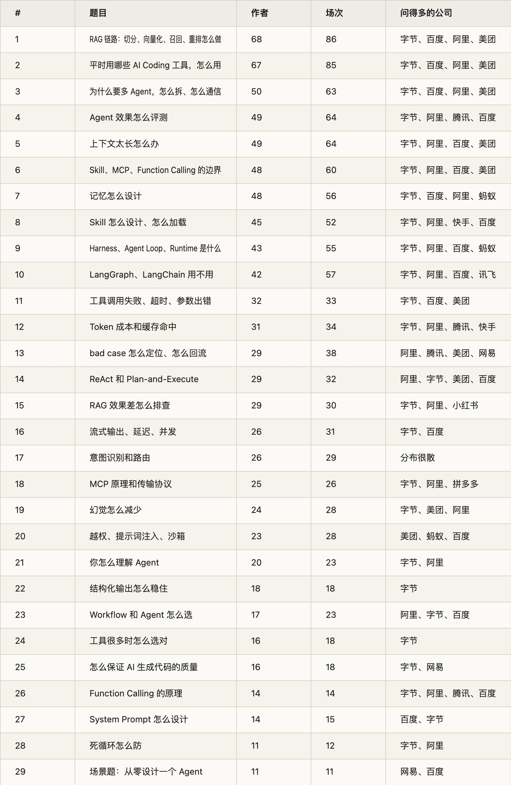
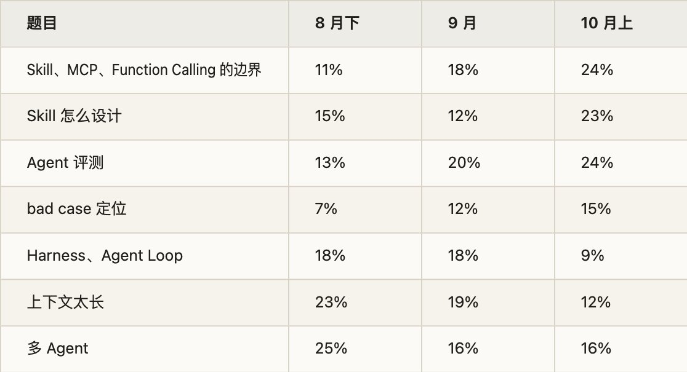

秋招到了 10 月，Agent 岗的面试都在问什么？这份题单统计的是牛客网上 8 月 18 日到 10 月 18 日发的一手面经：180 位作者，343 场面试，近 80 家公司。

排序看有多少位作者的面经里出现过这道题，同一个人发多篇只算一次；公司和轮次按场次算。怎么收、怎么筛，写在文末。

这篇只列题和出处。每道题的详解，后面一题一篇地写。

统计下来，有几件事比较明显：

- 问得最多的是 RAG 链路和「平时怎么用 AI Coding 工具」，各有三成多的作者提到。

- Skill、MCP、Function Calling 的边界，还有 Agent 评测，9、10 月问得明显多了（见「趋势」）。

- Harness 也成了常考词，四分之一的作者被问到，常见问法是「你怎么理解 Harness」。

- 手撕基本还是 LeetCode 题，现场手写 Agent Loop 的只有个位数。

- 三成作者记了项目深挖。不少题是顺着候选人的项目往下问的，比如「项目里面对话记忆 Chat Memory 是怎么使用的？」。

## 一、总览

算法岗方向另列在第三节。

## 二、逐题

每题第一行依次是作者数、场次、公司分布和轮次分布，后两项按场次算。「问法」摘自面经原文，有压缩；「出处」链到牛客原帖，括号里是发帖日期。

1\. RAG 链路：切分、向量化、召回、重排怎么做

68 位作者 · 86 场｜字节 16、百度 12、阿里 9、美团 6、拼多多 3、腾讯 3｜一面 59、二面 16、三面 6

- 问法：「RAG 的核心流程？」「文档怎么切分，为什么这样分块？」「为什么要用 Rerank？」「同一个 chunk 被多路召回命中，怎么合并去重？」

- 出处：[携程agent一面](https://www.nowcoder.com/feed/main/detail/9f492f65706f42ed85ecc2d294690638)（10-17）· [长鑫存储agent开发实习一面](https://www.nowcoder.com/feed/main/detail/6b5af9c0f2cd4cd68709a0932656afd4)（10-16）· [虾皮秋招 研发工程师](https://www.nowcoder.com/feed/main/detail/dcb2bf1c6b7c4b6a9f4c095ba9329bce)（10-09）· [钉钉一面](https://www.nowcoder.com/discuss/923765750446202880)（08-31）

2\. 平时用哪些 AI Coding 工具，怎么用

67 位作者 · 85 场｜字节 18、百度 10、阿里 9、美团 6、腾讯 3、小红书 3｜一面 61、二面 19、三面 6

- 问法：「用过哪些 AI Coding 工具？」「Codex 和 Claude Code 有什么区别？」「Claude Code 的上下文是怎么压缩的？」「项目是不是全部用 AI Coding 写的？」

- 出处：[字节Agent全三轮面经](https://www.nowcoder.com/feed/main/detail/b4fb3bee56134c3d9bcde6a3166a1711)（10-18）· [字节业务中台AI全栈面经——日常实习](https://www.nowcoder.com/feed/main/detail/6ac5ba31705a4b64a407b087f39d5447)（10-12）· [理想汽车 IT全栈交付培养生 一面](https://www.nowcoder.com/discuss/938122023392366592)（10-09）· [蚂蚁 复活赛 agent开发 一面](https://www.nowcoder.com/feed/main/detail/39451cad5d2245b491d16778f2a9ca01)（08-31）

3\. 为什么要多 Agent：怎么拆、怎么通信、结果谁汇总

50 位作者 · 63 场｜字节 13、百度 9、阿里 7、美团 5、腾讯 4、快手 2｜一面 42、二面 13、三面 2

- 问法：「单 Agent 为什么不行，要拆成多个？」「怎么拆分子 Agent？」「多 Agent 之间怎么分配任务、共享信息？」「多 Agent 的通信、协作、调度机制怎么设计？」

- 出处：[字节 AI Agent 开发一面](https://www.nowcoder.com/feed/main/detail/9cd459d87a754e07a490ba7f1c03b495)（10-17）· [美团一面全栈开发日常实习面经](https://www.nowcoder.com/feed/main/detail/95e9fc44397d4118ba3946ef0d33b6da)（10-12）· [27秋招-恒生电子AI面试-AI应用开发岗](https://www.nowcoder.com/feed/main/detail/e7981675c7a44b098d97e90a854f9c3c)（09-24）· [钉钉一面](https://www.nowcoder.com/discuss/923765750446202880)（08-31）

4\. Agent 效果怎么评测：评测集怎么建、指标怎么定

49 位作者 · 64 场｜字节 13、阿里 10、腾讯 5、百度 4、小红书 4、携程 3｜一面 43、二面 16、三面 4

- 问法：「评测集和参考答案是怎么做出来的？」「准确率多少，测试集多少条？」「用另一个 Agent 评估结果，评估 Agent 本身也有幻觉怎么办？」「怎么避免评测集泄露、评测结果抖动？」

- 出处：[秋招-字节跳动-抖音电商-Agent开发一/二/三面](https://www.nowcoder.com/discuss/937314680270311424)（10-07）· [美团和阿里二面问题](https://www.nowcoder.com/feed/main/detail/a9e773c96cae4a8ebbca23d84f59cb8c)（10-14）· [滴滴企业级算法实习生 一面](https://www.nowcoder.com/feed/main/detail/ea411234bf9f4e129eb5b8711861d6a3)（10-16）· [高斯信息技术，ai开发工程师，一面](https://www.nowcoder.com/feed/main/detail/80a2ffb74adf42d9adec69ee3b7c73eb)（10-09）

5\. 上下文太长怎么办：压缩策略、上下文管理

49 位作者 · 64 场｜字节 18、阿里 7、百度 7、美团 4、蚂蚁 3、拼多多 3｜一面 48、二面 11、三面 4

- 问法：「上下文压缩策略是什么，什么时候触发？」「压缩后上下文里保留哪些内容？」「怎么避免压缩带来的对话质量下降？」「合同有一两百页，超过上下文窗口怎么办？」

- 出处：[蚂蚁 AI应用研发 一面](https://www.nowcoder.com/feed/main/detail/b4b8431d196a4e92b92b2b1b64c9d7d7)（10-12）· [秋招-字节跳动-抖音电商-Agent开发一/二/三面](https://www.nowcoder.com/discuss/937314680270311424)（10-07）· [度小满 - AI 全栈研发 - 二面](https://www.nowcoder.com/feed/main/detail/0bed1f22b62145f480d2c10c5ffd7951)（09-30）· [携程AI应用开发实习一面（OC）](https://www.nowcoder.com/discuss/933058120102739968)（09-25）

6\. Skill、MCP、Function Calling 的边界：有了 MCP 为什么还要 Skill

48 位作者 · 60 场｜字节 15、阿里 9、百度 5、美团 5、快手 3、腾讯 2｜一面 34、二面 17、三面 6

- 问法：「有了 MCP 为什么还需要 Skill？」「MCP 和 Function Calling、普通 API 调用有什么区别？」「Skill、MCP、Function Calling、Workflow、SubAgent 各解决什么问题，项目里怎么组合？」「什么情况下该抽成一个专门的 Agent，什么情况下一个 Skill 就够？」

- 出处：[网易互娱 AI应用开发 日常实习](https://www.nowcoder.com/feed/main/detail/683ffea1ead24f8d8539f6bab3b7b361)（10-16）· [美团Agent一面](https://www.nowcoder.com/feed/main/detail/18fa4134edb14e8c901787ee5cd33ace)（10-12）· [放生面经-百度](https://www.nowcoder.com/feed/main/detail/fc061fe55af84effb8014ed6c60db92d)（10-14）· [百度 AIGC 多模态智能体算法工程师二面](https://www.nowcoder.com/feed/main/detail/2d033fd6daa04e2aaad2282b75531bbc)（09-29）

7\. 记忆怎么设计：短期、长期记忆怎么分层、存取、遗忘

48 位作者 · 56 场｜字节 10、百度 8、阿里 6、蚂蚁 4、腾讯 3、网易 2｜一面 39、二面 12、三面 2

- 问法：「短期会话记忆和长期记忆怎么区分处理？」「长期记忆怎么存储、检索和加载？」「记忆的遗忘和过期怎么处理？」「超长上下文的模型下，还需要区分长短期记忆和 RAG 吗？」

- 出处：[10.14顺丰AI全栈二面](https://www.nowcoder.com/discuss/939846943163826176)（10-14）· [字节跳动 - Agent 研发 - 一面](https://www.nowcoder.com/feed/main/detail/0b91e9f5fbba4af4865c6fadc9a790e8)（10-14）· [网易互娱｜AI应用开发实习一面凉经](https://www.nowcoder.com/feed/main/detail/2d982457b8b94da09fab383e275de93d)（10-13）· [字节国际化广告后端实习一二面凉经](https://www.nowcoder.com/discuss/933056720308305920)（09-25）

8\. Skill 怎么设计：由什么组成、怎么按需加载

45 位作者 · 52 场｜字节 13、阿里 7、快手 5、百度 3、美团 3、腾讯 2｜一面 29、二面 11、三面 5

- 问法：「Skill 由哪些部分组成？」「Skill 是怎么被发现、按需加载的？」「怎么理解 Skill 的渐进式加载？」「如果让你写一个 Skill，你会怎么写？」

- 出处：[快手ai全栈一面](https://www.nowcoder.com/discuss/939918937486016512)（10-14）· [字节Agent全栈一面-Date泛抖音](https://www.nowcoder.com/feed/main/detail/3d554c6d99e74b93a673fa9c39e9d113)（10-13）· [9.18腾讯营销一面后端](https://www.nowcoder.com/feed/main/detail/c51f363514734218bcc5bb69fd655cd5)（09-24）· [OPPO 27届 IT开发一面凉经](https://www.nowcoder.com/discuss/923561467092160512)（08-30）

9\. Harness、Agent Loop、Runtime 是什么，怎么搭

43 位作者 · 55 场｜字节 15、阿里 7、百度 5、蚂蚁 4、腾讯 2、讯飞 2｜一面 39、二面 10、三面 2、HR 面 2

- 问法：「你怎么理解 Harness？」「模型外面的 Harness 工程包含哪些模块？」「了解 DeepSeek Harness 吗？」「新版本发布时，正在运行的 Agent Loop 怎么办？」

- 出处：[字节剪映AI应用开发一面](https://www.nowcoder.com/feed/main/detail/7211e82c75284d23a89b569cd9dc289d)（09-24）· [阿里云 Agent开发 一二面](https://www.nowcoder.com/feed/main/detail/fee780e1140147fbbad0f23a74e265c6)（10-05）· [9.17腾讯云一面AI应用](https://www.nowcoder.com/feed/main/detail/517d4adbe09d493e89a32e20801a1995)（09-24）· [放生面经-百度](https://www.nowcoder.com/feed/main/detail/fc061fe55af84effb8014ed6c60db92d)（10-14）

10\. LangGraph、LangChain：为什么用，为什么不用

42 位作者 · 57 场｜字节 10、阿里 7、百度 5、讯飞 3、网易 2、美团 2｜一面 29、二面 17

- 问法：「LangChain 和 LangGraph 有什么区别？」「LangGraph 的核心组件和原理？」「为什么不用 LangChain 这类框架，要自己写？」「项目是基于 LangChain 还是 LangGraph？」

- 出处：[美团一面全栈开发日常实习面经](https://www.nowcoder.com/feed/main/detail/95e9fc44397d4118ba3946ef0d33b6da)（10-12）· [阿里千问Agent开发二面](https://www.nowcoder.com/feed/main/detail/456b3698145c431dacdbe5a1ff7d057c)（10-04）· [科大讯飞 Agent开发 一面](https://www.nowcoder.com/feed/main/detail/ec89f399f5e24573a019238282a9b912)（09-25）· [猎聘面经](https://www.nowcoder.com/feed/main/detail/9416ce6a43584ad59807737c042f6e1a)（10-15）

11\. 工具调用失败、超时、参数出错怎么处理

32 位作者 · 33 场｜字节 6、百度 5、美团 2｜一面 20、二面 7、三面 3

- 问法：「工具调用失败怎么处理？」「模型生成的函数参数不符合接口规范、格式非法怎么办？」「工具之间有依赖，怎么并行执行并处理错误？」「子 Agent 崩溃或超时，系统怎么兜底？」

- 出处：[9.15秋招东方财富AI应用一面](https://www.nowcoder.com/feed/main/detail/d406314e733c4fc8945637ce5d06cdcf)（09-24）· [百度Agent秋招算法岗一二面面经](https://www.nowcoder.com/feed/main/detail/8a52d4f70093426fb8fc32e6825466e3)（09-23）· [老虎国际后端实习一二面面经](https://www.nowcoder.com/discuss/933053709867577344)（09-25）· [27秋招-恒生电子AI面试-AI应用开发岗](https://www.nowcoder.com/feed/main/detail/e7981675c7a44b098d97e90a854f9c3c)（09-24）

12\. Token 成本怎么控，缓存命中率为什么不同

31 位作者 · 34 场｜字节 11、阿里 4、腾讯 3、快手 2｜一面 23、二面 10

- 问法：「你怎么控制 Token 成本？」「不同 Coding Agent 的缓存命中率为什么不一样？」「上下文压缩之后怎么保证缓存命中？」「Token 消耗有哪些优化手段？」

- 出处：[网易互娱 AI应用开发 日常实习](https://www.nowcoder.com/feed/main/detail/683ffea1ead24f8d8539f6bab3b7b361)（10-16）· [拼多多 agent 一面凉经](https://www.nowcoder.com/feed/main/detail/4dd4b979b1f74625aaef3e7b975142ba)（09-22）· [【社招】腾讯一面面经](https://www.nowcoder.com/feed/main/detail/668c7f4007b44fc7b878f55eb01e6e11)（09-23）· [9.15快手二面AI应用](https://www.nowcoder.com/feed/main/detail/5356d768dc7a4c62a989ee425bef7b12)（09-24）

13\. bad case 怎么定位、怎么回流

29 位作者 · 38 场｜阿里 7、腾讯 3、美团 3、网易 2、携程 2、字节 2｜一面 28、二面 9

- 问法：「用户反馈 Agent“很蠢”，怎么定位问题？」「bad case 会不会回流入库？」「可观测链路搭好之后，用户对一次回答不满意，要怎么排查？」「讲一个你真实处理过的 bad case」

- 出处：[网易agent开发岗一面](https://www.nowcoder.com/feed/main/detail/bad72b1323274ad5b172039f48bfa4b1)（10-17）· [携程agent一面](https://www.nowcoder.com/feed/main/detail/9f492f65706f42ed85ecc2d294690638)（10-17）· [9.24 普通の快手一面（发券）](https://www.nowcoder.com/feed/main/detail/02dac811205448be9c3b0f146dd68f8b)（10-02）· [淘天供应链ai应用研发一面](https://www.nowcoder.com/feed/main/detail/8656f1483ebd441bac7c17c313e5394a)（09-23）

14\. ReAct 和 Plan-and-Execute：原理、缺点、适用场景

29 位作者 · 32 场｜阿里 6、字节 5、美团 4、百度 4｜一面 21、二面 10、三面 3

- 问法：「ReAct 有什么缺点？」「ReAct 和 Plan-and-Execute 分别适合什么场景？」「ReAct、Workflow、Replan 各在什么场景下用？」「Planner、Executor、Critic 分别负责什么？」

- 出处：[字节 二面 10.12](https://www.nowcoder.com/feed/main/detail/63e2f08340594129b803aa6e6ea43a5f)（10-12）· [9.15快手二面AI应用](https://www.nowcoder.com/feed/main/detail/5356d768dc7a4c62a989ee425bef7b12)（09-24）· [美团秋招AI后端一面二面面经（食杂零售）](https://www.nowcoder.com/feed/main/detail/0fade3c42efb40e5ae3ca0dcfd3d4dfa)（10-01）· [百度后端开发一面凉经](https://www.nowcoder.com/discuss/932313667943616512)（09-23）

15\. RAG 效果差、召回不准，从哪排查

29 位作者 · 30 场｜字节 6、阿里 6、小红书 3、美团 2、百度 2｜一面 23、二面 4

- 问法：「检索出来的内容相关性很差，你会怎么排查？」「召回不准可能是什么原因？」「检索内容和模型自身知识冲突怎么处理？」「用哪些指标衡量 RAG 的效果？」

- 出处：[字节 AI Agent 开发一面](https://www.nowcoder.com/feed/main/detail/9cd459d87a754e07a490ba7f1c03b495)（10-17）· [小红书 Product Engineer（AI与全栈方向）一面](https://www.nowcoder.com/feed/main/detail/70ad5ead2f784676b0b399eab877d3d4)（09-24）· [美团和阿里二面问题](https://www.nowcoder.com/feed/main/detail/a9e773c96cae4a8ebbca23d84f59cb8c)（10-14）· [字节跳动Agent开发1面凉经](https://www.nowcoder.com/discuss/929406267141914624)（09-15）

16\. 流式输出、延迟、并发

26 位作者 · 31 场｜字节 9、百度 7、美团 2、阿里 2｜一面 22、二面 10、三面 2

- 问法：「SSE 是怎样的协议，断连了怎么办？」「SSE 只返回了一半 JSON，要不要执行这个工具？」「把同步调用改成异步、并发，要注意哪些问题？」「这一步没法流式输出，用户会不会等太久？」

- 出处：[满帮ai全栈 一面](https://www.nowcoder.com/feed/main/detail/0dfa45a987bb4c19b6963af6bbeb5815)（10-08）· [百度后端开发一面凉经](https://www.nowcoder.com/discuss/932313667943616512)（09-23）· [9.17腾讯云一面AI应用](https://www.nowcoder.com/feed/main/detail/517d4adbe09d493e89a32e20801a1995)（09-24）· [字节 Agent 秋招二面](https://www.nowcoder.com/discuss/932657562825027584)（09-24）

17\. 意图识别和路由怎么做

26 位作者 · 29 场｜公司很散，B站、阿里、字节、美团、小红书、百度各 2｜一面 24、二面 2

- 问法：「意图识别怎么做，怎么知道分得对？」「用户一句话里有多个意图怎么处理？」「口语化、有错别字、意图不明确时怎么办？」「多模型切换和路由怎么设计？」

- 出处：[携程agent一面](https://www.nowcoder.com/feed/main/detail/9f492f65706f42ed85ecc2d294690638)（10-17）· [迅雷 Agent一面](https://www.nowcoder.com/discuss/932392798559432704)（09-23）· [字节Agent开发后端 日常实习一面](https://www.nowcoder.com/discuss/932295617999622144)（09-23）· [快商通一面凉经 丨 大模型Agent全栈](https://www.nowcoder.com/feed/main/detail/36f96f0e0ff249e2b8025cbe9b19927d)（09-30）

18\. MCP 是什么，底层走什么协议

25 位作者 · 26 场｜字节 6、阿里 4、拼多多 3、网易 2、美团 2、百度 2｜一面 21、二面 6

- 问法：「MCP 底层用的是什么协议？」「stdio 和 Streamable HTTP 有什么区别？」「MCP 的 Client 和 Server 怎么分工？」「一个 MCP 服务的全链路流程是什么？」

- 出处：[10.8 pdd秋招 agent 一面](https://www.nowcoder.com/feed/main/detail/b7c5a262265f41e6ab95c008f7dd31de)（10-09）· [字节前端一面面经（剪映）](https://www.nowcoder.com/feed/main/detail/ffe074f01683402fb85c324430f2877d)（09-22）· [9.7百度agent开发日常实习面经](https://www.nowcoder.com/feed/main/detail/bb8c28105f364770b57ff5eb5649cc60)（09-07）· [阿里云 ai应用开发 一面](https://www.nowcoder.com/feed/main/detail/7e27cf4dedb142d9b643471ba31276ed)（09-20）

19\. 幻觉怎么减少

24 位作者 · 28 场｜字节 5、美团 4、阿里 4、腾讯 2｜一面 19、二面 4、三面 2

- 问法：「为什么会产生幻觉？」「出现幻觉怎么办？」「查一个指标，十次里有两次因为幻觉走错链路，怎么强控？」「怎么在工具层拦截模型因幻觉做出的错误操作？」

- 出处：[wxg一面，全方位拷打，已老实](https://www.nowcoder.com/feed/main/detail/b7811e3f8b5942a0b1eab4c1a9704d81)（09-28）· [字节—数据开发](https://www.nowcoder.com/feed/main/detail/2594098aeb504cb99e773987cf831198)（10-10）· [美团AI Agent一面](https://www.nowcoder.com/feed/main/detail/50bcdc47e7754aa7be59b6318fea514b)（09-15）· [9.15 蚂蚁一面](https://www.nowcoder.com/feed/main/detail/754ac010a05e4090a05d7ba4d06c757f)（09-15）

20\. Agent 安全：越权、提示词注入、沙箱

23 位作者 · 28 场｜美团 5、蚂蚁 4、百度 4、讯飞 2、字节 2、快手 2｜一面 23、二面 6、三面 2

- 问法：「怎么防提示词注入和越狱？」「Agent 的写操作权限怎么控制？」「子 Agent 的工具和消息权限怎么隔离？」「Runtime 的沙箱隔离怎么做，gVisor 是什么？」

- 出处：[蚂蚁 AI应用研发 一面](https://www.nowcoder.com/feed/main/detail/b4b8431d196a4e92b92b2b1b64c9d7d7)（10-12）· [度小满 - AI 全栈研发 - 一面](https://www.nowcoder.com/feed/main/detail/f9c29fa841664294b8ab7e9921072afd)（09-30）· [9.15科大讯飞AI应用一面](https://www.nowcoder.com/feed/main/detail/aece93373f9c47ea95c831aef6471886)（09-24）· [携程 AI 应用开发一面（已oc）](https://www.nowcoder.com/feed/main/detail/2b1c35eace4a4bb3bd88ee669f163793)（09-18）

21\. 你怎么理解 Agent，它和普通的大模型调用有什么区别

20 位作者 · 23 场｜字节 9、阿里 4、百度 2、美团 2｜一面 12、二面 6

- 问法：「你理解的 Agent 是什么？」「Agent 和普通大模型调用的本质区别？」「Agent 开发和传统前后端开发有什么区别？」「实现一个最简单的 Agent 需要哪些核心模块？」

- 出处：[千问AI研发一面凉经](https://www.nowcoder.com/feed/main/detail/ebf0ec03e5ee4fa8a140cc8d247b1e20)（09-21）· [美团Agent开发一面凉经](https://www.nowcoder.com/feed/main/detail/1d067ce539c64d3988eabb9b646ef8a0)（08-25）· [字节跳动火山引擎agent开发秋招一面](https://www.nowcoder.com/feed/main/detail/3ae147c4caaf40b580071ef9da71da2e)（10-09）· [平安科技秋招后端全栈一面](https://www.nowcoder.com/feed/main/detail/4fac87164f41465d89102d636f4d1968)（09-17）

22\. 结构化输出：JSON 怎么稳住

18 位作者 · 18 场｜字节 6、百度 2、阿里 2｜一面 15、二面 2

- 问法：「模型输出 JSON 不稳定，有哪些方案？」「返回的 JSON 不符合结构要求怎么办？」「流式输出时怎么解析结构化结果？」「弱模型做不好结构化输出，怎么改进？」

- 出处：[字节 二面 10.12](https://www.nowcoder.com/feed/main/detail/63e2f08340594129b803aa6e6ea43a5f)（10-12）· [阿里 Token Foundry AI应用研发二面面经](https://www.nowcoder.com/feed/main/detail/ed25d2f60ddc4436b0139a7c52e62a61)（09-08）· [拼多多 agent 复活赛 一面](https://www.nowcoder.com/feed/main/detail/2109cf8eb0254507911fbf86bcbf51e4)（09-03）· [中兴未来领军计划AI算法一面](https://www.nowcoder.com/discuss/932316204088180736)（09-23）

23\. Workflow 和 Agent 怎么选

17 位作者 · 23 场｜阿里 4、字节 3、百度 3、美团 2、小红书 2、快手 2｜一面 17、二面 5、三面 3

- 问法：「Agent 和 Workflow 有什么区别？」「Skill、Workflow、Agent 三者是什么关系？」「原来的 Workflow 为什么改成了 Agent 和 Skill？」「你说的受控 Agent Workflow，具体受控在哪？」

- 出处：[字节 AI Agent 开发一面](https://www.nowcoder.com/feed/main/detail/9cd459d87a754e07a490ba7f1c03b495)（10-17）· [小红书 Product Engineer（AI与全栈方向）一面](https://www.nowcoder.com/feed/main/detail/70ad5ead2f784676b0b399eab877d3d4)（09-24）· [百度 Agent 后端三面](https://www.nowcoder.com/discuss/931476137576845312)（09-21）· [阿里 Token Foundry AI应用研发二面面经](https://www.nowcoder.com/feed/main/detail/ed25d2f60ddc4436b0139a7c52e62a61)（09-08）

24\. 工具很多时怎么让模型选对

16 位作者 · 18 场｜字节 5，其余各 1｜一面 15、二面 3

- 问法：「有 100 个 Skill 和 100 个 MCP，怎么处理？」「Agent 有 20 个 Tool，怎么避免选错？」「路由不准只改 description 吗，Skill 功能重叠怎么办？」「工具太多挤占上下文怎么办？」

- 出处：[字节业务中台AI全栈面经——日常实习](https://www.nowcoder.com/feed/main/detail/6ac5ba31705a4b64a407b087f39d5447)（10-12）· [9.15秋招东方财富AI应用一面](https://www.nowcoder.com/feed/main/detail/d406314e733c4fc8945637ce5d06cdcf)（09-24）· [9.15科大讯飞AI应用一面](https://www.nowcoder.com/feed/main/detail/aece93373f9c47ea95c831aef6471886)（09-24）· [金9银10真的是28的天堂吗](https://www.nowcoder.com/feed/main/detail/c7bb3d5f19104b4b8d2c0866ca9655b4)（09-24）

25\. 怎么保证 AI 生成代码的质量

16 位作者 · 18 场｜字节 4、网易 2，其余各 1｜一面 10、二面 6

- 问法：「怎么保证 AI 生成代码的质量？」「AI 审查完说没问题，这个结论可靠吗？」「怎么避免 AI 生成的代码污染主分支？」「为什么 AI 写的代码能跑，逻辑却很烂？」

- 出处：[网易互娱 AI应用开发 日常实习](https://www.nowcoder.com/feed/main/detail/683ffea1ead24f8d8539f6bab3b7b361)（10-16）· [字节跳动ai-agent一面-10.9](https://www.nowcoder.com/feed/main/detail/508d61746d7542de84312ca845a1f087)（10-15）· [科大讯飞 Agent开发 一面](https://www.nowcoder.com/feed/main/detail/ec89f399f5e24573a019238282a9b912)（09-25）· [高德地图 agent开发 二面](https://www.nowcoder.com/feed/main/detail/0208597586e744c884bdc571dc441fad)（08-24）

26\. Function Calling 的原理：模型怎么决定调哪个工具

14 位作者 · 14 场｜字节 3、阿里 2、腾讯 2、百度 2｜一面 9、二面 2、三面 2

- 问法：「模型怎么知道该调 A 工具还是 B 工具？」「讲讲 Function Calling 的完整运行原理」「工具调用是模型直接执行，还是模型生成请求、由外部 Runtime 执行？」

- 出处：[阿里千问Agent开发二面](https://www.nowcoder.com/feed/main/detail/456b3698145c431dacdbe5a1ff7d057c)（10-04）· [字节剪映AI应用开发一面](https://www.nowcoder.com/feed/main/detail/7211e82c75284d23a89b569cd9dc289d)（09-24）· [小鹏汽车端侧agent一面](https://www.nowcoder.com/feed/main/detail/ac25d49b0692473c8f65654adda82b9b)（09-11）· [启云方AI Agent一面凉经](https://www.nowcoder.com/feed/main/detail/fea2d18bd59a421da7d16fe16223d38c)（09-03）

27\. System Prompt 怎么设计、怎么调

14 位作者 · 15 场｜百度 3、字节 2，其余各 1｜一面 11、二面 2

- 问法：「System Prompt 怎么设计，包含哪些部分？」「提示词里的约束怎么设计？」「怎么验证 Prompt 优化有效果？」「Prompt Engineering 和 Context Engineering 怎么理解？」

- 出处：[美团后端开发一面](https://www.nowcoder.com/discuss/932016310274228224)（09-22）· [中兴未来领军计划AI算法一面](https://www.nowcoder.com/discuss/932316204088180736)（09-23）· [韶音AI应用开发一面](https://www.nowcoder.com/feed/main/detail/11e40634018b47a7974bf5c96605024c)（09-12）· [百度秋招Agent一面二面三面面经(三面挂)](https://www.nowcoder.com/feed/main/detail/b9521e2b51e04afeac0a3a32e13f4da9)（08-28）

28\. Agent 死循环怎么防

11 位作者 · 12 场｜字节 4、阿里 3｜一面 8、三面 2、二面 1

- 问法：「有哪些终止条件？」「没到最大步数，但一直在重复同一个操作，怎么办？」「除了步数上限，还有什么办法防死循环？」

- 出处：[网易agent开发岗一面](https://www.nowcoder.com/feed/main/detail/bad72b1323274ad5b172039f48bfa4b1)（10-17）· [阿里云一面](https://www.nowcoder.com/feed/main/detail/ceade00d742046d0bef6bee7fe7a7aad)（09-28）· [字节前端一面面经（剪映）](https://www.nowcoder.com/feed/main/detail/ffe074f01683402fb85c324430f2877d)（09-22）· [b站测开一面（凉经）](https://www.nowcoder.com/feed/main/detail/44d088a151964a17bf46d7b776313253)（08-20）

29\. 场景题：从零设计一个 Agent

11 位作者 · 11 场｜网易 2、百度 2，其余各 1｜一面 10、二面 3

- 问法：「设计一个全自动 AI 漫剧创作 Agent」「从零设计一个 Coding Agent，你会怎么设计？」「设计一个 Coding Agent 要考虑哪些问题？」「让你设计一个企业知识库，链路怎么设计？」

- 出处：[网易agent开发岗一面](https://www.nowcoder.com/feed/main/detail/bad72b1323274ad5b172039f48bfa4b1)（10-17）· [百度秋招Agent一面二面三面面经(三面挂)](https://www.nowcoder.com/feed/main/detail/b9521e2b51e04afeac0a3a32e13f4da9)（08-28）· [9.14小红书 PE（产品工程师/全栈方向&#45;&#45;实习）二面](https://www.nowcoder.com/discuss/929891805049421824)（09-17）· [高斯信息技术，ai开发工程师，一面](https://www.nowcoder.com/feed/main/detail/80a2ffb74adf42d9adec69ee3b7c73eb)（10-09）

## 三、算法岗方向

样本以 Agent 开发、AI 应用、AI 全栈为主，算法岗的面经少，下面只作参考。

- Transformer 和注意力原理（14 位作者 · 20 场；百度、腾讯、字节、阿里各 3）：「详解 Self-Attention 底层原理」「用 torch 实现 MHA」。出处：[百度大模型算法岗一二面面经](https://www.nowcoder.com/feed/main/detail/0024a4c85440443aacbda5f101c601a7)（10-06）· [9.22 阿里千问二面](https://www.nowcoder.com/feed/main/detail/5ff7b7fde8bc49eb960d5badde3ac623)（09-22）· [淘天集团 Agent算法 一面](https://www.nowcoder.com/discuss/931957859154132992)（09-22）

- 微调：SFT、LoRA，和 RAG 怎么选（14 位作者 · 20 场；阿里 3、腾讯 3）：「详细阐述 LoRA 微调的基本原理」「SFT 数据量怎么判断？」。出处：[虾皮大模型后训练日常实习 一二面](https://www.nowcoder.com/feed/main/detail/1ce068100536444f8cbb1bb78b0b3eb5)（10-12）· [2027届秋招 淘天技术一面面经](https://www.nowcoder.com/discuss/924497771812397056)（09-02）· [小红书 Agentic 端侧推理优化实习生一面](https://www.nowcoder.com/feed/main/detail/7d354aa6146d467a92bf1132dd33438f)（09-14）

- RL：DPO、GRPO、奖励设计（7 位作者 · 16 场；腾讯 4、字节 3）：「你能写出 DPO 的损失函数吗？」「GRPO 有哪些固有缺点？」。出处：[字节算法（Agent）凉经](https://www.nowcoder.com/feed/main/detail/6d80836574e647d39eb9842dc4131ace)（09-16）· [虾皮大模型后训练日常实习 一二面](https://www.nowcoder.com/feed/main/detail/1ce068100536444f8cbb1bb78b0b3eb5)（10-12）

## 四、低频题

- 哪些环节要人工确认（10 位作者）：「哪些环节需要人工确认？」。[美团Agent一面](https://www.nowcoder.com/feed/main/detail/18fa4134edb14e8c901787ee5cd33ace)（10-12）· [美团和阿里二面问题](https://www.nowcoder.com/feed/main/detail/a9e773c96cae4a8ebbca23d84f59cb8c)（10-14）

- AI Coding 上机题（6 位作者）：面试前先发一道限时 AI Coding 题，面试时追问「拿到题目后怎么解读、实现」。[美团Agent一面](https://www.nowcoder.com/feed/main/detail/18fa4134edb14e8c901787ee5cd33ace)（10-12）· [秋招-字节跳动-抖音电商-Agent开发一/二/三面](https://www.nowcoder.com/discuss/937314680270311424)（10-07）

- GraphRAG、知识图谱（6 位作者）：「除了向量 RAG，了解 GraphRAG 或 Neo4j 在 Agent 里的用法吗？」。[10.10 无锡赫玛科技](https://www.nowcoder.com/feed/main/detail/24a0ee8b5d2c4d65aaf5fc1e18bfcc23)（10-10）

- 反思和 Critic（5 位作者）：「Critic 判定不通过以后你怎么做的？」。[阿里 Token Foundry AI应用研发二面面经](https://www.nowcoder.com/feed/main/detail/ed25d2f60ddc4436b0139a7c52e62a61)（09-08）

- A2A（2 位作者）：「Skills、MCP、A2A 有什么区别？」。[放生面经-百度](https://www.nowcoder.com/feed/main/detail/fc061fe55af84effb8014ed6c60db92d)（10-14）· [蔚来-软件开发二面面经](https://www.nowcoder.com/feed/main/detail/9f92610c99b34894b35be91086df05a2)（09-17）

- 现场手写 Agent Loop：只有个位数作者提到，手撕仍以算法题为主（见下节）。

## 五、面试结构

- 项目深挖：54 位作者（三成）记了项目追问，问难点、架构、指标。上面很多题是顺着项目问的。

- 手撕：51 位作者提到手撕或算法题，基本是 LeetCode，比如合并区间、LRU、K 个一组反转链表、最大正方形。字节最常见，有 27 场。

- AI 面试官：6 场标注为「AI 面」，比如联宝科技、恒生电子的 AI 面试。

## 六、趋势

下表是每个月提到该题的面试占当月场次的比例。8 月下半月 95 场，9 月 173 场，10 月上半月 75 场，样本不大，只看方向。

拿 [agent-interview-hub 的高频题信号榜](https://zchary1106.github.io/agent-interview-hub/question-signals.html)（数据截至 9 月 7 日）对照一下。信号榜前四是 Tool/FC/MCP/Skill 的边界、记忆分层、AI Coding 代码验证和 Agent 评测，其中边界、记忆、评测在这份题单里也排在前面。差别在 AI Coding：「怎么验证 AI 生成的代码」这里只有 16 位作者问到，问得多的是「平时怎么用 AI Coding 工具」。

## 七、方法与局限

怎么收的

1. 牛客站内搜索。匿名搜索每个词只返回 60 条，所以把搜索词按公司、轮次拆成约 100 个（如「字节 Agent」「Agent 二面」「大模型应用 一面」），按最新和按相关度各跑一遍，得到 1818 条候选。

2. 标题或内容跟 Agent、AI 应用、大模型相关的读全文，共 1138 篇。按发帖日期留下 8 月 18 日到 10 月 18 日的。

3. 去掉的：多场面经合集（如「字节面经-后端开发岗面经-01」系列，里面不少是 4 到 7 月的面试）、题库和刷题指南、求面经帖、长文感想、模板化的「分享｜」体，以及近似重复的转帖。

4. 另外排除 2 个批量账号：两个月里分别发了 90 篇和 35 篇面经，各自横跨 20 多家公司，写法高度模板化，看着像营销号。这两个账号的 125 篇不计。

5. 剩下 343 场面试、180 位作者。每篇面经里的问题按关键词归到题目上，一篇只算一次；「作者数」里同一作者只算一次。公司和轮次从标题识别，识别不出的不列。

局限

- 不是全量。牛客匿名搜索有条数上限；字节、阿里、百度本来面经就多，公司排序里有这个因素。

- 问法是候选人自己回忆的，不是原题，少数帖子写明题目是 AI 总结的。归类靠关键词，个别问题可能归错。

- 发帖日期不等于面试日期，少数帖子写的是更早的面试。

- 图片形式的面经没读。小红书没纳入；linux.do 9 月只找到两个讨论帖（[agent开发面试内容](https://linux.do/t/topic/2911456)、[最近面试了一个佬友](https://linux.do/t/topic/2966377)），没有成体系的面经，未计入。
