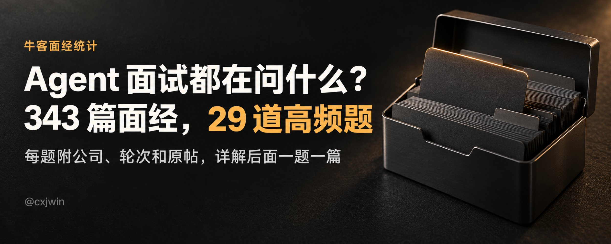
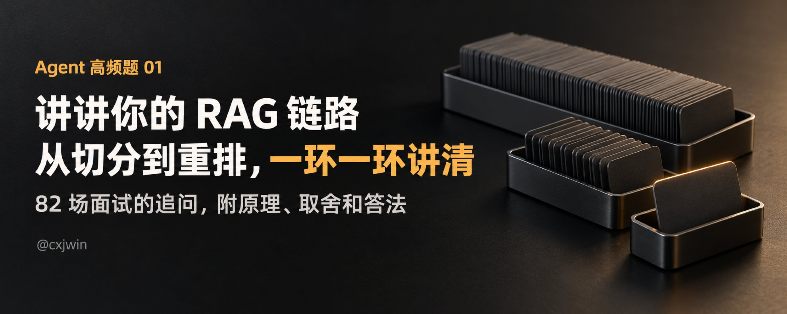
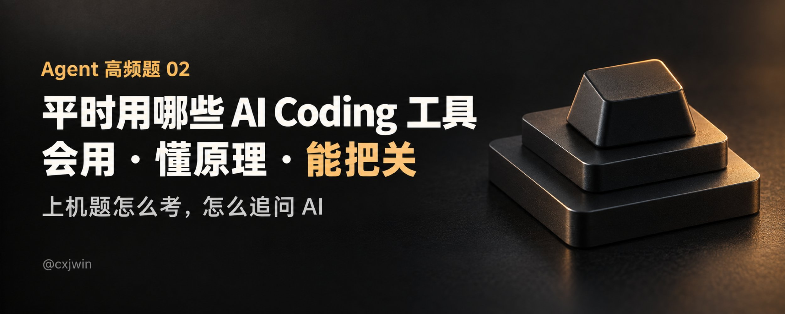
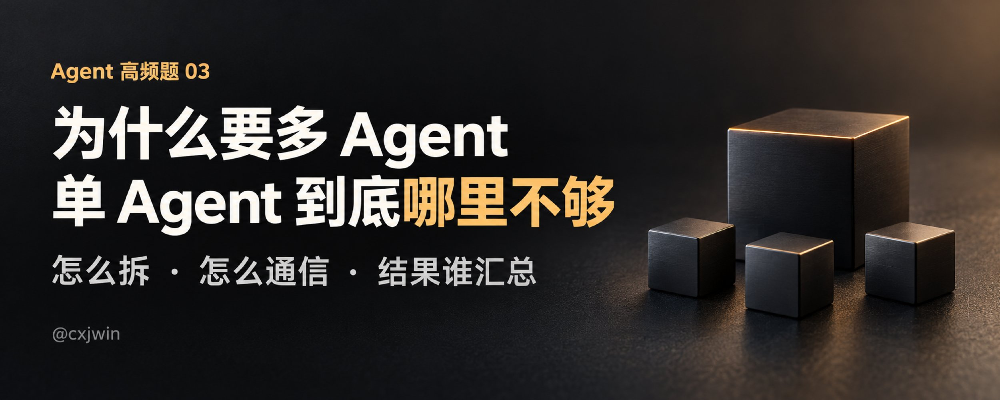
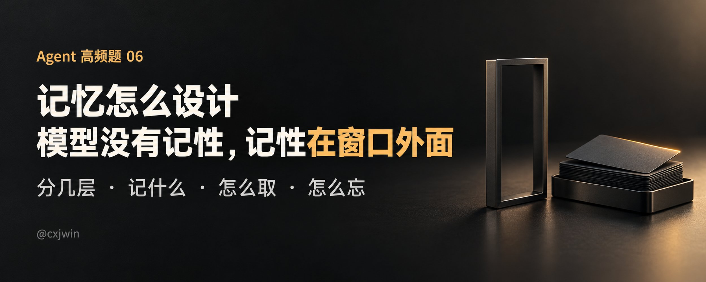
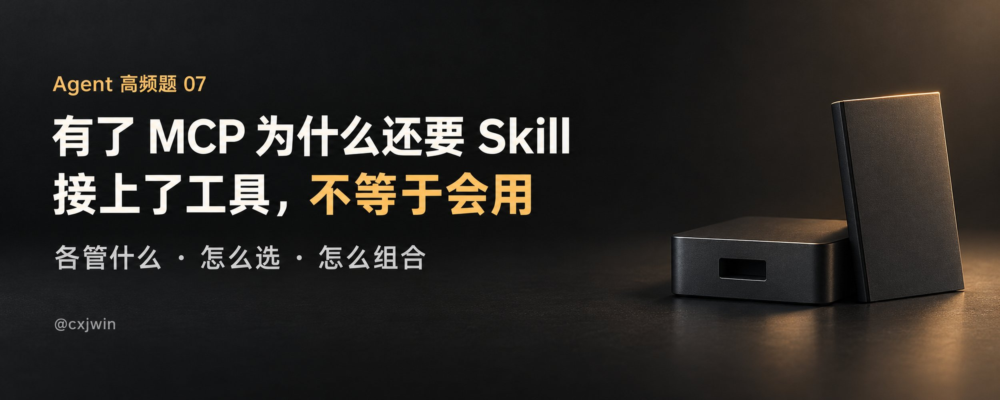
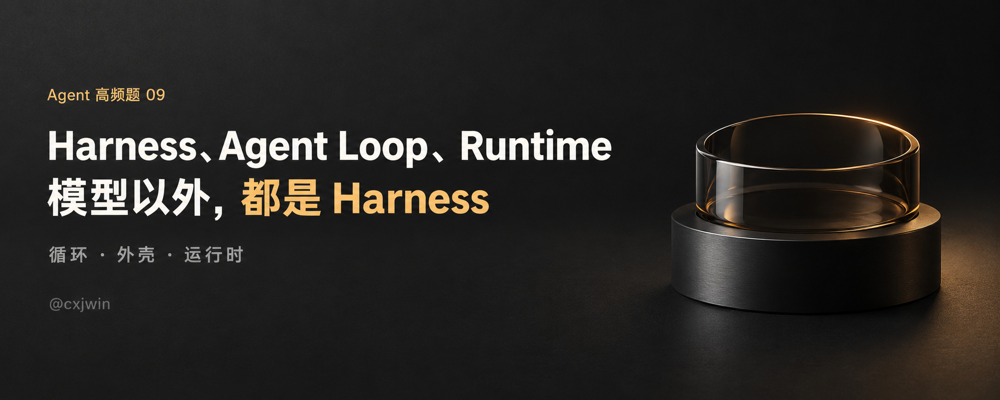
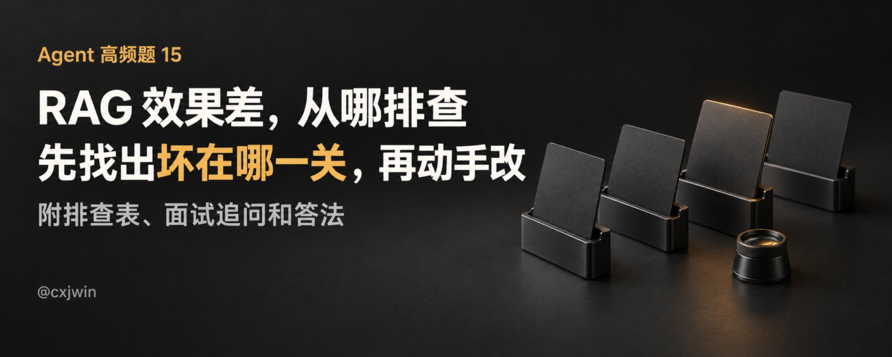

RAG 链路怎么讲？多 Agent 为什么要拆？上下文太长了怎么办？

我把最近两个月牛客上的 Agent 岗一手面经整理成了一份题单，再把高频题一题一篇展开写。这篇是系列目录，目前第 01～09 题均已发布，第 15 题也已提前更新；后面的题目会继续补充。

题单统计的是 2026 年 8 月 18 日到 10 月 18 日发的一手面经，发布版收录了 180 位作者、343 场面试，涉及近 80 家公司。排名按独立作者数算，同一个人发多篇只算一次。这是一段时间内的样本，不是所有公司的面试大纲。

## 先看总题单

[Agent 高频面试题单（8.18–10.18）](/Agent%20%E9%AB%98%E9%A2%91%E9%9D%A2%E8%AF%95%E9%A2%98%E5%8D%95%EF%BC%888.18%E2%80%9310.18%EF%BC%89/)

秋招到了 10 月，Agent 岗的面试都在问什么？这份题单统计的是牛客网上 8 月 18 日到 10 月 18 日发的一手面经：180 位作者，343 场面试，近 80 家公司。&#46;&#46;&#46;

29 道题按作者数排序，每题附常见问法和面经出处。算法岗方向、低频题、面试结构和这两个月的变化也另有整理。想先看看哪些题问得多，从这里开始。

## 已发布的详解

[Agent 高频题 01. 讲讲你的 RAG 链路](/Agent%20%E9%AB%98%E9%A2%91%E9%A2%98%2001.%20%E8%AE%B2%E8%AE%B2%E4%BD%A0%E7%9A%84%20RAG%20%E9%93%BE%E8%B7%AF/)

这是 Agent 高频面试题单第 1 题的详解。RAG 链路在题单里排第一：近两个月牛客上的一手面经，67 位作者、82 场面试问到它，七成在一面，前端、测开、Java 后端的面试也会问。

开场问法多半是「讲讲 RAG&#46;&#46;&#46;

从离线解析、切分、向量化、建索引，到在线改写、召回、融合、重排和生成，逐环讲原理、取舍和面试官怎么追问。最后还有评测、更新、权限和两分钟答法。

[Agent 高频题 02. 平时用哪些 AI Coding 工具，怎么用](/Agent%20%E9%AB%98%E9%A2%91%E9%A2%98%2002.%20%E5%B9%B3%E6%97%B6%E7%94%A8%E5%93%AA%E4%BA%9B%20AI%20Coding%20%E5%B7%A5%E5%85%B7%EF%BC%8C%E6%80%8E%E4%B9%88%E7%94%A8/)

有位候选人做完美团 AI 全栈的 AI Coding 题，在面经末尾求助：有没有文档推荐，学习一下 AI Coding 做题步骤，「我是和 AI 在那乱说，感觉我没参与什么，一直是 AI 在改改改」。&#46;&#46;&#46;

面试官想听的不是工具清单，而是你怎么用、懂多少原理、怎么检查生成的代码。文章也讲 AI Coding 上机题怎么考、怎么追问 AI。题单第 25 题「怎么保证 AI 生成代码的质量」并在这一篇里。

[Agent 高频题 03. 为什么要多 Agent：怎么拆、怎么通信、结果谁汇总](/Agent%20%E9%AB%98%E9%A2%91%E9%A2%98%2003.%20%E4%B8%BA%E4%BB%80%E4%B9%88%E8%A6%81%E5%A4%9A%20Agent%EF%BC%9A%E6%80%8E%E4%B9%88%E6%8B%86%E3%80%81%E6%80%8E%E4%B9%88%E9%80%9A%E4%BF%A1%E3%80%81%E7%BB%93%E6%9E%9C%E8%B0%81%E6%B1%87%E6%80%BB/)

有位候选人在字节全栈二面讲自己做的多 Agent 研发平台，用「前后端可以并行」解释为什么要拆成多个 Agent。面试官接着问：单 Agent 调用多个 Skill 也能并行，为什么还要多&#46;&#46;&#46;

单 Agent 调多个 Skill 也能并行，为什么还要多 Agent？先讲拆分的收益和成本，再讲任务怎么分、信息怎么传、结论冲突谁来处理，以及超时、权限、预算和评测。

[Agent 高频题 04. Agent 效果怎么评测：评测集怎么建、指标怎么定、怎么证明变好了](/Agent%20%E9%AB%98%E9%A2%91%E9%A2%98%2004.%20Agent%20%E6%95%88%E6%9E%9C%E6%80%8E%E4%B9%88%E8%AF%84%E6%B5%8B%EF%BC%9A%E8%AF%84%E6%B5%8B%E9%9B%86%E6%80%8E%E4%B9%88%E5%BB%BA%E3%80%81%E6%8C%87%E6%A0%87%E6%80%8E%E4%B9%88%E5%AE%9A%E3%80%81%E6%80%8E%E4%B9%88%E8%AF%81%E6%98%8E%E5%8F%98%E5%A5%BD%E4%BA%86/)

有位候选人面某大厂的测试开发岗，项目里写着：评测集 36 道题、6 种题型，Recall@5 到了 100%，Prompt 从 v1 改到 v2，正确率从 52.78% 升到 100%。几轮面试下来，面试官把这几个数挨个拆开问：Recall@5 到了&#46;&#46;&#46;

评测集从哪来，谁来打分，指标怎么定，怎么证明新版本真的变好了。也讲多次运行、线上监控和面试里那些经不起追问的数字。

[Agent 高频题 05. 上下文太长怎么办：压缩策略、上下文管理](/Agent%20%E9%AB%98%E9%A2%91%E9%A2%98%2005.%20%E4%B8%8A%E4%B8%8B%E6%96%87%E5%A4%AA%E9%95%BF%E6%80%8E%E4%B9%88%E5%8A%9E%EF%BC%9A%E5%8E%8B%E7%BC%A9%E7%AD%96%E7%95%A5%E3%80%81%E4%B8%8A%E4%B8%8B%E6%96%87%E7%AE%A1%E7%90%86/)

有位候选人面百度后端（Go/Agent）一面，讲自己做的自动化红队 Agent。从面试官的追问能看出他的设计：模型能看到的会话消息放在内存里，完整记录另存一份 Transcript；上下文长了做全量摘要，最近 8&#46;&#46;&#46;

每一轮该放什么，快满了先清什么、怎么压缩，压完怎么验证有没有丢掉约束，以及哪些东西该移到窗口外面。

[Agent 高频题 06. 记忆怎么设计：分几层、记什么、怎么取、怎么忘](/Agent%20%E9%AB%98%E9%A2%91%E9%A2%98%2006.%20%E8%AE%B0%E5%BF%86%E6%80%8E%E4%B9%88%E8%AE%BE%E8%AE%A1%EF%BC%9A%E5%88%86%E5%87%A0%E5%B1%82%E3%80%81%E8%AE%B0%E4%BB%80%E4%B9%88%E3%80%81%E6%80%8E%E4%B9%88%E5%8F%96%E3%80%81%E6%80%8E%E4%B9%88%E5%BF%98/)

有位候选人面度小满 AI&#46;&#46;&#46;

模型本身没有跨调用的记忆。记忆分几层，什么该记、什么时候取，用户偏好变了怎么更新，旧的该不该删，以及多 Agent、多用户怎么隔离。

[Agent 高频题 07. Skill、MCP、Function Calling 的边界：有了 MCP 为什么还要 Skill](/Agent%20%E9%AB%98%E9%A2%91%E9%A2%98%2007.%20Skill%E3%80%81MCP%E3%80%81Function%20Calling%20%E7%9A%84%E8%BE%B9%E7%95%8C%EF%BC%9A%E6%9C%89%E4%BA%86%20MCP%20%E4%B8%BA%E4%BB%80%E4%B9%88%E8%BF%98%E8%A6%81%20Skill/)

有位候选人面斑头雁的 Agent 实习生一面，面试官从最底下一层开始问：配置完工具之后，Agent 运行时怎样真正去调用工具？模型输出什么内容，让本地 Agent&#46;&#46;&#46;

Function Calling、MCP、Skill 各解决什么问题，MCP 和直接调用 API、CLI 怎么选，Skill 和系统提示词、脚本有什么区别，以及什么时候需要 Agent 和 Workflow。

[Agent 高频题 08. Skill 怎么设计：由什么组成、怎么按需加载](/Agent%20%E9%AB%98%E9%A2%91%E9%A2%98%2008.%20Skill%20%E6%80%8E%E4%B9%88%E8%AE%BE%E8%AE%A1%EF%BC%9A%E7%94%B1%E4%BB%80%E4%B9%88%E7%BB%84%E6%88%90%E3%80%81%E6%80%8E%E4%B9%88%E6%8C%89%E9%9C%80%E5%8A%A0%E8%BD%BD/)

9 月中旬有位同学面腾讯营销后端一面（09-24），简历上写了自己做过一套公司内部的 Agent 基建。面试官顺着项目里的 Skill 模块连问了四句：「Skill 是怎样被发现和按需加载的？」「加载后的 Skill&#46;&#46;&#46;

围绕 Skill 的组成和按需加载，讲怎么把一类任务的做法整理成 Agent 可以使用的说明。

[Agent 高频题 09. Harness、Agent Loop、Runtime 是什么，怎么搭](/Agent%20%E9%AB%98%E9%A2%91%E9%A2%98%2009.%20Harness%E3%80%81Agent%20Loop%E3%80%81Runtime%20%E6%98%AF%E4%BB%80%E4%B9%88%EF%BC%8C%E6%80%8E%E4%B9%88%E6%90%AD/)

有位候选人面字节 AI 算力基础设施方向的 Agent 研发工程师，面试官从最底下开始问：什么是 Agent Loop？搭一个 Agent Loop 需要哪些模块？Agent Harness 最重要要解决什么问题？候选人事后总结，这一段是沿着&#46;&#46;&#46;

先分清三个词各管什么，再讲模型怎么决策、程序怎么执行、循环怎么停，Harness 要补哪些能力，以及 Runtime 的状态、隔离和崩溃恢复。

[Agent 高频题 15. RAG 效果差、召回不准，从哪排查](/Agent%20%E9%AB%98%E9%A2%91%E9%A2%98%2015.%20RAG%20%E6%95%88%E6%9E%9C%E5%B7%AE%E3%80%81%E5%8F%AC%E5%9B%9E%E4%B8%8D%E5%87%86%EF%BC%8C%E4%BB%8E%E5%93%AA%E6%8E%92%E6%9F%A5/)

这是 Agent 高频面试题单第 15 题的详解。题单里，这题是 29 位作者、30 场面试，大多在一面。问得最多的是怎么评估 RAG&#46;&#46;&#46;

先分清问题出在知识库、召回、重排还是生成，再看分段指标、知识冲突和拒答。文章里还有一张排查表，可以按现象找到先查什么。

如果你正在准备面试，可以先按题目想一遍自己的项目：实际怎么做，为什么这么选，出过什么问题，有没有数据。原理能讲清楚之后，这些细节通常才是面试官继续追问的地方。

## 后续题目

下面这些是题单里还没单独出详解的题目，按系列目前的编号安排列出。写完会把链接补到这里；相近题目也可能合并，具体以更新后的文章为准。

10–14

- 10｜LangGraph、LangChain：为什么用，为什么不用

- 11｜工具调用失败、超时、参数出错怎么处理

- 12｜Token 成本怎么控，缓存命中率为什么不同

- 13｜Bad case 怎么定位、怎么回流

- 14｜ReAct 和 Plan-and-Execute：原理、缺点、适用场景

16–24

- 16｜流式输出、延迟、并发

- 17｜意图识别和路由怎么做

- 18｜MCP 是什么，底层走什么协议

- 19｜幻觉怎么减少

- 20｜Agent 安全：越权、提示词注入、沙箱

- 21｜怎么理解 Agent，它和普通的大模型调用有什么区别

- 22｜结构化输出：JSON 怎么稳住

- 23｜Workflow 和 Agent 怎么选

- 24｜工具很多时，怎么让模型选对

26–29

- 26｜System Prompt 怎么设计、怎么调

- 27｜Function Calling 的原理：模型怎么决定调哪个工具

- 28｜Agent 死循环怎么防

- 29｜场景题：从零设计一个 Agent

第 15 题已经提前写了，第 25 题并进第 02 篇，所以这两个编号不在待更新列表里。这里按系列编号整理，和最初发布的题单有两处顺序不同：记忆详解已用 06，Skill、MCP 和 Function Calling 的边界已用 07；System Prompt 和 Function Calling 原理暂列 26、27。
