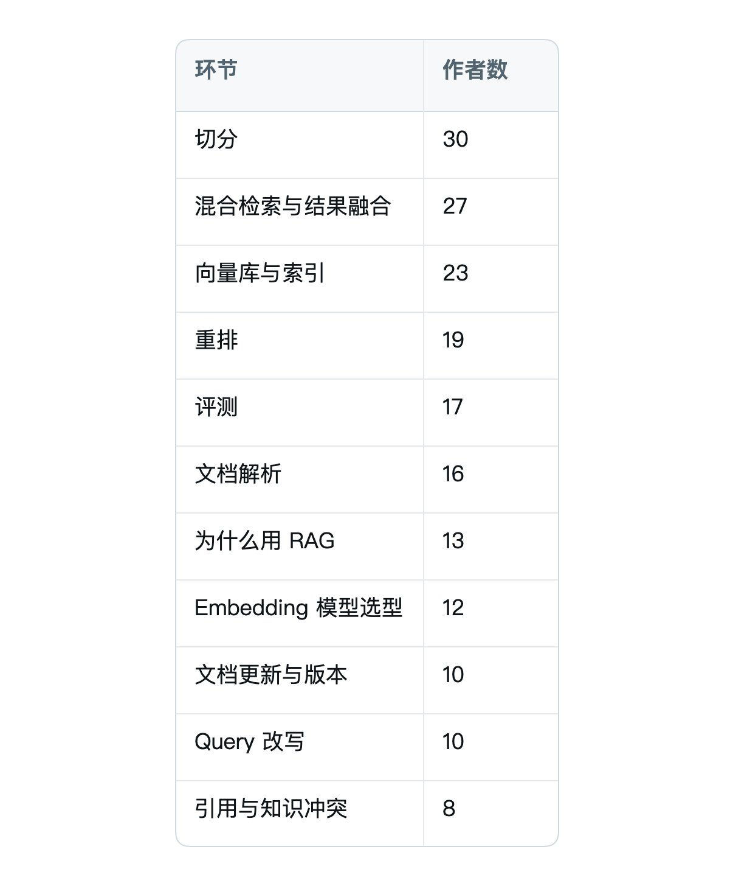
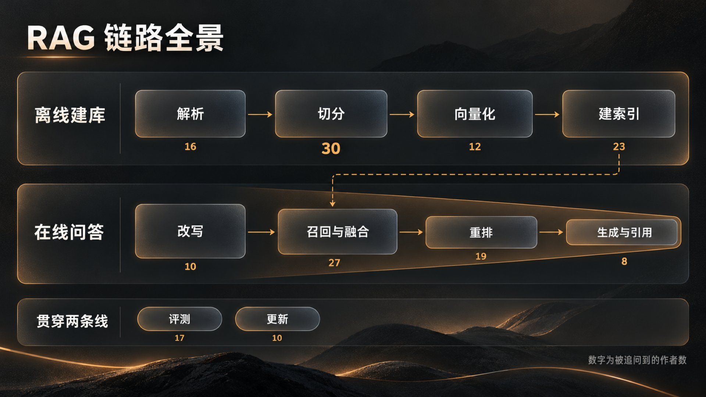
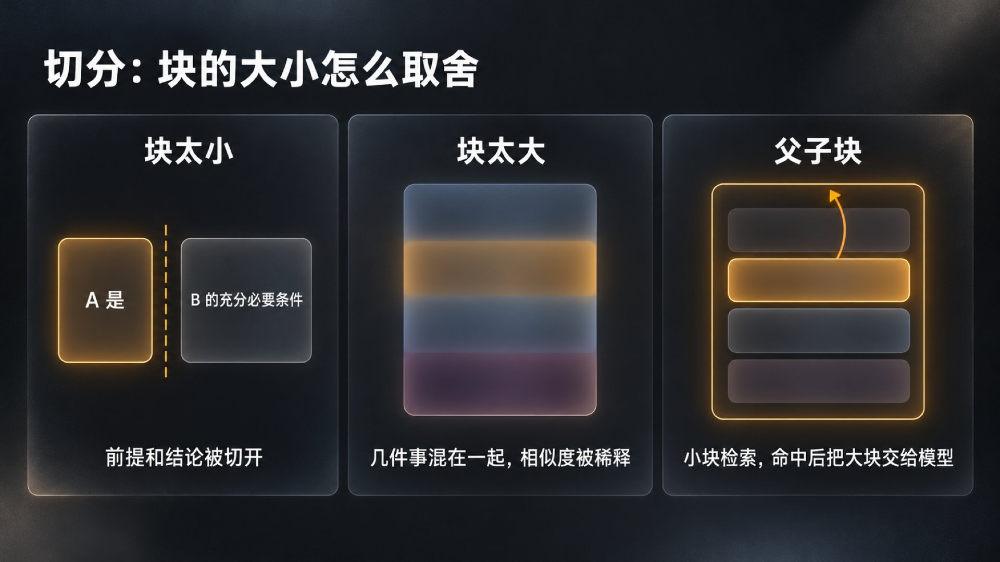
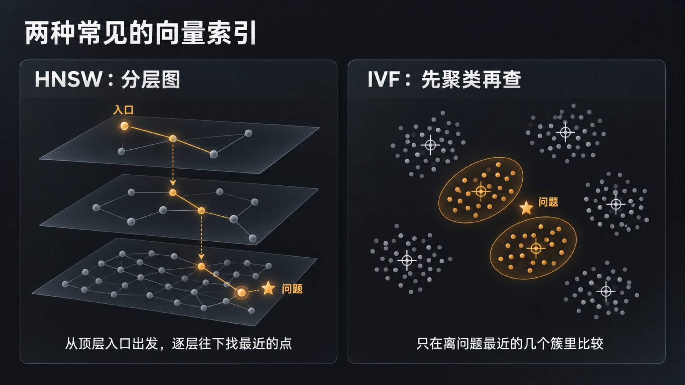
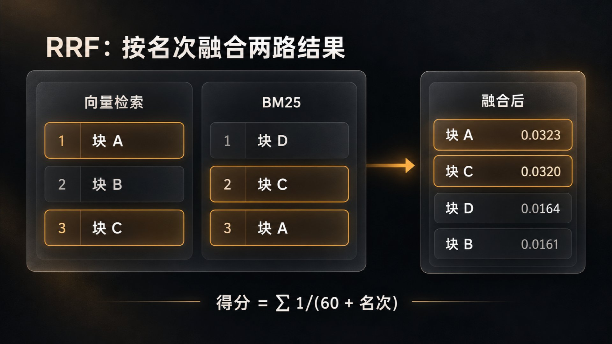
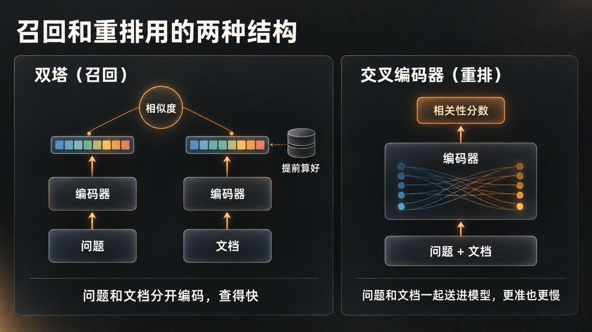

这是 Agent 高频面试题单第 1 题的详解。RAG 链路在题单里排第一：近两个月牛客上的一手面经，67 位作者、82 场面试问到它，七成在一面，前端、测开、Java 后端的面试也会问。

开场问法多半是「讲讲 RAG 的流程」，难的是后面：82 场里有 55 场，和 RAG 相关的问题问了三个以上，追问会落到链路的每一环。所以这篇按 RAG 这套系统本身来讲：先给一张整体的图，再讲为什么要 RAG，然后沿离线、在线两条线逐环讲它解决什么问题、原理是什么、有哪些取舍，每一环后面附上面试里常见的问法，最后讲评测、更新和面试答法。

各环节被追问到的作者数，可以当复习的优先级：



## 一、先有一张整体的图

RAG 是 Retrieval-Augmented Generation，检索增强生成：回答之前先去知识库里查相关内容，把查到的内容和问题一起交给模型，让模型照着资料回答。

整套系统分两条线。

离线建库：解析文档，清洗，切成块，把每一块变成向量，再建索引。产出的是一批带元数据的块，以及能快速找到它们的索引。

在线问答：用户提问后，先理解、改写问题，再多路召回候选，融合排序，重排，把最相关的几块拼进上下文，最后生成带引用的答案。

评测和更新贯穿两条线。每一环调得好不好要靠评测验证，文档变了，索引要跟着变。

在线这条线可以看成一个漏斗。召回要从全库捞出几十到上百个候选，目标是别漏；重排在这些候选里排准，挑出最后放进上下文的几条，目标是别错；上下文窗口是预算，放多了贵、慢，还会带进干扰。



离线这一侧决定了能找到什么。解析丢了表格、切分切断了逻辑，在线怎么调也补不回来。

## 二、为什么要 RAG

模型的知识存在参数里，是训练时学到的。它有截止时间，也不包含企业内部的文档，要改只能重新训练。RAG 把知识放在模型外面，问的时候再查，所以能解决三件事：用上私有的、新的知识；答案能指回原文出处；知识变了改文档就行，不用重训模型。

面试里更常问的是 RAG 和其他方案的边界。

和长上下文比。文档少、问题需要通读全文时，比如总结一份合同，直接放进上下文更简单。文档一多就不行了：每次全量放进去，成本和延迟跟着文档量涨，窗口也放不下；无关内容越多，模型越容易被带偏。2023 年的论文《Lost in the Middle》测过：相关信息放在输入的开头或结尾时，模型表现往往最好；放在长上下文中间时，表现明显变差。

和让 Agent 自己 grep 比。代码仓库里的函数名、报错信息都是精确的字符串，grep 加读文件效果很好，还不用维护索引，Claude Code 默认就是这样查代码的。换成几万份业务文档，用户的说法和原文用词常常对不上，关键词搜不到，向量检索的语义匹配就有优势。Agent 要多轮调用工具，延迟也更高。

和微调比。微调改的是模型的行为和表达习惯，比如输出格式、领域术语的用法，不适合装经常变的知识，也给不出出处。常见的分工是微调管怎么说，RAG 管说什么。

和工具调用比。订单状态、库存、价格这类有确定答案的数据，直接查接口或数据库，不该去检索文档。

和记忆比。记忆也可能存在向量库里，但它存的是这个用户、这段对话里产生的信息，RAG 查的是外部知识库，两者的写入时机、作用范围和过期方式都不一样。

面试常问：上下文窗口已经这么大，为什么不把文档直接交给模型？web search 也能拿到新知识，为什么还要 RAG？精确查询的场景为什么不走 RAG？Memory 和 RAG 都用向量库，Memory 算不算 RAG？

## 三、离线建库

离线建库分四步：解析、切分、向量化、建索引。

## 1. 解析

原始文档有 PDF、Word、网页、表格和图片，解析要做的是把它们变成干净、有结构的文本。这一步错了，后面每一步都在错误的文本上工作。

PDF 分两类。文字版有文本层，可以直接抽取；扫描版只有图像，要走 OCR。文字版也有坑：多栏排版、页眉页脚和页码会打乱阅读顺序，所以版面复杂的文档要先做版面分析，识别出标题、正文、表格、图片各自的区域和阅读顺序。

表格要单独处理，按行列结构转成 Markdown 或 HTML，让模型还能看出哪个数属于哪一行、哪一列。有合并单元格的表格要用 HTML，Markdown 表格表示不了合并单元格。表格太大时可以按行拆开，每一块都带上表头。

图片有两种处理方式：用 OCR 抽出图里的文字，或者让多模态模型写一段描述，连同原图链接一起入库。每张图都过一次模型会拖慢入库，可以改成异步处理，跳过装饰性的图。

解析时顺手把元数据留下来：来源文档、标题层级、页码、版本、权限。后面讲的引用溯源、版本过滤和权限过滤，靠的都是这些字段。入库前还要做一遍清洗和质量检查：去重，去掉目录页和水印，找出内容缺失、过时或互相冲突的文档。

面试常问：PDF 怎么解析？表格为什么要转成 HTML？图片、扫描件和复杂表格怎么进知识库？每张图都过一次模型，入库会不会太慢？文档进库前怎么判断合不合格？

## 2. 切分

切分是把文档切成检索的基本单位。原因有两个：embedding 模型有输入长度上限，常见的从 512 到 8192 token 不等；检索要找的是和问题相关的那一段，整篇文档太粗。切分决定了检索的粒度。

块的大小，是在检索精度和语义完整之间取舍。

块太小，一段话说不完整。有面试官举过一个例子：「A 是 B 的充分必要条件」，如果正好在 A 和 B 之间切开，模型还推得出 B 吗？前提和结论分在两块，只召回其中一块就答不全。

块太大，一块里混着几件事。块的向量是整块内容的综合表示，和某个具体问题的相似度会被其他内容稀释；放进上下文的无关内容也多，既费 token 又带进干扰。



常见的切法有这几种：

- 固定长度加重叠：按 token 数切，相邻块重叠一部分，缓解边界被切断的问题。实现简单，但不管语义。

- 递归切分：按分隔符的优先级来，先按段落切，太长再按换行、句号切，直到每块不超过上限。

- 按结构切：Markdown 按标题层级，HTML 按标签，标题、段落、列表、表格各自成块，超长的再按长度切。

- 语义切分：算相邻句子的向量相似度，在相似度明显下降、话题转折的地方切开。

- 父子块：小块用来建索引和检索，命中后把它所属的大块交给模型。检索准，上下文也够。

不管用哪种切法，每块最好带上文档标题和标题路径，比如「员工手册 &gt; 报销 &gt; 差旅」。检索时更容易命中，模型也知道这一段在讲什么。

块大小没有标准答案。先按 embedding 模型的上限和文档类型定一个起点，比如几百 token，再用评测集比几组大小和重叠的召回率。切到最后剩一小段时，并进前一块，或者退回到句子边界重新切，不要留下半句话的碎块。

面试常问：块太大、太小各有什么问题？块大小怎么定？固定长度切断了上下文怎么办？父子索引解决什么问题？Markdown 没有标题怎么切？一段 1000 token、按 400 切，剩下的 200 怎么办？

## 3. 向量化

关键词匹配只认字面。「出差的费用怎么报」和「差旅报销流程」字面几乎不重合，意思却一样。向量化把文本映射到一个向量空间，意思相近的文本，向量也靠得近。

做这件事的是 embedding 模型。它通常基于 Transformer，把一段文本编码成一个固定长度的向量，维度在几百到几千之间。训练时用对比学习，让相关的问题和段落在空间里靠近，不相关的推远。查询时，问题和文档块用同一个模型编码，再用余弦相似度或内积比较远近。向量做过归一化以后，两种算法的排序结果一样。

问题向量和文档向量是分开算的。文档向量可以提前算好存起来，查询时只需要编码问题，这是向量检索快的原因。这种结构叫双塔，后面讲重排时会拿它和另一种结构对比。

检索时问题往往很短，只有三五个字，文档块却有一两百字，两边的长度和写法差得多，这叫非对称检索。有的模型约定给问题加检索前缀，比如 E5 要求在问题前加「query: 」，BGE 建议用短问题检索长文档时，在问题前加一句检索指令（v1.5 起不加也行，效果只略差一点）；也可以先把问题改写、扩写，在线部分会讲。

选 embedding 模型，主要看这几样：

- 中文效果。

- 最大输入长度。

- 向量维度：维度越高，越占存储，算得也越慢。

- 能不能同时输出稀疏向量：BGE-M3 能同时给出稠密向量、稀疏权重和多向量表示。

- 自部署还是调接口，以及成本。

MTEB、C-MTEB 这类公开榜单能用来初筛，最后要在自己的评测集上比。

还有一点容易忽略：换 embedding 模型要把全库重新向量化，新旧模型的向量不能混在一起比。

面试常问：向量化具体是怎么做的？为什么选这个 embedding 模型，比如为什么用 BGE-M3、不用 Qwen Embedding？问题只有三五个字、chunk 有一两百字，两个向量怎么比？相似度用什么算？

## 4. 建索引

有了向量，最直接的检索是暴力比对：拿问题向量和库里每个向量都算一次相似度。数据到几百万条、每秒又有不少查询时，延迟和算力都扛不住。近似最近邻（ANN）索引用一点召回率换速度，最常见的是 HNSW 和 IVF。

HNSW 是一张分层的图。最底层包含所有向量，每个点连着若干个近邻；越往上层点越少，连线跨度越大，像高速路网和城市道路的关系。查询从顶层的入口点出发，在当前层贪心地往离问题更近的邻居走，走不动了就下到下一层接着走，到最底层再在一个候选列表里扩展搜索，返回最近的 K 个。关键参数有两类：每个点连多少邻居（M），建图和查询时候选列表有多宽（efConstruction、efSearch）。候选越宽，召回越高，也越慢。HNSW 召回高、查得快，代价是要把图结构放在内存里。删除通常只是打标记，被标记的点搜索时跳过，但仍占着位置，要靠新数据复用这些空位或者重建索引来回收。

IVF 是先聚类再查。建库时用 k-means 把向量聚成若干个簇，每个向量归到离它最近的簇中心；查询时先找离问题最近的几个簇，只在这几个簇里逐个比较。簇分多少个、每次查几个簇，决定了速度和召回之间怎么平衡。IVF 常和乘积量化（PQ）一起用，把向量压缩存储，省内存，损失一些精度。它建库前要先训练聚类，数据分布变化大时要重新训练。



检索常常还要带条件，比如只查某类文档、某个时间之后的版本、当前用户有权限的内容。先过滤再检索，结果准，但过滤条件很严时，近似索引的效果会变差；先检索再过滤，可能过滤完剩不下几条。各家向量库处理这个问题的方式不同，选型时要问清楚。

向量库怎么选：

- 数据量小、做原型：FAISS 或 Chroma 就够了。FAISS 是一个索引库，只管近邻搜索，持久化、元数据和过滤这些要自己处理。

- 数据量大，要分布式、高可用和元数据过滤：用 Milvus 这类独立的向量数据库。

- 团队已经在用 Postgres 或 Elasticsearch：用 pgvector 或 ES 自带的向量检索，少维护一套系统，ES 还能在同一个系统里做关键词检索。

面试常问：为什么要建索引，不能每次扫一遍全库吗？HNSW 底层怎么实现？IVF 的原理是什么？什么时候选 HNSW？Chroma 和 Milvus 有什么区别？向量索引用 FAISS 还是数据库自带的？

离线这一侧做完，手里有一批带元数据的块、它们的向量和索引。下面从用户提问开始，看在线这条线怎么把块找全、排准。

## 四、在线问答

在线这条线就是开头那个漏斗：召回尽量别漏，重排尽量别错，上下文是预算。用户提问以后，要经过五步。

## 1. 理解和改写问题

用户的问题常常不适合直接拿去检索。多轮对话里有指代，比如上一句问的是某款产品，这一句只问「那它的保修期呢」；还有口语化、错别字、问题太短，或者一句话里包着好几个问题。

常见的做法有四种：

- 补全改写：结合对话历史，把问题改写成一句独立、完整的检索语句。

- 扩写成多个问法：生成几种不同说法分别检索，结果合并，提高召回。

- 拆成子问题：复杂问题拆开，各自检索，回答时再汇总。

- HyDE：先让模型写一段假设的答案，拿这段文字的向量去检索。假设答案和真实文档的写法更接近，比一个短问题更容易匹配上；代价是多一次生成，模型对这个领域不熟时，假设答案也可能把检索带偏。

改写之前，还可以先做一次路由：这个问题要不要检索、查哪个知识库，还是应该直接调工具。前面说过，订单、库存这类精确查询应该走接口。

每多一次模型调用，就多一段延迟。改写和拆分可以放在一次调用里完成，让模型直接输出改写后的问题和子问题列表。拆出来的子问题各自召回以后，结果要先合并、去重、重排，再截断。有场面试就追问过：三个子问题各取 6 条，就是 18 段一起交给模型吗？不应该原样全交，要在这一步收窄。

面试常问：Query 改写在整条链路里起什么作用？口语化的问题怎么改写、扩写、拆分？HyDE 怎么用？改写和拆分是一次模型调用完成，还是要调好几次？

## 2. 多路召回

向量检索懂意思，但对必须精确命中的词不敏感，比如产品型号、错误码、人名、内部缩写和新出现的词。这些词在 embedding 模型训练时很少见，向量里的区分度不够。关键词检索正好擅长这类匹配，所以常见做法是两路一起召回。

关键词检索最常用的是 BM25。它给问题里的每个词算一个匹配分，再加起来：

```text
score(D, Q) = Σ IDF(q) × f(q, D) × (k1 + 1) / ( f(q, D) + k1 × (1 − b + b × |D| / avgdl) )
```

式子里有三个关键因素：

- IDF 衡量词有多稀有，越少见的词越重要。

- f(q, D) 是这个词在文档里出现的次数，但加分会饱和：从 1 次到 2 次加分明显，从 10 次到 11 次几乎不加。k1 控制饱和的快慢。

- |D| / avgdl 是文档长度和平均长度之比。长文档天然包含更多词，要按长度打折，b 控制打折的力度。

Elasticsearch 的默认值是 k1 = 1.2、b = 0.75。和朴素的 TF-IDF 相比，BM25 的核心改进就是词频饱和和文档长度归一化。中文用 BM25 要先分词，分词的质量直接影响效果。

BM25 属于稀疏表示，维度是整个词表，绝大多数位置是 0；embedding 是稠密向量。也有模型学出来的稀疏向量，比如前面提到的 BGE-M3 的稀疏输出。

召回还可以再加几路：按标题或摘要检索，按预先给每块生成的问题检索，按结构化字段过滤。每加一路，都要说得清它补的是哪个短板，否则只是在堆复杂度。

面试常问：已经有向量检索，为什么还要 BM25？BM25 的原理是什么，比 TF-IDF 好在哪？为什么要做稀疏、稠密双路召回？为什么要三路、五路，第三路补的是什么？

## 3. 融合

两路召回各给出一个排好序的列表，要合成一个。难点在于两路的分数不在一个尺度上：BM25 的分数没有上限，还随问题变化；余弦相似度在 -1 到 1 之间。直接相加，结果会被分数范围大的那一路主导。

常见的做法有两种。

一种是先把两路分数各自归一化到同一区间，比如缩放到 0 到 1，再加权相加。权重要调，而且归一化的结果受这一批候选的分数分布影响。

另一种是 RRF（倒数排名融合），只看名次、不看分数：一条结果在每一路里按名次得 1/(k + 名次) 分，各路相加后再排序。k 一般取 60，出自 2009 年 Cormack 等人的论文：60 是他们在预实验里定下的，k 在 10 到 100 之间效果差别不大。k 的作用是削弱某一路把一条结果排得特别靠前时的影响。

举个例子，见下图：块 A 在向量路排第 1、在 BM25 路排第 3，得分是 1/61 + 1/63 ≈ 0.0323；块 D 只在 BM25 路排第 1，得分是 1/61 ≈ 0.0164。两路都出现的块 A 和块 C 排到了最前面。RRF 不用调权重，对分数尺度不敏感，代价是丢掉了分数本身的信息：第一名比第二名强多少，它看不出来。



融合时顺带去重。同一个块被多路命中，按块 ID 合并；同一篇文档的相邻块可以合成一段；也可以限制每篇文档最多入选几块，避免结果被一篇文档占满。

面试常问：两路召回的结果怎么融合？为什么不直接把两路的原始分数加起来？RRF 怎么算？同一个块被多路命中，怎么合并去重？

## 4. 重排

召回为了别漏，会拿回几十到上百条候选，其中不少只是沾边。真正放进上下文的只能是最相关的几条，所以要再排一次。

重排和召回用的是两种结构。前面讲过，向量检索用双塔：问题和文档各自编码成向量再比较，文档向量提前算好，所以快，能在几百万条里找；但两段文本在编码时互相看不见，否定、条件、数字对不对得上这类细节容易丢。

重排模型多用交叉编码器（cross-encoder）：把问题和一个候选拼成一段输入，一起送进模型，注意力能在两段文本之间充分交互，直接输出相关性分数。它更准，但每个候选都要和问题一起现算，没法提前算好。



所以要分两段：便宜的召回把范围从全库缩到几十条，贵的重排只处理这几十条。如果全库都做 rerank，计算量会跟着库的大小线性增长，做不下去

常见的重排模型有 BGE-reranker 这类开源模型，也有云厂商的 rerank 接口。让大模型逐条打分或者直接排序也可以，效果好，但更贵、更慢，适合候选很少的场景或离线评测。

几个参数和工程问题：

- 截断：召回留多少条、重排后取多少条，比如先留 20 条、重排后取 8 条。用评测集比较不同截断下的召回率和答案质量，再结合上下文长度和延迟来定。

- 阈值：重排分数低于某个值的候选，不放进上下文。宁可少给，也别把不相关的内容塞进去。

- 降级：reranker 超时或出错时，直接返回融合排序的结果，打上降级标记，记进日志，别让整条链路失败。

面试常问：为什么既要 embedding 又要 rerank？为什么不能全部 rerank？cross-encoder 为什么比向量相似度准？先留 Top20 再取 Top8，这两个数怎么定？reranker 超时怎么办？用大模型打分，成本会不会太高？

## 5. 生成与引用

最后一步是让模型根据检索到的内容回答，要做到三件事：用上该用的内容，标出出处，没有依据时不乱答。

拼上下文时，按相关性排好，给每段编号，带上来源和标题路径；相邻块合并，重复的去掉，总长度控制在预算内。顺序也有讲究：按前面提到的《Lost in the Middle》的结论，相关信息放在中间时模型表现明显变差，所以最相关的内容放在开头或结尾更稳。

提示词里约定三条：只根据给定资料回答；资料里没有就说不知道；结论后面按编号标注引用。

引用溯源靠的是解析时留下的元数据。编号对应块 ID，块上存着文档、页码和位置，前端据此跳到原文，高亮对应的段落。

检索内容和模型自己的知识冲突时，以检索内容为准。资料之间互相矛盾时，按版本和时间取新的，或者把矛盾摆给用户看。检索不到依据时，明确回答不知道或者转人工，不让模型自己补。

面试常问：结论有没有引用，怎么实现？引用溯源到页面高亮怎么做？检索到的内容和模型自己的知识冲突了怎么办？检索不到依据、资料互相矛盾时怎么处理？

## 五、评测：怎么知道它好不好

块切多大、召回几路、截断取几条，每个选择都要有依据。没有评测，所有优化都只是感觉。评测还要把检索和生成分开，出了问题才知道是哪一段的。

先建评测集。找一批真实问题，可以从日志里捞，也可以请业务方提供；每个问题标出应该召回的块和参考答案。里面要有知识库答不了的问题，用来考拒答；也要有多轮、口语化的问题。几十条起步，也比没有强得多。

检索看这几个指标：

- Recall@K：前 K 条结果里，命中了多少比例的应召回块。比如一个问题有 2 个相关块，前 5 条命中 1 个，Recall@5 就是 50%，再对所有问题取平均。

- 命中率（Hit Rate@K）：前 K 条里至少命中一个相关块的问题，占全部问题的比例。

- MRR：每个问题取第一个相关结果名次的倒数，第 1 名得 1，第 2 名得 0.5，再对所有问题取平均。它衡量相关结果排得靠不靠前。

- Precision@K：前 K 条里，相关结果占多少。

K 越大，召回越高，混进来的噪声也越多，召回率和精确率常常此消彼长。怎么取舍看业务：漏答的代价高，就保召回；答错的代价高，就提精度，再加上拒答。

说「召回率 85%」之前，先讲清分母是应召回的块还是问题、K 是多少、评测集有多大。Recall@5 到了 100%，也只说明标注的相关块都进了前 5：评测集是不是太小、太简单，最终答案对不对，它都看不出来。

生成看这几样：

- 正确性：和参考答案比，人工打分，或者让大模型打分。

- 忠实度：答案里的结论能不能在检索到的内容里找到依据，用来衡量幻觉。

- 回答相关性：答的是不是用户问的。

- 引用正确率：标注的引用是不是真的支持那条结论。

RAGAS 这类框架主要用大模型当裁判，算忠实度（Faithfulness）、回答相关性（Response Relevancy）、上下文精确率（Context Precision）、上下文召回率（Context Recall）这些指标。裁判本身也会出错，要抽样人工核对。

没有人工标注时，可以看线上信号，比如点踩、追问、转人工的比例；定期人工抽检；或者让模型从文档里生成一批问答对当测试集，用之前人工过一遍。

调参时每次只改一个变量，在同一个评测集上比，记下前后的指标。比较两套 RAG 方案也是这样：同一个评测集上比检索和生成指标，再比延迟、成本和维护难度。

面试常问：召回率怎么定义、怎么计算？召回质量和回答质量怎么分开评？Recall@5 到了 100%，这个指标有什么局限？线上没法人工标注，怎么评？同事各做了一套 RAG，你怎么选？

## 六、更新与权限

知识库会变，索引要跟着变。

每个块记下所属的文档 ID、版本号和内容哈希。文档更新时，按文档 ID 找出所有旧块，删掉或者标记失效，再写入新块；也可以先写好新版本，校验通过后再切换过去。用哈希判断内容有没有变，只对变了的文档重新切分和向量化，大库能省下大量 embedding 开销。

同一份文档有多个版本时，检索按版本或生效时间过滤，默认只召回最新版本。删除以后要确认索引已经同步，前面说过 HNSW 多是打标记删除；缓存要一起失效，否则旧内容还会被召回。换 embedding 模型要全量重算，可以新建一套索引，两套并行一段时间再切过去。

权限要在检索阶段就带上：按用户的组织和角色加过滤条件，只在有权限的块里找，至少要保证没有权限的内容进不了上下文。还要检查旁路：缓存是不是跨用户共享，日志和引用片段会不会把没有权限的内容带出去。

面试常问：文档更新、删除怎么处理？同一份文档多个版本共存怎么办？旧文档还会被召回怎么办？TB 级的文档，建库和增量更新时怎么省 embedding 开销？多个知识库隔离，除了按知识库 ID 过滤，还有哪些权限漏洞？

## 七、面试怎么答

把前面的内容收成一条两分钟左右的主线：

1. 一句话说清这个 RAG 解决什么问题：什么知识库、多大、谁在用。

2. 离线：怎么解析，表格和图片怎么处理；怎么切，块多大、为什么；用什么 embedding 模型、什么索引。

3. 在线：问题怎么改写，几路召回、怎么融合，用什么重排模型，截断取几条。

4. 生成：引用怎么做，没有依据时怎么处理。

5. 效果：评测集多大，Recall@K、正确率、引用正确率分别多少，做过哪些对比实验。

每一环说清做了什么、为什么、数字是多少。讲完就停，让面试官挑一环往下问。

数字要提前备好。67 位作者里，近一半（31 位）被问到的是自己项目里的 RAG：块切多大，top-k 取几，召回率多少，怎么测出来的。没测过的就说没测过。

几个常见的失分点：

- 只背四步：切分、向量化、检索、生成。第一个「为什么」就接不住。

- 数字说不出来历。有面试官抓着候选人提到的召回率提升 20% 左右，追问具体做了哪些工作。说出口的每个数，都要能讲清怎么测的、分母是什么。

- 没有评测集，所有「效果变好了」都只是感觉。

- 说不清哪些是自己做的。面试官会问：RAG 是不是直接调的别人的服务，是不是在 Dify 上二开的，哪段核心代码是你自己写的，HNSW 索引是不是 Agent 帮你写的。用现成平台、让 AI 写代码都没问题，前提是讲得出里面怎么切、怎么召回、你改了什么。

RAG 效果差、召回不准从哪排查，是题单第 15 题，后面单独写。

## 出处

文中的面试问法都出自下面这些面经，括号里是发帖日期，链到牛客原帖。

- 为什么要 RAG：[美团 Agent 开发一面](https://www.nowcoder.com/feed/main/detail/58159306df52463ab75d72daa80d66df)（08-25）· [百度后端开发一面](https://www.nowcoder.com/discuss/932313667943616512)（09-23）· [美团全栈日常实习一面](https://www.nowcoder.com/feed/main/detail/95e9fc44397d4118ba3946ef0d33b6da)（10-12）· [字节、百度一二面](https://www.nowcoder.com/feed/main/detail/c7bb3d5f19104b4b8d2c0866ca9655b4)（09-24）

- 非 Agent 岗也问：[字节前端一面](https://www.nowcoder.com/feed/main/detail/27ecaad483364bdaa0c64bc88c4248ca)（09-15）· [百度前端一二面](https://www.nowcoder.com/feed/main/detail/6211d5f22c8d4904ae220fb82aa29b76)（09-03）· [欢乐互娱前端实习一面](https://www.nowcoder.com/feed/main/detail/359a1961cc6c4510864a727cb0754825)（08-24）· [B 站测开一面](https://www.nowcoder.com/feed/main/detail/44d088a151964a17bf46d7b776313253)（08-20）· [美团容器平台 Java 开发](https://www.nowcoder.com/feed/main/detail/91e3b76eabd140bdbed20dc43724b396)（09-12）

- 解析：[百度 Agent 一面](https://www.nowcoder.com/feed/main/detail/72858aade19d443facc870fea8bb134f)（09-06）· [字节 Agent 秋招二面](https://www.nowcoder.com/discuss/932657562825027584)（09-24）· [美团、阿里二面](https://www.nowcoder.com/feed/main/detail/a9e773c96cae4a8ebbca23d84f59cb8c)（10-14）

- 切分：[小鹏 AI 全栈一面](https://www.nowcoder.com/feed/main/detail/ff967cd4e7384b26b38823025297450b)（09-02）· [虾皮 Agent 开发一面](https://www.nowcoder.com/feed/main/detail/79fe3fc8f8cb4c4d9beca478f4279e3a)（08-24）· [小红书 Agentic 端侧推理实习一面](https://www.nowcoder.com/feed/main/detail/7d354aa6146d467a92bf1132dd33438f)（09-14）· [百度 Agent 一面](https://www.nowcoder.com/feed/main/detail/72858aade19d443facc870fea8bb134f)（09-06）· [美团 Agent 开发一面](https://www.nowcoder.com/feed/main/detail/58159306df52463ab75d72daa80d66df)（08-25）· [字节 Agent 秋招二面](https://www.nowcoder.com/discuss/932657562825027584)（09-24）

- 向量化：[字节全栈一面](https://www.nowcoder.com/feed/main/detail/a01aeac81ad342d88252f899c47f2dc4)（09-25）· [腾讯 AI 全栈一面](https://www.nowcoder.com/feed/main/detail/5f08a2b54559471aac95ea8009d38403)（09-10）· [美团 Agent 开发一面](https://www.nowcoder.com/feed/main/detail/58159306df52463ab75d72daa80d66df)（08-25）· [上海某独角兽 AI 全栈](https://www.nowcoder.com/feed/main/detail/6468c9ab07664b15901a3470fad6115f)（08-28）

- 建索引：[百度面经](https://www.nowcoder.com/feed/main/detail/fc061fe55af84effb8014ed6c60db92d)（10-14）· [拼多多 Agent 三面](https://www.nowcoder.com/feed/main/detail/9908477cdd4041fabacbfbf02febb13c)（09-07）· [途游 Agent 二面](https://www.nowcoder.com/feed/main/detail/eccda50b085b44b0852c580c68a871b9)（08-18）· [虾皮秋招研发工程师](https://www.nowcoder.com/feed/main/detail/dcb2bf1c6b7c4b6a9f4c095ba9329bce)（10-09）· [华为 OD Agent 应用开发](https://www.nowcoder.com/discuss/921761916530196480)（08-25）· [上海某独角兽 AI 全栈](https://www.nowcoder.com/feed/main/detail/6468c9ab07664b15901a3470fad6115f)（08-28）

- Query 改写：[阿里边缘 BU 一面](https://www.nowcoder.com/feed/main/detail/bdebbb6088b6405e9eb2bd2c345acb6e)（09-03）· [小红书 Agentic 端侧推理实习一面](https://www.nowcoder.com/feed/main/detail/7d354aa6146d467a92bf1132dd33438f)（09-14）· [字节 Agent 秋招二面](https://www.nowcoder.com/discuss/932657562825027584)（09-24）· [淘天一面](https://www.nowcoder.com/discuss/926606679108521984)（09-07）

- 多路召回：[字节 Agent 开发后端实习一面](https://www.nowcoder.com/discuss/932295617999622144)（09-23）· [欢乐互娱前端实习一面](https://www.nowcoder.com/feed/main/detail/359a1961cc6c4510864a727cb0754825)（08-24）· [腾讯混元大模型算法一面](https://www.nowcoder.com/feed/main/detail/b11b6fee1e454010bae30726449b22c3)（09-22）· [长鑫存储 Agent 开发实习一面](https://www.nowcoder.com/feed/main/detail/6b5af9c0f2cd4cd68709a0932656afd4)（10-16）· [美团、阿里二面](https://www.nowcoder.com/feed/main/detail/a9e773c96cae4a8ebbca23d84f59cb8c)（10-14）

- 融合：[字节 Agent 开发后端实习一面](https://www.nowcoder.com/discuss/932295617999622144)（09-23）· [淘天技术一面](https://www.nowcoder.com/discuss/924497771812397056)（09-02）· [虾皮秋招研发工程师](https://www.nowcoder.com/feed/main/detail/dcb2bf1c6b7c4b6a9f4c095ba9329bce)（10-09）

- 重排：[中兴 AI 算法一面](https://www.nowcoder.com/discuss/932316204088180736)（09-23）· [字节 Agent 开发后端实习一面](https://www.nowcoder.com/discuss/932295617999622144)（09-23）· [美团、阿里二面](https://www.nowcoder.com/feed/main/detail/a9e773c96cae4a8ebbca23d84f59cb8c)（10-14）· [虾皮秋招研发工程师](https://www.nowcoder.com/feed/main/detail/dcb2bf1c6b7c4b6a9f4c095ba9329bce)（10-09）· [字节全栈二面](https://www.nowcoder.com/feed/main/detail/c3d462fb98c246e08510a2555ce5ba90)（09-24）

- 生成与引用：[百度 Agent 一面](https://www.nowcoder.com/feed/main/detail/72858aade19d443facc870fea8bb134f)（09-06）· [金蝶 Agent 开发一面](https://www.nowcoder.com/feed/main/detail/0cfe501739834deb90c2a1f741b7b7fe)（09-21）· [网易 Agent 开发一面](https://www.nowcoder.com/feed/main/detail/bad72b1323274ad5b172039f48bfa4b1)（10-17）· [美团、阿里二面](https://www.nowcoder.com/feed/main/detail/a9e773c96cae4a8ebbca23d84f59cb8c)（10-14）

- 评测：[携程 Agent 一面](https://www.nowcoder.com/feed/main/detail/9f492f65706f42ed85ecc2d294690638)（10-17）· [阿里 Token Foundry 二面](https://www.nowcoder.com/feed/main/detail/ed25d2f60ddc4436b0139a7c52e62a61)（09-08）· [某大厂测开一二三面](https://www.nowcoder.com/feed/main/detail/7e8a226e2ecb42dc8a5fcd4c7659acbe)（10-12）· [途游 Agent 二面](https://www.nowcoder.com/feed/main/detail/eccda50b085b44b0852c580c68a871b9)（08-18）· [阿里云 AI 应用开发一面](https://www.nowcoder.com/feed/main/detail/7e27cf4dedb142d9b643471ba31276ed)（09-20）· [上海某独角兽 AI 全栈](https://www.nowcoder.com/feed/main/detail/6468c9ab07664b15901a3470fad6115f)（08-28）· [淘天一面](https://www.nowcoder.com/discuss/926606679108521984)（09-07）

- 更新与权限：[拼多多 Agent 一面](https://www.nowcoder.com/feed/main/detail/b7c5a262265f41e6ab95c008f7dd31de)（10-09）· [蔚来二面](https://www.nowcoder.com/feed/main/detail/9f92610c99b34894b35be91086df05a2)（09-17）· [虾皮 Agent 开发一面](https://www.nowcoder.com/feed/main/detail/79fe3fc8f8cb4c4d9beca478f4279e3a)（08-24）· [百度前端一二面](https://www.nowcoder.com/feed/main/detail/6211d5f22c8d4904ae220fb82aa29b76)（09-03）· [某小厂 AI Agent 面试](https://www.nowcoder.com/feed/main/detail/10b2fcaf73d2401f8636bd0459e1cd08)（09-04）· [某大厂测开一二三面](https://www.nowcoder.com/feed/main/detail/7e8a226e2ecb42dc8a5fcd4c7659acbe)（10-12）

- 面试答法：[百度前端一二面](https://www.nowcoder.com/feed/main/detail/6211d5f22c8d4904ae220fb82aa29b76)（09-03）· [钉钉一面](https://www.nowcoder.com/discuss/923765750446202880)（08-31）· [淘天一面](https://www.nowcoder.com/discuss/926606679108521984)（09-07）· [虾皮秋招研发工程师](https://www.nowcoder.com/feed/main/detail/dcb2bf1c6b7c4b6a9f4c095ba9329bce)（10-09）
