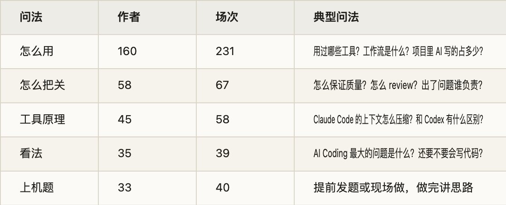
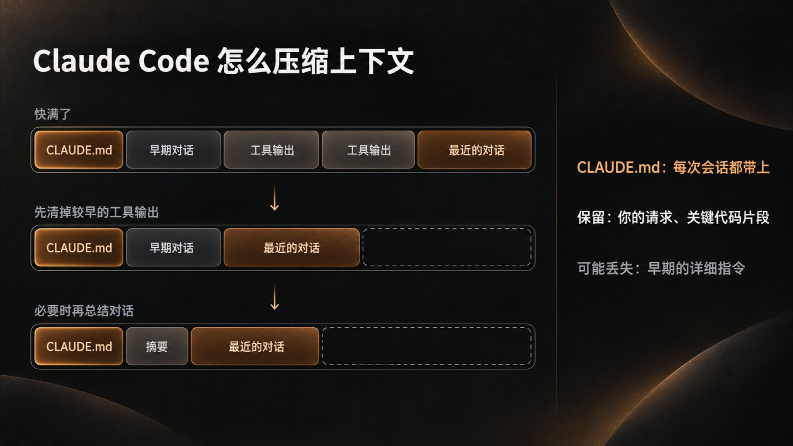
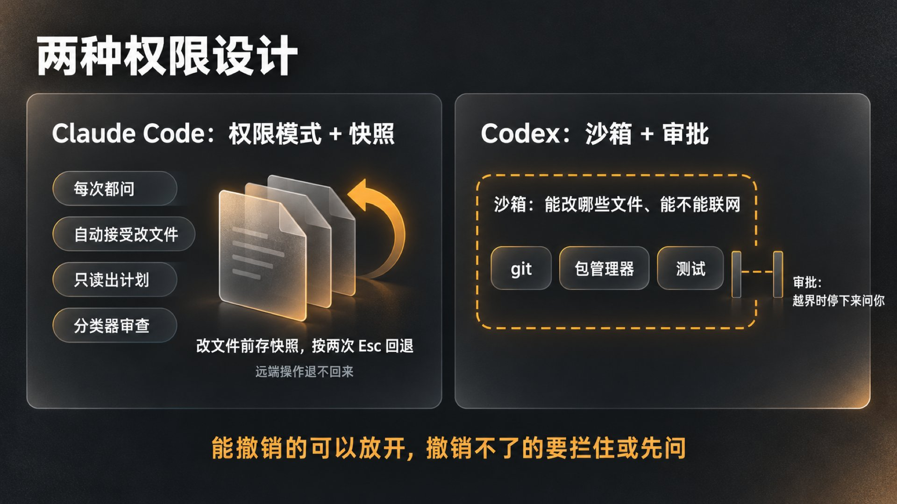
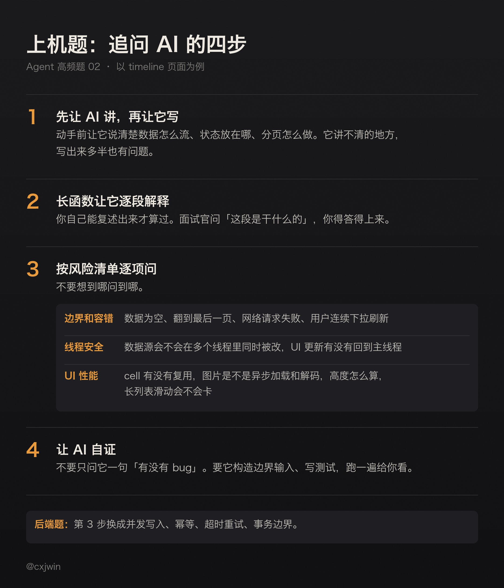

有位候选人做完美团 AI 全栈的 AI Coding 题，在面经末尾求助：有没有文档推荐，学习一下 AI Coding 做题步骤，「我是和 AI 在那乱说，感觉我没参与什么，一直是 AI 在改改改」。

这句话差不多就是这道题的考点。面试官问你平时用什么工具，真正想听的是你在这个过程里干了什么。

这是 Agent 高频面试题单第 2 题的详解。题单里这题是 65 位作者、83 场面试，和第 1 题 RAG 链路只差两位作者。写这篇时，我又在牛客把 8 月 18 日到 10 月 18 日的面经专门重扫了一遍，这次不限岗位。结果是 208 位作者、332 场面试问到了 AI Coding。标题写明 AI、Agent 或大模型岗位的只有 107 场；标题是后端、全栈、前端、客户端、测开这些岗位的有 126 场，其余大多没写岗位。这题已经不只是 Agent 岗在问了。

题单里排第 25 的「怎么保证 AI 生成代码的质量」，在面试里常常和这题连着问，这篇一起讲。

重扫的 332 场，问法大致分五类，按作者数排：

一场面试常常不止问一类，所以场次加起来比 332 多。工具名里，Codex 出现在 55 位作者的面经里，Claude Code 48 位，Cursor 15 位。国产工具很少：Trae 6 位，Qoder 3 位，GLM 和 Kimi 各 2 位。所以这篇不按工具分节，讲各家都有的机制。

下面按面试官追问的顺序讲：会用，懂原理，能把关。最后讲上机题，它是把这三层放到现场一起考。

## 一、会用：讲清你自己的流程

1\. 工具说到什么程度

开头这一问，面试官多半只是起个头：「用过哪些 AI Coding 工具？」照实说就行，说你真用过的，再说清楚各用在什么地方。比如终端里的 Agent 用来改多个文件、跑测试；IDE 里的对话和补全用来改手头这一段。不用罗列产品，面试官接下来会顺着你说的往下问。

有些追问是在核实你是不是真的在用。比如百度一位面试官问「你有付费使用 Codex，Claude Code 嘛？」，另一场面试直接让候选人共享屏幕，打开 Codex 看看订阅的是什么套餐。用 Claude Code 的，可能被问底层配的是什么模型。只装过、没用熟的工具，别写在简历上。

最容易答坏的是比例问题：「项目是不是全部用 AI Coding？」「两个项目中 AI 辅助编程大概占多少比例？」说「全是 AI 写的」不丢人，说不清自己做了什么才丢分。更稳的答法是把分工讲清楚：哪些是你定的（需求拆分、接口和数据结构、技术选型），哪些交给 AI 写，哪些是你逐行看过、改过的。

2\. 规则文件：把一次次的提醒写下来

用得久了，一般会把反复跟 AI 说的话写成文件，每次开工自动带上。面试官问「是否做过规则配置（如 .cursorrules）？」「用过 Hooks 等特性吗？」，看的就是这个。

各家的叫法不同，思路是一样的：

- Claude Code 读项目里的 CLAUDE.md，每次会话都会带上。官方文档里写着，仓库里已经有给其他 Agent 用的 AGENTS.md，Claude Code 也能读它，不必再写一份。

- Codex 读 AGENTS.md。它从全局目录开始，再从项目根目录一路读到当前目录，逐层拼起来；离当前目录越近的文件排得越靠后，优先级也越高。默认合起来最多 32 KiB。

- Cursor 的规则放在 .cursor/rules 下，是带元数据的 .mdc 文件，可以按文件路径自动生效，也可以手动调用。它同样支持 AGENTS.md，包括子目录里嵌套的。

迅雷有位面试官问过：「如果 CLAUDE.MD 的话，大家 Coding Agent 不一样，怎么办？」团队里有人用 Claude Code，有人用 Codex，规则就该放在大家都认的 AGENTS.md 里，各家的专用文件只放各自独有的部分。我自己的写作仓库就是这么做的，约定只写在 AGENTS.md，CLAUDE.md 里只有一行 [@AGENTS](https://x.com/@AGENTS).md 把它引进来。

规则文件里写什么，比用了什么格式更重要。值得写进去的是：项目怎么构建、怎么跑测试，代码风格，哪些目录不能动，以及踩过的坑。Hooks 管的是「每次都必须做」的事，比如改完文件自动跑格式化和 lint，不用每次都提醒 AI。

3\. 一个完整流程怎么讲

「你平时使用 AI Coding 工具的完整开发工作流是什么？」这类问题，按一个需求从接到到合入讲一遍最清楚：

1. 先让 AI 读代码、出方案，不急着写。你确认方案，改掉不对的地方。

2. 把任务拆小，一次只做一块，每块做完能单独验证。

3. 让它写完就跑测试、跑 lint，失败了自己修。

4. 你看 diff，挑重点逻辑追问，确认没问题再提交。

面试官接着可能问：「你人在整个开发过程中主要参与的环节是哪一些？」答案就在上面四步里：定方案、拆任务、定验收标准、看 diff。

团队协作的问法也开始出现了：「复杂项目多人用 AI Coding 开发时，上下文怎么处理？」「多个人用不同 AI 工具开发同一个功能时，你们怎样协作？」可以从三处答：规则文件进版本库，大家共用；方案和接口约定先写成文档，再分头让 AI 实现；合入前照常走 code review 和 CI，不因为是 AI 写的就放松。

有人会问到 SDD（Spec-Driven Development，规格驱动开发）：先把需求写成一份可以验收的规格文档，再让 AI 照着实现。被问「采用的是哪套 AI Coding 工作流，例如 SDD、Superpowers 或其他流程？」时，用过就讲你怎么用的，没用过就讲你自己的流程，不用硬套名词。

还有一类是关于国产工具的。重扫里问到的不多，但问法很直接：「有用过国产的 AI 工具吗，体验如何？」「企业内部不能使用 Claude、Codex 这类国外工具，只能使用国产内部模型，会不会影响你的开发产出效率？」不少公司的上机环境给的也是国产模型，后面讲上机题时会说到。平时哪怕只是用国产模型跑过同一个任务，也比只会说「没用过」强。

面试常问：用过哪些 AI Coding 工具，为什么选它？Codex 和 Claude Code 各自更擅长解决什么类型的任务？项目里哪些代码是你写的，哪些是 AI 写的？用 Claude Code 有哪些使用规范和提效小技巧？为什么会切换多款不同的 AI 工具？是否做过规则配置？用过 Hooks 吗？作为服务端开发，使用 AI Coding 时需要给 AI 哪些特殊的上下文和约束？你的 AI Coding 工作流是怎样的，有没有更 native 的做法？怎么判断两个人 AI Coding 的能力？

## 二、懂原理：工具本身就是一个 Agent

Agent 岗爱问这一层。面试官问 Claude Code 怎么压缩上下文，其实是借一个你天天在用的东西，考你懂不懂 Agent。这一层和第 5 题（上下文太长怎么办）、第 9 题（Harness、Agent Loop）是连着的，这里只讲 AI Coding 工具里的样子。

1\. 一个循环

Claude Code 的官方文档把它的工作方式描述成一个循环：收集上下文，采取行动，验证结果，三步交织着反复进行，直到任务完成，人随时可以打断。模型负责推理，工具负责动手：读写文件、搜索、执行命令、上网查、看类型错误。文档还专门说，模型外面这一层提供工具、管理模型看到的上下文，这就是常说的 Agent Harness。

面试里被问「Claude Code 的原理、组成和工作流是什么」，按这个说就有骨架：一个循环，一组工具，一套上下文管理，再加一层权限控制。

2\. 上下文怎么压缩

工具原理里，这一点被问得很多，Claude Code 和 Codex 都有人问。

按 Claude Code 官方文档的说法：上下文快满时，它先清掉较早的工具输出，必要时再把对话总结压缩。你的请求和关键代码片段会保留，但对话早期的详细指令可能丢失，所以长期要遵守的规则应该写进 CLAUDE.md，不要只在对话里说一次。想控制压缩时保留什么，可以在 CLAUDE.md 里加一节「Compact Instructions」，或者手动运行 /compact 并带上重点，比如 /compact focus on the API changes。用 /context 能看到上下文都被什么占着。

另外几个机制也是为了省上下文：

- Skill 按需加载。启动时只看到每个 Skill 的描述，用到时才加载全文。

- MCP 的工具定义默认延迟加载，用到某个工具时才把它的定义拿进来。

- 子 Agent 在自己的上下文窗口里干活，做完只把一段摘要交回来，中间的工具调用不占主对话的上下文。

Codex 也有 /compact，文档里的说法是把之前的轮次替换成一段简洁的摘要，腾出上下文，同时保留关键细节。

面经里有人被问 Claude Code 的「三层压缩」。官方文档里没有这个说法，网上的源码分析说法不一。被问到时，先讲文档里能确认的部分，再说明哪些是你看社区分析得来的，比编一个层数稳妥。

3\. 怎么在大仓库里找代码

「面对大型代码库和有限上下文窗口，Coding Agent 如何理解整个项目？」还有一个更尖的版本：「之前用 RAG 检索代码，现在却直接用 grep 检索，原因是什么？」

Claude Code 文档里列的内置搜索工具，就是按文件名模式找文件、按正则查内容。为什么这样做也行，可以从几方面说：代码一直在改，向量索引要跟着同步；代码里大量是函数名、错误码这类要精确匹配的符号，第 15 题讲过，这正是向量检索的弱项；Agent 可以多轮搜索，一次没找到就换个词再搜，读到一个文件又顺着引用找下一个。再加上规则文件里写好的项目结构说明，大仓库也能一步步摸清。

4\. 权限和沙箱

「AI 编程助手怎么做指令安全分级，如何防止高危命令执行？」「Codex / Claude Code 等工具的本地沙箱如何做？」这两家的设计思路不太一样，正好可以拿来对比：

- Claude Code 主要靠权限模式和规则。模式有几种：每次改文件、跑命令前都问；自动接受文件修改，其他命令还要问；只读代码、出计划，不改源码；还有一种由分类器在后台审查，拦下有风险的操作。常用的安全命令可以在 .claude/settings.json 里放行。另外，它改文件前会先存快照，按两次 Esc 就能回退。不过快照只管本地文件，数据库、接口调用、部署这类远端操作退不回来。

- Codex 把沙箱和审批分成两层。沙箱是技术边界，规定能改哪些文件、命令能不能联网，它启动的 git、包管理器、测试这些命令也在沙箱里；审批策略决定要越过边界时，什么时候停下来问你。

答这类题，可以落到一个判断上：能撤销的操作可以放开，撤销不了的操作要拦住或者先问。

5\. Claude Code 和 Codex 有什么区别

这一句在工具类问法里很常见。别答「哪个更强」，模型和版本几个月就变一轮。从你用过的机制讲区别，面试官更容易接着往下聊：说明文件怎么组织，权限怎么控制，上下文怎么管理，各自适合什么任务。上面几节已经有现成的对比点。

如果你只用过其中一个，就说只用过一个，讲清楚它的机制，再说你了解到另一个在哪些地方不同。

面试常问：Claude Code 是怎么做上下文压缩的？Codex 的上下文压缩机制有什么优势？Claude Code 在任务执行过程中收到用户新增的要求，会怎么处理和注入这条指令？Claude Code 本身用了多 Agent 架构吗？Codex 一般先读什么文件？用 Codex 迭代新功能时，历史上下文存在什么地方？你了解 Claude Code 的沙箱机制吗？如何在不修改 Codex 的情况下让它使用本地的工具？Codex 和 Claude Code 有什么区别？

## 三、能把关：AI 写的代码谁负责

这是并进来的第 25 题。题单里它是 16 位作者，重扫里「怎么把关」这一类有 58 位作者问到，分散在后端、前端、测开各个岗位。问法都很具体：

- 「AI 开发的功能，review、测试都没问题，上线后出现严重问题，是谁的责任？」

- 「AI 生成速度超过人工 Review 速度时怎么办？」

- 「如果让 AI 一次性生成成千上万行代码，代码审查应该交由 AI 自动审，还是由人工审核？」

- 「如何避免 AI 生成代码污染主分支？」

- 「为什么有时候 AI 生成的代码虽然能跑，但逻辑很烂？」

- 「有时候 AI 写的代码你看不懂了，这个问题你怎么解决？」

第一个问题的答案没有悬念：代码是你提交的，就是你负责。面试官想听的是你怎么让自己负得起这个责：

1. 先审方案，再审代码。方案错了，代码写得再干净也没用。字节有一场面试问：「AI 给出的技术方案很长，人应该怎样 Review、抓重点和做取舍？」可以先看它改了哪些模块、加了哪些依赖、数据怎么流，跟你的预期对不上的地方先问清楚。

2. 任务拆小，提交拆小。美团有位面试官直接点破了一位候选人的问题：所有任务串行跑完再让人 CR，AI 生成的代码本来就难读，一堆任务一起生成更难弄。生成速度超过 review 速度时，该做的是把每次交给 AI 的任务改小，而不是把 review 做浅。

3. 让机器先挡一道。测试、类型检查、lint 和 CI 都跑过了，人再去看逻辑。

4. 看不懂的代码不合入。让 AI 解释清楚，或者让它换一种你看得懂的写法。

5. 别污染主分支：在分支或 worktree 里做，走正常的 PR 和 review，合入前过 CI。

至于「能跑但逻辑很烂」，常见原因是 AI 只看到了眼前这一段，没看到项目里已有的写法和约定，于是又造了一遍轮子，或者为了让测试通过绕开了真正的问题。规则文件里写清楚约定，方案阶段先让它找到已有的实现，能减少这类问题。

还有一种越改越乱的情况：同一个问题让 AI 修了三四轮还没修好，代码越堆越多。这时候别再接着让它改了，退回到最后一个好的版本，把问题描述清楚，或者把任务拆小，重新来一遍。

面试常问：怎么保证 AI 生成代码的质量？AI 生成的代码，你怎么验证正确性？AI 写代码的时候，怎么保证它不发散、不多写额外的东西和逻辑？在大型遗留系统里用 AI Coding 有哪些风险，怎么确保修改不影响现有业务？AI 生成的代码出了问题，脱离这些代码，怎么快速定位？自动化 review 时，AI 按自己的判断坚持另一个方案，和你的预期不符，怎么办？工作中 vibe coding 会不会把数据放进提示词里？

## 四、上机题：面试官在看什么

重扫里有 33 位作者记了 AI Coding 上机题，字节、阿里、美团、快手都有。形式大致有三种：

- 提前发题。面试前两小时发题，不限 AI 工具，面试时共享屏幕演示，讲代码含义和思路，展示用 AI 解题的过程。字节好几个部门这么考，美团也有。

- 现场做。阿里淘天一场是 30 分钟写一个商品计价系统，要能随时更新优惠策略；快手一场是做一个满多少钱送赠品的页面；美团一场是做订单详情页。阿里云一场给了 120 分钟，要实现一个动态写入系统，考虑各种异常情况。美团有自己的 AI Coding 平台，有候选人吐槽平台里的模型太慢。

- 和手撕二选一。滴滴、字节客户端都出现过。滴滴那位候选人选了 AI Coding，半个小时做出第一版，被面试官说做得太假，又改了半小时被叫停，面试官给了不少 AI Coding 思路上的建议。

做完以后，追问大多是这一类：「讲一下这道题 AI Coding 时你的思路是什么，技术选型的原因是什么，AI 起到什么样的作用？」携程一位候选人的总结是：考的不是让 AI 帮你写代码，而是你能不能把工程思路讲清楚。

我们公司怎么考

我们公司的上机题也是这个路子。限时一般二三十分钟，用的是一个在线 IDE，带云端环境，类似 Cursor 那种，工具不能自己选。模型可以选，主要是国产的，比如 DeepSeek、GLM、Kimi。题目一般是一个业务小功能，举个例子，比如做一个微博 timeline 页面。

我主要看两件事。一是实时看候选人怎么跟 AI 沟通。二是代码生成以后，候选人对这份代码是什么态度：会自己做 review，还是完全信任 AI。

我会专门挑 AI 容易出错的地方问。最容易出错的是复杂逻辑，特别是比较长的函数或方法。我会指着一段问：这个是干什么的，主要功能是什么？还会重点看容错和边界 case 有没有考虑到。iOS 开发里的线程安全也是重点。还有一个是 UI 性能，没有相关经验的人比较容易漏掉。

遇到问题时，自己动手解的候选人很少，大多还是继续追问 AI。这本身没问题，区别在于追问的时候有没有自己的一套方法，还是想到哪儿问到哪儿。很多人问不到重点。

追问 AI 可以这样准备

拿 timeline 页面举例，下面这套方法可以提前练：

1. 先让 AI 讲，再让它写。动手前让它说清楚数据怎么流、状态放在哪、分页怎么做。它讲不清的地方，写出来多半也有问题。

2. 长函数让它逐段解释，你自己能复述出来才算过。面试官问「这段是干什么的」，你得答得上来。

3. 按风险清单逐项问，不要想到哪问到哪：

- 边界和容错：数据为空、翻到最后一页、网络请求失败、用户连续下拉刷新。

- 线程安全：数据源会不会在多个线程里同时被改，UI 更新有没有回到主线程。

- UI 性能：cell 有没有复用，图片是不是异步加载和解码，高度怎么算，长列表滑动会不会卡。

1. 让 AI 自证，而不是问它一句「有没有 bug」。要它构造边界输入、写测试，跑一遍给你看。题单里有个问法正好对得上：「AI 审查完说没问题，这个结论可靠吗？」不可靠，所以要让它拿测试结果来证明。

这份清单针对的是客户端页面，换成后端题，第 3 步换成并发写入、幂等、超时重试、事务边界就行。重点是在开始追问之前就想好要查什么。

上机还有一个难处：时间短，环境陌生。字节一位候选人的经历可以参考：做提前发的题时，本地的 Agent 工具全罢工了，找备用工具接备用 API 折腾了很久，最后用 GLM 踩点跑完。平时多换几个工具和模型做同一件事，上机时就不会被环境卡住。

面试常问：拿到 AI Coding 题以后，你是怎么解读、实现的？讲一下你 AI Coding 的思路。AI 在这道题里起了什么作用？这道题实际花了多长时间？AI 给出的方案很长，你是怎么取舍的？

## 五、看法题：别喊口号

「你认为目前 AI Coding 最大的问题是什么？」「有 AI Coding 工具后，程序员还要会写代码吗？」「AI 写代码，哪些可以交给 AI，哪些不能？」这类问题在重扫里有 35 位作者被问到。

有位候选人在腾讯 IEG 二面被问对 AI Coding 的认识、人和 AI 在开发中应该扮演什么角色，这位候选人的感受是「完全没给喊口号的机会」。面试官会顺着你的回答往下问，所以最好用自己踩过的坑来回答：哪类任务 AI 做得好，哪类任务它反复出错，你后来是怎么调整的。说「AI 是工具，人要有判断力」，下一个问题就会是「举个例子」。

## 六、面试怎么答

两分钟左右的主线：

1. 工具：用哪几个，各用在什么场景，不夸大。

2. 流程：先出方案再写代码，任务拆小，跑测试，你负责定方案和看 diff。

3. 配置：规则文件里写了什么，为什么写这些。

4. 把关：怎么 review，怎么验证，出过什么问题，后来怎么防。

5. 原理：被追问时，能讲清你用的工具怎么管上下文、怎么控制权限。

最好带一个具体的例子：一个需求，AI 第一版哪里写错了，你是怎么发现的，怎么让它改对的。

几个常见的失分点：

- 只报工具名，说不出自己怎么用。

- 说项目全是 AI 写的，却讲不清哪些是自己定的。

- 被问到上下文压缩、沙箱这些原理，只能说「它很智能」。

- 上机题全程只在跟 AI 对话，问到代码细节答不上来。

## 出处

文中的面试问法都出自下面这些面经，括号里是发帖日期，链到牛客原帖。

- 开头的例子：[美团面试（AI 全栈）](https://www.nowcoder.com/feed/main/detail/7f424fd7e4b84f4fbf064ae97022336f)（10-17）

- 会用：[百度 Agent 一二三面](https://www.nowcoder.com/feed/main/detail/b9521e2b51e04afeac0a3a32e13f4da9)（08-28）· [xx 科技一面](https://www.nowcoder.com/feed/main/detail/dc968a546ce14b59b9ebf078e31fcc51)（09-23）· [超参数二面](https://www.nowcoder.com/discuss/927163538441764864)（09-09）· [小红书 Product Engineer 一面](https://www.nowcoder.com/feed/main/detail/70ad5ead2f784676b0b399eab877d3d4)（09-24）· [小厂全栈面经](https://www.nowcoder.com/feed/main/detail/b7a11a657f574ee6867f8752de0d52c7)（08-26）· [阿里千问二面](https://www.nowcoder.com/feed/main/detail/9124b0efb14349d2a60ee58a26c1ccbd)（08-28）· [美团 AI 后端一面](https://www.nowcoder.com/discuss/927579574932705280)（09-10）· [迅雷 Agent 一面](https://www.nowcoder.com/discuss/932392798559432704)（09-23）· [字节 Agent 秋招一面](https://www.nowcoder.com/discuss/929731481189044224)（09-16）· [理想汽车 IT 全栈一面](https://www.nowcoder.com/discuss/938122023392366592)（10-09）· [快手生服测开一面](https://www.nowcoder.com/feed/main/detail/9114b47f04e847479b85eda4979fcecc)（09-17）· [快手 AI 应用二面](https://www.nowcoder.com/feed/main/detail/5356d768dc7a4c62a989ee425bef7b12)（09-24）· [美团 AI 后端一二面](https://www.nowcoder.com/feed/main/detail/0fade3c42efb40e5ae3ca0dcfd3d4dfa)（10-01）· [腾讯技术咨询三面](https://www.nowcoder.com/feed/main/detail/19d48fec983541468bc80758d2953773)（09-02）· [药明康德二面](https://www.nowcoder.com/feed/main/detail/365904cd189149ffb52c36286ab23b37)（09-23）· [百度前端一二面](https://www.nowcoder.com/feed/main/detail/6211d5f22c8d4904ae220fb82aa29b76)（09-03）· [合合信息前端一面](https://www.nowcoder.com/feed/main/detail/1eea7d1b62b84faa80296ca813784b0c)（09-16）· [豹趣科技一面](https://www.nowcoder.com/discuss/932639511236870144)（09-24）· [字节 Agent 全三轮](https://www.nowcoder.com/feed/main/detail/b4fb3bee56134c3d9bcde6a3166a1711)（10-18）· [百度后端二面](https://www.nowcoder.com/feed/main/detail/375c98ff67c949c4b7e55b1422f8474d)（08-21）

- 懂原理：[百度大模型研发一面](https://www.nowcoder.com/discuss/921590204903723008)（08-25）· [快手效果营销二面](https://www.nowcoder.com/discuss/921722245028794368)（08-25）· [字节业务中台 AI 全栈](https://www.nowcoder.com/feed/main/detail/6ac5ba31705a4b64a407b087f39d5447)（10-12）· [阿里边缘 BU 一面](https://www.nowcoder.com/feed/main/detail/bdebbb6088b6405e9eb2bd2c345acb6e)（09-03）· [百度后端一面](https://www.nowcoder.com/feed/main/detail/1d81340e139a461e92321f71ce7ca9bd)（08-20）· [字节即梦后端一面](https://www.nowcoder.com/feed/main/detail/ccd6ea94a9ee4c7a9b9e5f77fe3492b1)（10-15）· [字节后端日常一面](https://www.nowcoder.com/feed/main/detail/3e522f6018904b85b0a5def4222e7740)（08-25）· [科大讯飞 AI 应用一面](https://www.nowcoder.com/feed/main/detail/aece93373f9c47ea95c831aef6471886)（09-24）· [百度 Agent Harness 一面](https://www.nowcoder.com/discuss/926928449204129792)（09-08）· [中科曙光前端一面](https://www.nowcoder.com/feed/main/detail/3ac3c2cd176646d484a85e6945550a4b)（09-29）· [Shopee 后端一面](https://www.nowcoder.com/feed/main/detail/e1aa72bb07364f52b7a5cc57c54985ed)（09-12）· [蚂蚁 Agent 一面](https://www.nowcoder.com/feed/main/detail/39451cad5d2245b491d16778f2a9ca01)（08-31）· [中兴 AI 算法一面](https://www.nowcoder.com/discuss/932316204088180736)（09-23）

- 能把关：[欢乐互娱前端一面](https://www.nowcoder.com/feed/main/detail/359a1961cc6c4510864a727cb0754825)（08-24）· [美团 AI 后端二面](https://www.nowcoder.com/discuss/929087871779110912)（09-14）· [汇川数字化全栈一面](https://www.nowcoder.com/feed/main/detail/28032c48a90c4f69827704deb3fae34c)（09-22）· [网易 Agent 一面](https://www.nowcoder.com/feed/main/detail/bad72b1323274ad5b172039f48bfa4b1)（10-17）· [字节 AI 应用二面](https://www.nowcoder.com/feed/main/detail/7e8a821479a649fd914e449d312eeb95)（08-30）· [趣链科技 Java 面经](https://www.nowcoder.com/discuss/929042072709918720)（09-14）· [字节抖音电商 Agent 一二三面](https://www.nowcoder.com/discuss/937314680270311424)（10-07）· [美团一面](https://www.nowcoder.com/feed/main/detail/9829290b37464ac99152a7b37ee9a2ba)（09-16）· [东方财富一面](https://www.nowcoder.com/feed/main/detail/1de289019a1542659820e66c330795d1)（09-18）· [平安银行一面](https://www.nowcoder.com/feed/main/detail/b9278eb5974b4a189a1150c68cda0b00)（10-13）· [恒生电子二面](https://www.nowcoder.com/discuss/939914986833313792)（10-14）· [华顺信安 golang 实习](https://www.nowcoder.com/discuss/940603493713207296)（10-16）· [华为 OD 面试](https://www.nowcoder.com/discuss/932020632663916544)（09-22）

- 上机题：[字节秋招二面](https://www.nowcoder.com/feed/main/detail/11b0ef73177f4e84ae2a9f0db7d5ca9a)（09-04）· [字节全栈一二三四面](https://www.nowcoder.com/feed/main/detail/d8822fc2b4ae4b2fbdb03c95fa2a427d)（10-17）· [字节抖音电商二面](https://www.nowcoder.com/feed/main/detail/7aef35efd1e44e5eb509c48f28972f1f)（09-15）· [美团一面](https://www.nowcoder.com/feed/main/detail/8aa09d879bfc408fae7442565fd25fbe)（09-08）· [阿里淘天 AI 应用一面](https://www.nowcoder.com/discuss/922452114809376768)（08-27）· [快手 AI 全栈一面](https://www.nowcoder.com/discuss/921807075905130496)（08-25）· [美团一面](https://www.nowcoder.com/feed/main/detail/9b94f595d15148869e0334029b5ddb67)（09-02）· [阿里云 Agent Infra 一面](https://www.nowcoder.com/discuss/924245733962719232)（09-01）· [美团 AI 全栈二面](https://www.nowcoder.com/feed/main/detail/064725eb6da14cda9efabb2a51a68681)（09-23）· [滴滴一面](https://www.nowcoder.com/feed/main/detail/e74f86c352964cbc944965eff2a0f03a)（09-10）· [字节抖音电商客户端一面](https://www.nowcoder.com/feed/main/detail/9d9259986b304b749bc8ab07c20365c9)（09-15）· [淘天 AI 应用一面](https://www.nowcoder.com/feed/main/detail/e8202d996bf24b92aaceefda2456875c)（09-15）· [美团 Agent 一面](https://www.nowcoder.com/feed/main/detail/18fa4134edb14e8c901787ee5cd33ace)（10-12）· [携程一面](https://www.nowcoder.com/discuss/938072865532923904)（10-09）· [字节二面（双非前端）](https://www.nowcoder.com/discuss/925810899087101952)（09-05）

- 看法题：[腾讯 IEG 后台二面](https://www.nowcoder.com/discuss/935191455750946816)（10-01）· [字节后端一面](https://www.nowcoder.com/feed/main/detail/c8e0b31cf6484e04b7f91d7023a7c8b9)（09-24）· [嘉为科技一面](https://www.nowcoder.com/feed/main/detail/b620aac6ca9a4f7f940e538ef1120e62)（10-13）

- 官方文档：[How Claude Code works](https://code.claude.com/docs/en/how-claude-code-works) · [Codex：AGENTS.md](https://learn.chatgpt.com/docs/agent-configuration/agents-md) · [Codex：Sandbox](https://learn.chatgpt.com/docs/sandboxing) · [Codex：斜杠命令](https://learn.chatgpt.com/docs/developer-commands?surface=cli) · [Cursor：Rules](https://cursor.com/docs/rules)
