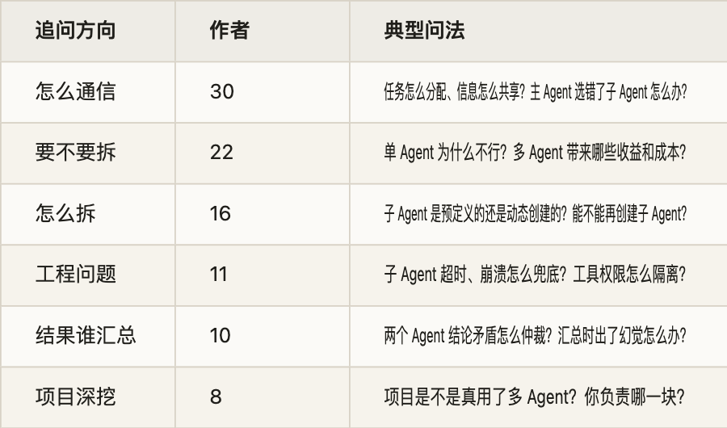
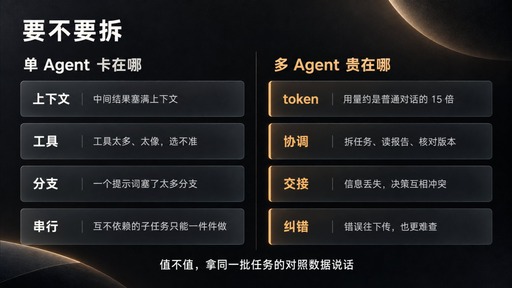
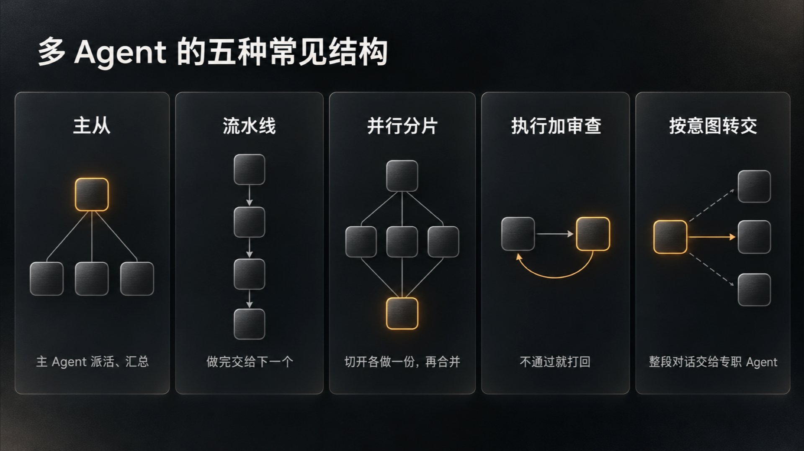
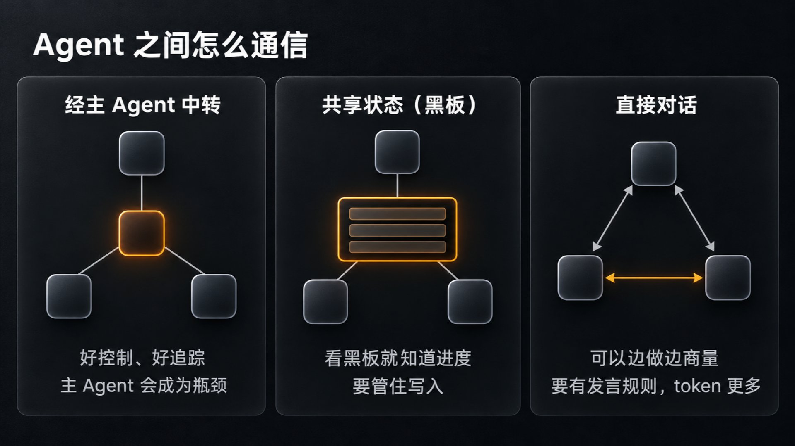
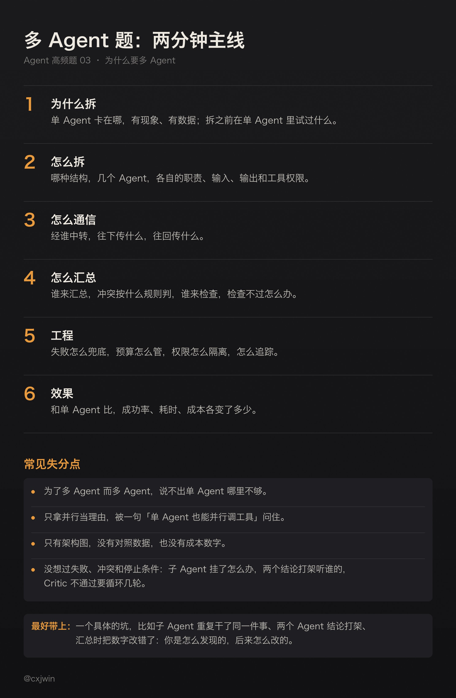

有位候选人在字节全栈二面讲自己做的多 Agent 研发平台，用「前后端可以并行」解释为什么要拆成多个 Agent。面试官接着问：单 Agent 调用多个 Skill 也能并行，为什么还要多 Agent？又问：研发平台和电商下单都是相对固定的流程，为什么前者用了多 Agent，后者用单 Agent？

多 Agent 的架构图谁都会画，这道题考的是拆分的理由：单 Agent 卡在哪里，拆开以后多花了什么，换回了什么。小红书一位面试官在这一点上追问了很久，要候选人说服他；快手的面试官问得更直接：单 Agent 和多 Agent 做过对照评测吗？

这个问题我自己也没能回答。九月我发过一篇复盘：一个主 Agent 带三个子 Agent，62 分钟交卷，token 用到了预算的 192 倍。同一套运行系统下没有单 Agent 的对照组，并行到底省了多少时间，说不清。

这是 Agent 高频面试题单第 3 题的详解。题单里这题是 50 位作者、63 场面试，大多在一面。题单里的两道低频题也并进来讲：A2A 协议，比如 Skills、MCP、A2A 有什么区别；反思和 Critic，比如 Critic 判定不通过以后怎么办。第 7 题里还有一种问法，问什么时候该抽成专门的 Agent、什么时候一个 Skill 就够，也放在这里。

把这些面经逐条读过，追问大致分六个方向（按作者数，一场可以算进几类）：

问得最多的是怎么通信，追得最紧的是要不要拆。这一问答不好，后面讲得再细，面试官也会觉得是为了多 Agent 而多 Agent。

下面按这个顺序讲：先回答要不要拆，再讲怎么拆、怎么通信、结果谁汇总，然后是工程上要管住的几件事，最后是面试怎么答。Workflow 和 Agent 怎么选（第 23 题）、ReAct 和 Plan-and-Execute（第 14 题）另外单写，这里用到时只点一下。

## 一、先回答要不要拆

1\. 单 Agent 卡在哪

一个 Agent 就是一个循环：模型读上下文，决定调哪个工具，把结果放回上下文，再决定下一步（第 2 题讲过）。任务一大，这个循环常在四个地方卡住。

一是上下文被中间结果塞满。查日志、搜代码、翻网页，读进来的东西大多只用一次，却一直占着上下文，也分散了模型对任务本身的注意力。我在解读 pstack 指南时写过：「让读了 5000 行日志的那个 agent 死在自己的沙盒里，别让它污染指挥部。」Anthropic 讲上下文工程时给过一个量级：子 Agent 探索时可能用掉几万 token，交回主 Agent 的往往只是一两千 token 的摘要。

二是工具太多、太像，选不准。OpenAI 的建议是，问题不只在工具数量，更在工具之间是否相似、重叠：有的系统能用好 15 个以上界限清楚的工具，有的不到 10 个互相重叠的工具就开始选错。Anthropic 今年 10 月一篇讲子 Agent 何时并回主循环的文章，也给过一个经验值：系统提示词里的工具定义超过 30 到 50 个，选工具就容易变差；他们建议按用户意图给工具分组，不要一个接口一个工具，再用工具搜索按需加载。先把工具的名字、参数和说明写清楚，还选不准，再按领域拆给不同的 Agent（工具多时怎么选对，第 24 题单讲）。

三是一个提示词里塞了太多分支。规则里全是「如果……就……否则……」，改一处牵动别处。OpenAI 的建议是，条件分支多到提示词模板难以维护时，把每段逻辑拆给单独的 Agent。还有一种是角色冲突：同一个上下文里既写代码又审代码，审的时候带着写的时候的假设，很难看出自己的错。

四是互不依赖的子任务只能一件件做。查五个竞品、看十个模块，单 Agent 只能轮流来，每做完一件，上下文里就多一堆材料。Anthropic 的研究系统让主 Agent 一次派出 3 到 5 个子 Agent 同时搜索，每个子 Agent 也同时调 3 个以上工具，复杂问题的研究时间最多缩短了九成。

这四种情况，拆的理由不一样：前两种是隔离上下文和工具，第三种是分开职责，第四种才是并行。面试时把理由讲到这一层，比一句「任务复杂，所以拆」有说服力。

2\. 多 Agent 贵在哪

最直接的是 token。Anthropic 的数据是，Agent 的 token 用量一般是普通对话的 4 倍左右，多 Agent 系统是 15 倍左右。他们的研究系统用 Opus 4 做主 Agent、Sonnet 4 做子 Agent，在内部研究评测上比单 Agent 的 Opus 4 高 90.2%。但他们也分析过，在 BrowseComp 这个测试上，token 用量一项就能解释八成的表现差异。照这个分析，多 Agent 赢的很大一部分，来自它能把更多 token 花到任务上。

我那次实验，主 Agent 用了约 3860 万 token，三个子 Agent 合计约 1.53 亿，全部加起来约 1.92 亿，预算是 100 万。这组数不能拿来给框架排名，模型、任务和统计口径都没控制。它说明的是另一件事：子 Agent 的用量要单独记账，它们交回的报告还会进主 Agent 的上下文，被反复读取。

其次，协调本身要花钱。主 Agent 要拆任务、写任务说明、读报告、核对版本、纠正工具给出的错误结论。我那次复盘里，有一轮测试读到了实现还在修改的中间产物，结果只能作废重跑。

再次，信息在交接时丢失，决策互相冲突。Cognition 的 Walden Yan 举过一个例子：做一个 Flappy Bird，拆成做背景和做小鸟两个子任务，交给两个子 Agent 并行。一个把背景做成了超级马里奥的风格，另一个做的鸟看着不像、动起来也不像 Flappy Bird 里的鸟。两个子 Agent 都只看到自己那一块，各自的决定说得通，放在一起却对不上。他由此总结了两条原则：共享上下文，而且要共享完整的过程记录，不能只传几条消息；动作里带着隐含的决策，决策冲突，结果就坏了。

最后，错误会往下传，也更难查。一个 Agent 的错误结论，到了下游就成了已知事实。Anthropic 的说法是 Agent 有状态，错误会累积。Cemri 等人分析了 7 个多 Agent 框架的 1600 多条运行记录，把失败归成三类：系统设计的问题，Agent 之间对不齐，检查没做好。

3\. 什么任务值得拆

几家的说法听上去对立。Cognition 那篇文章的标题就是《Don&#39;t Build Multi-Agents》，建议用单线程的 Agent；OpenAI 建议先把单个 Agent 的能力用到头；Anthropic 做了多 Agent 的研究系统，同时写明了它不适合什么。放在一起看，条件是一致的。

Anthropic 10 月那篇则更进一步，劝企业把不少子 Agent 并回主循环。他们的 Applied AI 团队在几家企业的部署里做过对比：带 Skill 的单 Agent，在质量上常常既胜过把所有内容塞进一个提示词的写法，也胜过拆成子 Agent 的写法，单个任务的成本和延迟往往还更低。他们没有否定子 Agent，验证、并行和按模块分权限都还用得上，但把该用的情况收成了三种：单 Agent 的循环因为上下文塞得太满，出现了可测量的效果下降；几件事要并行做，每件都要一个用完就能丢掉的干净上下文；单 Agent 选不对工具，或者系统提示词里的指令互相冲突。这三种正好对应第 1 小节的四个卡点，多出来的一条要求是先有数据：退化得测得出来。

值得拆的任务：

- 子任务之间依赖少，可以各做各的，比如广度优先的调研、几个来源分头检索、按模块分头审查。

- 过程很长、结论很短，比如读大量日志、翻代码，最后只要一个结论。

- 需要不同的工具或权限，比如只读的检索和能写的执行。

- 需要一个没参与过程的人来检查。

- 任务够值钱。Anthropic 也说，多 Agent 只适合价值高到付得起额外开销的任务。

不该拆的任务：

- 各部分强依赖，要共享同一套决策。Anthropic 在 2025 年那篇文章里举的例子就是编码：大多数编码任务里真正能并行的部分比研究少，Agent 也还不擅长实时地协调、分派给别的 Agent。

- 一个 Agent 几步就能做完的任务。

- 流程固定、每一步都能写死的任务，用 Workflow 更稳。

回到开头的两个反问。单 Agent 也能并行调工具，那拆开图什么？如果每一路只是一次查询，单 Agent 并行调工具就够了；如果每一路都要自己搜、读、判断，再搜好几轮，放在一个上下文里，几路的中间材料会挤在一起，这时拆成子 Agent，换来的是每一路有自己干净的上下文。研发平台和电商下单为什么一个拆一个不拆，也照这个思路答：关键不在流程固不固定，而在每一步要不要大量探索、要不要独立的上下文和权限、能不能并行。

比讲道理更有说服力的是对照数据，怎么做放在第五节。我那次实验缺的就是这个，所以只能复盘成本，回答不了值不值。

4\. 抽成 Agent，还是一个 Skill 就够

Skill 是一份做事的说明，可以带上脚本和资料，用到时加载进当前 Agent 的上下文。活还是这个 Agent 在干，上下文和权限都是同一套。子 Agent 是另起炉灶：Claude Code 的文档写的是，每个子 Agent 在自己的上下文窗口里运行，有自己的系统提示词、可用工具和独立的权限，做完只把摘要交回主对话。

所以，缺的是「会不会做」，加 Skill；缺的是「做的时候别把主上下文弄乱」「要用不同的权限」「要一个独立的检查者」「要并行跑好几轮」，才拆成 Agent。

同一篇文章还给了一个更细的分工：Skill 装的是一个团队怎么做事，步骤、规则和要拿捏的判断，以前写在专职子 Agent 提示词里的就是这些；工具用来执行动作、读实时数据、返回固定格式的结果；只是偶尔要查的参考资料，比如政策、指标定义、产品规格，放进知识库，让模型用检索或查询工具去取，或者作为参考文件放进 Skill，别让代码检索好了再整段贴进提示词。

美团有位面试官把几个概念放在一起问：Skill、MCP、Function Calling、Workflow、SubAgent 分别解决什么问题，项目里怎么组合？可以一句话说一个：Function Calling 是调工具的基础机制；MCP 用统一的协议把工具和数据源接进来；Skill 把某类事怎么做打包，用到时再加载；Workflow 的步骤由代码写死；SubAgent 另起一个上下文干一段活，只交回结果。项目里常常组合着用：Workflow 串起主流程，节点里的 Agent 调 MCP 接进来的工具，遇到要大量探索的步骤再派子 Agent。几者的边界和 Skill 怎么设计，留给第 7、8 题。

5\. 拆了以后，什么时候并回来

这篇文章的主题其实是反方向：已经拆成一堆子 Agent 的系统，哪些该并回主循环。他们常见到这样一种设计：意图分类器，固定的多步推理流水线，按用户分群，分开的推荐分支，最上面再加一个多 Agent 编排器。给出的反馈往往是，这些结构大多在替模型做它已经不需要别人代劳的事，一份清楚的系统提示词、四五个轻量的数据工具，加上严格的输出护栏，就能覆盖大部分场景。还有一家公司，对客 Agent 里有十几个专职子 Agent，品牌口径很难保持一致，延迟也拖累了体验。

并回来的理由有三条。一是共享上下文：主 Agent 看得到前面每一步的结果，能把它们连起来，比读子 Agent 交回的摘要强，交接也少了。二是按需加载：Skill 和工具先只给模型一句简短说明，用到时才加载全文，上下文塞满这个拆分的主要理由就没了。三是模型变强了：从 Opus 4.5 开始，一个循环里能管的事比多数团队预想的多；他们帮客户迁移到新模型时，僵硬的多 Agent 结构常常拦着新模型多干活。

他们建议的目标形态是：一个模型、一个上下文窗口，跑开放的工具循环，轮数、成本预算和写操作的闸门由 Harness 管；模型每轮发出一批工具调用，Harness 并行执行，把原始结果交回同一个模型，直到模型给出回答或者预算用完；模型在第一轮把计划写进上下文，边做边改。写计划的就是执行计划的那个，所以中途能改主意，这是和主从结构最大的不同。做事的步骤和领域规程放进 Skill；校验、审批这类硬约束，以及对话中途才用得上的东西（比如查记忆），放进工具。

并回来要分步做，每一步都拿评测说话：

1. 先建一套小的端到端评测，10 个标准样例就能起步。用评分标准判最后的回复；还有编排器时，统计路由选对的比例，并进来以后改看它加载的 Skill、调的工具对不对。

2. 先并用得最多、耦合最紧的专职 Agent：一个的输出总是喂给另一个，碰的是同一份数据，或者经常一起被调用。线上流量里有不小的比例是先调 A 再调 B，这一对就该先合并。

3. 留下的子 Agent，改成被主 Agent 当工具调用，主 Agent 继续和用户对话；只有子 Agent 必须直接和用户说话时，才把对话整个交给它。这一步不用重写子 Agent，还能统一它们的回传格式，让主 Agent 拿真实数据核对它们的结论。

4. 一次并一个：把子 Agent 的提示词改成 Skill，把它调的接口做成 MCP 工具，在评测上比有它和没它。并完的版本分数更差，才把它留成子 Agent。

比的时候别只看总分，要看哪些任务从通过变成了失败。他们在一个客服 Agent 的样例上试过：把一个子 Agent 并进另一个以后，延迟降了，一条原本能过的流程却坏了。主 Agent 手里有查订单的工具，就自己回答了，没有去问负责物流的子 Agent 要送达日期。这个问题两次运行里只出现了一次。所以每次改动前，评测里要有题覆盖线上每一条会连着跑的 Agent 链路，覆盖每一条不能违反的规则，每道题都跑不止一次（跑几遍才算数，第 4 题讲）。

面试常问：为什么拆成多个 Agent，而不是单 Agent？多 Agent 适合什么场景，什么情况下会启动多个 Agent 协作？对比单 Agent，多 Agent 的收益和额外成本是什么？单 Agent 调多个 Skill 也能并行，为什么还要多 Agent？为什么不做简单的 RAG，而要做一整套多智能体系统？不用子 Agent 能不能完成任务？单 Agent 和多 Agent 做过对照评测吗？项目为什么用 Agent Teams 架构，相比 Workflow 有什么优势？

## 二、怎么拆

1\. 几种常见结构

- 主从：一个主 Agent 拆任务、派活、汇总，子 Agent 只对主 Agent 负责。Anthropic 的研究系统、Claude Code 的子 Agent 都是这种。OpenAI 把它叫 manager 模式，子 Agent 被当成工具来调，只有主 Agent 和用户说话，适合要由一个 Agent 掌控流程、最后综合结果的任务。

- 流水线：按阶段排好，需求、设计、编码、测试，一个 Agent 做完交给下一个。顺序是写死的，更接近 Workflow。

- 并行分片：同一类任务切成几份，几个子 Agent 各做一份，再合并。比如长文档按章节切开，各自抽取，再汇总。

- 执行加审查：一个干活，一个检查，不通过就打回。Anthropic 把它叫 evaluator-optimizer：一次调用生成结果，另一次调用给出评估和反馈，循环往复。我在《别再 prompt agent 了？》里介绍过 loop 的典型形态，就有这一步：派一个子 Agent 干活，第二个子 Agent 对照测试做 review。

- 按意图转交：前台的分诊 Agent 判断用户要什么，把对话整个交给对应的专职 Agent，之后由它直接和用户对话。OpenAI 把它叫 decentralized 模式，转交是单向的，最新的对话状态一起交过去，适合不需要一个 Agent 居中掌控和综合的场景，典型是客服。

主从还可以套娃：主 Agent 下面是编排 Agent，编排 Agent 下面是原子 Agent。每多一层，就多一次转述和等待，只有下面的 Agent 多到一个主 Agent 管不过来，或者各层权限确实不同，才值得加。

字节一位面试官问 Multi-Agent 和 Sub-Agent 的区别。Sub-Agent 一般指主从结构里的子 Agent，由主 Agent 派生，做完把结果交回去。Multi-Agent 的范围更大，也包括几个 Agent 平级协作、互相转交、互相发消息。Claude Code 两种都有：子 Agent 把结果交回调用者；agent teams 里的队友可以直接互相发消息，用一个共享的任务列表认领工作，token 也明显更多。选哪种，看子任务之间要不要边做边商量。只需要各自交结果，用子 Agent；要边做边对齐，才考虑平级协作。

2\. 按什么边界拆

- 上下文边界：子 Agent 拿着一份任务说明就能干完，不需要知道主 Agent 之前的全部讨论。离开那些讨论就做不对的部分，不该拆出去。

- 工具和权限边界：只读的和能写的分开，碰生产数据的单独一个。

- 能单独验收：子 Agent 的产出要能单独检查，比如测试是否通过、文件是否生成、结论有没有出处。没法单独检查的产出，汇总时也查不出错。

按职位起名不等于找到了边界。「产品经理 Agent」「架构师 Agent」「程序员 Agent」如果读的是同一批材料、做的是互相依赖的决定，拆完只是多了几次转述。

按团队拆也是同样的问题。Anthropic 10 月那篇说，很多企业给每个团队、每类问题各配一个子 Agent，架构成了组织结构图的翻版，也就是康威定律。后果有四个：上下文在 Agent 之间来回传，细节越传越少；各团队各发各的子 Agent，最后几百个互相重叠，没有统一标准，也没人负责；每个团队都往系统提示词里加一句，规则互相冲突，口径也不统一；评测各管一段，只对自己那块子任务优化，没人维护整体。他们的建议是按上下文拆：分给子 Agent 的活要尽量不依赖系统的其余部分，交回紧凑的结果，比如互不相干的调研方向、接口清楚的独立组件、只看输入输出的验证。按问题类型拆，Agent 之间就成了传话游戏，每转一手，信息就失真一点。

至于要不要单独设一个负责拆任务的 Agent：拆分通常由主 Agent 自己做；任务类型固定、计划比较长时，可以单设一个规划的角色先出计划，代价是多一次交接。Planner 和 Executor 这类角色在一个 Agent 内部怎么配合，放到第 14 题。

3\. 预定义，还是动态创建

预定义，是每种子 Agent 的提示词、工具和权限提前写好，主 Agent 只决定派谁、派什么任务。好测试，行为可预期。Claude Code 的自定义子 Agent 就是这样，可以用 tools 字段列出允许的工具，也可以用 disallowedTools 排除。

动态创建，是主 Agent 临场写任务说明，自己决定派几个。灵活，但要有上限。Anthropic 的研究系统早期就犯过这种错：一个简单问题派出 50 个子 Agent。后来他们把规模写进了提示词：简单的事实查询，1 个 Agent、3 到 10 次工具调用；直接比较，2 到 4 个子 Agent，各 10 到 15 次调用；复杂研究，10 个以上子 Agent，分工要清楚。

常见做法是两者结合：子 Agent 的类型预先定义，具体任务动态下发。

4\. 给子 Agent 的任务说明

子 Agent 从一个干净的上下文开始，看不到主 Agent 之前聊过什么。Anthropic 的经验是，每个子 Agent 都要拿到目标、产出格式、该用的工具和资料，以及清楚的任务边界。他们举过反例：任务只写了「研究半导体短缺」，结果一个子 Agent 去查 2021 年的汽车芯片危机，另外两个重复调查 2025 年的供应链。

照这个思路，任务说明至少写清六样：要交付什么；做什么、不做什么，和别的子 Agent 怎么分界；已经确认的事实和相关文件的路径，免得重查；用哪些工具，优先看哪些来源；交回的格式（见第三节）；做到什么程度算完成，最多花多少步、多少 token。检验办法很简单：把这份说明交给一个没参与讨论的新同事，对方能不能直接开工。

子任务有难有易，派的时候也可以分档：难的给更强的模型、更多预算，机械的给便宜的模型。Anthropic 的研究系统就是 Opus 4 做主 Agent、Sonnet 4 做子 Agent。

5\. 子 Agent 能不能再派子 Agent

字节一场后端实习面试连着追问：子 Agent 能不能无限创建？能不能再创建自己的子 Agent？不允许的话为什么，允许的话怎么防止无限递归？

可以参考 Claude Code 现在的做法（10 月 23 日读的文档）：子 Agent 默认可以再派子 Agent，最深到主对话下面第三层，层数可以用环境变量调，设成 1 就关掉嵌套；同一个会话里同时运行的子 Agent 默认最多 20 个，超了再派会直接失败。

设计时要管住三样：深度、并发数、整棵树共用的预算。再加循环检测：每次派生都带上祖先链，记下谁派的谁，派之前检查有没有绕回去；同一个工具用同样的参数被反复调用，也要能识别出来。几个 Agent 互相调用停不下来时，最后的兜底是全局的步数和时间上限。死循环的通用防法放到第 28 题。

面试常问：多 Agent 怎么拆分、怎么分工？主 Agent、编排 Agent 和原子子 Agent 的职责分别是什么？子 Agent 是预定义的，还是主 Agent 动态创建的？Multi-Agent 和 Sub-Agent 有什么区别，怎么选？会不会单独设一个负责拆分的 Agent？子任务有难有易，怎么派发，子 Agent 干活需要给哪些信息？为什么拆成两个分析 Agent、一个裁决 Agent 和一个 Reviewer？子 Agent 能不能无限创建，能不能再创建子 Agent？

## 三、怎么通信

1\. 三种方式

经主 Agent 中转：子 Agent 只和主 Agent 说话，彼此看不见。好控制，好追踪；代价是主 Agent 成了瓶颈，所有报告都要进它的上下文。

共享状态，也叫黑板：大家读写同一块存储，比如一张任务表、一个状态对象、一个共享目录。子 Agent 之间不用直接对话，看黑板就知道进度。并行执行时，每个子任务的编号、负责人、状态、结果放在哪，都记在这张表里，主 Agent 读表，而不是靠自己记。要管住的是写入：一个任务只能被一个 Agent 认领；同一份数据只有一个权威副本，写入带版本，冲突能被发现。

直接对话或转交：A 直接给 B 发消息，或者把整个对话交给 B。Claude Code 的 agent teams 属于前一种，每个队友有自己的上下文，可以直接互相发消息。这个功能目前是实验性的，默认关闭，文档也写明它比单个会话多用很多 token。

百度有位面试官问，怎么保证多个 Agent 按顺序操作、不抢答。经主 Agent 中转时，顺序由主 Agent 定；用共享状态时，靠任务认领和加锁；直接对话时，要有明确的规则，比如由一个协调者指定下一个轮到谁。没有规则的群聊最容易抢答。

2\. 派给谁

主 Agent 或路由节点要决定一件事交给哪个子 Agent，可以用规则、分类模型，或者让大模型按各个子 Agent 的说明来选。用大模型选时，说明要写清负责什么、不负责什么，彼此不能重叠，道理和工具重叠时选不准一样。

准确率靠评测提上去：标一批真实问题「应该派给谁」，统计准确率，错例回流；给路由留一个拿不准的出口，把握不大时追问用户，或者交给通用的 Agent。派错了要能退回：子 Agent 发现任务不归自己管，就退回主 Agent，不硬做；转交模式里可以再转一次，但要限次数，免得几个 Agent 来回踢皮球。意图识别和路由的细节，第 17 题单讲。

3\. 往下传什么

阿里一位面试官问，怎么保证传给子 Agent 的上下文足够完整、不漏关键信息。答案就是第二节讲的任务说明，它是子 Agent 唯一的上下文来源，要自带背景。大的材料不要整段贴进去，给文件路径或链接，让子 Agent 自己读。

还有面试官问，子 Agent 能不能在运行中参与主 Agent 的上下文。一般不这样设计，隔离本来就是拆的理由之一。子 Agent 缺信息时，可以带着问题提前返回，状态写明需要补充信息，主 Agent 补完再派；或者让它去读共享状态。A2A 里也有类似的设计：任务可以停在「需要输入」的状态，等对方补充再继续。

4\. 往回传什么

这里有两种主张。Cognition 主张共享完整的过程记录，因为隐含的决策都在过程里。Anthropic 的研究系统让子 Agent 把产出存到外部，只把轻量的引用交回主 Agent，理由是避免多阶段处理里层层转述丢信息，他们把这种丢失比作传话游戏。

两者可以兼顾：默认只回短结论，完整内容留在文件里，需要时能查。我在复盘里给自己定的改法就是这样：子 Agent 先交结论、关键证据和待处理的事项，详细日志落文件，主 Agent 有疑问再读。

回传最好有固定的字段：状态（完成、部分完成、失败、需要补充信息），几句话的结论，证据（文件路径、链接、测试结果），以及做了哪些假设、哪些还没核实。字段固定了，主 Agent 能检查，程序也能检查。产出还会变的话，结论要绑定版本：我那次复盘的改法是，实现交出可测版本后记下文件哈希，测试结论绑定这个版本，免得拿中间产物的失败结论来回讨论。

美团一位面试官问，多 Agent 交互、推理一多，上下文膨胀了怎么处理。办法就是上面这些：子 Agent 回短报告，原文落文件；不把一个子 Agent 的完整对话转给另一个；主 Agent 自己的历史也要压缩，计划这类要一直保留的内容写到外部。Anthropic 的研究系统里，主 Agent 会把研究计划存进 Memory，因为上下文超过 20 万 token 就会被截断。压缩策略本身，第 5 题单讲。

5\. A2A 和 MCP 的分工

A2A（Agent2Agent）是 Google 在 2025 年 4 月发布的开放协议，发布时的定位是和 Anthropic 的 MCP 互补。A2A 文档的说法更直白：A2A 把 Agent 彼此连起来，MCP 把每个 Agent 连到它自己的工具。

几个核心概念：

- Agent Card：一个 JSON，写明这个 Agent 是谁、服务地址、支持哪些 A2A 能力、怎么认证、会做什么，标准路径是 /.well-known/agent-card.json。别的 Agent 先读它，再决定要不要把活交过去。

- 任务：有状态、有生命周期，比如已提交、处理中、需要输入、需要认证、完成、失败、取消、拒绝。长任务可以一直跑，中途停下来问对方要信息。

- 消息和产出物：消息是一轮交流，产出物（artifact）是任务做出的结果。

- 传输：HTTP 上的 JSON-RPC 2.0，长任务可以用 SSE 推送进度，或者用回调通知；规范里还列了 gRPC 和 HTTP+JSON 两种绑定。

和 MCP 比，调 MCP 的工具像调函数，输入输出确定，工具自己不做判断；通过 A2A 找的是另一个 Agent，它有自己的模型、工具和记忆，对你是个黑盒，可能跑很久，中途还会回头问你要信息。百度一位面试官问 Skills、MCP、A2A 的区别，可以连起来讲：Skill 是 Agent 自己的做事方法，MCP 接的是它手边的工具，A2A 是把活交给另一个 Agent。MCP 的协议细节放在第 18 题。

什么时候用 A2A：Agent 由不同团队、不同厂商开发，分开部署。同一个进程、同一个框架里的主从 Agent，用框架自带的子 Agent 或者直接函数调用就够了，上 A2A 只是多了网络、认证和版本管理的成本。被问到 A2A 和项目场景匹不匹配，如实说清楚你的 Agent 是不是跨系统部署的，比硬说用了更好。子 Agent 要不要做成服务也是同样的判断：要独立扩缩容、独立发布，或者要给别的团队用，才值得。

面试常问：多 Agent 之间怎么分配任务、共享信息？主 Agent 和子 Agent、子 Agent 之间怎么通信、传递结果？怎么保证传给子 Agent 的上下文足够完整？子 Agent 能不能在运行过程中参与主 Agent 的上下文？多 Agent 交互导致上下文膨胀，怎么处理？怎么保证多个 Agent 按顺序操作、不抢答？主 Agent 选错了子 Agent 怎么办，怎么提高路由的准确性？多 Agent 并行时怎么管理各任务的执行状态？Skills、MCP、A2A 有什么区别？了解 A2A 吗，和你的项目场景匹配吗？子 Agent 是不是做成服务？

## 四、结果谁汇总，冲突怎么办

1\. 汇总：只用交回来的东西

汇总一般由主 Agent 做。并行分片时，比如几个子 Agent 分别处理了一份长文档的不同部分，子 Agent 要按统一格式交结果，带上出处（第几块、哪一段）。汇总按字段合并、去重、标出冲突，不要把几份报告丢给模型自由改写。块很多时，可以分层汇总。

蔚来一位面试官问过一个很具体的情况：子 Agent 返回的结果全部正确，主 Agent 汇总时却出现了幻觉，为什么？常见的原因有几种：报告太多太长，汇总时漏看或看混了；模型用自己的知识补空缺；转述时改了数字和限定词；几份报告有冲突，被揉成了一个读起来通顺的说法。

怎么约束主 Agent 只采信子 Agent 返回的内容：

- 每条结论都标出来自哪个子 Agent 的哪条证据，标不出来的不写。

- 汇总后加一道核对，逐条检查结论在子 Agent 的结果里有没有依据。Anthropic 的研究系统在最后专门有一个 CitationAgent，给报告里的说法找到对应的出处。

- 关键的数字和名称照抄，不让模型改写。

- 汇总这一步不给检索工具，免得它半路自己找新材料。

2\. 两个 Agent 说法矛盾

恒生电子的 AI 面试问过：两个执行 Agent 对同一个业务事实给出了矛盾的结果，仲裁机制怎么设计？可以分四步：

1. 先确认是不是真冲突。时间点不同、统计口径不同、数据来源不同，都会让两个说法看起来矛盾。

2. 再按规则采信。权威数据源优先于文档，文档优先于模型推断；新版本优先于旧版本；有证据的优先于没证据的。

3. 规则判不了就去查。直接调权威系统核实，或者派一个 Agent 专门复核这一点；还判不了，交给人。

4. 冲突写进结果里，不能让汇总的模型自己挑一个了事。

也有人用投票：让几个 Agent 做同一件事，少数服从多数，Anthropic 把这种并行叫 voting。投票只在各自出错的原因互不相关时才有用。用的是同一个模型、读的是同一份错误资料，几票会一起错。

3\. Critic：检查要有依据

题单里反思和 Critic 这道低频题，问法很集中：Critic 怎么判断 Executor 的结果合不合格？和 Executor 用同一个模型吗？判定不通过以后怎么办？怎么防止 Planner、Executor 和 Critic 反复循环？

先说查什么。最好是有客观依据的：测试能不能过，格式对不对，每条结论有没有出处，需求清单上的项做没做到。主观的部分，用评分标准让模型打分。Anthropic 评估自己的研究系统时，看的是事实准不准、引用对不对、完不完整、来源质量，以及工具用得是否合理。

再说用不用同一个模型。同一个模型在同一个上下文里检查自己的结果，作用有限。Huang 等人的研究发现，没有外部反馈时，大模型很难自己纠正推理中的错误，改完有时反而更差。所以 Critic 最好有独立的上下文，只看需求和产出，不看执行者的推理过程；能接上测试结果、工具返回这类外部信号更好；条件允许，可以换一个模型。度小满的面试官问，跑测试的 Agent 和验证结果的 Agent 是同一个还是相互隔离的，问的就是这一点。

不通过以后，Critic 要给出具体的问题和证据：哪条测试没过，哪条结论缺出处。执行者按清单改，而不是整个重做。证据不足就定向补证：Critic 列出缺哪几条，只派任务去补这几条。

防止反复循环，可以设一个最多几轮；连续两轮问题数没有减少就停；整体预算到线也停。停下来时，把没解决的问题写进结果，或者交给人。

Critic 自己也会错。判错了，好结果被打回，来回返工；判漏了，坏结果放过去。所以 Critic 也要评测：拿一批标好对错的结果去测它。我那次实验里，检查的一方就出过错：像素检查工具把清屏操作改成了不执行，上一帧残留的火球被当成了飞机，只能先修工具，再重新验证。但同一次实验里，检查也确实抓出了 NaN、撞山、机头瞬间转向这些真问题。检查不能省，检查的结论也要有证据。

4\. 幻觉怎么不被放大

网易一位面试官问，怎么避免多 Agent 幻觉放大。在一条链路上，上游的一句猜测，到了下游就成了已知事实，再往下传，就没人记得它没验证过。

办法是让证据跟着结论走：结论和出处一起传，没有出处的标「未核实」；下游把上游的输出当成说法，而不是事实；关键事实在交接处核对一次；最终的引用能追到原始出处。前面那篇失败分析里，检查没做好就单独是一大类。幻觉本身怎么减少，放到第 19 题。

面试常问：子 Agent 的职责、输入和输出怎么划分，最终结果由谁汇总和检查？不同子 Agent 分别处理文档块之后，怎么汇总？两个执行 Agent 对同一业务事实输出矛盾的结果，怎么仲裁？子 Agent 的结果全部正确，主 Agent 汇总时却出现幻觉，原因是什么，怎么约束它只采信子 Agent 的内容？怎么避免多 Agent 幻觉放大？Critic 怎么判断合格，和执行者用同一个模型吗，不通过以后怎么办，怎么防止反复循环？Critic 发现证据不足后，定向补证怎么实现？有没有用户反馈过 Critic 判断错误？验证的 Agent 发现测试结果不对，会自动打回重写、重测吗？

## 五、工程上要管住的几件事

1\. 子 Agent 失败、超时

- 每个子 Agent 设超时和步数上限。

- 偶发的错误（网络抖动、限流）自动重试，次数有限；同样的错误反复出现就别再试。

- 失败了也带着做完的部分返回，写清楚做到哪一步、哪些还没核实。主 Agent 据此决定重派、换一个子 Agent、跳过，还是降级交付。

- 长任务要能续跑。Anthropic 的做法是从出错的地方恢复，而不是从头再来；Agent 跑得久、有状态，从头再来代价太大。

- 有副作用的操作（写库、发消息、下单）要幂等，重试时不能做两遍。

百度一位面试官接着问整体任务的成功率。多 Agent 的成功率是一环一环乘出来的：五个环节各有 95% 的成功率，互相独立、出错也不重试的话，整体只有 77% 左右。所以既要看整体的成功率，也要看每个环节的，才知道该在哪里加检查、加重试。工具调用失败的通用处理，放在第 11 题。

2\. 预算要覆盖所有 Agent

我那次实验最明确的问题，是预算只写在题面里，没有变成整个运行过程的停止条件。主 Agent 和子 Agent 都只看得到自己那一部分，总量得由运行系统统一汇总，到线就停。

做法是开工前给各个子 Agent 留出份额，运行时持续累加主 Agent 和所有子 Agent 的用量，时间和 token 两项都看，哪个先到就停。子 Agent 继承的是剩余预算，不能各自从头算。只看主 Agent 的用量会严重低估：我那次主 Agent 只占全部用量的五分之一左右。这笔账得从开工时就一起算。

反过来，汇川的面试官问：预算卡死，只能用单 Agent，不能调两个模型，怎么避免准确率大幅下滑？可以把几个角色改成同一个 Agent 的几个步骤，先分析，再按清单自查；能用规则和代码检查的，不交给模型；要读的材料先筛一遍再给模型。少了独立的视角，就更要依赖外部信号：测试、规则校验、数据核对。

3\. 权限各管各的

美团、欢乐互娱都有面试官问：子 Agent 的工具和消息权限怎么隔离？父、子 Agent 是不是拥有全部工具权限？

默认不该全给，按最小权限来：做检索、做审查的只读；做实现的只能写自己的工作目录或分支；发消息、写生产数据、部署这类有副作用的操作，要么只留给主 Agent，要么要人确认。前面说过，Claude Code 的每个子 Agent 都能单独限定工具。消息也一样，子 Agent 能给谁发、能读哪些共享状态，都要限定。沙箱和提示词注入放在第 20 题。

反过来，用户的权限不同，不一定要拆成不同的 Agent。Anthropic 10 月那篇的做法是把权限检查放进工具：每个工具先查调用它的用户能看什么、能做什么，不允许就返回一句模型读得懂的拒绝，一个循环就能服务权限不同的用户。硬性的前置条件尽量少，必须有的也放进工具：工具 Y 需要工具 X 的结果，就由 Y 自己检查，缺了就返回一条模型能照着做的提示。

4\. 链路追踪和分 Agent 记账

一个任务一个 trace ID，每个子 Agent 是其中一段，记下它收到的任务说明、调用的工具、交回的结果，用了多少 token、多少时间。出了问题，才能定位是哪个 Agent 引入的错；成本也才能分到每个 Agent 头上。Anthropic 的说法是，加上完整的线上追踪以后，他们才能系统地诊断 Agent 为什么失败。

5\. 评测：先有单 Agent 基线

快手的面试官问单 Agent 是怎么评测的。小红书有位面试官在候选人讲完子 Agent 的改进以后，追问了一串评测问题，落到一句：就算你做了改进，有什么用？

- 端到端：同一批任务，单 Agent 基线和多 Agent 各跑几遍，比成功率或质量分、耗时、token 和费用。Agent 每次跑的结果都不一样，跑一遍不够。

- 分环节：路由选对的比例，每个子 Agent 的完成率，Critic 判对的比例，汇总后的结论有多少能在子 Agent 的结果里找到依据。

- 起步不用大。Anthropic 一开始只用了大约 20 个代表真实用法的问题，用模型打分，也做人工测试：人工发现早期的 Agent 总是挑做过搜索优化的内容农场，而不是排名靠后、更权威的来源。

- 有人统一管。讲并回主循环的那篇文章建议，一套端到端评测由一个中心团队维护，各团队只给自己的 Skill 附一小套评测。各管各的评测，最后只会得出越来越局部的分数。

Agent 评测的完整做法，第 4 题单讲。

6\. 延迟

阿里一位面试官问，引入多层 Agent 以后，执行效率会不会变慢。会。每多一层，就多一轮模型调用、一份任务说明和一次汇总，串行的部分只会更慢。并行只能缩短互不依赖的那几路，整体耗时取决于最慢的那一路。Anthropic 那篇文章里，研究系统还是同步执行的：主 Agent 派出一批子 Agent，要等这一批都做完才往下走，中途没法调整，子 Agent 之间也没法协调，一个子 Agent 慢，整个系统都得等。

也有反过来的数据。Anthropic 10 月那篇提到，一家客户把多 Agent 的 Harness 和单 Agent 循环放在一起比，后者的运行时间快了约一倍。子 Agent 改成被当工具调用以后也一样，每调一次都是一层嵌套的模型循环。

面试常问：某个子 Agent 崩溃、超时或执行失败，系统怎么兜底？整体任务成功率多少？几个子 Agent 形成死循环、谁都停不下来，怎么让它们及时停止？子 Agent 的工具和消息权限怎么隔离？预算卡死，只能用单 Agent、不能调两个模型，怎么避免准确率大幅下滑？子 Agent 做了改进，怎么证明有用？引入多层 Agent 以后，执行效率会不会变慢？

## 六、面试怎么答

两分钟左右的主线：

1. 为什么拆：单 Agent 卡在哪，有现象、有数据；拆之前在单 Agent 里试过什么。

2. 怎么拆：哪种结构，几个 Agent，各自的职责、输入、输出和工具权限。

3. 怎么通信：经谁中转，往下传什么，往回传什么。

4. 怎么汇总：谁来汇总，冲突按什么规则判，谁来检查，检查不过怎么办。

5. 工程：失败怎么兜底，预算怎么管，权限怎么隔离，怎么追踪。

6. 效果：和单 Agent 比，成功率、耗时、成本各变了多少。

最好带一个具体的坑，比如子 Agent 重复干了同一件事、两个 Agent 结论打架、汇总时把数字改错了：你是怎么发现的，后来怎么改的。

项目深挖时，面试官会核实细节：项目是不是真用了多 Agent，你负责哪一块，编排引擎是自己写的还是框架自带的，整体成功率多少。这些很难临场编，提前把自己负责的部分和数字准备好。

几个常见的失分点：

- 为了多 Agent 而多 Agent，说不出单 Agent 哪里不够。

- 只拿并行当理由，被一句「单 Agent 也能并行调工具」问住。

- 只有架构图，没有对照数据，也没有成本数字。

- 没想过失败、冲突和停止条件：子 Agent 挂了怎么办，两个结论打架听谁的，Critic 不通过要循环几轮。

## 出处

文中的面试问法都出自下面这些面经，括号里是发帖日期，链到牛客原帖。

- 开头的例子：[字节全栈二面](https://www.nowcoder.com/feed/main/detail/3cac2a5686f5478f849d7e64a5a2e124)（10-17）· [小红书 AI 全栈实习一面](https://www.nowcoder.com/feed/main/detail/c712eda7fbf44ba69835b6dd2ff7fc4c)（09-18）· [快手大模型 Agent 研发一面](https://www.nowcoder.com/discuss/932315325276618752)（09-23）

- 要不要拆：[网易 Agent 开发一面](https://www.nowcoder.com/feed/main/detail/bad72b1323274ad5b172039f48bfa4b1)（10-17）· [美团、阿里二面](https://www.nowcoder.com/feed/main/detail/a9e773c96cae4a8ebbca23d84f59cb8c)（10-14）· [腾讯混元大模型算法一面](https://www.nowcoder.com/feed/main/detail/b11b6fee1e454010bae30726449b22c3)（09-22）· [淘天技术一面](https://www.nowcoder.com/discuss/924497771812397056)（09-02）· [钉钉一面](https://www.nowcoder.com/discuss/923765750446202880)（08-31）· [上海某独角兽 AI 全栈](https://www.nowcoder.com/feed/main/detail/6468c9ab07664b15901a3470fad6115f)（08-28）· [小红书 PE 二面](https://www.nowcoder.com/discuss/929891805049421824)（09-17）· [蚂蚁 AI-Agent 开发一面](https://www.nowcoder.com/feed/main/detail/6490526c86124f92b79a993e171f7222)（08-28）· [美团 Agent 一面](https://www.nowcoder.com/feed/main/detail/18fa4134edb14e8c901787ee5cd33ace)（10-12）

- 怎么拆：[美团全栈日常实习一面](https://www.nowcoder.com/feed/main/detail/95e9fc44397d4118ba3946ef0d33b6da)（10-12）· [腾讯大模型算法一二面](https://www.nowcoder.com/feed/main/detail/21495a0c52c74f5bac93ae94129de7f6)（10-02）· [阿里边缘 BU 一面](https://www.nowcoder.com/feed/main/detail/bdebbb6088b6405e9eb2bd2c345acb6e)（09-03）· [字节前端一面（剪映）](https://www.nowcoder.com/feed/main/detail/ffe074f01683402fb85c324430f2877d)（09-22）· [字节 Agent 研发一面](https://www.nowcoder.com/feed/main/detail/0b91e9f5fbba4af4865c6fadc9a790e8)（10-14）· [百度大模型算法一二面](https://www.nowcoder.com/feed/main/detail/15b32d64325d4c968096eba29076d75d)（09-21）· [百度后端开发一面](https://www.nowcoder.com/discuss/932313667943616512)（09-23）· [汇川数字化全栈一面](https://www.nowcoder.com/feed/main/detail/28032c48a90c4f69827704deb3fae34c)（09-22）· [字节国际化广告后端实习](https://www.nowcoder.com/discuss/933056720308305920)（09-25）

- 怎么通信：[字节 AI Agent 开发一面](https://www.nowcoder.com/feed/main/detail/9cd459d87a754e07a490ba7f1c03b495)（10-17）· [小鹏 Agent 开发实习一面](https://www.nowcoder.com/feed/main/detail/3832f2e0ba074b4782daa6ff7a65a1f9)（08-28）· [欢乐互娱前端实习一面](https://www.nowcoder.com/feed/main/detail/359a1961cc6c4510864a727cb0754825)（08-24）· [阿里边缘 BU 一面](https://www.nowcoder.com/feed/main/detail/bdebbb6088b6405e9eb2bd2c345acb6e)（09-03）· [杭州微链词元 AI 应用开发](https://www.nowcoder.com/feed/main/detail/0fa200b70a5442f2aad559323802d889)（09-22）· [美团 AI Agent 一面](https://www.nowcoder.com/feed/main/detail/50bcdc47e7754aa7be59b6318fea514b)（09-15）· [百度后端一面（海外 AI 产品）](https://www.nowcoder.com/feed/main/detail/e85010df058348e7bf91fcc2172e0cd8)（08-30）· [小米后端 Java 一面](https://www.nowcoder.com/feed/main/detail/ec9340e947aa4613a284688e00ec4f5d)（08-27）· [携程 Agent 一面](https://www.nowcoder.com/feed/main/detail/9f492f65706f42ed85ecc2d294690638)（10-17）· [美团 Agent 开发一面](https://www.nowcoder.com/feed/main/detail/1d067ce539c64d3988eabb9b646ef8a0)（08-25）· [百度面经](https://www.nowcoder.com/feed/main/detail/fc061fe55af84effb8014ed6c60db92d)（10-14）· [蔚来软件开发二面](https://www.nowcoder.com/feed/main/detail/9f92610c99b34894b35be91086df05a2)（09-17）· [B 站 Agent 二面](https://www.nowcoder.com/discuss/919630524673458176)（08-19）· [中兴 AI 算法一面](https://www.nowcoder.com/discuss/932316204088180736)（09-23）

- 结果谁汇总：[美团、阿里二面](https://www.nowcoder.com/feed/main/detail/a9e773c96cae4a8ebbca23d84f59cb8c)（10-14）· [字节抖音电商 Agent 一二三面](https://www.nowcoder.com/discuss/937314680270311424)（10-07）· [恒生电子 AI 面试](https://www.nowcoder.com/feed/main/detail/e7981675c7a44b098d97e90a854f9c3c)（09-24）· [蔚来软件开发二面](https://www.nowcoder.com/feed/main/detail/9f92610c99b34894b35be91086df05a2)（09-17）· [网易 Agent 开发一面](https://www.nowcoder.com/feed/main/detail/bad72b1323274ad5b172039f48bfa4b1)（10-17）· [阿里 Token Foundry 二面](https://www.nowcoder.com/feed/main/detail/ed25d2f60ddc4436b0139a7c52e62a61)（09-08）· [美团 AI 后端一二面](https://www.nowcoder.com/feed/main/detail/0fade3c42efb40e5ae3ca0dcfd3d4dfa)（10-01）· [度小满 AI 全栈二面](https://www.nowcoder.com/feed/main/detail/0bed1f22b62145f480d2c10c5ffd7951)（09-30）

- 工程问题：[百度 Agent 算法一二面](https://www.nowcoder.com/feed/main/detail/8a52d4f70093426fb8fc32e6825466e3)（09-23）· [字节国际化广告后端实习](https://www.nowcoder.com/discuss/933056720308305920)（09-25）· [美团全栈日常实习一面](https://www.nowcoder.com/feed/main/detail/95e9fc44397d4118ba3946ef0d33b6da)（10-12）· [欢乐互娱前端实习一面](https://www.nowcoder.com/feed/main/detail/359a1961cc6c4510864a727cb0754825)（08-24）· [汇川数字化全栈一面](https://www.nowcoder.com/feed/main/detail/28032c48a90c4f69827704deb3fae34c)（09-22）· [快手大模型 Agent 研发一面](https://www.nowcoder.com/discuss/932315325276618752)（09-23）· [小红书 PE 二面](https://www.nowcoder.com/discuss/929891805049421824)（09-17）· [阿里边缘 BU 一面](https://www.nowcoder.com/feed/main/detail/bdebbb6088b6405e9eb2bd2c345acb6e)（09-03）

- 项目深挖：[字节全栈二面](https://www.nowcoder.com/feed/main/detail/3cac2a5686f5478f849d7e64a5a2e124)（10-17）· [快手大模型 Agent 研发一面](https://www.nowcoder.com/discuss/932315325276618752)（09-23）· [百度 Agent 算法一二面](https://www.nowcoder.com/feed/main/detail/8a52d4f70093426fb8fc32e6825466e3)（09-23）· [一面 10 分钟，没有过的风险](https://www.nowcoder.com/feed/main/detail/bbcee8b049074af098932f9c8f7baf8c)（08-28）

- 外部资料：Anthropic [How we built our multi-agent research system](https://www.anthropic.com/engineering/multi-agent-research-system)（2025-06-13）· [Building agents: When to fold subagents into your main agent loop](https://claude.com/resources/articles/building-agents-when-to-fold-subagents-into-your-main-agent-loop)（2026-10-22）· [Building effective agents](https://www.anthropic.com/engineering/building-effective-agents)（2024-12-19）· [Effective context engineering for AI agents](https://www.anthropic.com/engineering/effective-context-engineering-for-ai-agents)（2025-09-29）· Cognition [Don&#39;t Build Multi-Agents](https://cognition.com/blog/dont-build-multi-agents)（2025-06-12）· OpenAI [A practical guide to building agents](https://cdn.openai.com/business-guides-and-resources/a-practical-guide-to-building-agents.pdf) · Cemri 等 [Why Do Multi-Agent LLM Systems Fail?](https://arxiv.org/abs/2503.13657) · Huang 等 [Large Language Models Cannot Self-Correct Reasoning Yet](https://arxiv.org/abs/2310.01798)（ICLR 2024）· Google [Announcing the Agent2Agent Protocol (A2A)](https://developers.googleblog.com/en/a2a-a-new-era-of-agent-interoperability/)（2025-04-09）· A2A 文档 [A2A and MCP](https://a2a-protocol.org/latest/topics/a2a-and-mcp/) · [Key concepts](https://a2a-protocol.org/latest/topics/key-concepts/) · Claude Code 文档 [Subagents](https://code.claude.com/docs/en/sub-agents) · [Agent teams](https://code.claude.com/docs/en/agent-teams)

- 我自己的文章：[62 分钟交卷，Token 用了预算的 192 倍](https://x.com/cxjwin/article/2100289856635383880) · [让 agent 自己验收（pstack 指南解读）](https://x.com/cxjwin/article/2096204795732508761) · [别再 prompt agent 了？](https://x.com/cxjwin/article/2064492969005355193)
