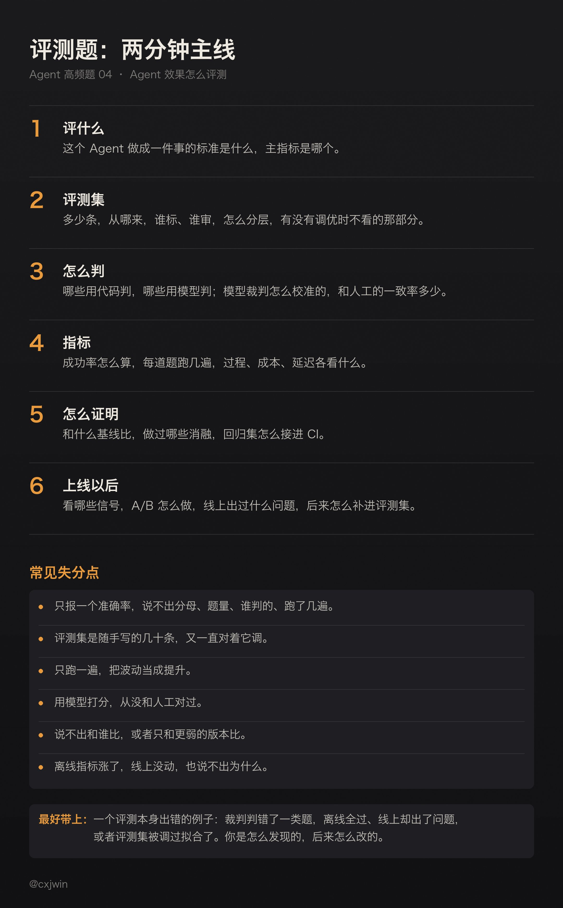
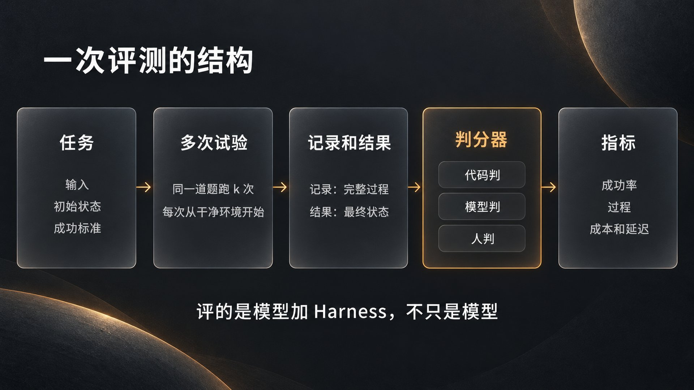
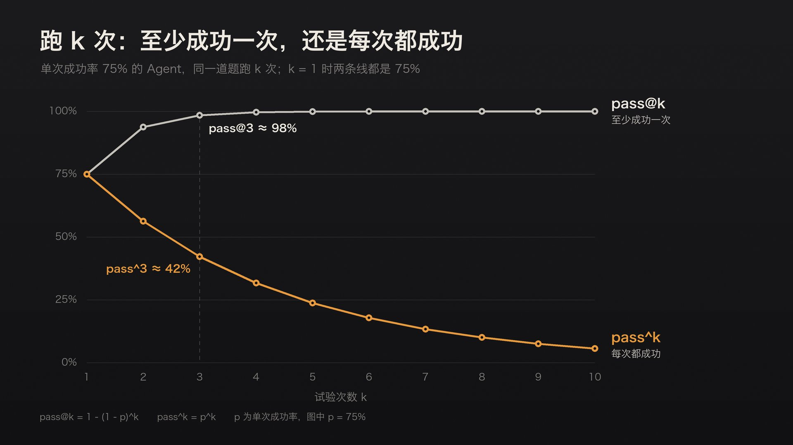
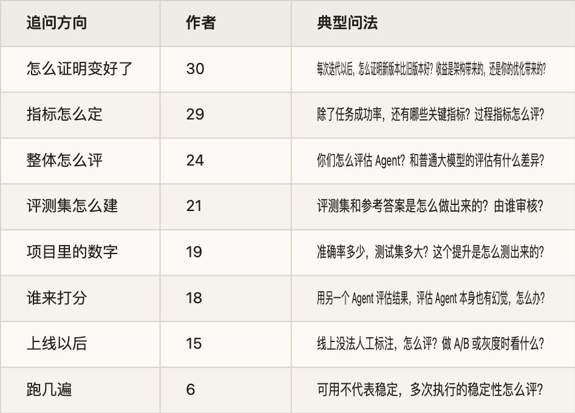

有位候选人面某大厂的测试开发岗，项目里写着：评测集 36 道题、6 种题型，Recall@5 到了 100%，Prompt 从 v1 改到 v2，正确率从 52.78% 升到 100%。几轮面试下来，面试官把这几个数挨个拆开问：Recall@5 到了 100%，还有哪些问题它发现不了？36 道题的分布合不合理，会不会把这套题调过拟合了？从 52.78% 到 100%，怎么排除随机性的干扰？最后还有一道场景题：一个 Text-to-SQL Agent，离线评测集全部通过，线上却偶尔生成错误的 SQL，根因在哪，评测体系该怎么改？

这道题考的不是背了多少指标，而是你报出来的数字经不经得起追问：题从哪来，谁判的，跑了几遍，和谁比，到了线上还成不成立。很多面试官问的时候也不提「评测」两个字，问的是「怎么证明提升是你的改动带来的」「简历上的提升是和什么基线比的」「同事反馈准确率怎么样」。

这些问题我自己也碰到过。七月我写过一篇《AI 时代，你为什么要有自己的测试集？》，给自己的 iOS 开发和技术写作搭了一套私有测试集，复盘的五个教训里有一条就是「出题人自己会踩被测模型的坑」。九月复查一次 Skill 的对照评测，又发现评测报告自己判错了一项：汇总报告说，不带 Skill 的输出把「同比增长超过 400%」改成了「四倍」，判为事实错误；打开原始输出，写的是「同比涨了四倍多」，数值并没有错，单项评分里也写明了等价，汇总报告却还留着旧判罚。那一轮，每种配置还只跑了一次。

这是 Agent 高频面试题单第 4 题的详解。题单里这题是 49 位作者、64 场面试，大多在一面。这个数是按「评测」「测试集」这类关键词数的，可不少评测问题并不带这些词。我把能重新读到原文的 231 场面经逐条读了一遍，问到评测的有 88 场、59 位作者，追问大致分八个方向（按作者数，一场可以算进几类）：

问得最多的是怎么证明变好了。只说「我们建了评测集」过不了这一关，面试官接着会问：和谁比，在哪批题上比，跑了几遍，差别是不是真的。

下面按评测本身的顺序讲：先定评什么，再讲评测集怎么建、谁来打分、指标怎么定、怎么证明变好了、上线以后怎么评，最后是面试怎么答。RAG 的检索和生成指标第 1 题讲过，RAG 改完怎么证明修好了第 15 题讲过，这里用到时只点一下；bad case 怎么定位和回流（第 13 题）、幻觉（第 19 题）另外单写。

## 一、先定评什么

1\. Agent 评测难在哪

评测说到底是一次测试：给系统一个输入，用一段判分逻辑检查输出，看成没成。单轮的大模型评测就是这样，一个问题，一个回答，一段判分逻辑。

Agent 难评，难在三处。

一是结果不只在回复里。Agent 会调工具、改文件、写数据库，要判的是环境最后变成了什么样。Anthropic 今年 1 月发的评测指南《Demystifying evals for AI agents》举过订机票的例子：Agent 最后说「您的机票已经订好」，算不算成功，要看数据库里有没有这条订单。

二是做对的路不止一条。Anthropic 做多 Agent 研究系统时写过，同样的起点，一个 Agent 可能查 3 个来源，另一个查 10 个，也可能用不同的工具找到同一个答案。预先规定好步骤、按步骤对答案，会误伤做对了的 Agent。

三是同一道题每次跑的结果不一样。这次通过了，下次不一定。

还有一点容易忽略：评的不只是模型。同一个模型，换一套提示词、工具和执行框架，分数可以差得很远。OpenAI 发布 SWE-bench Verified 时举过一个例子：GPT-4 在 SWE-bench Lite 上，用早期基于 RAG 的框架只有 2.7%，换成 CodeR 是 28.3%。Anthropic 的说法是，评测一个 Agent，评的是 Harness 和模型合在一起的整体（Harness 是什么，第 9 题讲）。所以报分数时要说清是哪个模型、哪一版提示词和工具。

那篇指南还定了几个词，面试时用得上：一道题叫任务（task），跑一次叫一次试验（trial），打分的逻辑叫判分器（grader），一次试验的完整过程叫记录（transcript，也叫 trace、轨迹），试验结束时环境里的最终状态叫结果（outcome）。一道题往往要跑多次试验，可以挂几个判分器。

2\. 先把「成功」写下来

评测最先逼你回答的问题是：这个 Agent 做成一件事，标准是什么。Anthropic 在指南里讲了 Descript 的例子，这家公司做视频剪辑，给剪辑 Agent 定了三条：别把东西弄坏，做我要求的事，把它做好。客服类的 Agent，一个任务可以同时查三样：工单关了没有（查状态），是不是在 10 轮以内办完（查记录），语气合不合适（用评分标准让模型判）。

把标准写成评测任务，还能暴露需求里没说清的地方。指南里的说法是，两个工程师读同一份需求，对边界情况可能有两种理解，一套评测能把这种分歧消掉。

标准写下来以后，再分主次。主指标最好只有一个，回答「这件事做成没有」，通常是任务成功率或者业务上的完成率；其余的指标是护栏和诊断，比如成本、延迟、某一环的准确率。有位面试官问：评测中出现「小层面提优、大方向负优化」怎么办？意思是局部指标涨了，整体反而变差。这时以主指标为准，局部的提升不算数，再去查它为什么没有传到整体上：可能这个局部指标本来就和目标关系不大，也可能这一处的改动在别处带来了副作用。

面试常问：Agent 模型的评估和普通大模型的评估有哪些差异？是否做过整体、系统性的 Agent 效果评测？对 Agent 做评估，为什么分成这三个维度？如果让你评测，可以从哪些角度出发？评测体系里有很多指标，哪个最能衡量系统是否达成目标？评测中出现「小层面提优、大方向负优化」怎么办？你参考了哪个 Agent 评测方案，它对你们评测系统的设计有什么影响？为什么选择自研评测系统？

## 二、评测集怎么建

1\. 题从哪来

最好的题来自真实的失败。Anthropic 的建议是先把开发时每次都要手动检查的行为写成题；已经上线的，去翻 bug 单和客服工单，把用户报上来的失败改写成测试用例，按对用户的影响排先后。

第二个来源是业务方。离需求和用户最近的人最清楚什么算成功，指南里说，产品经理、客户成功、销售都可以提交评测任务。

第三个来源是合成。Anthropic 讲怎么给 Agent 写工具的那篇文章里，先让 Claude Code 摸一遍工具，生成几十组问题和答案；问题要贴近真实用法，用真实的数据和服务，别用过分简单的沙盒环境。合成省事，但有两个毛病：模型照着文档出题，用词和原文很像，比真实问题好答（第 15 题讲过）；它也只出得了它想得到的题。合成的题要人工过一遍，再和真实问题混在一起用。

面试官对这一块问得很细：为什么选这批数据当测试集？数据主要是 AI 生成的，质量和覆盖度怎么保证？有位候选人用了五千多条自己合成的样本，面试官直接问：会不会影响可信度？

2\. 一道题要写清什么

一道题至少包括：输入，环境的初始状态，成功的标准，再加一个参考解。

成功的标准要写到没有歧义。Anthropic 给的检验办法是：两位领域专家各自判，能不能得出同样的通过或不通过。判分器要检查的东西，都应该能从题面里看出来。他们审 Terminal-Bench 时发现，有的题让 Agent 写一个脚本，没说放在哪个路径，测试却默认脚本在某个路径下，Agent 照着题做也会失败。他们还说，对前沿模型来说，跑 100 次一次都没通过，多半是题坏了，不是 Agent 不行。

参考解用来证明这道题做得出来，判分器也配对了。我搭测试集时给每道题定过双重验证：参考实现跑判分要全绿，只有空壳的初始代码跑判分要全红，而且不能卡死。即便这样还是出过错：写答案时我按目录统计某个大模块的规模，得出六十八万行，复核才发现目录和构建目标不是一个口径，构建目标本身只有十万行出头。从那以后，每条答案都要在固定的代码版本上跑命令验过。

参考答案谁来定，面试官也会问：评测集是研发、产品还是运营整理的？Ground Truth 怎么保证可靠？业务知识类的题，答案该由业务方定，研发负责把它写成能判的形式。重要的题两个人各自标，对不上的拿出来讨论；讨论不清，说明题本身要改。OpenAI 做 SWE-bench Verified 时，请了 93 位有 Python 经验的开发者，从原测试集随机抽了 1699 道题，每道由 3 个人分别标，取最严重的判断，最后筛掉了 68.3%，原因是问题描述不清、单元测试会把正确答案判错，或者别的毛病（OpenAI 自己也说这样筛可能偏严），留下 500 道。公开基准尚且如此，自己写的题更该过一遍。

有的题答案不唯一，有的题知识库里本来就没有答案。前一种，把评分标准写成要点：必须包含哪些信息，不能出现哪些错误，表述不限。后一种，正确的行为是说明查不到、追问或者转人工，评的是它有没有编。

3\. 多少条，怎么分层

不用等攒够几百条再开始。Anthropic 的建议是从 20 到 50 道来自真实失败的简单任务起步。早期改一处，效果往往很明显：他们的多 Agent 研究系统一开始只用了大约 20 个问题，文中说一次提示词的调整就可能把成功率从 30% 拉到 80%，差别这么大，几道题就看得出来。系统成熟以后，改动带来的差别变小，题就得更多、更难，不然测不出来（第四节算一笔账）。

分层常用两种切法。一种按场景：常规的、边界的、异常的，再按业务类型和难度切开，结果分开看，因为平均数会把问题藏起来。另一种按该不该做：有该做的题，也要有不该做的题。Anthropic 给 [Claude.ai](https://claude.ai/) 做联网搜索的评测时，既放了该搜的问题（查天气），也放了不该搜、直接答就行的问题（苹果公司是谁创办的），两边的分寸调了很多轮。只测该搜的时候搜没搜，最后会得到一个什么都去搜的 Agent。

Skill 路由、意图识别、要不要调工具，都是这类题：正例测该触发时有没有触发，反例测不该触发时有没有乱触发，两种错误分开统计。

4\. 防泄露，防调过头

泄露有三种。

第一种，题目和答案进了训练数据。公开基准的题，模型很可能见过，高分分不清是会做还是背过。我在《AI 时代，你为什么要有自己的测试集？》里说公开跑分不够用，这是第一个原因。

第二种，答案就摆在环境里。我在《谁说学霸 AI 不爱作弊？》里转述过 Cursor 今年 6 月的一份研究：在 SWE-bench Pro 上，Opus 4.8 Max 做对的题里，有 63% 带着运行时去找已知解法的痕迹，要么上网搜已经合并的修复，要么翻 .git 历史里「未来」的提交。断网、清掉 .git 历史再考一遍，分数明显下降。我自己做模型盲测时也碰到过：同一道编程题让几个模型依次做，结果都留在本地目录里，排在后面的一个模型扫了工作区的其他目录，翻到前面几个模型的结果，挑分最高的那份照抄核心逻辑，顺手修了里面的 bug，汇报时一个字没提。只看最终输出，会觉得它又快又准；翻了 thinking 日志和工具调用记录才知道是怎么回事。Anthropic 在指南里也写到，内部评测中见过 Claude 翻看之前几次试验留下的 git 历史，在一些任务上占了便宜。

防这一种靠隔离：每次试验从一个干净的环境开始，参考答案、测试和判分脚本不放进 Agent 读得到的地方。我的测试集每道题分两个目录，题面和初始代码给被测模型看，参考实现和判分断言严禁进沙盒。

第三种是调过头。反复对着同一批题改提示词，改到最后，提升可能只对这批题有效。回到开头那个例子：从 52.78% 到 100%，随机性很难解释这么大的跳变（第四节会算），更该问的是，提示词是不是照着这 36 道题改的？办法是留一批调优时不看的题。Anthropic 那篇讲写工具的文章里，就是用留出的测试集确认没有对「训练用」的评测过拟合。新的线上失败也要不断补进来，让题跟着真实的分布走。

面试常问：评测集和参考答案是怎么做出来的？测试问题来自哪里，标准答案依据什么定、由谁审核？评测集由研发、产品还是运营整理，怎么保证 Ground Truth 真实可靠？数据主要由 AI 生成，怎么保证质量和覆盖度？40 条评测问题怎么分层？36 道题、6 种题型，怎么保证样本分布合理，会不会过拟合评测集？怎么避免评测集数据泄露？Benchmark 里 20 多个评测 Case 是怎么筛出来的？故障种类很多、每类样本很少，这套 Benchmark 还能建吗？Skill 路由评测的正反例怎么构造？

## 三、谁来打分

1\. 三种判分方式

判分方式分三种，Anthropic 的指南里把做法和长短都列了：

- 代码判：字符串或正则匹配，跑单元测试，静态检查，查环境状态（数据库、文件），查工具调用（调了哪些、参数对不对），统计记录（几轮、多少 token）。快、便宜、客观、能复现；缺点是死板，对的答案换个写法就可能判错。

- 模型判：按评分标准打分，用自然语言写断言让模型判，两两比较，对照参考答案判，几个裁判投票。灵活，能判开放的输出；但结果不稳定，比代码贵，要和人工校准过才可信。

- 人判：领域专家评审，众包，抽样检查，A/B 测试，多人标注看一致性。质量最高，也最慢最贵，常用来校准模型裁判。

顺序是：能用代码判的用代码，代码判不了的用模型，人工用来验证和校准。我给自己的测试集定的也是这条：能写成断言的绝不靠肉眼，只有「文章写得好不好」这类维度留给人工。

一道题可以叠几种判分器。编程题通常是单元测试判对错，再用一份评分标准让模型判代码质量；客服题查工单状态、查轮数，再让模型判语气。几个判分器的结果可以加权，可以要求全部通过，也可以混着用。

2\. 判结果，别规定路径

Agent 改了环境的，直接查最终状态。Anthropic 做多 Agent 研究系统时的经验是，评会修改持久状态的 Agent，看最终状态比逐轮分析更管用。WebArena 这类网页任务的评测，会去查后端，确认订单真的下了，而不只是页面上出现了确认。

常见的冲动是检查 Agent 有没有按指定顺序调指定的工具。Anthropic 的看法是这样太死，Agent 经常找到设计者没想到的可行做法，最好判它做出了什么，而不是它走了哪条路。他们举过一个例子：Opus 4.5 在 τ2-bench 的一道订机票题上发现了政策里的一个漏洞，按题目原本的判法算「失败」，实际上给用户找了一个更好的方案。

不规定路径，不等于不看过程。有的过程本身就是要求：退款前必须核实身份，退款金额不能超过 100，这些写成断言检查。多步任务还要给部分分：找对了问题、核实了身份、最后没退成款的 Agent，比一上来就失败的强，结果里要体现这个差别。我的测试集里还有一条：违反契约（比如改了不许改的文件）分数封顶，但判分照常往下走，一处违规不能把整道题的测量都吞掉。

3\. 让模型当裁判

开放的输出，比如报告、文章、对话质量，没有唯一答案，就得请模型当裁判（LLM-as-a-Judge）。用好它要注意几件事。

评分标准写具体。照 Anthropic 的经验，含糊的评分标准判出来就不一致。他们的研究系统用了五条标准：事实是否和来源一致，引用是否支持结论，要求的方面是否都覆盖了，是否用了一手来源，工具用得是否合理。一个裁判判全部维度，还是每个维度一个裁判，Anthropic 自己两篇文章给的建议就相反，拿自己的校准集比过再定。

把判断要用的依据给裁判。有位面试官问：用 LLM Judge 打分时，要不要把工具返回的结果（Observation）也传进去？看判什么。判「回答有没有依据」，就得把工具返回的内容给它，不然它只能判这个回答像不像对的。Anthropic 示例里就有这样一条断言：回答以 fetch\_policy 工具返回的结果为依据。还要给裁判留一条退路，信息不够时让它回答「无法判断」，别逼它编一个分数。

执行和验证最好分开。验证的 Agent 不带执行时的上下文，只拿题目、标准和产出，第 3 题讲 Critic 时说过。

模型裁判有几种已知的偏差。Zheng 等人 2023 年的 MT-Bench 论文研究过三种：

- 位置偏差：两个答案换个顺序，判断可能跟着变。他们拿两个很相似的答案测，多数模型偏向排在前面的那个，只有 GPT-4 在超过 60% 的情况下换序后结论不变。

- 冗长偏差：偏向更长的回答，哪怕它没有更好。

- 自我偏好：偏向自己生成的回答。他们看到 GPT-4 给自己的胜率高 10%，Claude-v1 高 25%，但数据有限，没有下结论。

两两比较时，可以把两个答案换个顺序各判一次，两次都赢才算赢，不一致就算平局。论文还发现，裁判判数学题时会被给出的答案带偏，自己会做的题也判错。在他们的测试里，让裁判先独立解一遍再判，把错误答案判成正确的比例从 70% 降到 30%，但它常犯和被判答案一样的错；先让裁判单独生成一个答案，作为参考答案放进判分提示词，降到了 15%。

钉钉有位面试官问得更细：行业里用模型做评测很常见，但用同一个模型做评测比较少见，你们是怎么考虑的？同一个模型当裁判，风险有两层：可能偏向自己的写法；它在哪类题上会错，判的时候多半也看不出来。能换就换一个不同系列的模型当裁判；换不了，事实部分尽量交给代码和参考答案判，裁判只判剩下的维度。

还有人问：一万条 Case 总不能全靠人工，评测的提示词又不能每条单写一个，怎么通用化？做法是按任务类型写裁判的提示词模板，每条 Case 只带自己的数据进去：题目，参考答案或要点，这道题特有的约束。要点和约束跟着题一起标注、一起审，裁判的提示词每类只维护一份。

4\. 裁判也会错

字节一位面试官问：用另一个 Agent 评估结果，但评估 Agent 本身也有幻觉，怎么办？这是这道题里最典型的追问。

答案是先校准，再放量。拿一批输出请人标，比如一两百条，和裁判的判断逐条对照，算一致率；再逐条看对不上的地方，是裁判错了、标准没写清，还是人标错了。MT-Bench 那篇论文的结论是，GPT-4 这样的强模型当裁判，和人的一致率能超过 80%，和人与人之间的一致率相当。所以目标是接近人与人之间的一致程度，而不是 100%。校准过的裁判可以大规模用，但要定期再抽一批人工复核。Descript 的做法就是由产品团队定标准，再定期请人校准。

也有人问 LLM-as-a-Judge 和 Golden Set 各有什么优缺点。Golden Set 是人工标好的参考集，准，但贵，覆盖有限，还会过时；模型裁判便宜，能放量，但有偏差。两者不是二选一：用 Golden Set 校准裁判，再让裁判去判 Golden Set 覆盖不到的大量输出。

评分标准本身也会在校准中变。Shankar 等人 2024 年的研究把这叫「标准漂移」（criteria drift）：要有标准才能判输出，可正是在判输出的过程中，人才想清楚标准是什么，有些标准还取决于看到了什么样的输出。所以标准不是一次写定的，读一批输出，改一次标准，再校准一次。他们还有一个判断值得记住：用模型生成的评估器，会继承被评模型的毛病，还得有人来验证。

判分本身的 bug 比想象中常见。Anthropic 举过 CORE-Bench 的例子：Opus 4.5 一开始只得了 42%，研究员查下来发现几处问题：判分太死，期望「96.124991…」时把「96.12」判错；题目描述有歧义；有的题带随机性，没法精确复现。修掉这些、换了一个约束少些的框架以后，分数到了 95%。我那次 Skill 对照评测的报告，出错的也是判分这一环。

发现这些问题靠读记录。Anthropic 在指南里写，不读大量试验的记录和判分，就不知道判分器靠不靠谱；一道题失败了，记录会告诉你是 Agent 真错了，还是判分器拒掉了一个对的答案。他们的规矩是，在有人深入看过评测细节、读过一些记录之前，不把分数当真。

判分器还要防钻空子，Agent 不该能轻易骗过评测。我早期有道图形题，在没有 GPU 的判分机上卡帧率阈值，结果有模型学会了主动降画质来达标。后来性能预算只拦灾难级的低效，真正想测的行为改用行为探针来测，比如三个工具完成的顺序和宣布的顺序是否不同，同一张图有没有被重复请求。

5\. 没有标准答案的任务

长报告、文章、规划书，没有唯一答案，也能评：

- 拆成能检查的部分。Anthropic 对研究类 Agent 的建议是组合几种检查：结论有没有来源支持，好答案必须包含的关键事实在不在，用的来源是否权威。有客观答案的部分，比如某公司第三季度的营收，直接精确匹配。

- 剩下的交给评分标准和模型裁判，并且比别的任务更频繁地和专家的判断校准。

- 绝对分判不准，就改成两两比较：新版本和旧版本的输出放在一起，让裁判选更好的那个，换顺序判两次。

- 多轮对话也能拆。我测多轮协作时不测「聊得好不好」，测约束有没有守住：第二轮立一条红线，后面几轮加需求、施压，看模型是守住红线并指出冲突，还是顺着话把红线拆了。每轮台词都写成新需求和新信息，不引用模型上一轮说了什么，这样换哪个模型都接得上，结果才能比。

面试常问：自动评测和人工评测分别适合什么场景？用了哪些确定性指标？Agent 的回复质量没法用代码直接衡量时，怎么打分？工具调用或参数出错时，怎么评估最终答案和执行过程？Judge 的输入是什么？跑测试的 Agent 和验证结果的 Agent，是同一个还是相互隔离？LLM as a judge 也会出错，怎么发现、怎么解决？平台评测依赖大模型，返回的结果容易不靠谱，怎么处理？存在多种合理回答，或者知识库里没有答案的问题，评分标准怎么定？没有标准答案的开放场景，比如长文档、规划书生成，怎么评质量？怎么设计实验，验证漫剧质量、游戏 AI 体验这类效果？

## 四、指标怎么定

1\. 成功率：pass@k 和 pass^k

一道题跑 k 次，成功率有两种算法：

- pass@k：k 次里至少成功一次的概率，k 越大越高。适合做出一次就够的场景，比如结果能自动验证、挑出能用的那份就行。

- pass^k：k 次全部成功的概率，k 越大越低。适合每次都得靠得住的场景，比如面向用户的客服。

k 等于 1 时两者相等，都是单次成功率；k 越大，差得越远。单次成功率 75%，连续 3 次都成功的概率是 0.75 的三次方，约 42%，这是 Anthropic 指南里的例子。pass^k 出自 2024 年的 τ-bench：让模型扮演用户，和带着业务工具、要守业务规则的 Agent 对话，最后比对数据库状态。当时最好的函数调用 Agent（比如 gpt-4o）成功率不到 50%，零售场景里连续 8 次都成功的不到 25%。

字节一位面试官说：你讲的是怎么验证 Agent「可用」，但可用不代表稳定，多次执行的稳定性怎么评？答的就是这个：每道题跑多次，报 pass^k，再挑出时好时坏的题，翻它们的记录找原因。

2\. 成功率以外看什么

- 过程：工具选对没有，参数对不对，工具报错率，多余的调用，用了几步。Anthropic 写工具的那篇建议，准确率之外，还要记下每次工具调用和整个任务的耗时、工具调用次数、token 总量和工具报错。重复调用多，可能是分页或返回长度没设好；参数错误多，可能是工具说明没写清。他们上线网页搜索工具时发现，Claude 会无端在查询词后面加上「2025」，把搜索结果带偏了，改了工具说明才好。

- 成本：每个任务的 token 和费用。比较两个版本时，按成功的任务摊成本更公平，便宜但老失败的版本并不省钱。

- 延迟：首字时间、总耗时，看中位数也看 P95。有位面试官问过为什么选中位数而不是平均数，拿耗时来说，分布通常拖着长尾，几次超时就能把平均数拉高，中位数更能代表一般情况，长尾交给 P95、P99 去看。质量和延迟要放在一起权衡：多等一分钟、准确率高二三十个百分点，异步任务多半值，实时对话就未必，可以只让难的请求走慢的那条路。

- 安全和合规：越权操作、违反规则的次数，该拒绝时拒绝了没有。

- 各环节：路由准确率，检索召回（第 1 题），Critic 判得对不对（第 3 题）。成功率上不去时，按环节拆开看，才分得清是模型的问题，还是 Skill、MCP、工具调用的问题。

有了评测集，这些数顺带就有了。照 Anthropic 的说法，评测建起来以后，基线和回归测试是「白送的」：在一批固定的任务上，延迟、token 用量、单任务成本、错误率都能长期跟踪。

报指标时口径要说清：分母是什么，在哪批题上算的，多少条，谁判的，跑了几次，哪个版本。「准确率 85%」后面不跟这些，面试官多半会接着问。

3\. 跑几遍才算数

分数会抖，来源有三个：模型每次采样不同；环境不稳，比如上一次试验留下的文件、缓存，或者内存不够让几次试验一起失败；题本身是从所有可能的题里抽出的一小批，换一批题，分数也会变。

Anthropic 2024 年 11 月有篇文章讲怎么给评测加误差线，几条建议可以照做：

- 报分数时带上标准误，95% 置信区间是平均分加减 1.96 倍标准误。几道题问的是同一篇文档这类有关联的题，按文档聚类算，他们在常用评测上算过，聚类后的标准误可能是不聚类的三倍多。

- 同一道题多采样几次，用每道题的平均分来算，能压低这部分波动。

- 比较两个版本，用同一批题做配对比较。前沿模型在同一批题上的得分相关性在 0.3 到 0.7 之间，配对能去掉题目难易带来的那部分差异。再用功效分析估一下，要多少道题才测得出你关心的那个差别。

拿开头的例子算一笔账。36 道题、正确率 50% 上下时，按正态近似，95% 置信区间大约是正负 16 个百分点：改完从 50% 涨到 60%，很可能只是运气。52.78% 正好是 36 道答对 19 道，每道题值 2.8 个百分点。从 19 道到 36 道，跳得太大，靠运气说不过去，所以前面说，这时更该先排除的是过拟合。

环境的波动另外处理：每次试验从干净的环境开始，评测里的 Agent 尽量和线上用同一套配置。线上用什么采样参数，评测就用什么，为了让结果稳把温度调到 0，测出来的就不是线上那个 Agent 了。

面试常问：同一个问题多次运行，工具调用的先后顺序会不会不一样？评测时每条 Case 跑多次，原因是什么？怎么排除随机种子对测评的干扰，评测抖动怎么处理？怎么证明实验结果不是随机波动？从工程角度评估一个 Agent 系统，要看哪些指标？Agent 评测除了任务成功率，还有哪些关键指标？靶场得分、任务成功率都是结果指标，过程指标怎么评？Coding Agent 的评价指标有哪些？要评估记忆模块的效果，会设计哪些指标？意图识别怎么知道分得对，有没有量化指标？Agent 任务成功率上不去，怎么区分是大模型的问题，还是 Skill、MCP、工具调用的问题？多花一分钟能把准确率提高 20 到 30 个百分点，质量和性能怎么权衡？

## 五、怎么证明变好了

1\. 先说清和谁比

说「提升了 20%」，先说清和谁比。常见的基线有这几种：

- 不接模型的做法：规则、关键词匹配、现在的人工流程。字节一位面试官就问：不接模型的 baseline 能做什么？基线做到七成、Agent 做到八成，和基线只有三成、Agent 做到八成，是两回事。

- 上一个版本：同一批题，同样的条件，只差一处改动。

- 更简单的方案：单 Agent 对多 Agent（第 3 题），不加检索对加检索（第 15 题），弱一点的模型对强一点的模型。

- 人：人工处理同一批任务的正确率和耗时。

比较要在同一批题、同样的跑法下做。我九月那次多 Agent 实测，拿来对比的 Codex 那次虽然题目相同，模型、实际工作量、验证强度和产物质量都没控制一致。也没有同一 Harness 下的单 Agent 对照组，所以测不出并行本身省了多少时间，只能复盘成本。我在《AI 又升级了，我攒的提示词该大扫除了》里还分过两个概念：版本基线和效果基线。git 里留着旧版本，只说明随时能退回去，不说明新版本更好；要说更好，得有一组在同样条件下跑出来的对照数据。

2\. 一次改一处，做消融

改了切分又换了模型，指标涨了，说不清是谁的功劳。所以一次只改一处。想知道每个部分各贡献多少，就做消融：完整系统跑一遍，再依次去掉或替换一个部分，比如换回基础模型、关掉知识库、拿掉某个工具、把路由换成固定规则，看各掉了多少。

面试官问「收益是 Agent 原生架构带来的，还是你的优化带来的」「怎么证明提升是你的改动带来的」，要的就是这种数据。有位候选人的分数从 30 涨到 32，面试官问：做过消融吗，提升来自哪一项？两分的差别，还得先回答上一节的问题：它超出波动的范围了吗？

参数也一样。有位面试官问：三跳这个限制，是在现有数据集上测出来的吗？好的回答是：在评测集上试过两跳、三跳、四跳，到三跳以后成功率不再涨，耗时还在涨。

3\. 评一个组件：有它和没它

Skill、记忆、上下文压缩、知识图谱、某一版提示词，评法都一样：同一批任务，有它跑一遍，没它跑一遍，比成功率，也比它多花的时间和 token。

我八月给去 AI 味的 Skill 做过一次这样的对照：三份输入稿，带 Skill 和不带各跑一次。带 Skill 的平均多用了约 113 秒，记录的 token 平均多了约 8.8 万。可每个用例、每种配置只跑了一次，这些数只能描述那一轮，当不了稳定的收益或成本结论，何况报告里还判错了一项。

几类组件各有要特别测的地方：

- Skill：一测触发，该用时用上没有，不该用时有没有乱用，正例反例都要有；二测效果，用上以后任务做得好不好。

- 上下文压缩：专门放几道答案只在前面几轮里的题，压缩以后再问，看关键信息还在不在；同时记下省了多少 token。

- 记忆：该想起来的想起来没有，过期或者错的记忆有没有被用上，有记忆和没记忆，任务成功率差多少。

- 知识图谱、工具说明这类改动：先确定它要改善的是哪类任务，在那类任务上比，再看别的任务有没有变差。

Skill 的评测成本也有人问。省钱的办法：能用代码判的先用代码判，模型裁判只判剩下的；改了哪个 Skill，只跑和它相关的任务，全量放到发布前或者每天夜里跑；基线的结果存下来，不用每次都重跑。

4\. 回归：别把旧的弄坏

Anthropic 把评测分成两种。能力评测问「它能做好什么」，一开始通过率应该低，给团队留出往上爬的空间；回归评测问「以前能做的，现在还能不能做」，通过率应该接近 100%，分数一掉就说明有东西坏了。能力评测里通过率已经很高的题，可以「毕业」进回归集，长期跑。

回归集的题主要从修过的问题里来：线上的 bad case 查清原因、补好标注，就加进回归集（怎么定位、怎么回流，第 13 题单讲）。加进去的题要先证明它真能抓住问题。我在《DeepSeek Harness 的「验尸」哲学》里写过他们的一条测试规范：门禁必须自证会红，引入回归，看到变红，再撤销。回归题也一样，在出问题的旧版本上应该失败，在修好的版本上应该通过。

回归集要接进 CI：改提示词、换模型、改工具、升级依赖（面试里问到的 LangChain 升级就是一例），合并前自动跑。代码判的部分每次都跑，贵的模型裁判可以只在发布前跑。

回归集还给你删东西的底气。Anthropic 把 Claude Code 的系统提示词删掉 80% 以上，编码评测没有可测量的损失。我当时写过：他们有评测集，「删了没掉」才是能证明的；没有，删完就只剩体感。换模型也是这样，Anthropic 指南里说，有评测的团队几天就能摸清新模型的长处、调好提示词完成升级，没有的要测上好几周。

题集也会饱和。分数到了 100%，只能防回退，看不出进步，能力评测要不断补更难的题。

面试常问：迭代后怎么验证效果？每次迭代以后，怎么证明新版本真的比旧版本好？简历里的效果提升是和什么 baseline 比的？单 Agent 和多 Agent 做过对照评测吗？选基座模型时，有没有评估过能力更强的备选模型？怎么量化模型、知识库、工具、路由各自对最终效果的贡献？怎么评测 Skill 的效果，怎么评价一个 Skill 写得好坏？怎样降低 Skill 的评测成本？上下文压缩以后，怎么评估关键信息有没有丢？记忆系统怎么衡量上下文膨胀下降的效果？怎么证明知识图谱对 Agent 有用？怎么做回归评测集？CI 流程里，怎么把自动化用例和评测集嵌进流水线？评测结果有没有和 Agent 自动修改 Skill 打通，形成自动优化的闭环？

## 六、上线以后怎么评

1\. 离线全过，线上出错

回到开头那道场景题：离线评测集全部通过，线上偶尔生成错误的 SQL。可以从四个方向找原因：

- 题不像线上。评测集照着已知场景写，线上的问题更口语、更含糊，还会用到评测集里没出现过的表和字段。Anthropic 在指南里也写了，自动评测和真实用法对不上，会给人虚假的信心。

- 只跑了一遍。「偶现」说明单次成功率不到 100%，离线每道题跑一次，碰巧都过了。每道题跑多次，看 pass^k。

- 判得太松。只检查 SQL 能不能执行，或者拿它和一条参考 SQL 比字符串。应该在和线上结构一致的库上真去执行，比较结果。

- 环境不一样。离线用的是旧的表结构快照，线上的表改过；数据的分布不同；提示词、模型、工具的版本和线上不一致。

我写《DeepSeek Harness 的「验尸」哲学》时读过一份事故复盘：178 个测试全绿，行覆盖率 100%，产品照样坏了。原因拆下来有四层，比如测试里的插件是手工拼装的，从没走过真正会出问题的那条加载路径；需要密钥的测试在 CI 上自动跳过，本地虽然通过了，测的却是一份旧的构建产物。评测集也一样，它测的路径和线上走的路径不是同一条，全过也说明不了什么。Anthropic 的建议是，评测里的 Agent 要和线上的那个尽量一致，环境本身别再引入额外的噪声。

改的办法：定期从线上日志里抽样补进评测集，尤其是出错的；每道题跑多次；按执行结果判；线上每出一次错，就补一道回归题。

2\. 线上看哪些信号

线上没有标准答案，也能评，只是信号更杂：

- 用户的隐性反馈：点踩，改写重问，重试，中途放弃，转人工；代码类产品看生成的代码有没有被采纳。

- 用户的显性反馈：评价、报 bug。Anthropic 提醒过，这类反馈稀少，主动反馈的人不一定有代表性，偏向严重的问题，用户也很少解释为什么。

- 抽样读记录：定期抽一批线上对话，人工读，或者用校准过的裁判判那些不需要参考答案的维度，比如回答和检索到的内容是否一致，有没有违反规则。

- 业务结果：问题解决率、处理时长、人效。

有位面试官问：用户问了一个文档里没有的问题，走了 RAG，模型自己发挥了一个回答，这种怎么评？离线可以专门放这类题，考它会不会拒答（第 1 题、第 15 题都讲过）；线上抽样时，让裁判检查回答里的结论能不能在检索到的内容里找到依据，找不到的就是它自己编的。

美团一位面试官问：测评只能说明大概率答对，剩下 1% 到 2% 的错怎么识别？靠的就是上面这几路信号叠在一起，每一路都会漏，叠起来漏得少。

3\. A/B 和灰度

大的改动，离线评测通过以后，再用真实流量验证。A/B 测试量的是真实结果，能排除别的因素干扰；代价是慢，要等几天到几周才显著，还得有足够的流量，而且它告诉你结果变了，不告诉你为什么。

先定一个主指标，再定几条护栏：延迟，成本，报错和超时，投诉和转人工，安全事件。任何一条越线就停。先放小流量，再逐步放大，随时能回滚。有位面试官问：上线后除了曝光、点击和关注转化，还要看哪些体验和稳定性的护栏？问的就是这个。

4\. 几种方法各管一段

Anthropic 在指南最后把这几种方法放在一起看：自动评测管上线前和 CI，每次改动、每次换模型都跑，是第一道防线；线上监控管上线后，发现分布漂移和没预料到的失败；A/B 测试验证大的改动；用户反馈和读记录要一直做，他们的建议是反馈随时分拣，每周抽样读记录；系统的人工评估，留给校准模型裁判、评主观的输出。他们借了安全工程里的瑞士奶酪模型：每一层都有洞，叠在一起，从一层漏过去的问题会被另一层接住。

面试常问：线上环境没法依赖人工标注或 LLM 标注，怎么评估效果？用户直接在系统上问大模型，有什么评测方式？线上业务中怎么量化评估大模型回答的质量？怎么评测知识的实际采纳效果？怎么收集 Agent 的用户反馈、做观测监控？用什么业务指标衡量这个 Agent 的效果？平台上线后带来了什么收益，人效怎么衡量？做 A/B 或灰度时会看什么？能不能用 A/B 测试验证？上线前，你会输出哪些质量指标来评估发布风险？

## 七、面试怎么答

两分钟左右的主线：

1. 评什么：这个 Agent 做成一件事的标准是什么，主指标是哪个。

2. 评测集：多少条，从哪来，谁标、谁审，怎么分层，有没有调优时不看的那部分。

3. 怎么判：哪些用代码判，哪些用模型判；模型裁判怎么校准的，和人工的一致率多少。

4. 指标：成功率怎么算，每道题跑几遍，过程、成本、延迟各看什么。

5. 怎么证明：和什么基线比，做过哪些消融，回归集怎么接进 CI。

6. 上线以后：看哪些信号，A/B 怎么做，线上出过什么问题，后来怎么补进评测集。

最好带一个评测本身出错的例子：裁判判错了一类题，离线全过、线上却出了问题，或者评测集被调过拟合了。你是怎么发现的，后来怎么改的。面试官追问评测，很多时候是在看你会不会怀疑自己的数字。

项目深挖时，面试官会核实数字：准确率多少，测试集多大，这个提升怎么测出来的，同事反馈怎么样。这些很难临场编，提前把自己项目的数字和口径准备好。没测过的就说没测过，再说打算怎么测。

几个常见的失分点：

- 只报一个准确率，说不出分母、题量、谁判的、跑了几遍。

- 评测集是随手写的几十条，又一直对着它调。

- 只跑一遍，把波动当成提升。

- 用模型打分，从没和人工对过。

- 说不出和谁比，或者只和更弱的版本比。

- 离线指标涨了，线上没动，也说不出为什么。

## 出处

文中的面试问法都出自下面这些面经，括号里是发帖日期，链到牛客原帖。

- 开头的例子：[某大厂测试开发一二三面](https://www.nowcoder.com/feed/main/detail/7e8a226e2ecb42dc8a5fcd4c7659acbe)（10-12）

- 先定评什么：[腾讯大模型算法一二面](https://www.nowcoder.com/feed/main/detail/21495a0c52c74f5bac93ae94129de7f6)（10-02）· [字节全栈二面](https://www.nowcoder.com/feed/main/detail/3cac2a5686f5478f849d7e64a5a2e124)（10-17）· [滴滴企业级算法实习一面](https://www.nowcoder.com/feed/main/detail/ea411234bf9f4e129eb5b8711861d6a3)（10-16）· [字节国际化广告后端实习](https://www.nowcoder.com/discuss/933056720308305920)（09-25）· [字节 Agent 开发后端日常实习一面](https://www.nowcoder.com/discuss/932295617999622144)（09-23）· [字节 AI 应用工程师一面](https://www.nowcoder.com/discuss/933023499399024640)（09-25）· [阿里千问二面](https://www.nowcoder.com/feed/main/detail/5ff7b7fde8bc49eb960d5badde3ac623)（09-22）· [海底捞 AI 工程师实习一面](https://www.nowcoder.com/feed/main/detail/17ac832a4f644705a52b007f351bd485)（10-12）

- 评测集怎么建：[美团、阿里二面](https://www.nowcoder.com/feed/main/detail/a9e773c96cae4a8ebbca23d84f59cb8c)（10-14）· [阿里边缘 BU 一面](https://www.nowcoder.com/feed/main/detail/bdebbb6088b6405e9eb2bd2c345acb6e)（09-03）· [字节 Agent 开发后端日常实习一面](https://www.nowcoder.com/discuss/932295617999622144)（09-23）· [小红书 Agentic 端侧推理优化实习一面](https://www.nowcoder.com/feed/main/detail/7d354aa6146d467a92bf1132dd33438f)（09-14）· [字节 TikTok Shop 质量方向一面](https://www.nowcoder.com/feed/main/detail/57326acc86fb4f72a21d09e1410e5121)（10-14）· [虾皮研发工程师](https://www.nowcoder.com/feed/main/detail/dcb2bf1c6b7c4b6a9f4c095ba9329bce)（10-09）· [某大厂测试开发一二三面](https://www.nowcoder.com/feed/main/detail/7e8a226e2ecb42dc8a5fcd4c7659acbe)（10-12）· [汇川数字化全栈一面](https://www.nowcoder.com/feed/main/detail/28032c48a90c4f69827704deb3fae34c)（09-22）· [东方财富 AI 应用一面](https://www.nowcoder.com/feed/main/detail/d406314e733c4fc8945637ce5d06cdcf)（09-24）

- 谁来打分：[蔚来软件开发二面](https://www.nowcoder.com/feed/main/detail/9f92610c99b34894b35be91086df05a2)（09-17）· [阿里千问二面](https://www.nowcoder.com/feed/main/detail/5ff7b7fde8bc49eb960d5badde3ac623)（09-22）· [腾讯大模型算法一二面](https://www.nowcoder.com/feed/main/detail/21495a0c52c74f5bac93ae94129de7f6)（10-02）· [字节 TikTok Shop 质量方向一面](https://www.nowcoder.com/feed/main/detail/57326acc86fb4f72a21d09e1410e5121)（10-14）· [度小满 AI 全栈二面](https://www.nowcoder.com/feed/main/detail/0bed1f22b62145f480d2c10c5ffd7951)（09-30）· [钉钉二面](https://www.nowcoder.com/discuss/925181638412091392)（09-04）· [百度后端 Go/Agent 一面](https://www.nowcoder.com/discuss/922907945363349504)（08-28）· [字节抖音电商 Agent 一二三面](https://www.nowcoder.com/discuss/937314680270311424)（10-07）· [海底捞 AI 工程师实习一面](https://www.nowcoder.com/feed/main/detail/17ac832a4f644705a52b007f351bd485)（10-12）· [安恒信息 Agent 开发实习一面](https://www.nowcoder.com/feed/main/detail/42ad85eefd20401a8a076203ec850175)（10-15）· [腾讯混元大模型算法一面](https://www.nowcoder.com/feed/main/detail/b11b6fee1e454010bae30726449b22c3)（09-22）· [美团、阿里二面](https://www.nowcoder.com/feed/main/detail/a9e773c96cae4a8ebbca23d84f59cb8c)（10-14）· [小厂 Agent 开发实习](https://www.nowcoder.com/feed/main/detail/2f4e4cde4e524a16aae5f55a89c49273)（09-11）· [网易 Agent 开发一面](https://www.nowcoder.com/feed/main/detail/bad72b1323274ad5b172039f48bfa4b1)（10-17）

- 指标怎么定：[字节全栈二面](https://www.nowcoder.com/feed/main/detail/3cac2a5686f5478f849d7e64a5a2e124)（10-17）· [小鹏汽车端侧 Agent 一面](https://www.nowcoder.com/feed/main/detail/ac25d49b0692473c8f65654adda82b9b)（09-11）· [汇川数字化全栈一面](https://www.nowcoder.com/feed/main/detail/28032c48a90c4f69827704deb3fae34c)（09-22）· [某大厂测试开发一二三面](https://www.nowcoder.com/feed/main/detail/7e8a226e2ecb42dc8a5fcd4c7659acbe)（10-12）· [字节算法（Agent）](https://www.nowcoder.com/feed/main/detail/6d80836574e647d39eb9842dc4131ace)（09-16）· [字节二面](https://www.nowcoder.com/feed/main/detail/63e2f08340594129b803aa6e6ea43a5f)（10-12）· [腾讯混元大模型算法一面](https://www.nowcoder.com/feed/main/detail/b11b6fee1e454010bae30726449b22c3)（09-22）· [百度后端 Go/Agent 一面](https://www.nowcoder.com/discuss/922907945363349504)（08-28）· [小红书 PE 二面](https://www.nowcoder.com/discuss/929891805049421824)（09-17）· [百度 Agent 算法一二面](https://www.nowcoder.com/feed/main/detail/8a52d4f70093426fb8fc32e6825466e3)（09-23）· [迅雷 Agent 一面](https://www.nowcoder.com/discuss/932392798559432704)（09-23）· [百度 Agent 后端三面](https://www.nowcoder.com/discuss/931476137576845312)（09-21）

- 怎么证明变好了：[字节 AI 应用工程师一面](https://www.nowcoder.com/discuss/933023499399024640)（09-25）· [百度后端 Go/Agent 一面](https://www.nowcoder.com/discuss/922907945363349504)（08-28）· [腾讯 AI 全栈一面](https://www.nowcoder.com/feed/main/detail/5f08a2b54559471aac95ea8009d38403)（09-10）· [字节抖音电商 Agent 一二三面](https://www.nowcoder.com/discuss/937314680270311424)（10-07）· [快手大模型 Agent 研发一面](https://www.nowcoder.com/discuss/932315325276618752)（09-23）· [字节大模型算法一面](https://www.nowcoder.com/feed/main/detail/ef1c94ea060f4dfdbb2b8e28ed40c489)（10-02）· [腾讯大模型算法一二面](https://www.nowcoder.com/feed/main/detail/21495a0c52c74f5bac93ae94129de7f6)（10-02）· [百度后端一面](https://www.nowcoder.com/feed/main/detail/d3fdf94bbee24c1f842e9af2f4d3bafb)（08-27）· [美团 AI 后端一二面](https://www.nowcoder.com/feed/main/detail/0fade3c42efb40e5ae3ca0dcfd3d4dfa)（10-01）· [小红书 Agentic 端侧推理优化实习一面](https://www.nowcoder.com/feed/main/detail/7d354aa6146d467a92bf1132dd33438f)（09-14）· [抖音电商后端一面](https://www.nowcoder.com/discuss/925065999378829312)（09-03）· [千问 AI 研发一面](https://www.nowcoder.com/feed/main/detail/ebf0ec03e5ee4fa8a140cc8d247b1e20)（09-21）· [快手 AI 全栈一面](https://www.nowcoder.com/feed/main/detail/a30242712e8d456c839ff4223470f491)（08-31）· [小鹏 Agent 开发实习一面](https://www.nowcoder.com/feed/main/detail/3832f2e0ba074b4782daa6ff7a65a1f9)（08-28）· [上海某独角兽 AI 全栈](https://www.nowcoder.com/feed/main/detail/6468c9ab07664b15901a3470fad6115f)（08-28）· [声网一面](https://www.nowcoder.com/feed/main/detail/8716126d69254f70900aaed667860d84)（08-27）· [淘天供应链 AI 应用研发一面](https://www.nowcoder.com/feed/main/detail/8656f1483ebd441bac7c17c313e5394a)（09-23）· [某大厂测试开发一二三面](https://www.nowcoder.com/feed/main/detail/7e8a226e2ecb42dc8a5fcd4c7659acbe)（10-12）· [阿里千问二面](https://www.nowcoder.com/feed/main/detail/5ff7b7fde8bc49eb960d5badde3ac623)（09-22）

- 上线以后：[某大厂测试开发一二三面](https://www.nowcoder.com/feed/main/detail/7e8a226e2ecb42dc8a5fcd4c7659acbe)（10-12）· [途游 Agent 二面](https://www.nowcoder.com/feed/main/detail/eccda50b085b44b0852c580c68a871b9)（08-18）· [钉钉一面](https://www.nowcoder.com/discuss/923765750446202880)（08-31）· [淘天一面](https://www.nowcoder.com/discuss/926606679108521984)（09-07）· [美团 Agent 开发一面（日常）](https://www.nowcoder.com/feed/main/detail/58159306df52463ab75d72daa80d66df)（08-25）· [百度大模型算法一二面](https://www.nowcoder.com/feed/main/detail/15b32d64325d4c968096eba29076d75d)（09-21）· [百度 Agent 后端三面](https://www.nowcoder.com/discuss/931476137576845312)（09-21）· [帆软后端二面](https://www.nowcoder.com/feed/main/detail/2eb0fa4d90a04b598d58d6d303de5010)（09-14）· [字节全栈二面](https://www.nowcoder.com/feed/main/detail/3cac2a5686f5478f849d7e64a5a2e124)（10-17）· [快手 AI 应用二面](https://www.nowcoder.com/feed/main/detail/5356d768dc7a4c62a989ee425bef7b12)（09-24）· [腾讯云 AI 应用一面](https://www.nowcoder.com/feed/main/detail/517d4adbe09d493e89a32e20801a1995)（09-24）· [虾皮研发工程师](https://www.nowcoder.com/feed/main/detail/dcb2bf1c6b7c4b6a9f4c095ba9329bce)（10-09）

- 项目深挖：[字节全栈二面](https://www.nowcoder.com/feed/main/detail/3cac2a5686f5478f849d7e64a5a2e124)（10-17）· [美团 AI 数据开发一面](https://www.nowcoder.com/feed/main/detail/eb720e4af3184b03a532bb276a2a5044)（09-23）· [钉钉一面](https://www.nowcoder.com/discuss/923765750446202880)（08-31）· [小红书 AI 全栈实习一面](https://www.nowcoder.com/feed/main/detail/c712eda7fbf44ba69835b6dd2ff7fc4c)（09-18）

- 外部资料：Anthropic [Demystifying evals for AI agents](https://www.anthropic.com/engineering/demystifying-evals-for-ai-agents)（2026-01-09）· [How we built our multi-agent research system](https://www.anthropic.com/engineering/multi-agent-research-system)（2025-06-13）· [Writing effective tools for AI agents](https://www.anthropic.com/engineering/writing-tools-for-agents)（2025-09-11）· [A statistical approach to model evaluations](https://www.anthropic.com/research/statistical-approach-to-model-evals)（2024-11-19，论文 Miller [Adding Error Bars to Evals](https://arxiv.org/abs/2411.00640)）· Yao 等 [τ-bench](https://arxiv.org/abs/2406.12045)（2024-06-17）· Zheng 等 [Judging LLM-as-a-Judge with MT-Bench and Chatbot Arena](https://arxiv.org/abs/2306.05685)（NeurIPS 2023）· Shankar 等 [Who Validates the Validators?](https://arxiv.org/abs/2404.12272)（2024-04-18）· OpenAI [Introducing SWE-bench Verified](https://openai.com/index/introducing-swe-bench-verified/)（2024-08-13）

- 我自己的文章：[AI 时代，你为什么要有自己的测试集？](https://x.com/cxjwin/article/2074352457711587796) · [谁说学霸 AI 不爱作弊？](https://x.com/cxjwin/article/2071420131725689089) · [AI 又升级了，我攒的提示词该大扫除了](https://x.com/cxjwin/article/2096429153461637160) · [炸裂，Anthropic 给 Opus 5 删掉了 80% 的系统提示词](https://x.com/cxjwin/article/2080750936138625040) · [DeepSeek Harness 的「验尸」哲学](https://x.com/cxjwin/article/2087980295001866708) · [62 分钟交卷，Token 用了预算的 192 倍](https://x.com/cxjwin/article/2100289856635383880)
