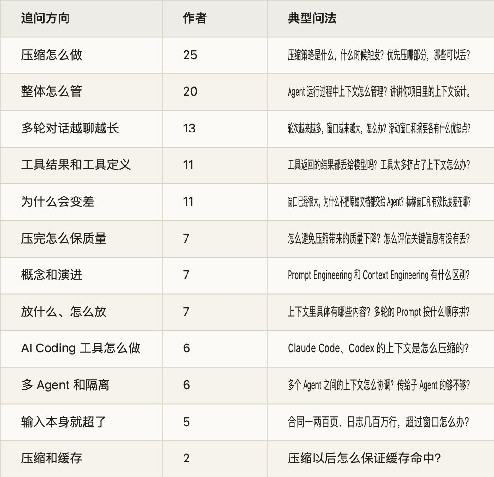
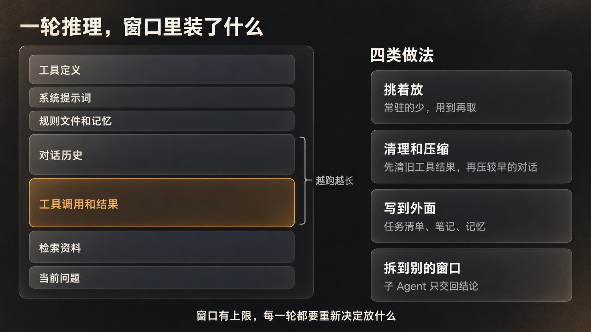
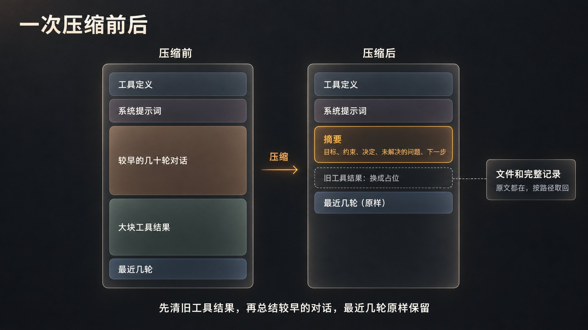
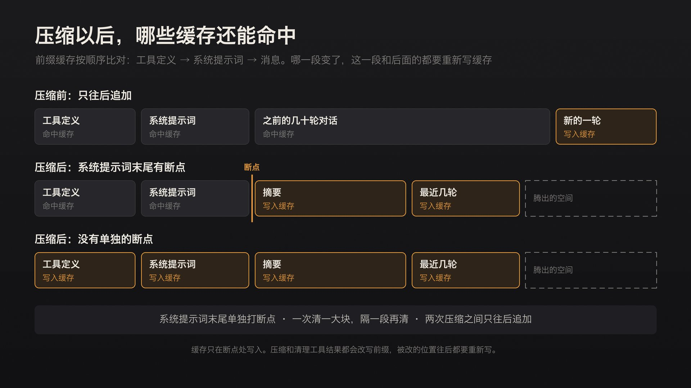
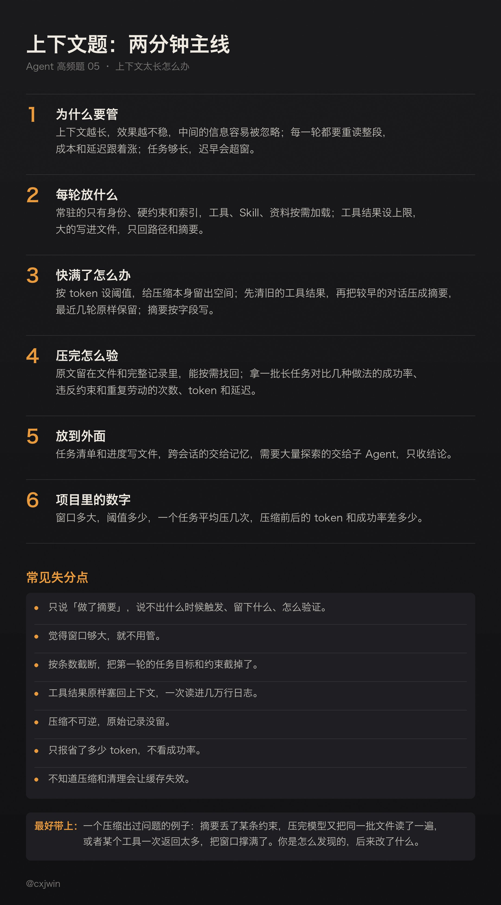

有位候选人面百度后端（Go/Agent）一面，讲自己做的自动化红队 Agent。从面试官的追问能看出他的设计：模型能看到的会话消息放在内存里，完整记录另存一份 Transcript；上下文长了做全量摘要，最近 8 条消息原样保留；另有一份任务清单，每 5 轮提醒一次。面试官顺着这套设计往下问：做全量摘要时，这 8 条也参与吗？要是这 8 条本身就超过了窗口呢？会话中断重启，从 Transcript 把原始消息全部加载回来，不又超长了吗？任务清单为什么每 5 轮提醒一次，统计过一个任务平均调几轮工具吗？

这道题考的不是你知不知道「压缩」这个词，是你的方案在边界上站不站得住：什么时候压，压掉什么，留下什么，压完怎么接着干，怎么知道没压坏。面试官也常换个角度问：窗口已经这么大了，为什么不把原始文档全交给 Agent？工具返回的东西都丢给模型吗？从大窗口的模型切到小窗口的模型，历史怎么办？

这些我在自己的项目里也撞上过。九月那次多 Agent 实测，主 Agent 的缓存输入占全部输入的 98.48%，累计输入还是到了约 3855 万 token：同一段上下文每一轮都被重新带进去，缓存命中率再高，累计用量照样往上涨。同月写本地部署那篇时也算过：32K 的窗口拿来做复杂编码和长时间运行的 Agent，系统提示词、工具定义、历史记录、代码和日志都要占地方，留给任务的余量越来越少，我很难接受。

这是 Agent 高频面试题单第 5 题的详解。题单里这题是 49 位作者、64 场面试，是按「上下文压缩」「上下文管理」这类关键词数的。和第 4 题一样，我把能重新读到原文的 231 场面经逐条读了一遍，剔掉不是单场面经和带参考答案的帖子，补上关键词漏掉的问法，比如「Agent 上下文太大怎么办」「工具返回的东西都丢给大模型吗」，问到上下文的有 78 场、58 位作者。追问大致分十二个方向（按作者数，一场可以算进几类）：

问得最多的是压缩怎么做，其次是笼统的「上下文怎么管理」。后一种最容易答空。面试官想听的，是你的项目里每一轮放了什么，什么时候清理，清掉的还能不能找回来。

下面按一个长任务里上下文的变化来讲：先讲它为什么会成问题，再讲每一轮放什么，快满了怎么清理和压缩，压完怎么证明没丢，哪些东西该放到窗口外面，最后是面试怎么答。Claude Code 具体怎么压缩，第 2 题讲过；子 Agent 之间传什么、回什么，第 3 题讲过；这里用到时只点一下。记忆怎么分层（第 6 题）、Token 成本和缓存（第 12 题）、工具很多时怎么选对（第 24 题）另外单写。

## 一、上下文为什么会成问题

1\. 窗口里装的是什么

模型每次推理看到的，是这一轮拼起来的全部内容：系统提示词，工具定义，CLAUDE.md 这类规则文件和记忆，之前的对话，每次工具调用和返回的结果，检索来的资料，最后才是用户这一句。Agent 在循环里跑，每一步的动作和工具结果都追加进去，作为下一步的输入，越跑越长。Manus 的季逸超写过，他们的 Agent 输入和输出的 token 比平均约是 100 比 1：输出常常只是一条简短的工具调用，输入却是越积越多的上下文。

面试常问的一组概念就在这里。Anthropic 2025 年 9 月那篇讲上下文工程的文章是这么分的：提示词工程（Prompt Engineering）讲怎么写好、组织好给模型的指令，重点是系统提示词；上下文工程（Context Engineering）管的是推理时进入窗口的所有 token，除了提示词，还有工具、MCP、外部数据、对话历史。提示词写好就定了，上下文每一轮都要重新决定放什么。他们把后者看成前者的延续：单轮任务写好提示词就够了，Agent 要跑很多轮，就得管整个上下文的状态。再往外一层是 Harness，第 9 题讲。

我七月写 Anthropic 给 Opus 5 删掉 80% 系统提示词那篇时，换了个说法讲这件事：对话框里敲的那句是 prompt，说完就过去了；系统提示词、CLAUDE.md、Skill、记忆是 context，写一次跟着你几百次。prompt 写错了，代价是一次；context 写错了，代价是每一次。

有面试官问 Agent 的 state、context、memory 分别是干什么的。可以这样分：context 是这一轮模型看得到的内容；state 是程序自己记的任务状态，比如做到第几步、改过哪些文件，不一定给模型看；memory 是跨轮次、跨会话存下来的东西，用到时再取进 context。

LangChain 2025 年 7 月的一篇博客引了 Karpathy 的比方：模型像 CPU，上下文窗口像内存，容量有限，得有东西决定往里放什么。那篇把常见做法分成四类：写到窗口外面，挑着放进来，压缩，拆到别的窗口里。下面几节大致对应这四类。

2\. 窗口大了，为什么还会变差

面试官常问：现在模型的窗口已经很大，为什么不直接把原始文档都交给 Agent？理由有三条：放得越多，效果越不稳；每一轮都要重读，又贵又慢；任务够长，再大的窗口也会满。

先说效果。常被引用的研究有三项：

- Lost in the Middle（Liu 等，2023）：在多文档问答和键值检索两个任务上，相关信息在开头或结尾时效果最好，在中间时明显变差，专门做长上下文的模型也一样。

- RULER（NVIDIA，COLM 2024）：测了 17 个长上下文模型，它们在最简单的「大海捞针」测试里几乎全对，换成 RULER 的任务，长度一增加，几乎都大幅下滑。这些模型都号称支持 32K 以上，到了 32K 还能保持满意表现的只有一半。面试官问「标称窗口和真实可用的有效长度差在哪」，说的就是这个。

- Chroma 的 Context Rot（2025 年 7 月）：测了 18 个模型，任务都很简单，输入一变长，表现照样往下掉。其中一组用 LongMemEval 的对话问答，同样的问题，只给相关内容的版本平均约 300 token，给完整对话的版本约 11.3 万 token，所有模型在前者上都明显更好。这差不多就是「为什么不把原始文档都交给 Agent」的答案。

Anthropic 给的解释是，模型像人一样有一份「注意力预算」，每多一个 token 就花掉一点。Transformer 里每个 token 都要和其他所有 token 建立关系，n 个 token 就有 n² 对；训练数据里短序列又比长序列多，模型处理全局依赖的经验更少。所以长度增加带来的是缓坡，不是悬崖：长上下文里模型仍然能干活，只是检索和长距离推理没那么准了。

再说成本和延迟。Agent 每一轮都要把整段上下文重新送一遍。前缀缓存能省不少，Manus 那篇举过 Claude Sonnet 的价格：命中缓存的输入每百万 token 0.30 美元，没命中的 3 美元，差 10 倍。但他们也说，有了前缀缓存，每个 token 的传输和预填充还是要付钱。我那次 98.48% 的命中率和 3855 万的累计输入，回答的是两件事：命中率说的是读入的内容有多少能复用缓存，累计用量把每一轮的输入都记了进去。

本地部署还多一笔显存账。我九月算过，Qwen3.8-27B 原生窗口是 262,144 token，按 mlx-dspark 的实测，开到 128K，缓存要多占约 11GB，开到 256K 约 23GB。模型支持多长，和这台机器开多长舒服，是两件事。有面试官问 32K 够不够做 SWE Agent。我的看法是，拿来做复杂编码和长时间运行的 Agent 不够用，原因开头说了；我自己更愿意把 128K 当成常用容量上的折中。

最后，窗口迟早会满。长任务一直在长，工具结果一次就可能很大：网页、PDF、日志。Anthropic 的判断是，可以预见的将来，至少在要求最强表现的场景里，多大的窗口都会碰到上下文被污染、信息不相关的问题，等更大的窗口不是办法。

也有人问：超长上下文的模型下，还需要区分长短期记忆和 RAG 吗？需要。窗口是这一次推理的工作区，记忆要跨会话保存，RAG 面对的资料库比任何窗口都大；再加上前面说的效果和成本，窗口变长改变的是余量，不是做法。记忆怎么设计，第 6 题讲。

3\. 上下文会怎么坏

LangChain 那篇博客引了 Drew Breunig 的四种说法，面试时可以拿来归类：

- 中毒：一个幻觉或错误进了上下文，后面一直被当成事实引用。

- 分心：上下文多到盖过了模型训练里学到的东西。

- 混淆：多余的内容影响了回答，比如一堆用不上的工具定义。

- 冲突：上下文里几部分说法互相矛盾。

面经里的问法大多能对上。「多轮对话里上下文带了脏数据，干扰了判断」是中毒或混淆；「上下文用错了历史结果、漏掉了关键结果」是混淆；「上下文过长，输出效果变差、产生幻觉」几种都可能有。冲突最容易出在自己写的规则里：Anthropic 复盘 Claude Code 的系统提示词时读过团队的对话记录，见过同一次请求里系统提示词说「该写文档的地方写文档」，Skill 说「不许加注释」，用户又提了第三种要求。模型多半还能猜出你要什么，但得先花功夫把这几条理清楚。

坏了以后，有时最省事的办法是重开。我六月写国产 Coding Agent 那篇时，引过 toyama nao 评 GLM 时说的一条经验：两轮改不好一个问题，别抱侥幸，直接重开。Agent 一旦在错的上下文里陷进去，再往下调往往越调越偏。

面试常问：你怎么理解 Prompt Engineering 和 Context Engineering？从提示词工程、上下文工程到 Harness，这些概念为什么一路演进，各自解决什么问题？Agent 的 state、context、memory、MCP 分别是干什么的？什么是上下文窗口，它和长期记忆怎么分工？目前有哪些长上下文模型？现在模型的窗口已经很大，为什么不把原始文档都交给 Agent，让它自己查？模型标称的窗口和真实可用的有效长度有什么差异，长上下文下效果为什么下滑？Lost in the Middle 是什么原理？超长上下文的模型下，还需要区分长短期记忆和 RAG 吗？32K 的上下文能不能满足 SWE Agent？有没有遇到过上下文太长，输出效果变差、产生幻觉？多轮对话里上下文带了脏数据，干扰了判断，怎么兜底？上下文用错了历史结果、漏掉了关键结果，有哪些典型的 Case？

## 二、每一轮放什么

1\. 常驻的越少越好

Anthropic 那篇文章给上下文工程定的原则是：用尽量少、信息量尽量高的 token，换最大的成功概率。落到每一部分：系统提示词要找对高度，太细会把复杂又脆弱的逻辑硬写进去，太虚又给不出具体的信号；工具之间别重叠，人都说不清该用哪个，模型也选不对；例子挑几条有代表性的，别把所有边界情况列成清单。

哪些内容该常驻，我在七月那篇里给过一个判断办法：上下文不是仓库，是缓存。一条信息一百次会话里能用上几次？低于个位数，就该下沉成 Skill，用到再加载。CLAUDE.md、AGENTS.md 这类文件也一样，写成索引和入口，别写成百科全书。

面试官问「上下文里具体包含哪些内容」「哪些该送、哪些不该送」，可以按三层答：

- 常驻：身份和产品背景、硬约束、工具和 Skill 的简介、规则文件的索引。

- 到了某个阶段才加载：这一步要用的规则和 Skill 全文。

- 用到再取：文档、代码、历史片段、记忆，让 Agent 用工具自己去拿。

2\. 资料用到再取

Anthropic 管这叫「即时」（just in time）的上下文：不预先把资料都塞进去，只留轻量的标识，比如文件路径、存好的查询、链接，Agent 运行时用工具按需加载。Claude Code 分析大数据时就这样做：写有针对性的查询，把结果存下来，用 head、tail 看大文件，不把整份数据读进上下文。文件大小、命名、时间戳本身也是线索，Agent 可以一层层摸清情况，只把需要的留在上下文里。

代价是慢一些，每取一次就是一次工具调用。所以也可以混着用：一部分先放进去图快，剩下的让 Agent 自己找。Claude Code 就是这样，CLAUDE.md 一开始直接放进上下文，代码用 glob、grep 现找，也就绕开了索引过期的问题。Anthropic 认为变化不频繁的内容，比如法律、金融资料，可能更适合这种混合做法。

面试官会接着问：资料有十几篇，或者是一个很大的代码仓库，用 RAG 检索和让 Agent 自己 grep，各有什么优劣？代码仓库这一边第 2 题讲过，RAG 这一边第 1 题讲过。

工具和 Skill 的定义也占上下文。Skill 平时只占一行简介，用到时才加载全文（第 8 题）；MCP 服务的工具定义，很多客户端是一接上就整组放进上下文，Claude Code 现在默认延迟加载，用到哪个再拿哪个（第 2 题）。有面试官问 MCP 和 Skill 在上下文上有什么差异，答的就是这一点。工具多到几百个时，第 3 题引过 Anthropic 的经验值：系统提示词里的工具定义超过 30 到 50 个，选工具就容易变差，他们建议按用户意图分组，再用工具搜索按需加载。怎么选对，第 24 题讲。

还有一处要留意：按需加载最好往后追加，别回头改前面的工具列表。Manus 的经验是迭代中尽量不动态增删工具，因为工具定义在上下文的前部，一改，后面所有内容的缓存都失效；他们的做法是在解码时屏蔽暂时不该选的工具。Anthropic 的缓存文档也写明，改了工具定义，整段缓存都要重来。

3\. 工具结果先设上限

上下文膨胀，大头往往是工具结果。字节剪映有位面试官问得很具体：读文件的工具，文件有 1 万行，每次最多读 2500 行，调用后返回什么？模型怎么知道还没读完？要不要接着读？

我会这样设计返回：读到的内容，加上几项元信息：文件路径、这次读的行号范围、总行数，再加一句明确的提示，告诉它后面还有、下次从第几行接着读。要不要接着读，交给模型按任务判断；找东西的时候，更该先 grep 定位到行，再读附近几段，而不是从头翻到尾。文件不存在，就明确报错，最好附上名字相近的文件。

同一场面试还追问：做了 10 轮工具调用，每轮结果都很大，原样保存、压缩、摘要还是丢弃？由模型决定还是由代码里的规则决定？我的看法是硬上限交给代码：每个工具返回多少、超了怎么办、原始结果存在哪，都由规则定；模型决定的是下一步看什么。原始结果写进文件或数据库，上下文里只留摘要和位置。Manus 的说法是压缩要可恢复：网页内容可以从上下文里拿掉，只要留着 URL；文档内容可以省略，只要沙盒里还有路径。

东方财富的面试官出过一道更难的：工具返回五六千只 A 股，用户要求全量输出，压缩的信息损失怎么办？全量输出别让模型来抄。代码把完整结果写成文件或表格，模型看统计和样本，写分析，最后把文件交给用户。模型是唯一的搬运工时，压缩才会丢东西。

4\. 大文件、长文档、海量日志

这一类问题是输入本身就超了：合同一两百页，日志几百万行，一次告警的日志上千条、十几 MB，代码库大到怎么都塞不下。思路一样，别把原件放进窗口，先把它变成模型能查的东西：

- 日志：先用代码筛，按时间窗口、级别、关键词过滤，相同的行合并计数；模型先看汇总，定个方向，再去 grep 细节。

- 长文档：按章节、条款切开，每一段用同一套问题去抽取（涉及哪些主体、金额、义务、风险，出自第几条），再合并。合并后还太长，就分层再合并，或者把抽出来的结果存成表，用的时候查；回答时带上条款编号，方便核对原文。字节抖音电商三面还追问：压缩或丢弃时，怎么判断哪些信息无效？先把任务需要什么写下来，对这些问题没贡献的才算无效；拿不准的留个位置，别直接删。

- 代码库：见第 2 题，grep、glob 现找，按行读，规则文件当地图。

长 Prompt 的拼法也有讲究。Anthropic 的提示词指南建议，输入在 2 万 token 以上时，把长文档放在前面，问题、指令和例子放在后面；他们测试里，问题放在最后，回答质量最多能提高 30%，多文档的复杂输入尤其明显。多份文档各自用标签包起来，带上来源；也可以先让模型把相关段落摘出来，再做任务。

阿里千问有位面试官问「多轮 Prompt 拼装的最优顺序」。把缓存也算进去，可以这样排：不常变的放最前面，工具定义、系统提示词、规则文件，这样缓存能命中；接着是历史和资料，长材料放在问题前面；当前任务和最新的指令放最后。

面试常问：上下文里具体包含哪些内容，什么信息该放进窗口？哪些内容该送、哪些不该送、哪些该裁剪，System Prompt 里写什么？多轮的 Prompt 按什么顺序拼？Loop 里上一轮的结果怎么传，是不是每次生成的文字都往上下文里塞？MCP 和 Skill 在上下文上有什么差异，Skill 是一开始就整个读进去吗？设计 Skill 时会考虑 Agent 执行时的上下文吗？工具太多导致上下文过长，怎么优化？Runtime 里有五六百个 Skill，怎么保证上下文健康？工具返回的结果都丢给大模型吗？很长的 Tool Result 怎么压缩，阈值是多少？读文件时文件很大，返回什么，模型怎么知道没读完？工具返回五六千只股票，用户要全量输出，压缩丢了信息怎么办？合同一两百页超过窗口怎么办，汇总后又超出怎么办？日志有几百万行，模型装不下，怎么检索过滤？面对大型代码库和有限的窗口，Coding Agent 怎么理解整个项目？

## 三、快满了：清理、截断、压缩

1\. 什么时候动手

按 token 算，别按条数和轮数算。开头那位候选人保留最近 8 条消息，面试官一问就露了：一条消息就可能有几万 token。

也别等满了才动手。压缩本身要调一次模型，输入就是整段历史。Claude 文档讲计费的示例里，压缩那一步的输入是 18 万 token，输出 3500 token。阈值要给压缩这次调用和下一轮的输出都留出空间。Claude API 的默认值可以参考：清理工具结果，默认在输入超过 10 万 token 时开始；按阈值自动压缩，默认 15 万，最低能设到 5 万。窗口大小不一样，阈值跟着变，换模型时要重算。

还有个容易漏的细节。Anthropic 的提示词指南提到，部分 Claude 模型能感知窗口还剩多少，快到上限时可能自己急着收尾。如果你的 Harness 会自动压缩，最好在提示词里告诉它：上下文会被压缩，不用因为预算提前停下。

2\. 先清旧的工具结果

工具结果被模型处理过以后，原文很少再用得上，又占大头，所以先清它。Anthropic 那篇文章说，这是最安全、动静最小的一种压缩。Claude API 有现成的策略：上下文超过阈值，就从最早的开始清工具结果，换成一段占位文字，告诉模型这里的内容被移除了，默认保留最近 3 次；可以指定某些工具不清，比如网页搜索，也可以连调用参数一起清。Claude Code 也是先清较早的工具输出，必要时再总结对话（第 2 题）。

清掉的内容要能找回来：重新读文件，重跑查询，或者去存好的原始结果里查。

Anthropic 发布这个功能时报过一组内部数字：在一套智能搜索的内部评测上，只用上下文编辑，表现比基线提高 29%，再加上记忆工具，提高 39%；在一个 100 轮的网页搜索评测里，上下文编辑让原本会因为上下文耗尽而失败的流程跑完了，token 消耗还降了 84%。

3\. 截断：最便宜，也最容易出事

截断就是只留最近 N 轮，最早的丢掉，也叫滑动窗口。面试官常问：直接截断有什么弊端，除了丢信息还有什么问题？

- 丢掉的往往最要紧：第一轮里的任务目标和用户提的约束。

- 硬切会切断依赖。工具调用和它的结果、一个问题和它的追问被拆开；有的接口要求工具结果必须紧跟对应的调用，切坏了，请求直接报错。

- 模型不知道有东西被删了，可能重做已经做过的事，或者凭印象编。上下文编辑留下占位文字，就是为了让模型知道。

- 对缓存不友好。窗口每滑一次，消息的开头就变一次，后面的缓存全部失效（见第 5 小节）。

虾皮的面试官问滑动窗口和动态摘要各有什么优缺点。滑动窗口简单，不用多调模型，行为可预测；代价是早期信息全丢，每一轮还都在改前缀。摘要能留住早期的要点，代价是多一次调用，有损，压缩那一下要等，还可能把错误也总结进去。常见的做法是两者结合：较早的部分压成摘要，最近几轮原样保留。

4\. 压缩：留下什么，丢掉什么

压缩（compaction）是把快满的对话总结一遍，带着摘要开一个新的窗口接着干。Anthropic 描述过 Claude Code 的做法：把消息历史交给模型总结，保留架构上的决定、没解决的 bug、实现细节，丢掉重复的工具输出和消息，再带上最近访问过的 5 个文件继续。Claude API 的默认压缩提示词因模型而异，其中一版要求摘要写清状态、下一步和学到的东西，好让模型在看不到原始历史的新窗口里接着做。

自己设计时，我建议摘要按固定的字段写：

- 任务目标，和用户原话里的约束；

- 已经做出的决定，和理由；

- 试过但失败的路，和原因；

- 还没解决的问题；

- 当前状态和下一步；

- 关键材料的位置：文件路径、链接、ID。

可以丢的是处理过的工具原始输出、重复的消息、被新版本替代的草稿。失败的尝试别全丢。Manus 的经验是把出错的尝试和报错留在上下文里，模型看到失败，就不容易重复同样的错；压缩时至少要留一行「试过什么，为什么不行」。

回到开头的追问。全量摘要时，最近保留的几条一般不参与，摘要只覆盖更早的部分，最近几轮原样接在摘要后面，Claude API 里「保留最近几轮」的压缩就是这么做的。要是保留的那几条本身就超过窗口，问题出在写入的时候：工具结果当时就该设上限，大的写进文件。保留区要按 token 预算算，不按条数；兜底时，保留区里的大块工具结果也要清掉或截短，只保住用户原话和最近的决定。

「怎么避免重复压缩」也常被问到。长任务里压缩一定会发生多次，下一次压的是「上一次的摘要加上新的几轮」，细节会一层层磨掉。一直要保留的东西别交给摘要：任务目标和硬约束放在系统提示词或单独的文件里，每次原样带上。Claude Code 的文档也建议，长期要遵守的规则写进 CLAUDE.md，别只在对话里说一次（第 2 题）。另外，压一次要腾出足够的空间，别刚压完又碰到阈值，来回反复。

谁来写摘要，可以是同一个模型，也可以换个便宜的，后者要拿真实轨迹验过，看会不会漏细节。用框架自带的也行，但面试官会问「压缩机制是自己设计的，还是 LangGraph 自带的」「你们是在 SDK 外围管理上下文，还是改了 SDK 内部」，要说清哪些是默认行为，你改了哪里，为什么改。Claude API 允许自己写压缩提示词，写了就完全替换默认的那份。

Codex 也有人问：它的上下文压缩有什么优势？OpenAI 2025 年 11 月发布 GPT-5.1-Codex-Max 时说，这是他们第一个经过原生训练、能通过压缩跨多个上下文窗口工作的模型，一个任务里能连贯处理数百万 token。在 Codex 里，快到窗口上限时，它会自动压缩会话，换一个新窗口接着干，如此反复直到任务完成；内部评估里有任务连续跑了 24 小时以上。和外面套一段总结提示词相比，区别在于压缩是模型训练过的能力。算法岗还有面试官问强化学习里长轨迹怎么压缩，那是同一件事的训练侧，这篇不展开。

5\. 压缩和缓存会打架

拼多多和科大讯飞的面试官都问过：压缩以后怎么保证缓存命中，摘要会不会影响前缀缓存？

会影响。前缀缓存按顺序比对：工具定义、系统提示词、消息，哪一层变了，这一层和后面的缓存都失效。Manus 那篇说，哪怕只差一个 token，从这里往后的缓存都用不上。压缩改写了消息部分，摘要是一段新内容，要重新写缓存。Claude 的压缩文档提醒，不额外设缓存断点的话，连系统提示词的缓存也会跟着失效；办法是在系统提示词末尾单独打一个断点，压缩时系统提示词照样命中，只有摘要需要新写。清理工具结果同样会让后面的缓存失效，所以文档建议每次至少清掉一定量的 token，让这次缓存重写值得。

归结起来：压得频繁、每次只压一点最伤缓存；一次清一大块，隔一段再清；两次压缩之间只往后追加，别回头改之前的内容；工具定义和系统提示词保持稳定。滑动窗口每一轮都改前缀，是最坏的情况。另外，压缩本身要多调一次模型，计费和限速都算在里面。Token 成本和缓存的细节，第 12 题讲。

6\. 换模型、断了重来

度小满和东方财富的面试官都问过：从大窗口的模型切到小窗口的模型，历史怎么处理？按新窗口重算预算，把历史重新压到预算以内：先清工具结果，再总结较早的轮次，别把原始历史整段搬过去。任务状态平时就写在文件里，换哪个模型都能接着做。

开头那位候选人还被问到，会话中断以后怎么恢复。要分清两样东西。一是完整记录，原样追加、持久化，用来审计和回放；二是工作上下文，也就是这一轮给模型看的内容：系统提示词、最近一次的摘要、最近几轮、状态文件。恢复时从最近一次的摘要和状态文件重建工作上下文，不从完整记录全量回放，所以摘要本身也要存下来。Claude API 的做法是把摘要作为一个压缩块放在回复里，你照常追加，下一次请求时它会自动丢掉压缩块之前的内容。腾讯 WXG 的面试官问容器迁移或重启以后上下文怎么办，也是这个道理，这些状态得放在容器外面。

用户一直追问，上下文会不会无限增长？窗口里的长度有阈值和压缩管着，不会；累计用量会一直涨。窗口有上限，账单没有。

面试常问：上下文压缩策略是什么，什么时候触发，用什么指标、阈值多少？优先压缩哪部分，哪些可以丢，哪些不能压？压缩后上下文里主要留下什么？除了工具结果的压缩，还有哪些压缩机制？窗口满了直接截断有什么弊端，除了丢信息还有什么问题？滑动窗口和动态摘要各有什么优缺点？做全量摘要时，最近保留的几条消息也参与吗？保留的这几条本身就超过窗口怎么办？如何避免重复压缩？压缩机制是自己设计的，还是框架自带的？Claude Code 是怎么压缩上下文的，了解它的「三层压缩」吗？Codex 的上下文压缩有什么优势？用 AI 编程时 Context Window 满了，你优先丢哪部分？上下文压缩后怎么保证缓存命中，摘要会影响 KV 或前缀缓存吗？从大窗口模型切到小窗口模型，历史上下文怎么处理？会话中断重启，怎么恢复上下文？用户不断追问，上下文会不会无限增长？

## 四、压完怎么证明没丢

1\. 能找回原文

腾讯一位面试官问：历史信息压缩以后，Agent 怎么按需找回原始内容？拼多多的面试官问：上下文摘要还原怎么做？

还原不是从摘要里反推原文，而是按位置把原文取回来。前提是压缩时原文没扔：工具结果存在文件里，完整记录存在库里，摘要里带着文件路径、链接、记录的 ID，Agent 有工具能重读。Manus 说得很直接：你没法可靠地预测哪一个观察结果在十步以后会变得关键，所以任何不可逆的压缩都有风险。

2\. 摘要写成字段

怎么避免压缩带来的质量下降，怎么让信息丢失最少，蚂蚁、字节的面试官都问过。

Anthropic 的建议是在复杂的真实轨迹上调压缩提示词：先追求召回，确保该留的全留下，再一步步提高精度，去掉多余的。压得太狠，丢掉的往往是一些细微的上下文，要到后面才显出它重要。

前面说的固定字段，好处是丢了能看出来：哪个字段空了，一眼就知道；写成流水账，漏了什么谁也看不出。还没核实的结论要在摘要里标出来，别让它压缩一次就成了「事实」，上下文中毒常常就是这么来的。

3\. 用评测说话

小鹏的面试官问：上下文压缩以后，怎么评估关键信息有没有丢？腾讯云的面试官问：怎么评测你这套上下文方案有没有效果？

做法和第 4 题一样，只是题要专门挑：

- 题目：一批会触发压缩的长任务，最好是真实轨迹回放；关键信息出现得早，到后面才用得上。

- 对照：不压缩（窗口够的时候）、截断、摘要、摘要加清理工具结果，每种配置跑几遍。

- 指标：任务成功率是主指标；再看压缩后有没有违反早期的约束，有没有重复劳动（同一个文件重读、同一个工具重调、走回已经失败的路），压缩后问它早期做过的决定能不能答对；最后看 token、延迟和压缩次数。

只报 token 降了多少不够。我在 192 倍那篇复盘里写过，只盯着 token 降幅、把检查全部删掉，交付质量很可能跟着变差。快手的面试官问得更尖：你的上下文方案是针对某个 Case 的修补，还是能在不同场景复用？拿一批不同场景的任务来证明，比讲一个修好的例子有说服力。

面试常问：在与大模型对话的过程中，如何避免上下文压缩带来的质量下降？上下文压缩怎么保证质量？压缩或摘要肯定会丢信息，怎么让丢失最少？上下文压缩时怎么降低信息丢失的概率？历史信息压缩后，Agent 怎么按需找回原始内容？上下文摘要还原怎么做？上下文压缩以后，怎么评估关键信息有没有丢？怎么评测这套上下文方案有没有效果？记忆系统怎么衡量上下文膨胀下降的效果？你的上下文方案是针对某个 Case 的修补，还是能在不同场景复用？

## 五、放到窗口外面

1\. 任务清单和笔记写进文件

Anthropic 管这叫结构化笔记：Agent 定期把笔记写到窗口外面，需要时再读回来。Claude Code 列的待办清单、自己维护的 NOTES.md 都是这一类。他们举过 Claude 玩宝可梦的例子：几千步里，它一直记着练了多少步、升了几级、地图探过哪里，上下文重置以后读自己的笔记接着打。

Manus 还用笔记来拉注意力。他们说一个典型任务平均要调大约 50 次工具，跑得久了，模型容易偏题、忘了早先的目标；所以复杂任务里它会建一个 todo.md，边做边改，每次重写都把目标复述到上下文末尾，放进模型最近的注意力范围，避开「中间丢失」。我九月整理 Opus 5.5 官方用法指南时也划过这一条：任务清单写进 TASKS.md 这样的文件，压缩后还在，看文件就知道做到哪一步。

开头那位候选人的任务清单每 5 轮提醒一次，面试官追问为什么是 5 轮，统计过一个任务平均调几轮工具没有，为什么用中位数。这类参数要从数据里来，中位数和长尾第 4 题讲过。

2\. 重开一个窗口

不一定非要压缩。Anthropic 的提示词指南说，上下文清空以后，可以考虑直接开一个新窗口，而不是压缩，因为新模型很擅长从本地文件里找回状态；要写清楚它怎么开始：先看进度文件、测试清单和 git 日志，跑一遍基本的集成测试，再接着做新功能。为此，第一个窗口最好先搭好框架，写测试、写启动脚本，后面的窗口照着待办清单迭代。

Anthropic 的 Thariq 也是这么用的，我七月翻译过他那篇：规划满意以后开一个新会话，把规划阶段的材料，比如 spec 和原型，一并放进去，Claude 既有干净的窗口，又有规划阶段积累的信息。

压缩还是重开，Anthropic 那篇上下文工程的文章给过一个分法：来回讨论多的任务适合压缩，里程碑清楚的迭代开发适合记笔记，可以并行探索的研究分析适合多 Agent。

3\. 跨会话的交给记忆

Anthropic 的记忆工具是一套基于文件的方案：Claude 在一个专门的目录里增删改查文件，目录放在你自己的基础设施里，跨对话保存。蔚来的面试官问上下文窗口和长期记忆怎么分工：窗口是这一次的工作区，记忆是存下来、需要时再取回来的东西。分几层、怎么检索、怎么遗忘，第 6 题讲。

4\. 拆给子 Agent

子 Agent 是另一种绕开上限的办法。Anthropic 的说法是，每个子 Agent 在干净的窗口里深挖，可能用掉几万甚至更多 token，交回来的只是 1000 到 2000 token 的摘要，细节留在子 Agent 那边。

但别把它当成省 token 的办法。我那次实测，三个子 Agent 合计用了约 1.53 亿 token，它们交回的报告还要进主 Agent 的上下文。委派出去的工作，仍然会产生阅读和复核的成本。给子 Agent 传什么、让它回什么，第 3 题的「三、怎么通信」讲过。

面试常问：当前 Agent 怎么保留短期对话上下文，超出最近几轮的历史怎么处理？短期上下文和长期摘要怎么分层？上下文窗口和长期记忆怎么区分、分工？任务清单多少轮提醒一次，这个数怎么定？多 Agent 交互、推理一多导致上下文膨胀，有哪些处理机制？长链路任务里上下文膨胀、爆炸怎么处理？多个 Agent 之间的上下文怎么协调、怎么传递？怎么保证传给子 Agent 的上下文足够完整？子 Agent 能不能在运行中参与主 Agent 的上下文？多任务之间的上下文怎么隔离？主 Agent 和子 Agent 的通信、上下文管理方式，对最终结果有什么影响？

## 六、面试怎么答

两分钟左右的主线：

1. 为什么要管：上下文越长，效果越不稳，中间的信息容易被忽略；每一轮都要重读整段，成本和延迟跟着涨；任务够长，迟早会超窗。

2. 每轮放什么：常驻的只有身份、硬约束和索引，工具、Skill、资料按需加载；工具结果设上限，大的写进文件，只回路径和摘要。

3. 快满了怎么办：按 token 设阈值，给压缩本身留出空间；先清旧的工具结果，再把较早的对话压成摘要，最近几轮原样保留；摘要按字段写。

4. 压完怎么验：原文留在文件和完整记录里，能按需找回；拿一批长任务对比几种做法的成功率、违反约束和重复劳动的次数、token 和延迟。

5. 放到外面：任务清单和进度写文件，跨会话的交给记忆，需要大量探索的交给子 Agent，只收结论。

6. 项目里的数字：窗口多大，阈值多少，一个任务平均压几次，压缩前后的 token 和成功率差多少。

最好带一个压缩出过问题的例子：摘要丢了某条约束，压完模型又把同一批文件读了一遍，或者某个工具一次返回太多，把窗口撑满了。你是怎么发现的，后来改了什么。

几个常见的失分点：

- 只说「做了摘要」，说不出什么时候触发、留下什么、怎么验证。

- 觉得窗口够大，就不用管。

- 按条数截断，把第一轮的任务目标和约束截掉了。

- 工具结果原样塞回上下文，一次读进几万行日志。

- 压缩不可逆，原始记录没留。

- 只报省了多少 token，不看成功率。

- 不知道压缩和清理会让缓存失效。

## 出处

文中的面试问法都出自下面这些面经，括号里是发帖日期，链到牛客原帖。

- 开头的例子：[百度后端 Go/Agent 一面](https://www.nowcoder.com/discuss/922907945363349504)（08-28）

- 整体怎么管：[字节二面（Trae）](https://www.nowcoder.com/discuss/924821959647440896)（09-03）· [字节 AI 应用工程师一面](https://www.nowcoder.com/discuss/933023499399024640)（09-25）· [字节前端一面（剪映）](https://www.nowcoder.com/feed/main/detail/ffe074f01683402fb85c324430f2877d)（09-22）· [百度 Agent 后端三面](https://www.nowcoder.com/discuss/931476137576845312)（09-21）· [百度放生面经](https://www.nowcoder.com/feed/main/detail/fc061fe55af84effb8014ed6c60db92d)（10-14）· [蚂蚁复活赛 Agent 开发一面](https://www.nowcoder.com/feed/main/detail/39451cad5d2245b491d16778f2a9ca01)（08-31）· [字节 AI 应用开发一面（中国交易与广告）](https://www.nowcoder.com/feed/main/detail/b34f6902e8544fe2953696ed52e49dba)（08-31）· [小鹏汽车端侧 Agent 一面](https://www.nowcoder.com/feed/main/detail/ac25d49b0692473c8f65654adda82b9b)（09-11）· [美团 Agent 开发一面](https://www.nowcoder.com/feed/main/detail/1d067ce539c64d3988eabb9b646ef8a0)（08-25）· [小鹏二面](https://www.nowcoder.com/discuss/924072511011102720)（08-31）

- 上下文为什么会成问题：[携程 Agent 一面](https://www.nowcoder.com/feed/main/detail/9f492f65706f42ed85ecc2d294690638)（10-17）· [美团后端开发一面](https://www.nowcoder.com/discuss/932016310274228224)（09-22）· [一面10分钟](https://www.nowcoder.com/feed/main/detail/bbcee8b049074af098932f9c8f7baf8c)（08-28）· [百度大模型研发一面（Agent 方向）](https://www.nowcoder.com/discuss/921590204903723008)（08-25）· [字节业务中台 AI 全栈日常实习](https://www.nowcoder.com/feed/main/detail/6ac5ba31705a4b64a407b087f39d5447)（10-12）· [蔚来软件开发二面](https://www.nowcoder.com/feed/main/detail/9f92610c99b34894b35be91086df05a2)（09-17）· [抖音电商 Agent 全栈一面](https://www.nowcoder.com/discuss/925066865183858688)（09-03）· [美团 Agent 开发一面（日常）](https://www.nowcoder.com/feed/main/detail/58159306df52463ab75d72daa80d66df)（08-25）· [字节大模型算法一面](https://www.nowcoder.com/feed/main/detail/ef1c94ea060f4dfdbb2b8e28ed40c489)（10-02）· [腾讯 WXG 微信读书一面](https://www.nowcoder.com/feed/main/detail/3ffc762437274543b6a8f5e2ea6fb535)（08-24）· [字节 Agent 研发一面](https://www.nowcoder.com/feed/main/detail/0b91e9f5fbba4af4865c6fadc9a790e8)（10-14）· [虾皮大模型后训练实习一二面](https://www.nowcoder.com/feed/main/detail/1ce068100536444f8cbb1bb78b0b3eb5)（10-12）· [金山数娱 AI 应用一面](https://www.nowcoder.com/feed/main/detail/8f0f005a1f7a48958ac5f07bea3c5d88)（09-13）· [要务科技](https://www.nowcoder.com/discuss/926539013991796736)（09-07）· [快手 AI 应用二面](https://www.nowcoder.com/feed/main/detail/5356d768dc7a4c62a989ee425bef7b12)（09-24）

- 每一轮放什么：[斑头雁 Agent 实习一面](https://www.nowcoder.com/discuss/930139676764102656)（09-17）· [微店 AI 全栈一面](https://www.nowcoder.com/discuss/940646573107650560)（10-16）· [美团 Agent 开发一面（日常）](https://www.nowcoder.com/feed/main/detail/58159306df52463ab75d72daa80d66df)（08-25）· [阿里千问 Agent 开发二面](https://www.nowcoder.com/feed/main/detail/456b3698145c431dacdbe5a1ff7d057c)（10-04）· [OPPO IT 开发一面](https://www.nowcoder.com/discuss/923561467092160512)（08-30）· [理想汽车 IT 全栈一面](https://www.nowcoder.com/discuss/938122023392366592)（10-09）· [美团 AI 后端一二面](https://www.nowcoder.com/feed/main/detail/0fade3c42efb40e5ae3ca0dcfd3d4dfa)（10-01）· [网易 Agent 开发一面](https://www.nowcoder.com/feed/main/detail/bad72b1323274ad5b172039f48bfa4b1)（10-17）· [百度后端开发一面](https://www.nowcoder.com/discuss/932313667943616512)（09-23）· [小厂 AI Agent 工程师一面](https://www.nowcoder.com/discuss/927944523437674496)（09-11）· [金山数娱 AI 应用一面](https://www.nowcoder.com/feed/main/detail/8f0f005a1f7a48958ac5f07bea3c5d88)（09-13）· [字节剪映 AI 应用开发一面](https://www.nowcoder.com/feed/main/detail/7211e82c75284d23a89b569cd9dc289d)（09-24）· [腾讯营销一面](https://www.nowcoder.com/feed/main/detail/c51f363514734218bcc5bb69fd655cd5)（09-24）· [科大讯飞 AI 应用一面](https://www.nowcoder.com/feed/main/detail/aece93373f9c47ea95c831aef6471886)（09-24）· [东方财富 AI 应用一面](https://www.nowcoder.com/feed/main/detail/d406314e733c4fc8945637ce5d06cdcf)（09-24）· [安恒信息 Agent 开发实习一面](https://www.nowcoder.com/feed/main/detail/42ad85eefd20401a8a076203ec850175)（10-15）· [字节抖音电商 Agent 一二三面](https://www.nowcoder.com/discuss/937314680270311424)（10-07）· [汇川数字化全栈一面](https://www.nowcoder.com/feed/main/detail/28032c48a90c4f69827704deb3fae34c)（09-22）· [某中厂 AI 全栈一面](https://www.nowcoder.com/discuss/926232883432296448)（09-06）· [百度后端一面](https://www.nowcoder.com/feed/main/detail/1d81340e139a461e92321f71ce7ca9bd)（08-20）

- 快满了怎么办：[阿里云一面](https://www.nowcoder.com/feed/main/detail/ceade00d742046d0bef6bee7fe7a7aad)（09-28）· [阿里云二面](https://www.nowcoder.com/feed/main/detail/640ec3ff1d7d4e9c8e42f5ededb1e4a6)（09-29）· [携程 AI 应用开发一面](https://www.nowcoder.com/feed/main/detail/2b1c35eace4a4bb3bd88ee669f163793)（09-18）· [携程 AI 应用开发实习一面](https://www.nowcoder.com/discuss/933058120102739968)（09-25）· [拼多多 Agent 一面](https://www.nowcoder.com/feed/main/detail/4dd4b979b1f74625aaef3e7b975142ba)（09-22）· [猎聘](https://www.nowcoder.com/feed/main/detail/9416ce6a43584ad59807737c042f6e1a)（10-15）· [蔚来软件开发二面](https://www.nowcoder.com/feed/main/detail/9f92610c99b34894b35be91086df05a2)（09-17）· [百度 Agent 一面](https://www.nowcoder.com/feed/main/detail/72858aade19d443facc870fea8bb134f)（09-06）· [虾皮 Agent 开发一面](https://www.nowcoder.com/feed/main/detail/79fe3fc8f8cb4c4d9beca478f4279e3a)（08-24）· [百度 AIGC 多模态智能体二面](https://www.nowcoder.com/feed/main/detail/2d033fd6daa04e2aaad2282b75531bbc)（09-29）· [字节 Agent 开发一面（9.3）](https://www.nowcoder.com/discuss/925342611194286080)（09-04）· [拼多多提前批 Agent 一面](https://www.nowcoder.com/feed/main/detail/328260668ec94ebda5c84de205d13a58)（08-18）· [抖音电商后端一面](https://www.nowcoder.com/discuss/925065999378829312)（09-03）· [腾讯社招一面](https://www.nowcoder.com/feed/main/detail/668c7f4007b44fc7b878f55eb01e6e11)（09-23）· [上海初创小厂](https://www.nowcoder.com/discuss/939554787337441280)（10-13）· [字节 Agent 全三轮](https://www.nowcoder.com/feed/main/detail/b4fb3bee56134c3d9bcde6a3166a1711)（10-18）· [字节业务中台 AI 全栈日常实习](https://www.nowcoder.com/feed/main/detail/6ac5ba31705a4b64a407b087f39d5447)（10-12）· [百度大模型研发一面（Agent 方向）](https://www.nowcoder.com/discuss/921590204903723008)（08-25）· [字节 AI 应用开发二面](https://www.nowcoder.com/feed/main/detail/7e8a821479a649fd914e449d312eeb95)（08-30）· [淘天 Agent 算法一面](https://www.nowcoder.com/discuss/931957859154132992)（09-22）· [科大讯飞 AI 应用一面](https://www.nowcoder.com/feed/main/detail/aece93373f9c47ea95c831aef6471886)（09-24）· [度小满 AI 全栈二面](https://www.nowcoder.com/feed/main/detail/0bed1f22b62145f480d2c10c5ffd7951)（09-30）· [东方财富 AI 应用一面](https://www.nowcoder.com/feed/main/detail/d406314e733c4fc8945637ce5d06cdcf)（09-24）· [百度后端 Go/Agent 一面](https://www.nowcoder.com/discuss/922907945363349504)（08-28）· [腾讯 WXG 微信读书一面](https://www.nowcoder.com/feed/main/detail/3ffc762437274543b6a8f5e2ea6fb535)（08-24）· [阿里 Token Foundry 二面](https://www.nowcoder.com/feed/main/detail/ed25d2f60ddc4436b0139a7c52e62a61)（09-08）· [美团全栈开发日常实习一面](https://www.nowcoder.com/feed/main/detail/95e9fc44397d4118ba3946ef0d33b6da)（10-12）· [小厂 Agent 开发实习](https://www.nowcoder.com/feed/main/detail/2f4e4cde4e524a16aae5f55a89c49273)（09-11）

- 压完怎么证明没丢：[蚂蚁 AI 应用研发一面](https://www.nowcoder.com/feed/main/detail/b4b8431d196a4e92b92b2b1b64c9d7d7)（10-12）· [抖音电商后端一面](https://www.nowcoder.com/discuss/925065999378829312)（09-03）· [字节 Agent 开发一面（9.3）](https://www.nowcoder.com/discuss/925342611194286080)（09-04）· [拼多多 Agent 复活赛一面](https://www.nowcoder.com/feed/main/detail/2109cf8eb0254507911fbf86bcbf51e4)（09-03）· [腾讯营销一面](https://www.nowcoder.com/feed/main/detail/c51f363514734218bcc5bb69fd655cd5)（09-24）· [小鹏 Agent 开发实习一面](https://www.nowcoder.com/feed/main/detail/3832f2e0ba074b4782daa6ff7a65a1f9)（08-28）· [腾讯云 AI 应用一面](https://www.nowcoder.com/feed/main/detail/517d4adbe09d493e89a32e20801a1995)（09-24）· [上海某独角兽 AI 全栈](https://www.nowcoder.com/feed/main/detail/6468c9ab07664b15901a3470fad6115f)（08-28）· [快手 AI 应用二面](https://www.nowcoder.com/feed/main/detail/5356d768dc7a4c62a989ee425bef7b12)（09-24）· [猎聘](https://www.nowcoder.com/feed/main/detail/9416ce6a43584ad59807737c042f6e1a)（10-15）

- 放到窗口外面：[携程 AI 应用开发一面](https://www.nowcoder.com/feed/main/detail/2b1c35eace4a4bb3bd88ee669f163793)（09-18）· [百度 AIGC 多模态智能体二面](https://www.nowcoder.com/feed/main/detail/2d033fd6daa04e2aaad2282b75531bbc)（09-29）· [蔚来软件开发二面](https://www.nowcoder.com/feed/main/detail/9f92610c99b34894b35be91086df05a2)（09-17）· [百度后端 Go/Agent 一面](https://www.nowcoder.com/discuss/922907945363349504)（08-28）· [美团 AI Agent 一面](https://www.nowcoder.com/feed/main/detail/50bcdc47e7754aa7be59b6318fea514b)（09-15）· [快手日常实习一面](https://www.nowcoder.com/feed/main/detail/5089cbce54834a7bb57ae2c69b7b9a89)（09-16）· [字节国际化广告后端实习一二面](https://www.nowcoder.com/discuss/933056720308305920)（09-25）· [阿里边缘 BU 一面](https://www.nowcoder.com/feed/main/detail/bdebbb6088b6405e9eb2bd2c345acb6e)（09-03）· [杭州微链词元 AI 应用开发](https://www.nowcoder.com/feed/main/detail/0fa200b70a5442f2aad559323802d889)（09-22）· [百度秋招 Agent 一二三面](https://www.nowcoder.com/feed/main/detail/b9521e2b51e04afeac0a3a32e13f4da9)（08-28）· [小红书 PE 二面](https://www.nowcoder.com/discuss/929891805049421824)（09-17）

- 外部资料：Anthropic [Effective context engineering for AI agents](https://www.anthropic.com/engineering/effective-context-engineering-for-ai-agents)（2025-09-29）· [Managing context on the Claude Developer Platform](https://www.anthropic.com/news/context-management)（2025-09-29）· [Building agents: When to fold subagents into your main agent loop](https://claude.com/resources/articles/building-agents-when-to-fold-subagents-into-your-main-agent-loop)（2026-10-22）· Claude 文档 [Compaction](https://platform.claude.com/docs/en/build-with-claude/compaction)、[Compaction at a token threshold](https://platform.claude.com/docs/en/build-with-claude/compaction-threshold)、[Context editing](https://platform.claude.com/docs/en/build-with-claude/context-editing)、[Prompt caching](https://platform.claude.com/docs/en/build-with-claude/prompt-caching)、[Prompting best practices](https://platform.claude.com/docs/en/build-with-claude/prompt-engineering/claude-prompting-best-practices)（10-26 读取）· Liu 等 [Lost in the Middle](https://arxiv.org/abs/2307.03172)（TACL，arXiv 2023-07-06）· Hsieh 等 [RULER](https://arxiv.org/abs/2404.06654)（COLM 2024，arXiv 2024-04-09）· Chroma [Context Rot](https://research.trychroma.com/context-rot)（2025-07-14）· Manus 季逸超 [Context Engineering for AI Agents: Lessons from Building Manus](https://manus.im/blog/Context-Engineering-for-AI-Agents-Lessons-from-Building-Manus)（2025-07-18）· LangChain [Context Engineering for Agents](https://blog.langchain.com/context-engineering-for-agents/)（2025-07-02）· OpenAI [GPT-5.1-Codex-Max 发布文章](https://openai.com/index/gpt-5-1-codex-max/)（2025-11-19）

- 我自己的文章：[62 分钟交卷，Token 用了预算的 192 倍](https://x.com/cxjwin/article/2100289856635383880) · [Fable 5.1 和 GPT-6 Astra 发布后，本地部署从我的时间线消失了](https://x.com/cxjwin/article/2096337795543683306) · [炸裂，Anthropic 给 Opus 5 删掉了 80% 的系统提示词](https://x.com/cxjwin/article/2080750936138625040) · [Opus 5.5 该怎么用？官方用法指南划重点](https://x.com/cxjwin/article/2102770079326945663) · [国产 Coding Agent 三强更新观察](https://x.com/cxjwin/article/2065861966460236144) · [Fable 实战指南：找出你的未知（译）](https://x.com/cxjwin/article/2076853854541640128)
