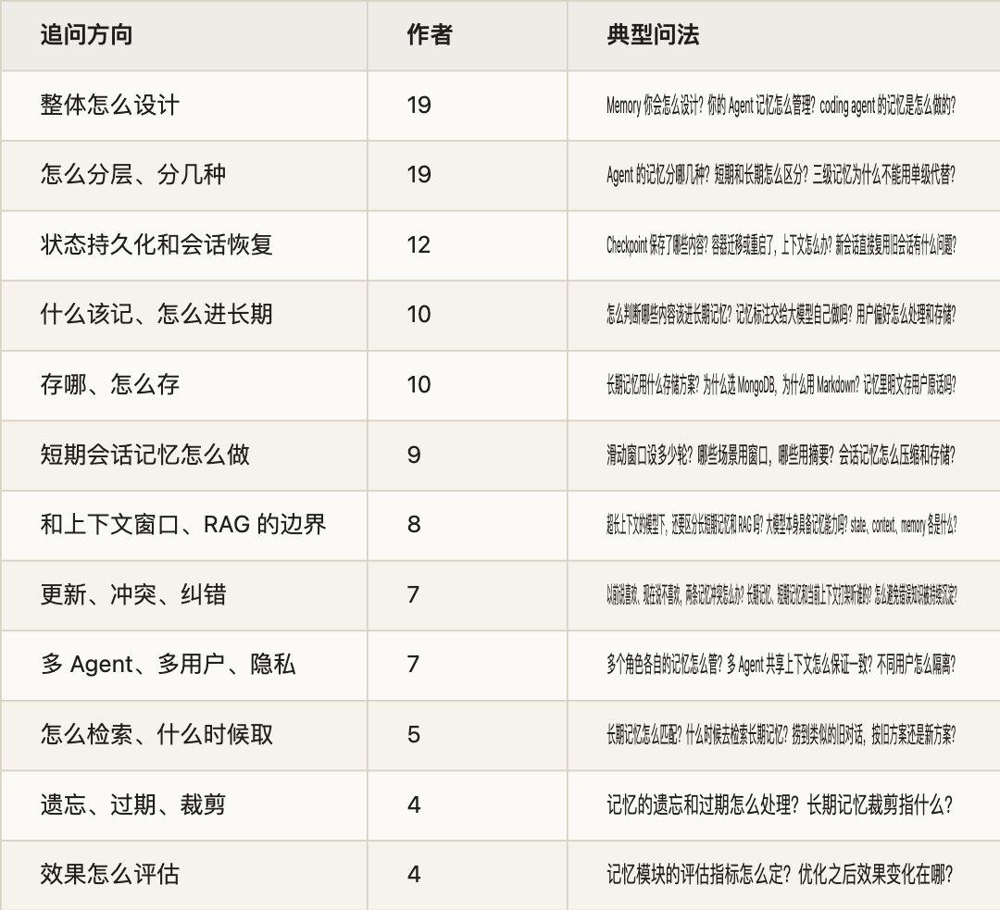
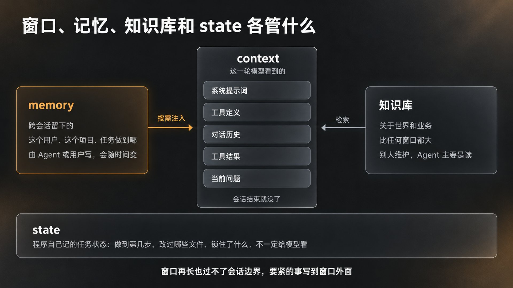
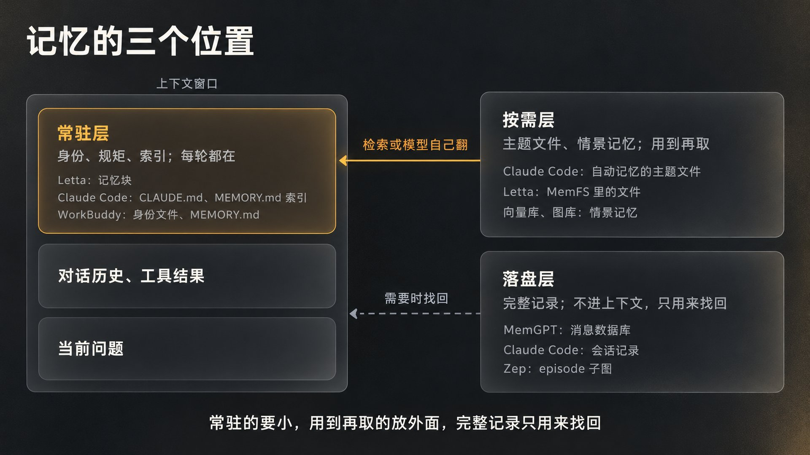
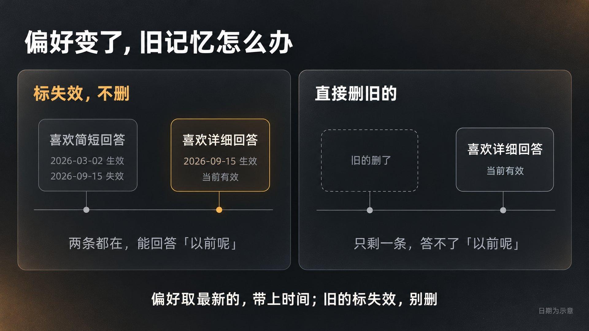
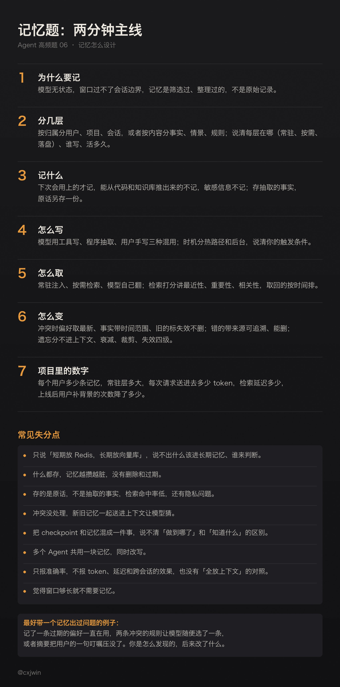

有位候选人面度小满 AI 全栈研发二面，讲自己项目里的记忆模块：重复的对话会精简掉，长期记忆会做裁剪。面试官顺着往下问：长期记忆裁剪具体指什么？除了精简重复对话，从短期记忆提取到长期记忆的逻辑是怎样的？系统怎么判断哪些内容该进长期记忆？提取新记忆时发现和历史记忆有冲突，比如以前说喜欢某样东西，现在说不喜欢了，有什么解决冲突的逻辑？

这四个追问正好是记忆系统的四道工序：记什么，谁来判断，怎么存怎么取，变了怎么办。「分短期和长期」只是开场一句，面试官要听的是每一道工序你怎么做。他们也常换个方向问：现在模型的窗口已经很长了，还需要区分长短期记忆和 RAG 吗？大模型本身有记忆吗？Checkpoint 保存了什么，容器重启了上下文怎么办？多个 Agent 共享记忆，怎么保证一致？

这件事我自己拆过一次。七月写 WorkBuddy 的记忆体系时，我把它的三层记忆、身份文件和「读、做、写回」的循环逐个拆开看了一遍，得出的判断是：上下文窗口是有界的，长程任务是无底的，要紧的事得写到窗口外面去。我整理文章库用的记忆也是同一个路数，一条经验一个文件，一行摘要做索引，发现错了就删。后来 Fable 5 的文档把这套写法写成了推荐范式，Claude Code 又把它做成了默认装配。

这是 Agent 高频面试题单第 6 题的详解。题单里这题是 48 位作者、56 场面试，按「记忆」「memory」两个关键词数的。和前几题一样，我把能重新读到原文的 247 场面经逐条读了一遍，剔掉不是单场面经和带参考答案的帖子，补上关键词漏掉的问法，比如「Checkpoint 保存了什么」「哪些用户信息适合长期保存」「不同用户的会话和工作区怎么隔离」，问到记忆的有 62 场、49 位作者。追问大致分十二个方向（按作者数，一场可以算进几类）：

问得最多的是「整体怎么设计」和「分几层」，各有 19 位作者。前一种最容易答空：说一句「用了 Mem0」或者「短期放 Redis、长期放向量库」就停了。面试官想听的是你的记忆里到底存了什么，谁写进去的，什么时候取出来，取出来的东西怎么影响下一步，错了怎么改。

下面按一条记忆从产生到消失的顺序讲：先讲模型为什么没有记忆，记忆和上下文窗口、RAG 各管什么；再讲分几层；每一层记什么、谁来写、什么时候写；存哪、怎么取；记忆会变时的更新、冲突和遗忘；多 Agent 和多用户；会话恢复和怎么证明记忆有用；最后是面试怎么答。上下文快满了怎么压缩，第 5 题讲过；子 Agent 之间传什么，第 3 题讲过；Claude Code 的规则文件和 Skill 怎么加载，第 2 题和第 8 题讲过；这里用到时只点一下。

## 一、模型没有记忆，记忆在窗口外面

1\. 大模型本身具备记忆能力吗

百度 Agent 一面问过这个问题。严格说没有。模型的权重里装着训练时学到的知识，但每次调用都从零开始，这次对话说过的话，下一次调用它不知道，除非你再送一遍。CoALA 那篇讲语言 Agent 认知架构的论文（普林斯顿，2023）开头就是这句：语言模型是无状态的，调用之间不保存信息。所谓「记忆」，全是模型外面的东西：程序把要紧的内容存下来，下一次推理时再放回上下文。

所以记忆系统要回答的其实是四个问题：存什么，存在哪，什么时候取回来，取回来放在上下文的什么位置。这四个问题答清楚了，「分几层」自然就有了。

我七月拆 WorkBuddy 的记忆体系时用过一个比喻：大多数 AI 是金鱼，每次对话都是一次失忆，不是它不想记，是没有地方记；靠谱的人都有把要紧的事从脑子挪到纸上的习惯，记忆系统就是把「好记性不如烂笔头」做成了工程。它干完活会记一笔，下次打开先翻自己的日记再开口。它并不「拥有」记忆，记忆不在模型权重里，在盘上的文件和云端的账号名下，它做的只是每次醒来先读，干完活再写。

2\. 窗口、记忆、RAG 各管什么

蔚来软件开发二面问上下文窗口和长期记忆的区别和分工，字节 Agent 研发一面问超长上下文的模型下还要不要区分长短期记忆和 RAG，字节业务中台的面试官让候选人分别解释 Agent 的 state、context、memory、MCP。这几个问题可以一起答。

上下文窗口是这一次推理的工作区，里面放的是系统提示词、工具定义、对话历史、工具结果和当前问题，会话结束就没了。记忆是跨会话保存下来的东西，关于这个用户、这个项目、这个任务做到哪了，由 Agent 或用户写进去，会随时间变。RAG 面对的是知识库，关于世界和业务的资料，比任何窗口都大，通常由别人维护，Agent 主要是读。state 是程序自己记的任务状态，比如做到第几步、改过哪些文件、锁住了什么，不一定给模型看。一句话分：context 是模型这一轮看到的，memory 是跨会话留下的，知识库是关于世界的，state 是程序的账本。

窗口变长，为什么还需要记忆？三个原因。第一，窗口再长也过不了会话边界，这次会话关了，下次还是从零开始，这是记忆最基本的用处。第二，长上下文的有效长度和成本问题，第 5 题讲过：放得越多效果越不稳，每轮都要重读，又贵又慢。第三，记忆是经过筛选和整理的，不是原始记录。LongMemEval 这个评测（UCLA 和腾讯 AI Lab，ICLR 2025）把一个问题的相关内容藏在约 11.5 万 token 的聊天历史里，GPT-4o 只看相关会话时准确率 0.87，看全部历史时 0.61，掉了三成；他们还观察到，ChatGPT 的记忆随着聊天继续会覆盖掉关键信息，Coze 常常记不住用户间接给出的信息。Mem0 的论文（2025 年 4 月）在 LOCOMO 这个对话记忆基准上给了另一组数：把整段对话全放进上下文，评分最高，72.9，他们自己的记忆系统 66.9；但全上下文每次要送约 2.6 万 token，p95 延迟 17 秒，记忆系统送约 1800 token，1.4 秒。Zep 的论文（2025 年 1 月）在 LongMemEval 上则是记忆系统反过来赢了全上下文：gpt-4o 从 60.2% 到 71.2%，延迟从 29 秒降到 2.6 秒。两家都是厂商论文，基准不同，结论也不同，面试时别背某一家的数字，把三个原因讲清楚就够了。

WorkBuddy 那篇我写过一句话：上下文越大，越掩盖不了它有界这个事实；任务越长，记忆越是刚需而不是点缀。OpenClaw 的文档里有句话说的是同一件事：「记忆活在上下文之外，按需注入上下文窗口。」

理想汽车的面试官问得更实际：怎么让帮助 Agent 后面做得更好的东西沉淀下来、共享出去，避免每次开个新任务都要跟 AI 说一大堆背景？这就是记忆要解决的问题，答案在后面几节。

面试常问：大模型本身具备记忆能力吗？Agent 的 state、context、memory、MCP 分别是干什么的？上下文窗口和长期记忆有什么区别，怎么分工？超长上下文的模型下，还需要区分长短期记忆和 RAG 吗？怎样做上下文窗口和 Memory 管理？团队有没有调研过已有的长期上下文或 Agent Memory 方案？Claude Code、Codex 有很多第三方的 RAG 或 Memory 插件，你用过吗？怎么看工具、记忆、权限管理和 Agent Loop 全面插件化的趋势？

## 二、分几层

1\. 三种分法

「记忆分几种」是这题最常见的开场。能答的分法有三种，面试时挑一种讲清楚，别三种混着说。

按时间分：短期记忆是当前会话里的东西，基本就是上下文窗口里的对话历史，加上窗口放不下时做的摘要；长期记忆是跨会话保存的，放在窗口外面。候选人大多这么答，面试官接着问的就是中间那层：百度多模态智能体二面问短期上下文和长期摘要怎么分层，百度 Agent 算法岗问三级记忆为什么不能用单级代替。

按内容分：这是认知科学的分法。CoALA 把长期记忆分成情景记忆（发生过什么：轨迹、对话、案例）、语义记忆（关于世界和自己的事实）和程序性记忆（怎么做事：规则、技能，隐式的在权重里，显式的在代码和提示词里）。LangGraph 的文档照这个分法给了 Agent 里的对应物：语义记忆是关于用户的事实，情景记忆是过去的动作，实现上常是 few-shot 例子，程序性记忆是系统提示词，模型可以改自己的提示词。有位小厂 AI Agent 工程师一面的候选人就是这么答的：长期记忆分三类，从对话里提取的产品事实、用户偏好、处理过的故障情景，做向量化存储。

按归属分：用户级、项目级、会话级。Claude Code 的文档把用户自己写的规则分成管理员策略、用户级 CLAUDE.md、项目级 CLAUDE.md、本地 CLAUDE.local.md 和规则目录几层，按从宽到窄的顺序加载；Claude 自己写的自动记忆按仓库存，同一个仓库的几个工作区共享。WorkBuddy 的三层也是按归属分的：L1 云端画像和历史检索，跟着账号走；L2 用户级的 MEMORY.md，放你明令它记住的规矩；L3 工作区级日志，按项目一天一篇。我当时的概括是，L1 记「你是个什么样的人」，L2 记「你定过什么规矩」，L3 记「这个项目发生过什么」。

2\. 每一层的位置：常驻、按需、落盘

分层真正要说清的不是名字，是每一层在哪、谁写、活多久、怎么取。MemGPT 那篇论文（伯克利，2023）用操作系统的比喻把这件事讲透了：把模型的上下文当成内存，外部存储当成磁盘，模型自己通过函数调用在两者之间搬数据。它的主上下文分三段：只读的系统指令，一块固定大小、可读写的工作上下文，和一个滚动的消息队列，队首是被踢出去的消息的递归摘要。外部存储两种：所有消息的数据库，和任意长度文本的读写库。论文举的例子是，队列用到 70% 时插一条「内存压力」的系统消息，提醒模型把要紧的东西存进工作上下文或外部库；到 100% 就踢出一半消息、重写摘要，踢出去的消息留在数据库里随时能查。

今天多数系统都是这个结构的变体，只是三个位置的名字不同：

- 常驻层：每轮都在上下文里的小块内容。Letta 里是带字符上限的记忆块，钉在系统提示里；Claude Code 里是 CLAUDE.md 和自动记忆的索引 MEMORY.md，索引一行一条，每次会话只加载前 200 行或 25KB；WorkBuddy 里是身份文件和 MEMORY.md。

- 按需层：不随启动加载，用到再取。Claude Code 自动记忆的主题文件，Letta 新方案 MemFS 里 system 目录以外的文件，模型看文件树，需要什么读什么；向量库和图库里的情景记忆，靠检索取。

- 落盘层：完整记录，不进上下文，只用来找回。MemGPT 的消息数据库，Claude Code 本地的会话记录（文档说定期清理旧记录时不动记忆文件），Zep 的 episode 子图保存原始消息，论文说这是无损的数据存储，实体和事实从这里抽取。

Anthropic 的记忆工具（2025 年 9 月发布）是一个很好的最小模板。它完全在客户端执行：Claude 发出 view、create、str\_replace、insert、delete、rename 六种文件操作，你的程序在一个 /memories 目录下执行，目录放在你自己的基础设施里，跨对话保存。工具一接上，API 会自动往系统提示里加一段指令，第一句是在做任何事之前先查看你的记忆目录，结尾让模型假定上下文随时可能被重置。记忆目录就是常驻层加按需层：模型每次先列目录，再读需要的文件。

3\. 为什么不能只有一层

百度 Agent 算法岗的面试官问：项目架构设计了三级记忆体系，为什么不能直接用单级完成，引入三级的必要性是什么？

答案是每一层的写入策略、寿命、容量预算和取用方式都不一样，一层做不到。全放常驻层，上下文被撑满，又贵又乱，第 5 题讲过；全靠检索，那些每次都该在场的事实（你是谁、硬约束、项目规矩）会漏掉，检索不到就等于不存在。我在七月那篇讲删掉 80% 系统提示词的文章里给过一个判断办法：上下文不是仓库，是缓存。一条信息一百次会话里能用上几次？用得上的常驻，低于个位数的下沉，用到再加载。按这个标准分层，常驻层会很小，这正是 Letta 给记忆块设字符上限、Claude Code 给索引设 200 行上限的原因：超了就要合并、压缩或者下沉，不是无限追加。

分层的另一个用处是遗忘有了落点，第五节讲。

面试常问：Agent 的记忆分哪几种？短期记忆和长期记忆分别怎么做、怎么区分处理？工作记忆、短期、长期怎么分层？记忆机制包含哪些信息？短期上下文和长期摘要怎么分层？项目里有没有对历史数据做记忆分层存储，分层策略是什么？三级记忆体系为什么不能用单级完成？两套存储引擎分别服务中期记忆、长期记忆，还是别的用途？短期记忆直接复用对话上下文就行，中长期记忆怎么维护？

## 三、每一层怎么写：记什么、谁来写、什么时候写

1\. 什么该进长期记忆

顺丰 AI 全栈二面问怎么判断哪些对话内容需要作为用户记忆存下来，度小满问系统怎么判断哪些内容该进长期记忆，虾皮问哪些用户信息或历史数据适合长期保存，小鹏问用户偏好怎么处理和存储。这是这题最有区分度的一问，因为「都存」是最差的答案。

该记的，一条标准就够：下次会话会不会用上。Claude Code 的文档说自动记忆不是每次会话都存东西，Claude 判断的依据就是这条信息对未来的对话有没有帮助。它把记忆分四类，每条文件头上标明类型：关于用户的（角色、专长、偏好），反馈（纠正过的错误和确认过的做法），项目（进行中的工作、截止日、从代码和 git 记录推不出来的决定），引用（指向外部的指针，比如 issue 和看板）。两类明确不记：能从代码库推出来的，CLAUDE.md 已经写了的。

这两条「不记」我很认同。pstack 指南的作者讲 Feature Map 时说，代码库才是终极的记忆，代码是你和团队所有决策的投影；她那份功能地图只是从代码里压缩出来的版本，目的是省 token。我当时的评论是，这个模型比「记忆是一个越攒越多的笔记本」干净得多：能从真相来源重新算出来的东西，不必攒，过期了重跑就行，不会越攒越脏。

不该记的还有两类。一类是操作噪声：有位社招候选人讲自己从对话 session 里沉淀知识，面试官追问怎么区分「真正有价值的知识」和「改字号、美化」这类操作。另一类是敏感信息。Claude.ai 的记忆默认不存健康、种族、宗教信仰、政治、性别认同这类话题，用户自己打开开关才记，证件号、犯罪记录、金融账号、移民身份永远不存。Anthropic 的记忆工具文档说 Claude 通常会拒绝把敏感信息写进记忆文件，但要更强的保证，得在你自己的处理程序里脱敏，这些保障是你的责任。百度后端一面问记忆模块是否明文存用户原话和模型回复，就是在问这个。

存原话还是存抽取的事实？两者都要，分工不同。检索用抽取出来的事实。LoCoMo 这个基准（Snap 和 UNC，ACL 2024）试过三种单位：原始对话、每场会话的摘要、按说话人抽出来的「观察」（谁说了什么事实），检索前五条时观察的 F1 是 41.4，原始对话 31.7，摘要 32.5；摘要召回很高，但细节丢了。Mem0 的做法也是先抽事实再存。原话另存一份在落盘层，用来核对和找回：Zep 把原始消息存在 episode 里不删，Claude Code 的会话记录和记忆文件也是分开存的。

2\. 谁来写

三种写法，多数系统混着用。

模型自己写。Anthropic 的记忆工具就是模型调用文件操作；MemGPT 的说法是记忆编辑完全自主，系统提示里给出函数定义，模型决定什么时候往工作上下文或外部库写；Claude Code 的自动记忆是 Claude 自己决定存什么、什么时候存。好处是写的人最知道刚才发生了什么，坏处是靠它自觉，忘了写这段记忆就没了。WorkBuddy 的本地两层就是这样，我当时把它列为短板二：记不记取决于它当次的判断，漏写一笔就永远丢了。

程序抽取。Mem0 的流程分两步：提取阶段把一段对话摘要、最近 m 条消息和新的一对消息交给模型，输出候选事实；更新阶段对每条候选事实检索最相似的 s 条已有记忆，让模型通过工具调用从四种操作里选一种：新增、更新、删除、不动。实验里 m 和 s 都是 10，模型用 GPT-4o-mini。Zep 的管线是从消息里抽实体和关系，看最近四条消息做上下文，写进图库。MemoryBank（中山大学，2023）存三样东西：带时间戳的对话、每日事件摘要再汇成全局摘要、随时间演化的用户性格评估。百度 Agent 算法岗问记忆相关的标注是否交由大模型自主完成，答案是提取可以交给模型，但要给它字段和规则，并且要有校验，第五节讲。

用户亲手写。CLAUDE.md 是人写的，[Claude.ai](https://claude.ai/) 的记忆可以逐条看、改、删，也可以直接对它说记住什么、忘掉什么；WorkBuddy 的 L2 放的是你明令它记住的铁律，我当时的评价是显式写下的比隐式学到的可靠，白纸黑字，随时能打开看。

蚂蚁 AI-Agent 一面问为什么选 Markdown 做记忆。Markdown 的好处是人能读、能改、能 diff，模型读写都顺手，git 能管版本，错了删一行就行。Letta 最新的方案 MemFS 就是一个 git 管理的记忆文件系统，system 目录下的文件每轮进系统提示，其余留在上下文外面，模型看文件树按需读；Claude Code 的自动记忆也是纯 Markdown。代价是文件只能 grep 和通读，记忆多到几百上千条就翻不动，要检索得另建索引。这是 WorkBuddy 那篇里我列的短板三，OpenClaw 在本地建 BM25 加向量索引，WorkBuddy 把检索托管到云端，两种解法。

3\. 什么时候写

LangGraph 的文档把写入时机分成两种。在热路径上写：Agent 回答之前就决定要记什么，马上可用，还能告诉用户「我记下了」，代价是多一个工具、多一次推理，回答时还得一心二用。在后台写：主流程不耽误，集中整理，代价是要定触发条件，写得太稀，别的线程拿不到新上下文。

两家头部产品 2026 年都改过一次时机。[Claude.ai](https://claude.ai/) 的记忆 2025 年 9 月上线时是每天刷新一次的记忆摘要，2026 年 7 月 10 日的发布说明改成一组独立的、分类的条目，Claude 在对话过程中读和更新，8 月 25 日起可以在设置里按主题逐条看、改、删。ChatGPT 2025 年 4 月 10 日起能引用全部历史对话；2026 年 6 月又换了一套记忆系统，给每个用户生成一份自动更新、可手改的记忆摘要，报道里说 OpenAI 把后台整理记忆叫「dreaming」。Letta 也用了这个词：后台子 Agent 回顾最近的对话、整理经验、更新记忆，触发条件可以是每隔若干步，或者上下文被压缩时。

字节 AI 应用工程师一面问得很细：你的 Agent 基座在 memory 压缩、同步还是异步、session 总结上是怎么定制的？我五月写 Hooks 那篇时拆过 claude-mem 这个插件的写法，可以当答案的骨架。它把记忆的每个动作挂在会话生命周期的事件上：会话开始时加载，从数据库里捞出相关记忆压成索引注入上下文；用户提交一句话时记意图；每次工具调用后记一条观察；一轮停下时生成摘要；会话结束时收尾归档。关键是快慢分开：hook 必须一秒内返回，而让模型把一堆原始记录提炼成精华要 5 到 30 秒，所以 hook 只做一件事，把要处理的东西塞进队列就放行，真正的压缩交给常驻的后台进程慢慢做。还有一个坑：你以为记忆压缩该在上下文快满那一刻做，其实那个时刻太早，摘要还没生成，hook 看不到，所以它绕了个弯，等下一次会话开始、摘要已经躺在记录里了，再捞出来存。

WorkBuddy 和 OpenClaw 在这件事上也是两种解法：一个完成工作后写回，云端画像兜底漏写；一个实时追加日记，每天再提炼进长期记忆。两家回答的是同一道题，漏写了怎么办。

4\. 写成什么样

每条记忆至少带四样东西：事实本身，时间，来源，状态。时间用来判断新旧和过期，来源用来找回原文，状态用来标它是确认过的还是待验证的。几个系统的字段可以参考：

- Generative Agents（斯坦福，2023）：每条记忆是一段自然语言描述，加创建时间和最近访问时间，创建时让模型打一个 1 到 10 的重要性分，「打扫房间」是 2，「约暗恋对象出去」是 8。

- A-MEM（NeurIPS 2025）：学卡片盒笔记法，每条笔记带内容、时间戳、模型生成的关键词、标签、一句上下文描述、嵌入向量和链接；新笔记进来时检索相近的旧笔记，由模型建链接，并且可以改写旧笔记的描述和标签。

- Claude Code 自动记忆：按主题分文件，文件头标类型，写入时自动打修改时间；MEMORY.md 是索引，一行一条。

这也是我整理文章库的写法。六月写《好 Prompt 是删出来的》时我注意到 Fable 5 的文档给了一个记忆系统的提示词模板，一个文件存一条经验，带一行摘要，发现错的笔记就删掉，和我自己的手感一模一样。七月再看，Claude Code 已经把它做成了默认装配。

写成一份档案还是一堆条目？LangGraph 的文档把语义记忆分成两种形态：一份持续更新的用户档案，通常是一个 JSON，读起来完整，但越大越容易在更新时出错，可以拆成几份或者用严格的结构化输出；一堆小条目，每条范围窄、容易生成、不容易丢信息，但更新和删除旧条目很难，模型可能过度新增或者过度更新，取用也从「读一份」变成「搜一堆」。微店一面问短期记忆和用户画像、什么信息填进 prefill 窗口，答法就是：画像是档案，小而常驻；情景是条目，多而按需。

面试常问：怎么判断哪些对话内容需要作为用户记忆存储？从短期记忆提取到长期记忆的逻辑是怎样的？哪些用户信息或历史数据适合长期保存？用户偏好信息是怎么处理和存储的？哪些信息需要持久化到数据库，哪些只放内存？记忆相关的标注是否交给大模型自主完成？记忆模块是否明文存储用户原始提问和模型回复？为什么选 Markdown 做记忆管理？记忆压缩、同步还是异步、session 总结是怎么定制的？怎么从对话里沉淀真正有价值的知识，而不是操作噪声？用户给了负面反馈，相关案例要不要沉淀下来用于后续学习？

## 四、存哪、怎么取

1\. 存储跟着层走

顺丰二面追问为什么选 MongoDB 存对话记忆，MongoDB 和 Redis 各有什么优缺点；百度 Agent 算法岗问长期记忆选什么存储方案、两套引擎各服务哪一层；美团全栈日常实习问历史对话存在哪里。存储选型的原则只有一条：每一层的访问模式不一样，存储跟着层走。

- 会话消息和任务状态：读写频繁、按会话取、过期要自动清，放内存或 Redis，带 TTL，同时落一份库防止进程重启丢失。度小满一面问 Redis 会话状态机怎么设计，就是这一层。

- 长期事实和画像：量不大，要按用户取、要改、要查，文档库或关系库都行。MongoDB 的好处是字段灵活，长文本和结构化字段能放在一起；Redis 的好处是快和自带过期，但不适合做需要复杂查询的主存储。

- 情景记忆和历史对话：量大，按语义找，加向量索引或全文索引，和 RAG 共用一套检索基础设施，第 1 题讲过的切分、召回、重排在这里都适用。

- 关系多、要做时间推理的：图库。Zep 把记忆存成时序知识图谱，实体是节点，事实是边，每条边带什么时候成立、什么时候失效；Mem0 也有图的变体，用 Neo4j。代价是构建慢、存储大，Mem0 的论文说他们测的 Zep 一段对话的图存储超过 60 万 token。

- 个人助手和 coding agent：文件系统。Anthropic 的记忆工具、Claude Code、Letta 的 MemFS、WorkBuddy 的本地两层都是文件，能用文件先用文件，检索不够了再建索引。

有位候选人讲自己做会话记忆的平台化，三层会话存储：前端内存态保证流式渲染连续，浏览器的 IndexedDB 存多会话历史、sessionStorage 存当前会话快照防刷新，SQLite 落盘供重登和跨端拉历史。这是会话层一个完整的例子。

2\. 三种取法

记忆取回上下文有三种方式，对应三层。

常驻注入：小而每次都用的，直接拼进系统提示或开头的用户消息。Claude Code 把 CLAUDE.md 和 MEMORY.md 的前 200 行在会话开始时送进去；Letta 的记忆块钉在系统提示里，不需要检索。

按需检索：用当前问题去查，取回最相关的几条。最经典的打分来自 Generative Agents：每条记忆按最近性、重要性、相关性各打一个分，归一化后相加，权重都是 1。最近性按上次被取用以来的时间指数衰减，衰减因子 0.995；重要性是创建时模型打的 1 到 10 分；相关性是嵌入的余弦相似度。检索到的记忆填进提示词，放不下的截掉。面试官问「记忆片段的匹配检索逻辑」，讲这个公式，再讲你改了什么。

模型自己翻：给它文件树和读文件的工具，让它决定看什么。记忆工具的 view 命令列两层目录，Claude Code 的主题文件不随启动加载，Claude 用到再读，Letta 的 MemFS 也是看到文件树、读需要的。这种方式最省事，前提是索引写得好，一行摘要要让模型判断得出该不该打开。

LongMemEval 那篇把检索拆成三段，索引、检索、阅读，每段都试了几种做法，结论可以直接用：索引时把会话拆成「轮」而不是整场会话，同样的 token 预算下读得更准；给每条记忆的检索键前面加上抽取出来的事实，召回率平均提高 9.4%，最终准确率提高 5.4%；时间类问题先抽出时间范围再查，召回率提高 11.3%；取回的条目按时间排序给模型；阅读阶段用结构化的「先记要点再回答」，不然检索对了也能丢最多 10 个点。LoCoMo 还有一条：取太多反而坏事，观察的 F1 从取 5 条的 41.4 一路降到取 50 条的 37.8，诱导性问题上掉得更多。

什么时候去查长期记忆，蔚来二面问过。每轮都查最稳，但每轮多一次检索；让模型判断要不要查最省，但它可能不查。折中是会话开始时查一次用户和项目层，轮次中只在问题涉及过去、偏好、「上次」这类信号时再查情景层。

迅雷一面有个好问题：记忆里捞到了之前类似的对话，Agent 怎么知道该按之前的方案做，还是用新方案？记忆给的是先例，不是命令。把先例连同当时的结果和时间一起给模型：上次这么做成功了，可以优先；上次失败了，要标明试过但失败，省得重蹈覆辙；时间太久的先例要让模型知道环境可能变了。Anthropic 的记忆工具文档给多会话软件项目的建议也是这个意思：进度日志和功能清单写进记忆，后续会话先读，一个功能端到端验证过才标完成。

面试常问：长期记忆是怎么存储、检索和加载的？长期记忆选什么存储方案，记忆片段怎么匹配？为什么选 MongoDB，MongoDB 和 Redis 存对话记忆各有什么优缺点？历史对话存在哪里？什么时候检索长期记忆？记忆数据的整体规模是什么量级？Redis 在 Agent 系统里可以承担哪些作用？记忆里捞到类似的旧对话，按旧方案还是新方案？

## 五、记忆会变：更新、冲突、遗忘

1\. 冲突听谁的

百度后端 Go/Agent 一面：用户之前说「我喜欢简短回答」，后来又说「我喜欢详细回答」，两条长期记忆冲突怎么办？度小满二面：以前说喜欢某样东西，现在说不喜欢了，提取新记忆时怎么处理？百度 Agent 一面更进一步：长期记忆、短期记忆和当前上下文三者冲突，怎么解决？

先分清是偏好还是事实。偏好类取最新的，带上时间，旧的标失效但别删，用户可能只是这一次想要详细回答。事实类要看时间范围：「以前住北京」和「现在住上海」两条都对，错的是没标时间的那种写法。Zep 的做法最完整：每条事实带四个时间戳，两个记它在现实里什么时候成立、什么时候失效，两个记系统什么时候写入、什么时候作废；新事实和旧事实冲突时，把旧边的失效时间设成新边的生效时间，论文说系统始终优先采用新信息，但历史保留着，可以回答「以前呢」。Mem0 的更新阶段简单一些：检索到相似的旧记忆后，由模型选新增、更新、删除还是不动，被矛盾的记忆直接删。两种都行，看你要不要回答「以前呢」。

三层冲突的优先级，我的看法是：当前上下文里用户刚说的最高，这一轮的短期记忆其次，长期记忆最低，因为越近的越可信。但有一类例外，用户明令的硬约束放在长期记忆里，要优先于临时的偏好，所以写入时就得区分「规则」和「偏好」。WorkBuddy 的 L2 只放铁律，L3 日志只追加不覆盖，今天的决策哪怕明天推翻，昨天那条原样留着。这种克制我很喜欢：它的记忆是一本日记，不是一份可以随时改口的证词。

冲突最怕的是没人发现。Claude Code 的文档说规则互相矛盾时，Claude 可能随便选一条；Anthropic 复盘自己团队的对话记录时见过系统提示词、Skill 和用户请求三方打架的场景，第 5 题引过。所以要定期清：Claude Code 有一条命令专门检查过期和冲突的指令，文档也建议定期复审规则文件。

2\. 错的记忆怎么纠

小米后端一面有一问很好：怎么避免错误知识被持续沉淀并影响后续回答？百度 Agent 算法岗问怎么校验落库记忆的正确性，蚂蚁问更新时怎么保证语义匹配的准确性。

三道防线。写入时带来源和状态：这条是用户说的、模型推的、还是工具返回的，确认过没有。A-MEM 那种新笔记可以改写旧笔记的设计要小心，改写也可能把对的改错。更新时先找同类再决定：Mem0 检索最相似的几条交给模型判断是同一件事的更新还是新事实，纯靠相似度阈值会把「喜欢猫」和「不喜欢猫」当成一条。事后抽查和回放：LongMemEval 那种在几十场会话之后问探针问题的办法，可以拿自己的记忆库做，错的删掉。Fable 5 文档那句发现错的笔记就删掉是最后一道防线，记忆系统要有删除这个操作，LongMemEval 的伦理声明里也提了，缺少删除会损害系统的可信度。

3\. 遗忘、过期、裁剪

网易互娱问 Memory 的遗忘机制应该怎么处理，字节国际化广告后端问怎么处理记忆的遗忘和过期，度小满问长期记忆裁剪具体指什么。问的人不多，但答得好很加分，因为多数候选人只有「存」没有「忘」。

遗忘有四种做法，由轻到重。

不进上下文。分层本身就是第一级遗忘：MemGPT 把消息踢出队列但留在数据库里，Claude Code 的主题文件不随启动加载。东西还在，只是不占注意力。

按时间和访问衰减。MemoryBank 用艾宾浩斯遗忘曲线：每条记忆的保留度 R 等于 e 的负 t 除以 S 次方，t 是距上次的时间，S 是记忆强度，首次出现时 S 为 1，每被召回一次 S 加 1、t 清零，用得多的记得久。Generative Agents 的最近性分也是指数衰减。Anthropic 记忆工具文档的建议更朴素：定期删掉很久没访问过的记忆文件。论文和文档都没给阈值，这个数要你自己定。

按容量裁剪。索引超过 200 行、记忆块超过字符上限时，合并重复的，去掉过期的，把低频的下沉成按需读，把多条合成一条档案。度小满问的「裁剪」就是这件事。

按事件失效。被新事实替代（Zep 的失效时间），项目结束，用户要求忘掉。Claude.ai 可以逐条删，也可以重置全部记忆；隐身对话不读也不写记忆。

迅雷问记忆混乱怎么优化。混乱一般来自四处：不同层互相矛盾，过期的没清，重复的没合并，来源混了分不清谁说的，对应的办法上面都有。虾皮还问过会话状态、语义缓存这些场景怎么设计过期策略：会话状态按会话结束或闲置多久过期，语义缓存按知识更新失效，这是 state 的过期，不是记忆的遗忘，别混着答。

面试常问：两条长期记忆冲突怎么办？长期记忆、短期记忆和当前上下文冲突，怎么解决？提取新记忆时和历史记忆冲突，有什么解决逻辑？记忆更新时怎么保证语义匹配的准确性？怎么校验落库记忆数据的正确性？怎么避免错误知识被持续沉淀？记忆的遗忘和过期怎么处理？长期记忆裁剪具体指什么？记忆混乱怎么优化？会话状态和语义缓存怎么设计过期策略？

## 六、多 Agent 和多用户

1\. 多 Agent 之间的记忆

拼多多提前批一面问多个 AI 角色同时交互时，不同角色的记忆怎么设计和管理；百度算法岗问双层记忆在多智能体共享上下文、共用任务时怎么保证全局数据的一致性和唯一性；科大讯飞问 Agent 的 Memory 能不能当多 Agent 交互的载体，替代部分人工文档。

默认不共享。Claude Code 的文档写得明确：主对话的自动记忆不加载进子 Agent，只有 fork 出来的例外；子 Agent 可以有自己的记忆目录。Generative Agents 里每个角色有自己的记忆流，角色之间靠对话传信息。第 3 题讲过子 Agent 传什么、回什么，记忆也一样：各自记各自的，共享的东西单独放。

要共享的，两种做法。共享块：Letta 允许一个记忆块挂到多个 Agent 上，一个改了，其他的立刻看到。它旧版记忆块的文档列了并发的坑：追加操作可以并发，定点替换在目标字符串被人改了时会失败，整块重写是后写覆盖先写，多个 Agent 同时重写同一块会丢更新。共享文件或仓库：Letta 的 MemFS 用 git 管，自托管可以指向自己的远程仓库；pstack 的 Feature Map 就是仓库里的 Markdown，每个贡献者共享；CLAUDE.md 也是随代码仓库共享的记忆。

一致性的办法和多人写同一份文档一样：要么一个写者，别的只读；要么只追加不改写，像 WorkBuddy 的日志；要么带版本，改之前先看版本号。讯飞那个问题我会答可以，文件就是协议，但要有固定的字段和明确的 owner，不然两个 Agent 各写各的，第三个 Agent 读不懂。

2\. 多用户与隐私

阿里千问二面问不同用户的会话和工作区怎么隔离，快手大模型 Agent 研发问把配置和会话数据保存在目录里会不会有信息泄露，百度后端问记忆是否明文存用户原话。

隔离在三处做。存储按用户分命名空间：LangGraph 的长期记忆按 namespace 和 key 组织，像文件夹和文件名；Anthropic 记忆工具的 /memories 只是一个前缀，你的处理程序把它映射到每个用户自己的目录或数据库键；Claude.ai 给每个项目单独一份记忆，官方说这是把敏感对话关在边界里的安全护栏。检索时带过滤：查向量库和图库时必须带用户或租户条件，别靠相似度把别人的记忆挡在外面。路径要校验：记忆工具文档专门写了路径穿越，模型可能发出 /memories/../../secrets.env 这样的路径，要校验前缀、解析规范路径、拒绝 ../ 和它的 URL 编码形式。

隐私上做减法：存抽取的事实不存原话，敏感字段不记或脱敏，用户能看、能改、能删。我写 WorkBuddy 前世今生时算过一笔账，云端画像换个角度念就是「你没让它记，它也在记」，办公数据又是最敏感的数据，记忆是它最强的护城河，也是它最薄的软肋。Claude.ai 2026 年 8 月的改版把敏感话题默认排除、逐条可删，Team 和 Enterprise 的管理员也看不到成员的个人记忆，方向是对的。第 20 题讲安全时再展开。

面试常问：多个 AI 角色之间的记忆怎么设计和管理？多智能体共享上下文时怎么保证全局数据一致、唯一？Agent 的 Memory 能不能作为多 Agent 交互的载体？多智能体系统里的上下文和记忆问题怎么解决？不同用户的会话和工作区怎么隔离？配置和会话数据存在目录里会不会泄露？记忆模块是否明文存储用户原话？

## 七、会话恢复，和怎么证明记忆有用

1\. Checkpoint 保存了什么

这一组问法题单的关键词没抓到，但问的人不少：百度 Agent 一面问 Checkpoint 保存了哪些内容，淘天一面问 State 管理和 Checkpoint 机制怎么实现，腾讯微信读书一面问云上的 Agent 容器迁移或重启了上下文怎么办，快手问会话恢复用什么方式、新会话直接复用旧会话有什么问题，百度 Go/Agent 问会话消息存在内存里、部署成多个 Pod 怎么让同一个用户访问到同一台机器。

Checkpoint 存的是短期记忆加任务状态：这一轮的消息列表、做到第几步、每一步工具调用的参数和结果、待办清单。LangGraph 把它叫 checkpointer，按线程保存，开发用内存版，生产用 Postgres，可以取最新的快照，也可以列出历史、按 checkpoint 回退。阿里边缘 BU 的面试官问 TAE Memory 和 Redis Checkpoint 分别解决什么问题，就是在问记忆和状态的分工：记忆回答「我知道什么」，checkpoint 回答「我做到哪了」。

恢复的原则第 5 题讲过：别把完整记录原样加载回来，加载摘要加最近几轮，原文按需取。新会话直接复用旧会话的问题是把旧任务的噪声和已经过期的状态带进来，新任务要新上下文，只带记忆。多 Pod 的问题不该靠会话粘滞解决，会话状态落到共享存储，哪台机器接到请求都能从 Redis 或数据库里把它读回来。工具调用成功但 checkpoint 写入失败，阿里边缘 BU 追问过，要么把写 checkpoint 和执行放进同一个事务，要么让工具幂等，重跑一次不出事。

2\. 怎么证明记忆有用

百度 Agent 算法岗问如果要对记忆模块做效果评估会设计哪些指标，上海一家独角兽问记忆系统怎么衡量上下文膨胀下降的效果，联宝科技的 AI 面试官问记忆模块优化之后实际表现变了什么。第 4 题讲过评测的通用做法，这里只说记忆特有的。

离线评测要有一个记忆问答集：一批真实或模拟的多场会话，隔几场之后问探针问题。LongMemEval 测五种能力，可以照抄做题型：从历史里抽信息，跨会话推理，时间推理，知识更新后答新值，问到没说过的事要说不知道。LoCoMo 还有一类诱导性问题，前提是错的，要能识别。MemoryBank 的做法最轻：15 个虚拟用户、10 天对话、194 道人工写的探针题。指标就是检索命中率、回答正确率、更新后答新值的比例、该弃答时的弃答率，再加每次请求送进去的 token 和延迟。

线上看的是用户行为：每次会话开头用户要补多少背景，同一件事被重复解释几次，用户纠正记忆的次数，还有被用户删掉的记忆占比，删得多说明记错了。成本侧看送进上下文的记忆 token 和检索延迟，Mem0 那组数字可以当参照：记忆系统每次送约 1800 token，全上下文约 2.6 万。

对照组要有「全放上下文」这一组。前面说过，窗口塞得下时全放效果往往最好，记忆系统赢的是成本、延迟和跨会话，评测得把这几项都报出来，只报准确率会被追问。

面试常问：Checkpoint 保存了哪些内容？State 管理和 Checkpoint 机制怎么实现？容器迁移或重启了，上下文怎么办？会话恢复用什么方式？新开会话直接复用旧会话有什么问题？会话消息存内存，多 Pod 部署怎么办？工具调用成功但 checkpoint 写入失败怎么恢复？记忆模块怎么做效果评估，设计哪些指标？记忆系统怎么衡量上下文膨胀下降的效果？记忆模块优化后，实际表现发生了哪些变化？

## 八、面试怎么答

两分钟左右的主线：

1. 为什么要记：模型无状态，窗口过不了会话边界，记忆是筛选过、整理过的，不是原始记录。

2. 分几层：按归属分用户、项目、会话，或者按内容分事实、情景、规则；说清每层在哪（常驻、按需、落盘）、谁写、活多久。

3. 记什么：下次会用上的才记，能从代码和知识库推出来的不记，敏感信息不记；存抽取的事实，原话另存一份。

4. 怎么写：模型用工具写、程序抽取、用户手写三种混用；时机分热路径和后台，说清你的触发条件。

5. 怎么取：常驻注入、按需检索、模型自己翻；检索打分讲最近性、重要性、相关性，取回的按时间排。

6. 怎么变：冲突时偏好取最新、事实带时间范围、旧的标失效不删；错的带来源可追溯、能删；遗忘分不进上下文、衰减、裁剪、失效四级。

7. 项目里的数字：每个用户多少条记忆，常驻层多大，每次请求送进去多少 token，检索延迟多少，上线后用户补背景的次数降了多少。

最好带一个记忆出过问题的例子：记了一条过期的偏好一直在用，两条冲突的规则让模型随便选了一条，或者摘要把用户的一句叮嘱压没了。你是怎么发现的，后来改了什么。

几个常见的失分点：

- 只说「短期放 Redis，长期放向量库」，说不出什么该进长期记忆、谁来判断。

- 什么都存，记忆越攒越脏，没有删除和过期。

- 存的是原话，不是抽取的事实，检索命中率低，还有隐私问题。

- 冲突没处理，新旧记忆一起送进上下文让模型猜。

- 把 checkpoint 和记忆混成一件事，说不清「做到哪了」和「知道什么」的区别。

- 多个 Agent 共用一块记忆，同时改写。

- 只报准确率，不报 token、延迟和跨会话的效果，也没有「全放上下文」的对照。

- 觉得窗口够长就不需要记忆。

## 出处

文中的面试问法都出自下面这些面经，括号里是发帖日期，链到牛客原帖。

- 开头的例子：[度小满 AI 全栈研发二面](https://www.nowcoder.com/feed/main/detail/0bed1f22b62145f480d2c10c5ffd7951)（09-30）

- 整体怎么设计：[网易 Agent 开发一面](https://www.nowcoder.com/feed/main/detail/bad72b1323274ad5b172039f48bfa4b1)（10-17）· [微店 AI 全栈一面](https://www.nowcoder.com/discuss/940646573107650560)（10-16）· [美团 Agent 一面](https://www.nowcoder.com/feed/main/detail/18fa4134edb14e8c901787ee5cd33ace)（10-12）· [南方基金 AI 应用](https://www.nowcoder.com/feed/main/detail/0d707380326e4d8cbd3fa310c3f6f441)（10-12）· [经纬恒润 AI 应用开发一面](https://www.nowcoder.com/feed/main/detail/32d60ac358504e86aab2d634a15b996b)（10-03）· [度小满 AI 全栈研发三面](https://www.nowcoder.com/feed/main/detail/e98c29d76e854e2bbd1b40731d6ce715)（10-01）· [字节 AI 应用工程师一面](https://www.nowcoder.com/discuss/933023499399024640)（09-25）· [字节 Agent 研发工程师（AI 算力基础设施）](https://www.nowcoder.com/discuss/930155293864914944)（09-17）· [蔚来软件开发二面](https://www.nowcoder.com/feed/main/detail/9f92610c99b34894b35be91086df05a2)（09-17）· [快手日常实习一面](https://www.nowcoder.com/feed/main/detail/5089cbce54834a7bb57ae2c69b7b9a89)（09-16）· [小厂 AI Agent 工程师一面](https://www.nowcoder.com/discuss/927944523437674496)（09-11）· [小厂 Agent 开发实习](https://www.nowcoder.com/feed/main/detail/2f4e4cde4e524a16aae5f55a89c49273)（09-11）· [腾讯 AI 全栈一面](https://www.nowcoder.com/feed/main/detail/5f08a2b54559471aac95ea8009d38403)（09-10）· [百度 Agent 一面](https://www.nowcoder.com/feed/main/detail/72858aade19d443facc870fea8bb134f)（09-06）· [字节 AI 应用开发一面（中国交易与广告）](https://www.nowcoder.com/feed/main/detail/b34f6902e8544fe2953696ed52e49dba)（08-31）· [百度 Agent 一面](https://www.nowcoder.com/feed/main/detail/53542e2dcfd44b1d84b0ae55b4fc1b35)（08-29）· [百度后端 Go/Agent 一面](https://www.nowcoder.com/discuss/922907945363349504)（08-28）· [百度后端一面](https://www.nowcoder.com/feed/main/detail/d3fdf94bbee24c1f842e9af2f4d3bafb)（08-27）· [声网](https://www.nowcoder.com/feed/main/detail/8716126d69254f70900aaed667860d84)（08-27）· [腾讯 WXG 微信读书一面](https://www.nowcoder.com/feed/main/detail/3ffc762437274543b6a8f5e2ea6fb535)（08-24）· [B 站 Agent 二面](https://www.nowcoder.com/discuss/919630524673458176)（08-19）

- 怎么分层：[猎聘](https://www.nowcoder.com/feed/main/detail/9416ce6a43584ad59807737c042f6e1a)（10-15）· [顺丰 AI 全栈二面](https://www.nowcoder.com/discuss/939846943163826176)（10-14）· [网易互娱 AI 应用开发实习一面](https://www.nowcoder.com/feed/main/detail/2d982457b8b94da09fab383e275de93d)（10-13）· [拼多多 Agent 一面](https://www.nowcoder.com/feed/main/detail/b7c5a262265f41e6ab95c008f7dd31de)（10-09）· [阿里云二面](https://www.nowcoder.com/feed/main/detail/640ec3ff1d7d4e9c8e42f5ededb1e4a6)（09-29）· [百度 AIGC 多模态智能体二面](https://www.nowcoder.com/feed/main/detail/2d033fd6daa04e2aaad2282b75531bbc)（09-29）· [字节国际化广告后端实习一二面](https://www.nowcoder.com/discuss/933056720308305920)（09-25）· [百度 Agent 算法岗一二面](https://www.nowcoder.com/feed/main/detail/8a52d4f70093426fb8fc32e6825466e3)（09-23）· [百度大模型算法岗一二面](https://www.nowcoder.com/feed/main/detail/15b32d64325d4c968096eba29076d75d)（09-21）· [平安科技后端全栈一面](https://www.nowcoder.com/feed/main/detail/4fac87164f41465d89102d636f4d1968)（09-17）· [百度 Agent 开发日常实习](https://www.nowcoder.com/feed/main/detail/bb8c28105f364770b57ff5eb5649cc60)（09-07）· [蚂蚁 AI-Agent 开发一面](https://www.nowcoder.com/feed/main/detail/6490526c86124f92b79a993e171f7222)（08-28）· [虾皮 Agent 开发一面](https://www.nowcoder.com/feed/main/detail/79fe3fc8f8cb4c4d9beca478f4279e3a)（08-24）

- 记什么、谁来写、什么时候写：[虾皮 Agent 开发一面](https://www.nowcoder.com/feed/main/detail/4d4b1c6d952942cea43417678fe5ea53)（10-06）· [理想汽车 IT 全栈一面](https://www.nowcoder.com/discuss/938122023392366592)（10-09）· [字节剪映 AI 应用开发一面](https://www.nowcoder.com/feed/main/detail/7211e82c75284d23a89b569cd9dc289d)（09-24）· [中厂 AI 全栈一面（社招）](https://www.nowcoder.com/discuss/926232883432296448)（09-06）· [小鹏 Agent 开发实习一面](https://www.nowcoder.com/feed/main/detail/3832f2e0ba074b4782daa6ff7a65a1f9)（08-28）· [抖音电商 Agent 全栈一面](https://www.nowcoder.com/discuss/925066865183858688)（09-03）· [字节 Agent 秋招一面](https://www.nowcoder.com/discuss/929731481189044224)（09-16）· [携程 AI 应用开发一面](https://www.nowcoder.com/feed/main/detail/2b1c35eace4a4bb3bd88ee669f163793)（09-18）· [拼多多提前批 Agent 一面](https://www.nowcoder.com/feed/main/detail/328260668ec94ebda5c84de205d13a58)（08-18）

- 存哪、怎么取：[字节 Agent 研发一面](https://www.nowcoder.com/feed/main/detail/0b91e9f5fbba4af4865c6fadc9a790e8)（10-14）· [美团全栈开发日常实习一面](https://www.nowcoder.com/feed/main/detail/95e9fc44397d4118ba3946ef0d33b6da)（10-12）· [度小满 AI 全栈研发一面](https://www.nowcoder.com/feed/main/detail/f9c29fa841664294b8ab7e9921072afd)（09-30）· [迅雷 Agent 一面](https://www.nowcoder.com/discuss/932392798559432704)（09-23）

- 更新、冲突、遗忘：[小米后端 Java 一面](https://www.nowcoder.com/feed/main/detail/ec9340e947aa4613a284688e00ec4f5d)（08-27）

- 多 Agent 和多用户：[科大讯飞飞凡计划](https://www.nowcoder.com/feed/main/detail/23401c14bf8f4fc2b4818f6cb8586049)（10-13）· [药明康德 AI 数据二面](https://www.nowcoder.com/feed/main/detail/365904cd189149ffb52c36286ab23b37)（09-23）· [快手大模型 Agent 研发一面](https://www.nowcoder.com/discuss/932315325276618752)（09-23）· [阿里千问二面](https://www.nowcoder.com/feed/main/detail/5ff7b7fde8bc49eb960d5badde3ac623)（09-22）· [蚂蚁二面](https://www.nowcoder.com/feed/main/detail/52b419448b854e24bbdf41ca9e6ffe06)（09-21）

- 会话恢复和评估：[字节业务中台 AI 全栈日常实习](https://www.nowcoder.com/feed/main/detail/6ac5ba31705a4b64a407b087f39d5447)（10-12）· [联宝科技 AI 面](https://www.nowcoder.com/feed/main/detail/15a413ed04ef43e0a3061a82bd5ff6bb)（10-13）· [字节全栈二面（中国交易与广告）](https://www.nowcoder.com/feed/main/detail/c3d462fb98c246e08510a2555ce5ba90)（09-24）· [携程 Agent 开发一面](https://www.nowcoder.com/feed/main/detail/0d590f82f4f243b180ee923860010b94)（09-23）· [阿里 Token Foundry 二面](https://www.nowcoder.com/feed/main/detail/ed25d2f60ddc4436b0139a7c52e62a61)（09-08）· [阿里边缘 BU 一面](https://www.nowcoder.com/feed/main/detail/bdebbb6088b6405e9eb2bd2c345acb6e)（09-03）· [淘天技术一面](https://www.nowcoder.com/discuss/924497771812397056)（09-02）· [上海某独角兽 AI 全栈](https://www.nowcoder.com/feed/main/detail/6468c9ab07664b15901a3470fad6115f)（08-28）

- 外部资料：Anthropic [Memory tool 文档](https://platform.claude.com/docs/en/agents-and-tools/tool-use/memory-tool)（10-27 读取）· [Managing context on the Claude Developer Platform](https://www.anthropic.com/news/context-management)（2025-09-29）· [Effective context engineering for AI agents](https://www.anthropic.com/engineering/effective-context-engineering-for-ai-agents)（2025-09-29）· Claude Code [Memory 文档](https://code.claude.com/docs/en/memory)（10-27 读取）· Claude 帮助中心 [Use Claude&#39;s chat search and memory](https://support.claude.com/en/articles/11817273-use-claude-s-chat-search-and-memory-to-build-on-previous-context) 与 [Release notes](https://support.claude.com/en/articles/12138966-release-notes)（10-27 读取）· [Bringing memory to Claude](https://claude.com/blog/memory)（2025-09-11）· Packer 等 [MemGPT: Towards LLMs as Operating Systems](https://arxiv.org/abs/2310.08560)（arXiv 2023-10-12）· Letta 文档 [Memory](https://docs.letta.com/agent-sdk/memory/)、[Dreaming](https://docs.letta.com/configuration/memory)、[Shared memory（旧版记忆块）](https://docs.letta.com/v1-sdk/memory/shared-memory/)（10-27 读取）· Chhikara 等 [Mem0](https://arxiv.org/abs/2504.19413)（arXiv 2025-04-28）· Rasmussen 等 [Zep: A Temporal Knowledge Graph Architecture for Agent Memory](https://arxiv.org/abs/2501.13956)（arXiv 2025-01-20）· Park 等 [Generative Agents](https://arxiv.org/abs/2304.03442)（UIST 2023）· Xu 等 [A-MEM](https://arxiv.org/abs/2502.12110)（arXiv 2025-02-17）· Sumers 等 [CoALA](https://arxiv.org/abs/2309.02427)（TMLR 2024）· LangGraph [Memory overview](https://docs.langchain.com/oss/python/langgraph/memory)（10-27 读取）· Wu 等 [LongMemEval](https://arxiv.org/abs/2410.10813)（ICLR 2025）· Maharana 等 [LoCoMo](https://arxiv.org/abs/2402.17753)（ACL 2024）· Zhong 等 [MemoryBank](https://arxiv.org/abs/2305.10250)（arXiv 2023-05-17）· TechCrunch [OpenAI updates ChatGPT to reference your other chats](https://techcrunch.com/2025/04/10/openai-updates-chatgpt-to-reference-your-other-chats/)（2025-04-10）· Thurrott [OpenAI Is Improving How ChatGPT&#39;s Memory Works](https://www.thurrott.com/a-i/337052/openai-is-improving-how-chatgpts-memory-works)（2026-06-05）

- 我自己的文章：[详解 WorkBuddy 的记忆体系](https://x.com/cxjwin/article/2074801345438318711) · [WorkBuddy 的前世今生](https://x.com/cxjwin/article/2077041040654279056) · [别再指望 AI 自觉了：用 Hooks 把 Claude Code 管起来](https://x.com/cxjwin/article/2058725874921545782) · [好 Prompt 是删出来的](https://x.com/cxjwin/article/2070342067570749898) · [炸裂，Anthropic 给 Opus 5 删掉了 80% 的系统提示词](https://x.com/cxjwin/article/2080750936138625040) · [让 agent 自己验收：pstack 指南解读](https://x.com/cxjwin/article/2096204795732508761)

-
