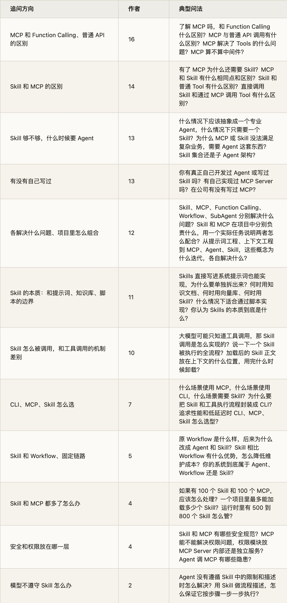
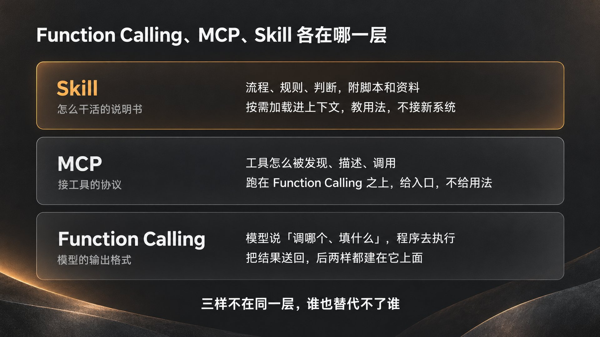
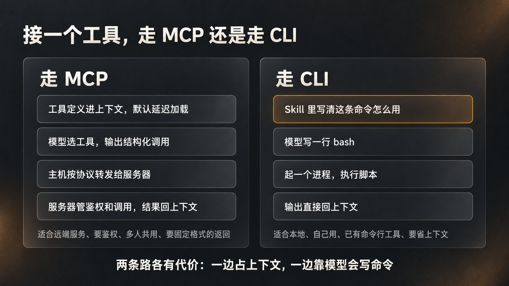
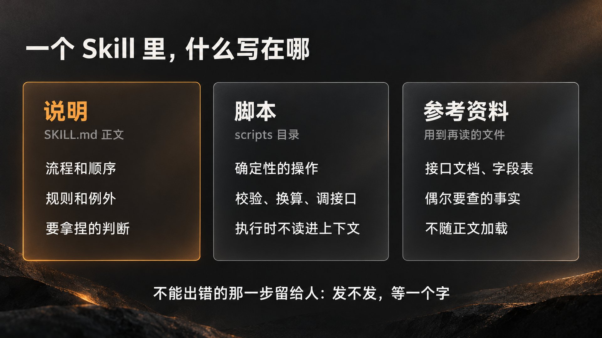
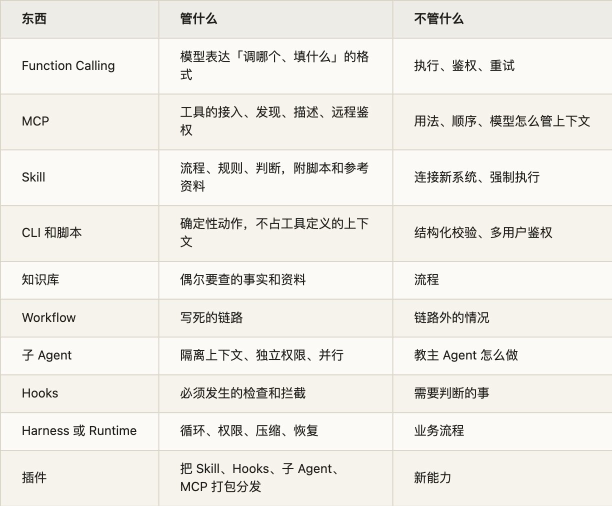
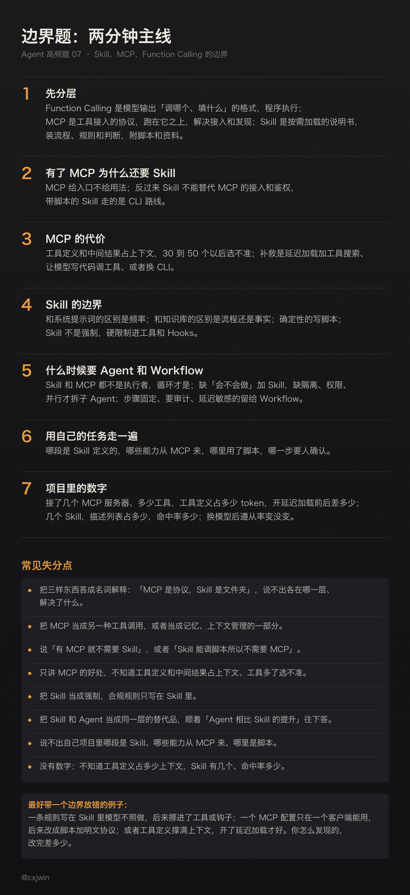

有位候选人面斑头雁的 Agent 实习生一面，面试官从最底下一层开始问：配置完工具之后，Agent 运行时怎样真正去调用工具？模型输出什么内容，让本地 Agent 去执行工具？模型这种结构化输出、工具调用的能力叫什么？追问 Function Calling 是什么。接着往上一层：简历提到的 MCP 是什么？MCP 和普通本地 Tools 很像，MCP 解决了 Tools 的什么问题？再往上：MCP 之后出现的 Skills 大概是什么？Skills 的能力直接写进系统提示词也能实现，为什么要单独拆出 Skills？模型怎么知道当前上下文需要加载哪些 Skill？

这一串追问就是这道题的全部：Function Calling、MCP、Skill 各自解决什么问题，为什么有了下一层还要上一层。字节电商的面试官把同一道题反过来问：Skill 出现了之后为什么还是需要 MCP？Skill 也能够调用脚本啊，Skill 和 MCP、Tool 的根本区别是什么？Skill 不适合干什么？美团 Agent 一面则是一口气问全了：Skill、MCP、Function Calling、Workflow、SubAgent 分别解决什么问题，你在项目中如何组合使用？

这三样东西我都在自己的流水线里折腾过。七月搭发推流水线，第一版用 Claude Code 的 Skill 编排，发布走 Buffer 的官方 MCP；后来要让另一个客户端也能跑，发现 Buffer 的 MCP 配置只活在 Claude Code 自己的配置文件里，别的客户端读不到。我把发布这一步从 MCP 面板里拆出来，改成两个零依赖的脚本直连官方接口，连接方式明文写进同一份 SKILL.md，Claude Code 自动加载成 Skill，WorkBuddy 当手册读，跑的是同一条流水线。当时的判断是：能力本身可以被任何客户端复现，Harness 决定的是能力怎么被用。这篇就沿着这条线把三样东西的边界讲清楚。

这是 Agent 高频面试题单第 7 题的详解。题单里这题是 47 位作者、59 场面试，按「Skill 和 MCP、工具」「MCP 和 Function Calling、API」两组关键词数的。和前几题一样，我把能重新读到原文的 247 场面经逐条读了一遍，剔掉不是单场面经和带参考答案的帖子，剔掉只是问 Skill 怎么写、MCP 走什么协议的（那是第 8 题和第 18 题），补上关键词漏掉的问法，比如「MCP 相比没有 MCP 的时代解决了什么问题」「如果要给 Agent 提供能力，MCP 是唯一的办法吗」「为什么取消独立的分类器，改成各分类沉淀为 Skill 动态挂载」，问到这道题的有 77 场、53 位作者。追问大致分十二个方向（按作者数，一场可以算进几类）：

问得最多的是「MCP 和 Function Calling 的区别」，16 位作者；其次是「有了 MCP 为什么还要 Skill」。这两问最容易答成名词解释：MCP 是协议，Skill 是文件夹，Function Calling 是模型能力。面试官要听的是每一样在一次请求里站在哪一层，解决了上一层解决不了的什么问题，又留下了什么问题给下一层。

下面按这三样东西出现的顺序讲：先把 Function Calling、MCP、Skill 各归各位；再讲 MCP 和直接调 API、CLI 的边界；Skill 和提示词、知识库、脚本的边界；Skill 够不够，什么时候要 Agent 和 Workflow；一个请求里它们怎么装配；规模、安全和遵从三个工程问题；最后是面试怎么答。Skill 文件怎么写、怎么渐进加载，第 8 题单讲；MCP 的协议细节，第 18 题；Function Calling 的训练和原理，第 27 题；工具多了怎么选对，第 24 题；子 Agent 什么时候该拆，第 3 题讲过。这里用到时只点一下。

## 一、三样东西各归各位

1\. Function Calling：模型只负责说「调它」，不负责调

启云方 AI Agent 一面的面试官连着追问：工具调用是依靠关键词、触发条件还是意图识别来决定的？模型决定调用工具以后，工具调用信息到底返回在哪里？模型是不是返回一段普通文本，然后从文本里通过正则解析出工具调用？工具调用是否是结构化输出？工具调用到底是模型「通过语言直接调用」，还是模型生成结构化调用请求，由外部 Agent Loop 真正执行工具？

最后一问就是答案。Function Calling 是模型的一种输出格式：你在请求里带上一组工具定义，每个工具有名字、一段给模型看的描述和一份用 JSON Schema 写的参数说明；模型判断要用工具时，不输出自然语言，而是输出一个结构化的调用块，里面是工具名和参数；你的程序去执行，把结果作为工具结果再送回去，模型接着推理。Anthropic 的文档把这件事写得很直白：Claude 根据用户的请求和工具描述决定什么时候调用工具，然后返回一个结构化的调用，由你的应用执行；响应的停止原因是 tooluse，你的代码跑完操作，把 toolresult 送回。OpenAI 的说法一样：函数是一种用 JSON Schema 定义的工具，模型调用函数时，你必须执行它并把结果返回。

两个细节面试官爱追。一是工具定义放在哪：两家都是塞进系统提示词。OpenAI 的文档写着，函数会以模型训练时见过的语法注入系统消息，所以函数定义算进上下文长度，按输入 token 计费；Anthropic 的 API 在你传了 tools 参数时会自动加一段启用工具的系统提示，Opus 5.5 这一段是 286 个 token，工具定义本身另算。这就是后面「工具太多会撑爆上下文」的来源。二是模型不执行任何东西。它决定调哪个、填什么参数，执行、鉴权、重试、超时都是你程序的事，那是第 11 题和第 27 题的地盘。

这一层 2023 年 6 月就有了。OpenAI 那年 6 月 13 日把它加进 Chat Completions API，公告的说法是开发者可以向 gpt-4-0613 和 gpt-3.5-turbo-0613 描述函数，模型会自己判断该不该调，并输出一个包含参数的 JSON 对象；模型为此专门做过微调，既学会判断什么时候需要调函数，也学会按函数签名输出 JSON。那时候 MCP 和 Skill 都还不存在，后面两样东西都建在它上面，而不是替代它。

2\. MCP：把「工具怎么接上来」标准化

Function Calling 解决了模型怎么表达「我要调这个」，没解决工具从哪来。2023 到 2024 年，每个 Agent 都自己写一遍 GitHub、Slack、数据库的接入，每换一个模型厂商再写一遍。Anthropic 2024 年 11 月发布 MCP，公告的说法是用一个通用的开放标准代替零散的集成：数据和工具的提供方实现 MCP 服务器，AI 应用实现 MCP 客户端，两边按同一套协议说话。

结构上是主机、客户端、服务器三层：主机是 Claude Code、Claude Desktop 这类 AI 应用，它为每个服务器建一个客户端，一个客户端只连一个服务器，消息格式是 JSON-RPC 2.0。服务器能提供三种东西，协议文档按「谁来控制」分：工具由模型控制，模型根据任务自己决定调不调；资源由应用控制，是只读的上下文，比如文件内容、数据库表结构；提示词由用户控制，要用户明确调用。传输有两种，本地的 stdio 和远程的 Streamable HTTP，早期的 HTTP 加 SSE 已经废弃。

面试里最常混的一点：MCP 不是另一种工具调用。MCP 服务器的工具列表到了主机这里，会被转成普通的工具定义，和你自己写的工具一起放进 tools 参数送给模型；模型输出的还是那个结构化调用块，主机拿到后按协议转发给对应的服务器。B 站测开一面的面试官问「外部 MCP 的接口参数如何转换成本地工具格式」，问的就是这一步。Claude Code 里 MCP 工具的名字就是 mcp 加服务器名加工具名拼起来的，和内置的 Bash、Read 没有本质区别。所以「MCP 和 Function Calling 的区别」的答案是：一个是模型和程序之间的约定，一个是程序和工具之间的约定，MCP 跑在 Function Calling 之上。

MCP 也不管模型。协议文档特意写了一句：MCP 只关心上下文交换的协议，不规定 AI 应用怎么用模型、怎么管理拿到的上下文。样本里有篇带参考答案的帖子把 MCP 说成「Agent 与大模型之间的通信协议层，负责模型调用、上下文管理、工具路由」，三样全错，这类帖子我是剔掉的。

3\. Skill：把「这件事怎么干」写成文件

MCP 解决了接入，没解决「接上以后怎么用」。接上 GitHub 的 MCP，模型知道有创建 PR 这个工具，不知道你们团队的 PR 要先跑哪三条检查、标题怎么写、谁来 review。这些东西以前要么塞进系统提示词，要么写在某个专职子 Agent 的提示词里。

Anthropic 2025 年 10 月 16 日发布 Agent Skills，定义是一个目录，里面有一个 SKILL.md，装着组织好的说明、脚本和资料。SKILL.md 开头是一段 YAML，必填两项：名字和描述，描述要写清楚这个 Skill 做什么、什么时候用。加载分三层：启动时只把所有 Skill 的名字和描述放进系统提示词，每个约 100 个 token；模型判断当前任务匹配某个 Skill，就用 bash 从文件系统把整个 SKILL.md 读进上下文，建议 5000 token 以内、500 行以内；SKILL.md 里引用的其他文件和脚本，用到再读，脚本可以直接执行而不读进上下文。所以 Skill 的前提是模型有文件系统和执行环境，Anthropic 的文档明写 Skill 运行在带文件系统、bash 和代码执行的环境里，API 上用 Skill 要先开代码执行工具。

两个月后 Anthropic 把这个格式开放成标准，放在 [agentskills.io](https://agentskills.io/)；今年 10 月 22 日又把标准捐给了 Linux 基金会下的 Agentic AI Foundation，MCP 去年 12 月已经捐进去了。捐赠公告里的数字：70 多个 Agent 平台接了这个格式，包括 ChatGPT、Cursor、GitHub Copilot 和 VS Code；发布的 Skill 超过 100 万个。Codex 的用法是在提示里写 [$skill-name](https://x.com/search?q=%24skill-name&src=cashtag_click)，Claude Code 是 /skill-name，或者让模型自己按描述挑。

4\. 一句话分，和「有了 MCP 为什么还要 Skill」

一句话分：Function Calling 是模型说「调它」的格式，MCP 是把「它」接上来的插座，Skill 是怎么用这些东西把活干完的说明书。三样不在同一层，谁也替代不了谁。

网易互娱那道「有了 MCP 为什么还需要 Skill」，正面答法是：MCP 给的是能力的入口，不给用法。Claude Code 的文档有一句话可以直接背：MCP 把 Claude 连到外部服务；Skill 扩展的是 Claude 知道什么，包括怎么把这些服务用好。Anthropic 10 月 22 日那篇讲单 Agent 的文章给了更准的分工：工具适合 Agent 要做一个动作、从系统读实时数据、或者要一个固定格式的结果的时候；Skill 适合 Agent 需要知道一个团队怎么干活的时候，也就是以前写在专职子 Agent 提示词里的步骤、规则和要拿捏的判断。

反过来也成立：Skill 替代不了 MCP。字节电商的面试官问「Skill 也能够调用脚本啊，根本区别是什么」，答案是脚本调的是你写死的那一个接口，鉴权、重试、分页都得你在脚本里自己处理，别的 Agent 要用还得再写一遍；MCP 把这些收进服务器，一次实现，所有主机都能发现和调用，模型还能按描述自己决定调哪个。Skill 带脚本的那条路其实就是 CLI 路线，第二节讲它什么时候划算。

还有一问常被当成送分题：字节业务中台让候选人分别解释 state、context、memory、MCP。前三个第 6 题讲过，MCP 放在这一组里是因为它常被当成「记忆」或「上下文管理」的一部分，其实它只是工具和资源的接入协议，不存任何东西。

面试常问：了解 MCP 吗，和 Function Calling 什么区别？MCP 与普通 API 调用有什么区别？MCP 之后出现的 Skills 大概是什么？有了 MCP 为什么还需要 Skill？Skill 出现了之后为什么还是需要 MCP？讲讲 Tools 和 MCP 以及 Skills 的区别？Agent 中的 Skill 和普通 Tool 有什么区别？Skills、MCP、A2A 有什么区别？Agent 的 state、context、memory、MCP 分别是干什么的？模型这种结构化输出、工具调用的能力叫什么？外部 MCP 的接口参数怎么转换成本地工具格式？

## 二、MCP 和直接调 API、CLI 的边界

1\. MCP 和普通 API、RPC 的区别

百度多模态智能体二面问 MCP 与普通 API 调用有什么区别，字节后端一面问 RPC 和 MCP 的接口区别是什么。两问是一回事。

普通 API 和 RPC 是程序和程序之间的合同：调用方是人写的代码，知道要调哪个接口、怎么传参，接口文档是给程序员看的。MCP 是程序和模型之间的合同：调用方是模型，它要先知道有哪些工具，再从每个工具的描述里判断该不该调、怎么填参数。所以 MCP 比 RPC 多出来的不是传输，是发现和描述：工具的 description 是写给模型看的，参数名要能自解释。Anthropic 讲怎么给 Agent 写工具那篇文章有一句定义，工具是一种新的软件，反映的是确定性系统和非确定性 Agent 之间的合同；他们的建议是写工具描述时想象你在给团队新来的同事介绍这个工具，参数不要叫 user，叫 user\_id。

MCP 另外统一了两件 RPC 不管的事：远程服务器的授权（推荐 OAuth），以及协议版本和能力的协商，服务器和客户端在每次请求上声明自己支持什么。今年 7 月 28 日的修订版把 MCP 改成了无状态协议，去掉了握手和会话 ID，每个请求自带版本和能力；采样和根目录两个客户端能力标记废弃，异步任务移到扩展里。面试提到「MCP 是有状态连接」的，说的是去年的版本。

2\. MCP 解决了什么，没解决什么

钉钉一面问「MCP 相比没有 MCP 的时代解决了什么问题」，美团和阿里二面问「项目引入 MCP 的原因是什么，它解决了工具接入和调用过程中的哪些具体问题」。解决的是三件事：接入一次、处处可用，不用每个 Agent 各写一遍；工具的发现和描述有了标准格式，模型能自己挑；远程服务的鉴权和传输有了统一做法。

没解决的也是三件，都和上下文有关。Anthropic 去年 11 月那篇讲用代码执行调 MCP 的文章列了前两件：工具定义撑爆上下文窗口，多数 MCP 客户端把所有工具定义一次性塞进上下文，连上几千个工具的 Agent 读请求之前先要处理几十万 token；中间结果也进上下文，一份两小时的会议记录从一个工具传到另一个工具，要多花五万 token。工具搜索的文档给了一个更常见的例子：GitHub、Slack、Sentry、Grafana、Splunk 五个服务器的定义约 5.5 万 token，Anthropic 自己内部见过 13.4 万的。第三件是选不准，工具超过 30 到 50 个，模型挑工具的准确率开始下降，相似名字最容易错。

快手一面问「如果要给 Agent 提供能力，MCP 是唯一的办法吗」，答案是不是，下面两条路就是对这三件事的回应。

3\. CLI 路线：为什么面试官问「为什么封装成 CLI」

美团 Agent 一面问为什么要把 Skill 和工具执行流程封装成 CLI，抖音电商三面问什么场景用 MCP、什么场景用 CLI、什么场景需要 Skill，字节 Data Agent 那场让候选人讲 CLI 的编译链路。CLI 在面经里出现得这么密，是因为它绕开了上面三件事：一条命令行工具不往上下文里放工具定义，模型只需要知道有这个命令和怎么用，这句话正好可以写在 Skill 里；调用就是模型写一行 bash，输出直接进上下文。Simon Willison 去年评 Skill 时说过一句被很多人引用的话：几乎所有他用 MCP 能做的事，都可以用 CLI 工具代替；他举的例子是 GitHub 的官方 MCP 一上来就占几万 token。

我自己是被逼着走这条路的。七月第一版发推流水线，发布这一步用 Buffer 的官方 MCP，用它的 introspect\_schema 把整个 GraphQL schema 翻了一遍，确认图片只收公开 URL、没有上传接口，这些实测结论都回写进了 SKILL.md。第二版要让 WorkBuddy 也能跑同一条流水线，发现 Buffer 的 MCP 配置只活在 Claude Code 自己的配置文件里，别的客户端读不到，连接器全是断开的。于是把发布改成两个零依赖的 node 脚本直连官方端点，协议和参数明文写在 SKILL.md 里，Claude Code 把它当 Skill 加载，WorkBuddy 当手册读，随便什么能跑 bash 和 node 的 Agent 都能跑。那次的结论是：连接层解耦比编排层差异重要；能力从「某个 Harness 的 MCP 面板」下沉到「脚本加明文协议」，Harness 就从看门人退成了运行时。五月写 Agent 操作浏览器那篇时我给过一个顺序，也是这个意思：能用 API 就不要点页面，能用 MCP、CLI、SDK 就不要靠视觉。

什么时候还是该用 MCP？三种情况：服务在远端、要鉴权、多个用户和多个 Agent 共用，CLI 里的密钥和会话不好管；需要结构化的参数校验和固定格式的返回，CLI 的输出是文本，模型得自己解析；工具要给不同团队、不同产品复用，MCP 的版本化接口和统一发现比一堆脚本好维护。抖音电商那问「追求性能和低延迟时怎么选型」可以这么答：本地 stdio 的 MCP 服务器是常驻进程，CLI 每次起一个进程，单次调用 MCP 不一定慢；但算上上下文，CLI 省的是每轮都要带的工具定义，长会话里这笔账更大。

4\. 两条补救：工具搜索和代码执行

MCP 这边也在补。第一条是延迟加载加搜索：Anthropic 的 Tool Search 把工具定义标成延迟加载，不进系统提示词，模型先用一个搜索工具按名字和描述找，找到的三五个再展开成完整定义。他们的数字是，50 多个 MCP 工具原来占约 7.2 万 token，开搜索后前置只有约 500，总消耗降到约 8700，省了 85%；MCP 评测的准确率，Opus 4.5 从 79.5% 提到 88.1%。文档建议工具超过 10 个、或者定义超过 1 万 token 就开。Claude Code 现在默认就是这么做的：会话开始只加载工具名和服务器说明，完整的 JSON Schema 等模型要用某个工具时再取；OpenAI 的 API 也有同名的 tool\_search。我七月写删掉 80% 系统提示词那篇时，在会话里看到 Workflow 工具的描述写着「MCP 工具的 schema 由 ToolSearch 按需加载」，说的就是这个。

第二条是让模型写代码调工具，而不是一轮一轮地调。Anthropic 的做法是把 MCP 服务器呈现成文件系统里的代码 API，模型翻目录找需要的接口，写一段代码串起来跑，中间结果留在执行环境里，只有最终结果回上下文。文章里的例子从 15 万 token 降到 2000，省了 98.7%；API 上对应的功能叫程序化工具调用，内部评测平均 token 从 43588 降到 27297。代价是要一个带沙箱、资源限制和监控的执行环境，这是直接调用不需要的。

面试常问：MCP 与普通 API 调用有什么区别？RPC 和 MCP 的接口区别是什么？MCP 相比没有 MCP 的时代解决了什么问题？项目引入 MCP 的原因是什么，它解决了工具接入和调用过程中的哪些具体问题？为什么 Agent 生态开始广泛使用 MCP？MCP 有哪些缺点或挑战？MCP 算不算中间件？如果要给 Agent 提供能力，MCP 是唯一的办法吗？什么情况下会考虑开发 MCP？为什么要把 Skill 和工具执行流程封装成 CLI，有什么好处？什么场景使用 MCP，什么场景使用 CLI，什么场景需要 Skill？怎样理解 CLI 和 MCP Tool，它们有什么区别？如果重点追求性能和低延迟，CLI、MCP、Skill 应怎样选型？如何优化工具与 Agent 之间的 CLI、MCP 交互？

## 三、Skill 和提示词、知识库、脚本的边界

1\. Skill 和系统提示词：区别是加载时机

斑头雁的面试官问：Skills 的能力直接写进系统提示词也能实现，为什么要单独拆出 Skills？字节 AI Agent 开发一面问得更狠：你认为 Skills 的本质到底是什么？

本质上 Skill 就是一段提示词，区别只在什么时候进上下文、待多久。系统提示词每一轮都在，Skill 只在模型判断用得上的时候进来，用不上的时候只占一行描述。Claude Code 早期把 code review 和验证流程的细节全写在系统提示词里，不是每次都用得上，但用得上的时候很关键，于是常驻；现在的做法是拆成独立的 Skill，需要时才加载，连一部分工具都改成了延迟加载。我七月那篇文章给过一个判断标准：上下文不是仓库，是缓存。一条信息一百次会话里能用上几次？用得上的常驻，低于个位数的下沉成 Skill。Anthropic 的 Skill 写作指南说的是同一件事：只加 Claude 本来没有的上下文。

所以 Skill 和提示词的边界是频率，不是内容。CLAUDE.md 和系统提示词放每次都要的规矩，Skill 放偶尔要的流程。Claude Code 的功能对照页写得很细：参考资料和用斜杠触发的工作流放 Skill，项目约定和「永远做某事」的规则放 CLAUDE.md。

2\. Skill 和知识库：流程和资料分开放

度小满一面问何时用知识文档、何时用向量库、何时用 Skill；蚂蚁二面问知识库和 Skills 分别承载什么内容。Anthropic 那篇单 Agent 文章给了三分法，可以直接用：工具做动作和读实时数据；Skill 装一个团队怎么干活，步骤、规则和判断；知识库放 Agent 只是偶尔要查的参考资料，政策、指标定义、产品规格这类，放在检索或查询工具后面让模型自己去取，或者作为参考文件放进 Skill。他们特意加了一句：别让代码把这些资料检索好了整段贴进提示词。

判断标准是「这段内容是告诉模型怎么做，还是告诉它一个事实」。怎么做的进 Skill 正文；事实太多、会变、只偶尔用，放知识库；事实不多但这个流程每次都要查，放 Skill 的第三层，比如一份接口文档、一张字段表。我写文章的仓库里有六类 Skill，写作 Skill 本身只有几十行，文风偏好单独放在一个参考文件里，写作和润色两个 Skill 都引用它，不各维护一份。

3\. Skill 和脚本：确定性的交给代码

美团食杂零售那场问得很实在：在业务 Skill 中，什么情况下适合通过脚本实现，什么情况下不适合使用脚本？这是 Skill 内部最重要的一条边界。Anthropic 的指南说得很直接：确定性的操作优先写脚本，写一个 validate\_form.py，而不是让模型现场生成校验代码；预先写好的脚本比生成的代码可靠，也省 token，因为脚本执行时不用读进上下文。

我的发推 Skill 就是这么分的。字数怎么算、时区怎么换、Buffer 的字段校验规则、图片尺寸限制，这些踩出来的确定结论写死在文档和脚本里；什么文章该用什么风格的短评、要不要配图、哪些内容不能自动发，这些留给模型判断；而「发不发」这一步永远留给人，涉政、重大灾难、无信源的负面指控、付费墙四类内容回退人工。Skill 的本质是把 SOP 写成文档：可执行的部分变成脚本，要判断的部分留给模型，不能出错的部分留给人。

字节电商的面试官问「Skill 不适合干什么」，顺着这条边界答：不适合装需要每次都在的硬规则，那是系统提示词和 Hooks；不适合装会变的大量事实，那是知识库；不适合替代连接和鉴权，那是 MCP 和服务端；也不适合装必须百分之百按顺序执行的链路，第四节讲。

4\. Skill 怎么被调用，和工具调用的机制差别

腾讯社招一面问：大模型可能只知道工具调用，那 Skill 调用是怎么实现的？腾讯营销一面连问四个：Skill 是怎样被发现和按需加载的？加载后的 Skill 正文放在模型上下文的什么位置？Skill 使用完后什么时候从上下文里卸载？下一轮不再带 Skill 正文，会不会影响前缀缓存？

答案是 Skill 不是一种新的调用类型。两种实现：API 和 [claude.ai](https://claude.ai/) 上，Skill 的名字和描述在系统提示词里，模型判断要用就用 bash 读文件，读文件本身就是一次普通的工具调用；Claude Code 里多一层，Skill 可以由用户用斜杠命令触发，也可以由模型通过一个 Skill 工具加载，frontmatter 里能设成只许用户触发或只许模型触发。加载进来的正文作为一条消息进入对话，之后的轮次一直在，不卸载；因为它是追加进对话的一条消息，前面的系统提示词和工具定义没变，前缀缓存不受影响。所以腾讯营销那四问的答法是：按描述发现，读进对话，放在消息区，不卸载，不影响缓存；用完还占着上下文这件事，靠对话压缩处理，第 5 题讲过。

字节客户端一面问「Skill 里能不能包含一套工具，完成任务时调用多个底层工具」。能，但要分清：Skill 可以带脚本，可以在 frontmatter 里预授权一组工具，可以在正文里写「先用 BigQuery 的 schema 工具查表结构」；但它不能注册新工具，模型能调的还是 Agent 本来就有的工具和脚本。能注册新工具的是 MCP 服务器。今年 MCP 还出了一个扩展，让服务器把 Skill 当资源发布，提案里写的理由是，以前一个服务器和教模型怎么用它的 Skill 是分开发布、分开安装的；主机把它们读下来，和本地文件夹里的 Skill 一样用，SDK 和主机的支持还在做。这也从反面说明两者是一对：MCP 管接入，Skill 管用法，现在可以打包在一起分发。

面试常问：Skills 直接写进系统提示词也能实现，为什么要单独拆出来？你认为 Skills 的本质到底是什么？如何理解 Agent 体系中 Skills 的设计思想？何时用知识文档、何时用向量库、何时用 Skill？知识库和 Skills 分别承载什么内容？哪些问题适合直接调用工具或执行确定性查询，哪些需要检索知识库？在业务 Skill 中，什么情况下适合通过脚本实现？Skill 只包含流程说明，还是包含完整设计？Skill 的功能边界和实现方式是什么？Skill 不适合干什么？大模型可能只知道工具调用，那 Skill 调用是怎么实现的？说一下一个 Skill 被执行的全流程？Skill 里能不能包含一套工具？加载后的 Skill 正文放在上下文的什么位置，什么时候卸载，影响前缀缓存吗？是否会由 Agent 自主调用 Skill？更换底层大模型，是否需要重新调优 Skill？

## 四、Skill 够不够：什么时候要 Agent，什么时候要 Workflow

1\. Skill 和 Agent 不是一层的东西

字节 AI Infra 一面有一串问题：为什么 MCP 或者之前的 Skill 没法满足复杂业务需求，需要 Agent 这套东西？tools 在 MCP 这一代、Skill 这一代就已经实现了，为什么还需要 Agent？Agent 相比 Skill 带来了哪些提升？

这串问题的前提有问题，答之前要先把前提摆正：Skill 和 MCP 都不是执行者。MCP 是接工具的协议，Skill 是说明书，两样东西都要有一个在跑的循环来用它们，这个循环就是 Agent：读上下文，决定下一步，调工具，看结果，再决定，直到任务完成。Claude Code 加 Skill 本身就是一个 Agent，面试官说的「Agent 这套东西」多半指的是自己搭的运行时，循环怎么跑、上下文怎么压、权限怎么管、出错怎么恢复，那是第 9 题的 Harness。所以「Agent 相比 Skill 的提升」这个问法本身不成立，可以答成「自研运行时相比直接用 Claude Code 加 Skill 多了什么」：对循环、权限和成本的控制，以及嵌进自己产品的能力。

字节全栈二面的「什么情况下应该抽象成一个专业 Agent，什么情况下只需要一个 Skill」，第 3 题讲过，这里只重复结论：缺的是「会不会做」，加 Skill；缺的是「做的时候别把主上下文弄乱」「要用不同的权限」「要一个独立的检查者」「要并行跑好几轮」，才拆子 Agent。Claude Code 的文档把这句话反过来说：想要在主对话上下文里跑的可复用提示词和工作流，用 Skill，不用子 Agent。那位候选人问「是否可以概括为单 Agent 加多 Skill」，可以。Anthropic 10 月那篇文章在几家企业的对比里得到的也是这个结论：带 Skill 的单 Agent 在质量上常常同时胜过「一个提示词管所有事」和拆子 Agent 两种写法，成本和延迟往往还更低。

2\. Skill 和 Workflow：改文档，还是改代码

快手 AI 全栈一面问为什么把原来的 Workflow 改成 Skill，美团 AI 后端二面问 Skill 相比 Workflow 有什么优势、具体怎么降低维护成本，百度 Agent 后端三面问原 Workflow 是什么样、后来为什么改成 Agent 和 Skill。无锡一家公司的问法最具体：为什么后期取消了独立的分类器，改为将各分类沉淀为独立的 Skill 并动态挂载？

Workflow 是代码写死的链路：第一步分类，第二步查库，第三步生成，每一步调一次模型或工具，顺序由代码定。Skill 是把这条链路写成说明，顺序和分支由模型按情况走。改成 Skill 的收益有三条：改流程改文档，不改代码、不发版；模型能跳过用不上的步骤，处理链路没写到的情况；一份 Skill 能被不同的 Agent 复用。Anthropic 那篇文章描述的正是无锡那家的改法：他们常见到意图分类器、固定的多步推理流水线、按用户分群这样的结构，反馈往往是这些结构大多在替模型做它已经不需要别人代劳的事，一份清楚的系统提示词、四五个轻量的数据工具加上严格的输出护栏就能覆盖大部分场景。他们的迁移建议是把每个子 Agent 的提示词变成 Skill，把 API 调用变成 MCP 工具，顺序和领域步骤进 Skill，硬限制进工具。

代价也要说：Skill 不保证顺序，第六节讲怎么办；每次都要模型读说明，延迟和 token 比固定链路高；要有评测才知道改了文档以后变好还是变坏，第 4 题讲过。所以 Workflow 留给步骤固定、每步要审计、延迟敏感的链路。Workflow 和 Agent 怎么选，第 23 题单讲。

字节电商的「你的系统到底属于 Agent、Workflow 还是 Skill」可以这么答：系统是 Agent，因为有循环在跑；Skill 是它的说明书；Workflow 是其中某几段写死的链路。三个词不在一层，一个系统里可以三样都有。

面试常问：什么情况下应该抽象成一个专业 Agent，什么情况下只需要一个 Skill？是否可以概括为「单 Agent 加多 Skill」？Skill 集合还是子 Agent 架构？你的项目为什么要用一个 Agent 而不是直接写一个 Skill 嵌进去？为什么 MCP 或 Skill 没法满足复杂业务需求，需要 Agent？Agent 相比 Skill 带来了哪些提升？Skill 和 Harness 在理解上有什么区别？如果遇到现有 Skill 无法解决的问题，Agent 会怎么处理？什么情况下应该设计成一个独立 Agent，什么情况下只是普通工具调用？怎么看基于 Claude Code、Codex 这类通用 Agent 加 Skill 和编排层用于生产的方案？直接修改开源 Agent 框架内核，和利用已有插件、扩展来做，各有什么优劣？Skill、Workflow、Agent 三者的联系和区别？为什么把 Workflow 改成 Skill，优势在哪，怎么降低维护成本？你的系统到底属于 Agent、Workflow 还是 Skill？

## 五、一个请求里，它们怎么装配

1\. 从用户输入到结果

美团和阿里二面要候选人用一个实际任务说明两者如何配合：哪些内容由 Skill 定义，哪些能力通过 MCP 提供，系统又如何完成调用。这是这道题最好的答法，用自己项目里的一个任务走一遍。

以我的发推流水线为例。一次请求开始时，上下文里有：系统提示词，常驻；内置工具和 MCP 工具的定义，MCP 的部分默认只有名字；所有 Skill 的名字和描述，一行一个；对话历史和我丢进去的链接。模型看到链接，匹配到发推 Skill 的描述，读进 SKILL.md，按里面的流程走：先用抓取工具读文章，反爬就换浏览器；按 Skill 里的规则写短评，风格按文章类型选；要配图就调一条 Codex 命令出图，这是 CLI；图传到图床，这是脚本；最后发布，第一版走 Buffer 的 MCP 工具，第二版走脚本直连接口；发之前把全文、配图和拟发时间摆出来，等我回一个字。每一步「调哪个工具、填什么参数」都是模型的结构化输出，执行的是 Claude Code 这个运行时。

把这个过程说清楚，Skill、MCP、Function Calling、CLI、人工确认各在哪一层就都出来了。

2\. 职责表

阿里千问二面问 Skill、CLI 和 Agent Runtime 分别承担什么职责，字节业务中台问 Skill、MCP、CLI、plugin 分别适用哪些场景。一张表：

最后一行是 Claude Code 文档的定义：插件是打包层，把 Skill、Hooks、子 Agent 和 MCP 服务器装成一个可安装的单元。蚂蚁二面问的「工具、记忆、权限管理和 Agent Loop 全面插件化」趋势，答的时候可以指着这张表说：被插件化的是表里每一行的实现，不是这些层本身。

3\. 出了问题归哪一层

字节二面问：Agent 任务成功率上不去，你怎么排查，怎么区分是大模型的问题，还是 Skill、MCP、工具调用的问题？顺着一次请求的装配往回查，每一层有自己的症状：

- 没选对 Skill，或者该用 Skill 时没加载：描述写得不清楚，或者 Skill 太多描述被截断。改描述。

- 加载了 Skill 没按步骤走：说明含糊，或者模型不遵从。改说明，硬约束移进工具或 Hooks，第六节讲。

- 工具调错了、参数填错了：工具描述和参数名不自解释，相似工具太多。改工具定义，分组，开延迟加载。

- 工具调对了结果不对：工具本身或下游服务的问题，和模型无关。

- 以上都对，答案还是错：模型推理的问题，换模型或者改提示词。

每一层改的东西不一样，所以要先有 trace 再下结论。bad case 怎么定位和回流，第 13 题单讲。

面试常问：Skill 和 MCP 在项目中分别负责什么？请用一个实际任务说明两者如何配合？Skill、MCP、Function Calling、Workflow、SubAgent 分别解决什么问题，你在项目中如何组合使用？Skill、CLI 和 Agent Runtime 分别承担什么职责？Skill、MCP、CLI、plugin 分别适用在哪些场景？你对 MCP、Skill、Tool 和 RAG 的理解是什么？从提示词工程、上下文工程到 MCP、Agent、Skill，这些概念为什么迭代更新，各自解决什么问题？主要是装配 Skill 和 MCP 吗？除了 Skill、MCP 和思考强度限制，还有哪些方式能让模型在特定场景下表现更好？Agent 工具调用这方面，了解哪些方式？Agent 任务成功率上不去，怎么区分是大模型的问题还是 Skill、MCP、工具调用的问题？

## 六、规模、安全、遵从

1\. 100 个 Skill 和 100 个 MCP

字节业务中台的问法是「如果有 100 个 Skill 和 100 个 MCP，应该如何去处理」，字节泛抖音一面问一个项目里最多能加载多少个 Skill，一家小厂问运行时里有 500 到 800 个 Skill 怎么管理。

两边的机制不一样。Skill 这边，每次请求都要带全部 Skill 的名字和描述，所以上限是描述列表的预算：Claude Code 给这张列表的预算是上下文窗口的 1%，每条描述最多 1536 个字符，超了先丢最少用的 Skill 的描述，名字保留；Codex 是 2%，窗口未知时 8000 字符，超了先缩描述，再省略一部分 Skill 并警告。[@pvncher](https://x.com/@pvncher) 九月那篇讲 Astra 技能与提示词的文章我译过，说的就是这件事：很多人往项目里下载一大堆技能，描述太长、太多时 Codex 会缩短描述，模型能看到的每条都变少，更难判断该选哪个。MCP 这边，工具定义默认延迟加载，上限是搜索的准确率而不是上下文；Claude Code 文档的说法是没有固定的每服务器工具数上限，实际上限是上下文预算。

所以答法是：Skill 多了，先看描述，用使用频率淘汰；MCP 多了，开延迟加载和工具搜索，按用户意图把工具分组而不是一个接口一个工具，30 到 50 个以后就该这么做。那家小厂的候选人答的是给 Skill 注册中心加调用计数，从执行结果反推有用还是有害，低频和废弃的不进路由池；Anthropic 现在的做法也类似，Claude Code 里有个 skill-doctor 命令，看每个 Skill 占多少上下文、实际用了几次，删掉没用的。工具多了怎么选对是第 24 题，Skill 的描述怎么写是第 8 题。

2\. 安全和权限放在哪一层

快手三面问 Skill 和 MCP 有哪些安全规范，拼多多问 Agent 调 MCP 有哪些隐患，美团容器平台那场连问三个：MCP 能不能解决权限问题？如果 Skill 既有读又有写，不同用户、不同部门只能操作自己有权限的资源，权限应该怎么设计？权限模块应该设计成独立服务，还是放在 MCP Server 内部？

先说原则：Skill 和 MCP 工具都是代码执行。MCP 的协议文档写着，工具代表任意代码执行，主机在调用任何工具前必须取得用户的明确同意；Anthropic 对 Skill 的说法是只用可信来源的，恶意 Skill 可以指使模型以和它声称的目的不符的方式调工具、跑代码，API 上的 Skill 没有网络访问。

再说权限放哪。放在被调用的那一侧，不放在 Skill 里。Skill 里写一句「不要越权」是说明，不是栅栏，第 3 小节讲为什么。Anthropic 那篇单 Agent 文章的做法是：每个工具自己检查调用它的用户能看什么、能做什么，不行就返回一句模型读得懂的拒绝，这样一个循环就能服务不同权限的用户，不用按权限等级各建一个 Agent。放到美团容器平台那三问上：MCP 本身不解决权限，它只负责把调用方的身份传过去；校验放在工具的实现里，也就是 MCP 服务器或它后面的服务，具体是独立的权限服务还是服务器内部的一段代码，取决于你们现有的权限系统在哪；Skill 层只负责告诉模型「写操作前先查权限」。越权、注入和沙箱，第 20 题单讲。

3\. 模型不遵守 Skill 怎么办

字节飞书一面问：Agent 没有遵循 Skill 中的限制和描述时，你是如何解决的？是否尝试过把 Skill 规则写入更底层、优先级更高的规范？快手问模型可能不遵循 Skill 文档，高合规场景怎样保证不越权；阿里国际三面问用 Skill 做流程描述，怎么保证它按步骤一步一步执行。

这三问指向 Skill 最硬的一条边界：Skill 是说明，不是强制。模型读了说明，大多数时候照做，但「大多数」在合规场景里不够。三层办法：

第一层，把说明写清楚。很多「不遵从」其实是说明含糊、互相矛盾，或者太长被模型略过了。我九月清理自己的提示词时，一份写作 Skill 要求每篇至少用三次某种句式，隔壁去 AI 味的 Skill 又要求控制同类修辞，两份规则互相牵制，模型怎么做都违反一条。Anthropic 的建议是把描述当成给新同事的介绍写，先用评测找问题，再写文档。

第二层，必须发生的事不靠说明。Anthropic 那篇文章的迁移建议里有一句：顺序和领域步骤进 Skill，硬限制，比如校验和审批门，进工具。工具可以在前置条件没满足时拒绝，把「必须先做 X」从一句叮嘱变成一个返回值。Claude Code 还有 Hooks：钩子在事件上触发，不经过模型判断，适合每次都必须一样的动作；Skill 由模型解释，结果可能变化。我五月写 Hooks 那篇的结论是，真正重要的约束不能只写在你跟它说的话里，得放进工具链和运行环境，让系统替你执行；PreToolUse 是拦截工具调用的入口，因为它发生在工具真正执行之前。

第三层，测。改了 Skill 或者换了模型，拿一组任务跑遵从率，这是第 4 题的事。科大讯飞那场问「更换底层大模型，是否需要重新调优 Skill」，答案是要重新验证：Skill 是给模型的说明，效果取决于读它的模型，Anthropic 的文档原话是 Skill 是模型的附加物，效果依赖底层模型。我九月那次换模型的做法是先保留旧配置和代表任务的输出，只换模型看变化，再逐条调可疑的规则；模型、客户端和整套 Skill 一起换，出了问题就没法定位。

面试常问：如果有 100 个 Skill 和 100 个 MCP，应该如何处理？一个项目里最多能加载多少个 Skill？Skill 增多导致模型上下文膨胀时怎么办？运行时里如果有 500 到 800 个 Skill，怎么管理？Skill 和 MCP 有哪些安全规范？Agent 调 MCP 有哪些隐患风险？MCP 能不能解决权限问题，权限模块放 MCP Server 内部还是独立服务？用户执行一个 Skill 拿到敏感信息再传给下一个 Skill，怎么让用户不接触这些信息？Agent 没有遵循 Skill 中的限制和描述时怎么解决？是否尝试过把 Skill 规则写入更底层、优先级更高的规范？模型可能不遵循 Skill 文档，高合规场景怎样保证不越权？用 Skill 做流程描述，怎么保证按步骤执行？

## 七、面试怎么答

两分钟左右的主线：

1. 先分层：Function Calling 是模型输出「调哪个、填什么」的格式，程序执行；MCP 是工具接入的协议，跑在它之上，解决接入和发现；Skill 是按需加载的说明书，装流程、规则和判断，附脚本和资料。

2. 有了 MCP 为什么还要 Skill：MCP 给入口不给用法；反过来 Skill 不能替代 MCP 的接入和鉴权，带脚本的 Skill 走的是 CLI 路线。

3. MCP 的代价：工具定义和中间结果占上下文，30 到 50 个以后选不准；补救是延迟加载加工具搜索、让模型写代码调工具、或者换 CLI。

4. Skill 的边界：和系统提示词的区别是频率；和知识库的区别是流程还是事实；确定性的写脚本；Skill 不是强制，硬限制进工具和 Hooks。

5. 什么时候要 Agent 和 Workflow：Skill 和 MCP 都不是执行者，循环才是；缺「会不会做」加 Skill，缺隔离、权限、并行才拆子 Agent；步骤固定、要审计、延迟敏感的留给 Workflow。

6. 用自己的任务走一遍：哪段是 Skill 定义的，哪些能力从 MCP 来，哪里用了脚本，哪一步要人确认。

7. 项目里的数字：接了几个 MCP 服务器、多少工具，工具定义占多少 token，开延迟加载前后差多少；几个 Skill，描述列表占多少，命中率多少；换模型后遵从率变没变。

最好带一个边界放错的例子：一条规则写在 Skill 里模型不照做，后来挪进了工具或钩子；一个 MCP 配置只在一个客户端能用，后来改成脚本加明文协议；或者工具定义撑满上下文，开了延迟加载才好。你怎么发现的，改完差多少。

几个常见的失分点：

- 把三样东西答成名词解释：「MCP 是协议，Skill 是文件夹」，说不出各在哪一层、解决了什么。

- 把 MCP 当成另一种工具调用，或者当成记忆、上下文管理的一部分。

- 说「有 MCP 就不需要 Skill」，或者「Skill 能调脚本所以不需要 MCP」。

- 只讲 MCP 的好处，不知道工具定义和中间结果占上下文、工具多了选不准。

- 把 Skill 当成强制，合规规则只写在 Skill 里。

- 把 Skill 和 Agent 当成同一层的替代品，顺着「Agent 相比 Skill 的提升」往下答。

- 说不出自己项目里哪段是 Skill、哪些能力从 MCP 来、哪里是脚本。

- 没有数字：不知道工具定义占多少上下文，Skill 有几个、命中率多少。

## 出处

文中的面试问法都出自下面这些面经，括号里是发帖日期，链到牛客原帖。

- 开头的例子：[斑头雁 Agent 实习生一面](https://www.nowcoder.com/discuss/930139676764102656)（09-17）· [字节电商日常实习一面（中国交易与广告）](https://www.nowcoder.com/feed/main/detail/45e715fbedcb4c1c93a968647823214c)（09-22）· [美团 Agent 一面](https://www.nowcoder.com/feed/main/detail/18fa4134edb14e8c901787ee5cd33ace)（10-12）

- 三样东西各归各位：[启云方 AI Agent 一面](https://www.nowcoder.com/feed/main/detail/fea2d18bd59a421da7d16fe16223d38c)（09-03）· [B 站测开一面](https://www.nowcoder.com/feed/main/detail/44d088a151964a17bf46d7b776313253)（08-20）· [网易 Agent 开发一面](https://www.nowcoder.com/feed/main/detail/bad72b1323274ad5b172039f48bfa4b1)（10-17）· [作业帮 AI 应用开发实习](https://www.nowcoder.com/feed/main/detail/73bad9d11163476d8cfce0f26c1c04f5)（10-16）· [网易互娱 AI 应用开发日常实习](https://www.nowcoder.com/feed/main/detail/683ffea1ead24f8d8539f6bab3b7b361)（10-16）· [百度](https://www.nowcoder.com/feed/main/detail/fc061fe55af84effb8014ed6c60db92d)（10-14）· [字节业务中台 AI 全栈日常实习](https://www.nowcoder.com/feed/main/detail/6ac5ba31705a4b64a407b087f39d5447)（10-12）· [理想汽车 IT 全栈一面](https://www.nowcoder.com/discuss/938122023392366592)（10-09）· [高斯信息技术 AI 开发一面](https://www.nowcoder.com/feed/main/detail/80a2ffb74adf42d9adec69ee3b7c73eb)（10-09）· [字节剪映前端一面](https://www.nowcoder.com/feed/main/detail/ffe074f01683402fb85c324430f2877d)（09-22）· [字节抖音电商客户端一面](https://www.nowcoder.com/feed/main/detail/9d9259986b304b749bc8ab07c20365c9)（09-15）· [钉钉二面](https://www.nowcoder.com/discuss/925181638412091392)（09-04）· [阿里边缘 BU 一面](https://www.nowcoder.com/feed/main/detail/bdebbb6088b6405e9eb2bd2c345acb6e)（09-03）· [阿里千问二面（8.28）](https://www.nowcoder.com/feed/main/detail/9124b0efb14349d2a60ee58a26c1ccbd)（08-28）· [小米后端 Java 一面](https://www.nowcoder.com/feed/main/detail/ec9340e947aa4613a284688e00ec4f5d)（08-27）

- MCP 和 API、CLI 的边界：[美团和阿里二面](https://www.nowcoder.com/feed/main/detail/a9e773c96cae4a8ebbca23d84f59cb8c)（10-14）· [美团全栈开发日常实习一面](https://www.nowcoder.com/feed/main/detail/95e9fc44397d4118ba3946ef0d33b6da)（10-12）· [字节业务 Data Agent](https://www.nowcoder.com/feed/main/detail/c42ce9e02e5f44c29768841663077d59)（10-08）· [字节抖音电商 Agent 开发一二三面](https://www.nowcoder.com/discuss/937314680270311424)（10-07）· [快手一面（发券）](https://www.nowcoder.com/feed/main/detail/02dac811205448be9c3b0f146dd68f8b)（10-02）· [百度 AIGC 多模态智能体二面](https://www.nowcoder.com/feed/main/detail/2d033fd6daa04e2aaad2282b75531bbc)（09-29）· [宏图智能一面](https://www.nowcoder.com/discuss/934206754898866176)（09-28）· [字节全栈二面（中国交易与广告）](https://www.nowcoder.com/feed/main/detail/c3d462fb98c246e08510a2555ce5ba90)（09-24）· [字节后端一面](https://www.nowcoder.com/feed/main/detail/6b68d99d9ff74e4f920d7527a8fb27c0)（09-23）· [阿里千问二面](https://www.nowcoder.com/feed/main/detail/5ff7b7fde8bc49eb960d5badde3ac623)（09-22）· [蚂蚁二面](https://www.nowcoder.com/feed/main/detail/52b419448b854e24bbdf41ca9e6ffe06)（09-21）· [字节 Agent 研发工程师（AI 算力基础设施）](https://www.nowcoder.com/discuss/930155293864914944)（09-17）· [帆软后端二面](https://www.nowcoder.com/feed/main/detail/2eb0fa4d90a04b598d58d6d303de5010)（09-14）· [美团容器平台 Java 开发](https://www.nowcoder.com/feed/main/detail/91e3b76eabd140bdbed20dc43724b396)（09-12）· [抖音电商 Agent 全栈一面](https://www.nowcoder.com/discuss/925066865183858688)（09-03）· [抖音电商后端开发一面](https://www.nowcoder.com/discuss/925065999378829312)（09-03）· [淘天技术一面](https://www.nowcoder.com/discuss/924497771812397056)（09-02）· [钉钉一面](https://www.nowcoder.com/discuss/923765750446202880)（08-31）

- Skill 和提示词、知识库、脚本，Skill 怎么被调用：[字节 AI Agent 开发一面](https://www.nowcoder.com/feed/main/detail/9cd459d87a754e07a490ba7f1c03b495)（10-17）· [科大讯飞飞凡计划](https://www.nowcoder.com/feed/main/detail/23401c14bf8f4fc2b4818f6cb8586049)（10-13）· [阿里千问 Agent 开发二面](https://www.nowcoder.com/feed/main/detail/456b3698145c431dacdbe5a1ff7d057c)（10-04）· [美团 AI 后端一二面（食杂零售）](https://www.nowcoder.com/feed/main/detail/0fade3c42efb40e5ae3ca0dcfd3d4dfa)（10-01）· [度小满 AI 全栈研发一面](https://www.nowcoder.com/feed/main/detail/f9c29fa841664294b8ab7e9921072afd)（09-30）· [腾讯营销一面后端](https://www.nowcoder.com/feed/main/detail/c51f363514734218bcc5bb69fd655cd5)（09-24）· [百度 Agent 算法岗一二面](https://www.nowcoder.com/feed/main/detail/8a52d4f70093426fb8fc32e6825466e3)（09-23）· [淘天供应链 AI 应用研发一面](https://www.nowcoder.com/feed/main/detail/8656f1483ebd441bac7c17c313e5394a)（09-23）· [腾讯一面（社招）](https://www.nowcoder.com/feed/main/detail/668c7f4007b44fc7b878f55eb01e6e11)（09-23）· [百度 Agent 一面](https://www.nowcoder.com/feed/main/detail/53542e2dcfd44b1d84b0ae55b4fc1b35)（08-29）· [百度 Agent 一二三面](https://www.nowcoder.com/feed/main/detail/b9521e2b51e04afeac0a3a32e13f4da9)（08-28）· [小鹏 Agent 开发实习一面](https://www.nowcoder.com/feed/main/detail/3832f2e0ba074b4782daa6ff7a65a1f9)（08-28）

- Skill、Agent 和 Workflow：[字节全栈二面](https://www.nowcoder.com/feed/main/detail/3cac2a5686f5478f849d7e64a5a2e124)（10-17）· [无锡赫玛科技](https://www.nowcoder.com/feed/main/detail/24a0ee8b5d2c4d65aaf5fc1e18bfcc23)（10-10）· [百度 Agent 后端三面](https://www.nowcoder.com/discuss/931476137576845312)（09-21）· [蚂蚁一面](https://www.nowcoder.com/feed/main/detail/754ac010a05e4090a05d7ba4d06c757f)（09-15）· [字节 AI Infra 一面](https://www.nowcoder.com/feed/main/detail/a1ce24c561874141abe6ba18a466f982)（09-14）· [美团 AI 后端二面](https://www.nowcoder.com/discuss/929087871779110912)（09-14）· [韶音 AI 应用开发一面](https://www.nowcoder.com/feed/main/detail/11e40634018b47a7974bf5c96605024c)（09-12）· [快手 AI 全栈一面](https://www.nowcoder.com/feed/main/detail/a30242712e8d456c839ff4223470f491)（08-31）· [百度后端 Go/Agent 一面](https://www.nowcoder.com/discuss/922907945363349504)（08-28）· [携程欢乐互娱前端实习一面](https://www.nowcoder.com/feed/main/detail/359a1961cc6c4510864a727cb0754825)（08-24）· [淘天日常实习一面（用户运营技术）](https://www.nowcoder.com/feed/main/detail/5dca9d9dd8284cc4aada23b9f0c20f15)（08-18）

- 怎么组合、归哪一层：[字节二面](https://www.nowcoder.com/feed/main/detail/63e2f08340594129b803aa6e6ea43a5f)（10-12）· [字节数据开发](https://www.nowcoder.com/feed/main/detail/2594098aeb504cb99e773987cf831198)（10-10）· [Binance AI 全栈开发实习一面](https://www.nowcoder.com/feed/main/detail/e2194645f6a44f68ab131372025297c1)（10-07）· [美团后端开发一面](https://www.nowcoder.com/discuss/932016310274228224)（09-22）· [携程 AI 应用开发二面](https://www.nowcoder.com/feed/main/detail/781cfc04e3bc4697acf0a5c913543a28)（09-18）· [某公司一面（十分钟）](https://www.nowcoder.com/feed/main/detail/bbcee8b049074af098932f9c8f7baf8c)（08-28）· [OPPO 一面](https://www.nowcoder.com/feed/main/detail/5a94fd0b4f924b8b903f28087b28d701)（08-21）· [阿里云 Agent 开发一面](https://www.nowcoder.com/feed/main/detail/42ba29ab006d4bb793112eb263d18f6a)（08-18）

- 规模、安全、遵从：[字节 Agent 全栈一面（泛抖音）](https://www.nowcoder.com/feed/main/detail/3d554c6d99e74b93a673fa9c39e9d113)（10-13）· [字节 AI 全栈一面（飞书）](https://www.nowcoder.com/discuss/931555466247700480)（09-21）· [快手 AI 全栈三面](https://www.nowcoder.com/discuss/929747739645136896)（09-16）· [小厂 AI Agent 工程师一面](https://www.nowcoder.com/discuss/927944523437674496)（09-11）· [拼多多 Agent 复活赛一面](https://www.nowcoder.com/feed/main/detail/2109cf8eb0254507911fbf86bcbf51e4)（09-03）· [阿里国际 Agent 开发三面](https://www.nowcoder.com/feed/main/detail/747f07e71f4448bebdce6ada5de800cd)（08-31）

- 有没有自己写过：[58 同城 Agent 开发一面](https://www.nowcoder.com/discuss/941138590514356224)（10-18）· [B 站测开面经](https://www.nowcoder.com/feed/main/detail/e8f444eea8554d7f82956b812bf1b40a)（09-16）· [阿里 Token Foundry 三面](https://www.nowcoder.com/feed/main/detail/bfd43b5c66784add8fbf5893c164697a)（09-08）· [字节 AI 应用开发二面](https://www.nowcoder.com/feed/main/detail/7e8a821479a649fd914e449d312eeb95)（08-30）· [要务科技 AI 应用开发实习](https://www.nowcoder.com/discuss/922574588683227136)（08-27）

- 外部资料：Anthropic [Tool use overview](https://platform.claude.com/docs/en/agents-and-tools/tool-use/overview) 与 [Tool search tool](https://platform.claude.com/docs/en/agents-and-tools/tool-use/tool-search-tool)（10-28 读取）· [Advanced tool use](https://www.anthropic.com/engineering/advanced-tool-use)（2025-11-24）· [Writing effective tools for agents](https://www.anthropic.com/engineering/writing-tools-for-agents)（2025-09-11）· OpenAI [Function calling and other API updates](https://openai.com/index/function-calling-and-other-api-updates/)（2023-06-13）与 [Function calling 文档](https://developers.openai.com/api/docs/guides/function-calling)（10-28 读取）· Anthropic [Introducing the Model Context Protocol](https://www.anthropic.com/news/model-context-protocol)（2024-11-25）· MCP [规范 2026-07-28](https://modelcontextprotocol.io/specification/latest)、[变更记录](https://modelcontextprotocol.io/specification/latest/changelog)、[架构](https://modelcontextprotocol.io/docs/learn/architecture)、[服务器概念](https://modelcontextprotocol.io/docs/learn/server-concepts)（10-28 读取）· MCP [Skills 扩展](https://modelcontextprotocol.io/extensions/skills) 与 [SEP-2640](https://modelcontextprotocol.io/seps/2640-skills-extension.md)（10-28 读取）· Anthropic [Code execution with MCP](https://www.anthropic.com/engineering/code-execution-with-mcp)（2025-11-04）· [Donating the Model Context Protocol and establishing the Agentic AI Foundation](https://www.anthropic.com/news/donating-the-model-context-protocol-and-establishing-of-the-agentic-ai-foundation)（2025-12-09）· [Equipping agents for the real world with Agent Skills](https://www.anthropic.com/engineering/equipping-agents-for-the-real-world-with-agent-skills)（2025-10-16）· [Introducing Agent Skills](https://claude.com/blog/skills)（2025-10-16）· [Agent Skills overview](https://platform.claude.com/docs/en/agents-and-tools/agent-skills/overview) 与 [Best practices](https://platform.claude.com/docs/en/agents-and-tools/agent-skills/best-practices)（10-28 读取）· [Agent Skills 规范](https://agentskills.io/specification)（10-28 读取）· [Donating Agent Skills to the Agentic AI Foundation](https://www.anthropic.com/news/donating-agent-skills-to-the-agentic-ai-foundation)（2026-10-22）· [Building agents: When to fold subagents into your main agent loop](https://claude.com/resources/articles/building-agents-when-to-fold-subagents-into-your-main-agent-loop)（2026-10-22）· [Building agents with the Claude Agent SDK](https://claude.com/blog/building-agents-with-the-claude-agent-sdk)（2025-09-29）· Claude Code 文档 [Skills](https://code.claude.com/docs/en/skills)、[Subagents](https://code.claude.com/docs/en/sub-agents)、[MCP](https://code.claude.com/docs/en/mcp)、[Extend Claude Code](https://code.claude.com/docs/en/features-overview)（10-28 读取）· OpenAI [Build skills](https://learn.chatgpt.com/docs/build-skills)（10-28 读取）· Simon Willison [Claude Skills are awesome, maybe a bigger deal than MCP](https://simonwillison.net/2025/Oct/16/claude-skills/)（2025-10-16）· [@pvncher](https://x.com/@pvncher) [Rethinking skills and prompts for GPT-6 Astra](https://x.com/pvncher/status/2095991462416490862)（2026-09-05）

- 我自己的文章：[我用 Claude Code + Codex + Buffer 搭了条无痛发推流水线](https://x.com/cxjwin/article/2073942204142498053) · [此文，由 WorkBuddy 自己发出](https://x.com/cxjwin/article/2077303004735438982) · [X 自动发文 Skill 已开源](https://x.com/cxjwin/article/2077659518343970841) · [你的 Agent 是怎么操作浏览器的？](https://x.com/cxjwin/article/2057980098855460971) · [炸裂，Anthropic 给 Opus 5 删掉了 80% 的系统提示词](https://x.com/cxjwin/article/2080750936138625040) · [AI 又升级了，我攒的提示词该大扫除了](https://x.com/cxjwin/article/2096429153461637160) · [别再指望 AI 自觉了：用 Hooks 把 Claude Code 管起来](https://x.com/cxjwin/article/2058725874921545782)
