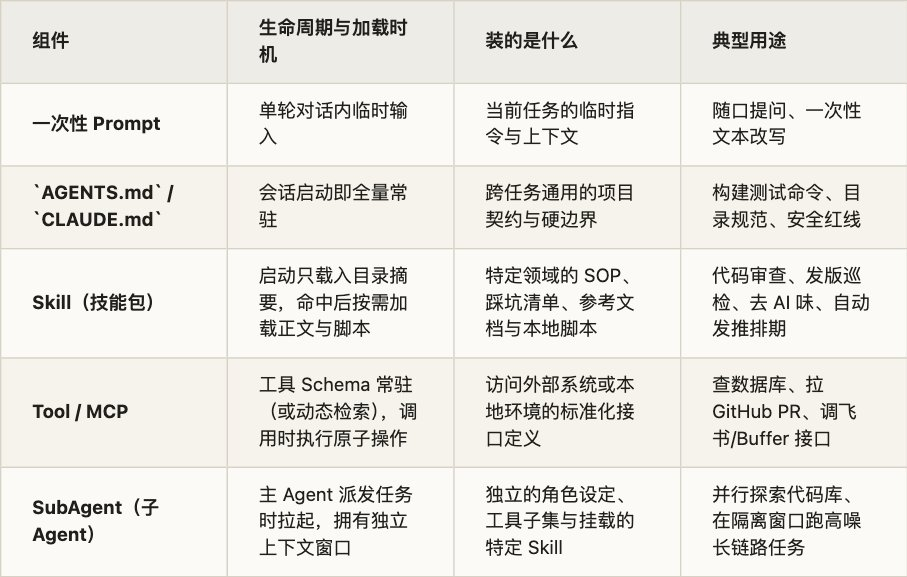
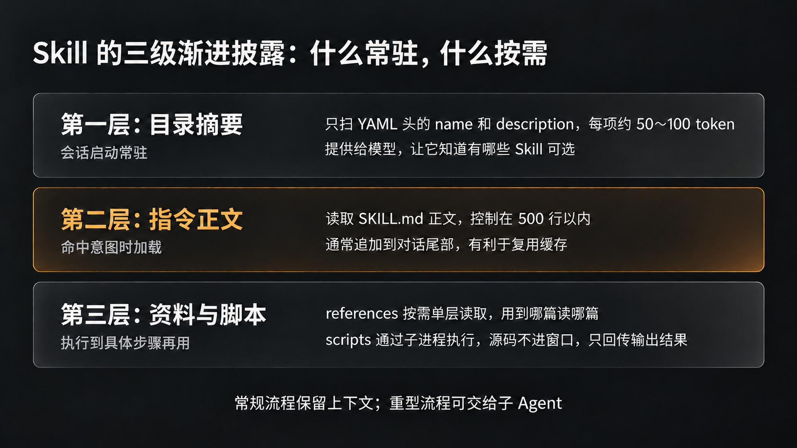
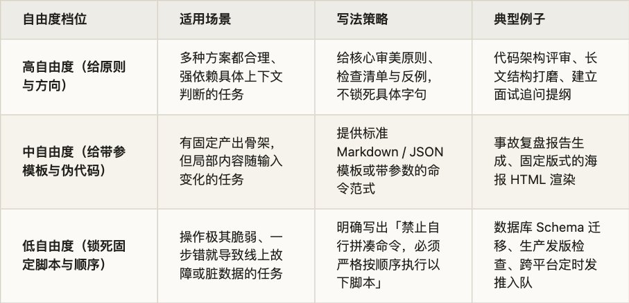
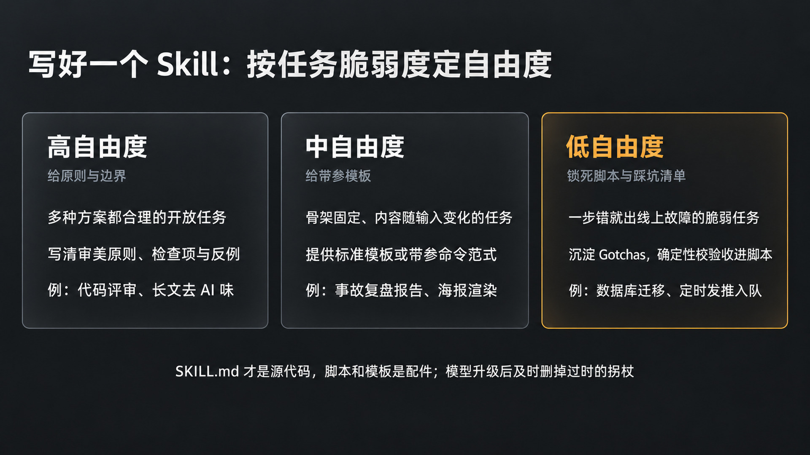
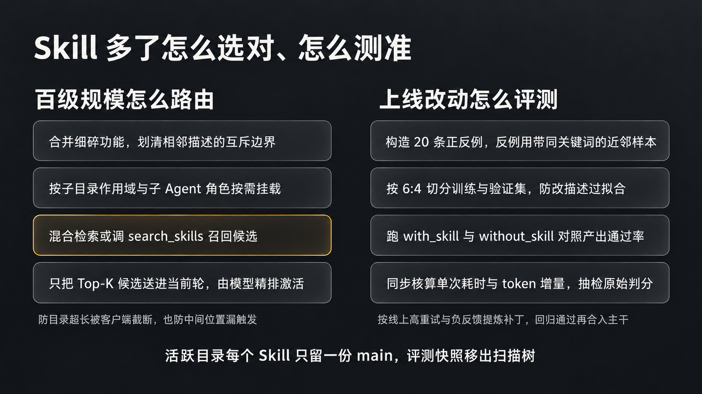
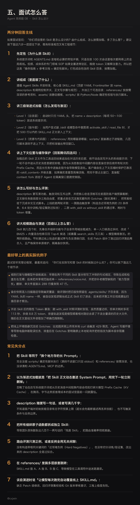

9 月中旬有位同学面[腾讯营销后端一面](https://www.nowcoder.com/feed/main/detail/c51f363514734218bcc5bb69fd655cd5)（09-24），简历上写了自己做过一套公司内部的 Agent 基建。面试官顺着项目里的 Skill 模块连问了四句：「Skill 是怎样被发现和按需加载的？」「加载后的 Skill 正文放在模型上下文的什么位置？」「Skill 使用完后，什么时候从上下文里卸载，下一轮还会带上吗？」「如果下一轮不再带 Skill 正文，会不会影响模型的 Prefix Cache？」追问完这四句，面试官又补了一题：「业务知识库和可复用的 SOP，怎样沉淀给 Agent 使用？」

这四连问把很多只停留在「写过几个 Markdown 提示词文件夹」的候选人直接问住了。

在牛客 757 篇面经里，「Skill 怎么设计、由什么组成、怎么按需加载」被 45 位作者在 52 场面试里问到，排在全部 30 道高频题的第 8 位（字节 13、阿里 7、快手 5、百度 3、美团 3、腾讯 2，一面占了 29 场）。如果把题单第 24 题里关于「几百个 Skill 怎么路由、怎么评测命中率」的追问并进来，覆盖面还要更广。

我自己每天都在跟这个问题打交道。一方面，我现在写文章的这个 Obsidian 仓库里常驻了 6 个自己打磨的 Skill（写作结构、去 AI 味、深度阅读、自动发推排期 x-post-scheduler、梗图生成、文章配图），其中 [x-post-scheduler](https://x.com/cxjwin/article/2077659518343970841) 还开源到了 GitHub；另一方面，在团队的多端工程仓库里，随着不同业务线往里塞规范，Skill 数量很快从十几个涨到了上百个，重名覆盖、描述打架、上下文挤爆和双份拷贝分叉的坑我全都踩过一遍。

翻完命中的真实面经，我发现面试官围绕 Skill 设计的提问主要集中在四个方向：

一、Skill 的本质、组成与定位：写进系统提示词也能跑，为什么要单独拆出 Skill？一个标准 Skill 文件夹里装了什么，和普通 Prompt、CLAUDE.md、MCP、SubAgent 怎么分工？

代表面经：[斑头雁 Agent 一面](https://www.nowcoder.com/discuss/930139676764102656)、[字节业务中台一面](https://www.nowcoder.com/feed/main/detail/6ac5ba31705a4b64a407b087f39d5447)、[阿里千问二面](https://www.nowcoder.com/feed/main/detail/456b3698145c431dacdbe5a1ff7d057c)

二、渐进式加载与上下文生命周期：三级渐进披露怎么实现？从扫描磁盘、注入目录到触发读取，正文插在上下文哪个位置？用完卸载吗，怎么保住 Prefix Cache？

代表面经：[腾讯营销后端一面](https://www.nowcoder.com/feed/main/detail/c51f363514734218bcc5bb69fd655cd5)、[OPPO IT 开发一面](https://www.nowcoder.com/discuss/923561467092160512)、[理想汽车一面](https://www.nowcoder.com/discuss/938122023392366592)

三、怎么写好一个 Skill：description 怎么写才不乱触发？正文写什么、不写什么，自由度怎么定？为什么说踩坑清单（Gotchas）和确定性脚本最值钱？

代表面经：[某中厂 AI 全栈一面](https://www.nowcoder.com/discuss/926232883432296448)、[蚂蚁复活赛一面](https://www.nowcoder.com/feed/main/detail/39451cad5d2245b491d16778f2a9ca01)、[猎聘一面](https://www.nowcoder.com/feed/main/detail/9416ce6a43584ad59807737c042f6e1a)

四、大规模路由、评测与治理自演进：100～800 个 Skill 怎么管、怎么选对？路由评测的正反例怎么构造，产出质量怎么量化？线上 Skill 怎么防分叉、做自演进？

代表面经：[小厂 Agent 一面](https://www.nowcoder.com/discuss/927944523437674496)、[科大讯飞一面](https://www.nowcoder.com/feed/main/detail/aece93373f9c47ea95c831aef6471886)、[东方财富一面](https://www.nowcoder.com/feed/main/detail/d406314e733c4fc8945637ce5d06cdcf)、[蚂蚁一面](https://www.nowcoder.com/feed/main/detail/b4b8431d196a4e92b92b2b1b64c9d7d7)

这篇文章顺着这四个方向，把 Skill 的内部结构、加载生命周期、编写铁律以及大规模路由治理拆开讲透。关于「有了 MCP 为什么还要 Skill」的协议层深水区对比，我们在[第 7 题](https://x.com/cxjwin/status/2115229460459069543)专门展开，这篇重点放在 Skill 本身的工程设计与落地上。

## 一、为什么要有 Skill，它由什么组成

1\. 写进系统提示词也能跑，为什么要拆出 Skill

[斑头雁 Agent 实习一面](https://www.nowcoder.com/discuss/930139676764102656)（09-17）上来就问了一个特别实在的问题：「Skills 的能力直接写进系统提示词也能实现，为什么要单独拆出 Skills？」[字节全栈一面](https://www.nowcoder.com/feed/main/detail/d8822fc2b4ae4b2fbdb03c95fa2a427d)（10-17）也追问过：「Skill 和普通 Prompt 的区别是什么？」

最直接的原因是上下文预算和注意力稀释。

我们在[第 5 题（上下文太长怎么办）](https://x.com/cxjwin/status/2114578501588398239)里算过账：系统提示词和根目录的 CLAUDE.md / AGENTS.md 是会话级常驻开销，不管你这一轮是让 Agent 改一行拼写错误，还是写一份数据库迁移方案，常驻区里的每一个字都会在每一轮推理时全量算一遍注意力。当团队把代码评审规范、PR 提交模板、SQL 慢查询排查手册、双端发版流程、周报格式全都塞进常驻提示词时，还没开始干活，两三万 token 就没了；更糟的是，规则之间还会互相串味。

我在今年 9 月做那次[提示词大扫除](https://x.com/cxjwin/article/2096429153461637160)时，给自己定过一条很简单的裁剪标准：上下文是高速缓存，不是仓库。判断一条规则该留在 AGENTS.md 还是下沉成 Skill，就问一个问题：100 次会话里，它能用上几次？ 每次都要遵守的底线（比如项目构建命令、目录红线、基础标点规范），留在 AGENTS.md 常驻；使用频率低于个位数、只有特定任务才触发的专门流程（比如长文去 AI 味检查、把文章转成卡片并排期发推、按固定维度拆解候选人简历出面试题），全部拆成独立的 Skill 按需加载。

除了省窗口，Skill 和普通 Prompt 还有一个工程形态上的分水岭：普通 Prompt 往往只是一段纯文本，而 Skill 是一个可以同时打包「操作指南（Markdown）+ 确定性脚本（Scripts）+ 参考资料（References）+ 静态模板（Assets）」的自包含目录。

在面试里被问到[懂车帝一面](https://www.nowcoder.com/feed/main/detail/69e209d77a4647b7896ef3fd835239b6)（08-28）或[美团 Agent 一面](https://www.nowcoder.com/feed/main/detail/18fa4134edb14e8c901787ee5cd33ace)（10-12）那种「Prompt、AGENTS.md、Skill、MCP/Tool、SubAgent 分别管什么」时，可以用一张表把位置对齐：



用一句话概括：MCP 解决的是「Agent 怎么伸手碰到外部世界的数据和接口」，\`AGENTS.md\` 解决的是「在这个仓库里干活每一步都要守什么规矩」，而 Skill 解决的是「遇到某类具体任务时，怎么把老手的 SOP、避坑经验和脚本工具按需递给模型」。

2\. 一个 Skill 里装了什么

2025 年 10 月 Anthropic 推出 [Agent Skills](https://www.anthropic.com/research/equipping-agents-for-the-real-world-with-agent-skills)，并在同年 12 月将其整理为跨平台的 [Agent Skills 开放标准（agentskills.io）](https://agentskills.io/specification)，随后 Claude Code、OpenAI Codex、Cursor、GitHub Copilot 等主流客户端都接入了这一目录规范。

回答[字节业务中台一面](https://www.nowcoder.com/feed/main/detail/6ac5ba31705a4b64a407b087f39d5447)（10-12）「SKILL 由哪些部分组成」时，直接画出标准目录结构最清楚：

```text
my-skill/
├── SKILL.md          # 唯一必需文件：YAML 元数据头 + Markdown 操作指令正文
├── scripts/          # 可选：可执行脚本（Python / Bash / Node.js），做确定性校验与外部调用
├── references/       # 可选：按需深读的补充参考文档（Schema、API 手册、风格细则）
├── assets/           # 可选：静态资源与模板（HTML 模板、字体、示例配置）
└── agents/           # 可选：特定客户端扩展配置（如 Codex 的 openai.yaml）
```

这里面每一层都有明确的规范约束：

第一是 \`SKILL.md\` 的 YAML Frontmatter（元数据头）。根据 [Agent Skills 规范](https://agentskills.io/specification)，最核心的两个字段是 name 和 description：

- name：1～64 个字符，只能用小写字母、数字和连字符（a-z0-9-），不能以连字符开头或结尾，且必须与外层文件夹同名。

- description：1～1024 个字符，写明这个 Skill 做什么、在什么场景下触发。这是模型判断是否加载它的唯一路标。

- 開放标准里的可选字段还包括 license、compatibility（环境依赖说明，如需要的系统包或网络权限）、metadata（自定义键值，如作者与版本号）以及实验性的 allowed-tools（预授权工具白名单）。

不同宿主客户端还在此之上做了实用的运行期扩展。比如在 [Claude Code 的 Skills 实现](https://code.claude.com/docs/en/skills)里，你可以通过 disable-model-invocation: true 禁止模型自作主张触发（只允许人工输入 /deploy 或 /commit 显式调用，防止模型写完代码顺手给你上线了）；也可以通过 user-invocable: false 把某个纯背景知识型 Skill 从用户的 / 菜单里藏起来，只让模型在后台按需读取；还可以配置 context: fork 和 agent: Explore，让这个 Skill 一旦被触发就在独立的子 Agent 上下文里跑，不污染主对话窗口。而在 [OpenAI Codex 的 Skills 体系](https://learn.chatgpt.com/docs/build-skills)里，除了读取 SKILL.md，还支持在 agents/openai.yaml 中配置 UI 展示名、默认提示词以及 allow\_implicit\_invocation 开关。

第二是 \`SKILL.md\` 的 Markdown 正文。这里写的是工作流步骤、输入输出格式、判断标准和常见踩坑清单（Gotchas）。

第三是 \`scripts/\`、\`references/\` 和 \`assets/\` 三个外挂目录。拿我自己开源的自动发推技能 [x-post-scheduler](https://x.com/cxjwin/article/2077659518343970841) 来说，SKILL.md 只负责串联五步工作流（读原文、写摘要、渲卡片、传图床、排期入队）和交代 API 踩坑；具体的排版规范放在 references/writing-format.md 里；海拔高度固定的 HTML 海报骨架放在 templates/poster.html 里；而真正去调 Buffer GraphQL 接口、Typefully REST 接口、裁剪图片和上传 GitHub 图床的动作，全部封在 scripts/buffer-post.mjs、scripts/typefully-post.mjs 和 scripts/md-assets.mjs 里。

把这几块拆开之后，你会发现：\`SKILL.md\` 才是整个技能包的源代码，脚本和模板都是受它调度的配件。

## 二、渐进式加载：从发现、激活到上下文生命周期

1\. 三级渐进披露：把目录留在窗口，把正文留在磁盘

[OPPO 27 届 IT 开发一面](https://www.nowcoder.com/discuss/923561467092160512)（08-30）和[小红书 Product Engineer 一面](https://www.nowcoder.com/feed/main/detail/70ad5ead2f784676b0b399eab877d3d4)（09-24）都直接考了：「怎么理解 Skill 的渐进式加载（Progressive Disclosure），具体是怎么实现的？」[理想汽车一面](https://www.nowcoder.com/discuss/938122023392366592)（10-09）也问：「Skill 是一开始就整个读进去吗？」

答案当然是不。Anthropic 在设计 [Agent Skills 架构](https://platform.claude.com/docs/en/agents-and-tools/agent-skills/overview)时，把信息加载严格拆成了三层（Three-level Progressive Disclosure）：

```text
Level 1：目录层（Metadata）       常驻系统提示词，每项约 50～100 tokens
  └── 仅包含 name + description（外加文件绝对路径）
        │
        ▼ 命中用户意图或显式调用时触发
Level 2：指令层（Instructions）   按需读入上下文，建议 < 500 行（< 5000 tokens）
  └── 读取 SKILL.md 完整 Markdown 正文（操作流程、规约、Gotchas）
        │
        ▼ 执行到具体分支或需要跑确定性逻辑时触发
Level 3+：资源与脚本层（Resources & Code）
  ├── references/*.md            用到哪篇读哪篇，未读文件占 0 token
  ├── assets/*                   作为模板路径传给工具，无需读入上下文
  └── scripts/*.py / *.mjs       通过 Bash 子进程执行，源码不进上下文，只回传 stdout/stderr
```

这三层设计最妙的地方在第三层的脚本执行。

以前我们让 Agent 处理一份复杂的 CSV 或者检查一篇文章的格式，如果只写纯提示词，模型要么得把整份文件吞进窗口肉眼数，要么得现场写一段 Python 代码再去跑，既费 token 又容易写错边界条件。放到 Skill 里之后，比如我的 de-ai-flavor 技能自带一个 scripts/check.py 机械自检脚本，模型在润色完文章后只需要执行一行命令：

```bash
python3 .agents/skills/de-ai-flavor/scripts/check.py 20_Drafts/article.md
```

[check.py](https://check.py/) 里面几百行正则表达式和段落长度统计代码根本不需要加载进模型的上下文窗口，只有脚本跑完吐出来的那十来行超标告警（哪一页出现了几个「不是……而是……」、哪个自然段超过了 220 字）会作为标准输出回到上下文里。既省下了读源码和现场写代码的开销，又把脆弱的概率生成换成了百分之百可复现的确定性检查。

2\. 客户端怎么发现、怎么激活

在[斑头雁 Agent 一面](https://www.nowcoder.com/discuss/930139676764102656)（09-17）里，面试官追问了一个动手题：「如果要让你自己的 Agent 框架实现加载 Skill，你打算怎么做？」

按照 [Agent Skills 客户端实现指南](https://agentskills.io/client-implementation/adding-skills-support)，完整的发现与激活链路分三步走：

第一步是启动期扫描与去重（Discovery）。 Agent 启动时，扫描约定的项目级目录（如 .agents/skills/、.claude/skills/）和用户级全局目录（如 \~/.agents/skills/、\~/.claude/skills/）。我现在自己的写作库为了同时兼容 Claude Code 和 Codex，直接把真实文件放在 .agents/skills/ 下，然后把 .claude/skills 建成指向它的软链接，两边维护同一套源码。

扫描器只解析每个子目录下 SKILL.md 顶部的 YAML Frontmatter（只读前几 KB，不读全文），校验字段合法性。如果遇到同名 Skill，遵循「项目级覆盖用户级」的优先级；而在 monorepo 子目录场景下，[Claude Code](https://code.claude.com/docs/en/skills) 和 [Codex](https://learn.chatgpt.com/docs/build-skills) 还支持顺着当前编辑文件的路径向上或向下动态发现子模块里的 .agents/skills/。

第二步是拼装目录摘要注入系统提示词（Catalog Injection）。 扫描完成后，客户端把所有可用 Skill 的 name、description 和 location（SKILL.md 的磁盘路径）拼成一段结构化列表（通常用 &lt;available\_skills&gt; XML 标签包裹），放进系统提示词。每个 Skill 在这一步只占 50～100 个 token。

第三步是运行期激活（Activation），分显式和隐式两条通道：

- 用户显式调用：用户在输入框里敲 /skill-name（Claude Code）或 [$skill-name](https://x.com/search?q=%24skill-name&src=cashtag_click)（Codex）。客户端在发请求前直接拦截识别，主动把对应 SKILL.md 的正文读出来塞进本轮消息，还可以把用户跟在后面的参数替换掉正文里的 [$ARGUMENTS](https://x.com/search?q=%24ARGUMENTS&src=cashtag_click) 占位符。在 Claude Code 里，甚至支持在 SKILL.md 里写  !git diff HEAD  这样的预处理命令，在发给模型前先由客户端跑完 shell 并把实时输出内联进去。

- 模型隐式触发：用户只说了一句自然语言（比如「帮我把这篇草稿去一下 AI 味」）。模型扫了一眼系统提示词里的 &lt;available\_skills&gt;，发现 de-ai-flavor 的描述跟当前任务高度吻合。这时根據客户端架构有两种加载实现：

1. 通用文件工具模式：具备 Bash 或 Read 工具的编码 Agent，直接调 read\_file(&quot;.agents/skills/de-ai-flavor/SKILL.md&quot;) 把正文读进来，并用技能目录作为相对路径基准去访问同级的 references/ 和 scripts/。

2. 专用激活工具模式：给模型注册一个 activate\_skill（或 lookup\_skills）工具，并把合法的技能名写进工具参数的 enum 列表里，防止模型自己编造不存在的技能名。工具被调用后，Runtime 读取正文，包上 &lt;skill\_content name=&quot;&#46;&#46;&#46;&quot;&gt; 标签并附上该技能目录下的文件清单，作为工具结果返回给模型。

3\. 进了上下文放在哪，用完卸载吗，会不会伤缓存

现在我们来正面回答文章开头[腾讯营销后端一面](https://www.nowcoder.com/feed/main/detail/c51f363514734218bcc5bb69fd655cd5)（09-24）那四个最见功底的追问。

追问一：加载后的 Skill 正文放在模型上下文的什么位置？ 放在对话历史后部（Message History 的当前轮次），作为一条 Tool Result 消息或紧跟用户消息的注入块追加进去，绝对不要去动态改写最前面的 System Prompt。

追问二 & 三：Skill 使用完后，什么时候从上下文里卸载？下一轮还会带上吗？会影响模型的 Prefix Cache 吗？ 这两问绑在一起，考的是你在[第 5 题](https://x.com/cxjwin/status/2114578501588398239)里见过的 KV Cache（前缀缓存）铁律。

大模型推理的 Prefix Cache 要求从第 0 个 token 开始逐字严格匹配。

- 如果你在激活某个 Skill 时，把它的 3000 token 正文直接插进最开头的 System Prompt 里，那么整个会话此前积累的所有历史消息缓存瞬间全部作废。

- 反过来，如果像标准做法那样，在第 N 轮通过工具调用把 Skill 正文追加在消息队列末尾，那么第 1 到 N-1 轮的缓存稳稳命中；到了第 N+1 轮，第 N 轮刚读进来的 Skill 正文自己也变成了命中缓存的前缀（在主流 API 定价下，缓存命中的输入 token 只有原价的 10%～25%）。

- 那如果我们在第 N+1 轮人为把第 N 轮里的 Skill 正文从历史消息中间「卸载（删掉）」呢？ 一旦你从历史数组中间抠掉一条消息，从第 N 轮往后的所有 token 序列立刻发生偏移，第 N 轮之后的所有 Prefix Cache 全部失效，你反而得为后面所有的消息重新付全价算预填充（Prefill）！更麻烦的是，长任务往往跨越多轮工具调用，如果中途把指令抽走，模型在后续步骤里就会发生静默退化，忘了前面要求过的校验格式。

正因为这两条原因，[Agent Skills 客户端官方实现指南](https://agentskills.io/client-implementation/adding-skills-support)里专门给出了三条上下文管理策略：

1. 常规会话不中途硬删：激活后的 &lt;skill\_content&gt; 留在消息历史里享受前缀缓存，不在下一轮强行抠除。

2. 上下文压缩（Compaction）时享受豁免：当长对话触发滑动窗口或自动摘要裁剪旧工具输出时，客户端通过 &lt;skill\_content&gt; 标签识别出已激活的技能指令，将其列入保护白名单，免于像大段网页抓取或日志输出那样被无脑截断。

3. 重复激活去重（Deduplication）：如果模型在同一个会话里第二次激活同一个 Skill，只保留一份或更新位置，不在上下文里堆两份一模一样的正文。

那如果某个 Skill 确实特别重（比如需要读十几篇参考文档、跑七八步抓取校验），用完之后我就是不想让它留在主窗口里占地方，该怎么办？ 答案不是去历史消息里硬抠，而是从一开始就走子 Agent 分叉（Subagent Forking）。在 Claude Code 里给这个 Skill 配上 context: fork，触发时 Runtime 会拉起一个拥有独立上下文窗口的子 Agent，在子窗口里加载 SKILL.md、读参考文件、跑脚本；等干完活，只把几百字的最终结论传回主 Agent 的消息流，子窗口直接销毁。这样主对话的上下文既干干净净，Prefix Cache 也连一根毫毛都不会伤到。



## 三、写好一个 Skill：描述、正文与脚本的分工

1\. description 决定能不能被选对

模型在决定用不用一个 Skill 时，看到的只有 name 和 description。很多同学写 Skill 时正文憋了三百行，description 却随手写一句「用于处理文档的技能」，结果该触发的时候装死，不该触发的时候乱跳。

综合 [Anthropic 的 Skill 编写最佳实践](https://platform.claude.com/docs/en/agents-and-tools/agent-skills/best-practices)和 [Agent Skills 描述优化指南](https://agentskills.io/skill-creation/optimizing-descriptions)，写好 description 有四条硬规矩：

1. 同时写清「做什么」和「什么时候触发」，且多用用户嘴里会说出的词。 别写内部模块黑话，要写用户提需求时的症状和文件类型。比如对比下面两条描述：

```yaml
# 差的写法：只有笼统概念，没有触发条件与边界
description: 帮助润色文章并检查写作质量。

# 好的写法：包含具体功能、适用场景、触发动作词与正反边界
description: 审查并消除中文文章中的 AI 生成痕迹（负向排比、自问自答、空洞过渡词、机械三段式），统一标点与中英混排空格，并运行 check.py 做机械自检。当用户要求「去 AI 味」「润色文风」「改得像人写的」或定稿前自检时使用；纯英文翻译或代码注释生成不使用。
```

1. 统一用第三人称或清晰的祈使句。 因为所有 description 会被拼进同一段系统提示词列表里，不要在里面混用「我可以帮你……」「你应该在……」。

2. 把最关键的触发场景塞在最前面。 虽然规范允许 description 最长写到 1024 个字符，但千万别写满。看一眼 [Codex 的源码与设计文档](https://github.com/openai/codex)就会知道，客户端通常会给初始技能目录设一个硬预算（比如上下文窗口的 2% 或约 8000 字符上限）；一旦你装的 Skill 变多、总长度超标，客户端会先从后往前截断每条 description，再不够就直接把排在后面的 Skill 整个丢出列表。所以核心动作和高频触发词一定要顶格写在前面。

3. 对容易误触发的相邻场景，显式写上一句「什么情况下不用」。 这是成本最低的防误路由手段。

2\. 正文写什么、不写什么，自由度怎么拿捏

进了 SKILL.md 正文，最容易犯的通病是「把大模型当傻子教」。

Anthropic 在指南里反复强调一条原则：只写模型原本不知道的信息。 Claude 和 GPT 本来就熟知怎么写 Python、什么是 PDF、怎么调标准 REST 接口，在 Skill 里花两百行解释这些常识纯属浪费 token；真正值得写进 SKILL.md 的，是你这个仓库特有的目录约定、内部接口的非标字段、团队偏好的取舍标准，以及以前翻过车的边界条件。

[某中厂 AI 全栈社招一面](https://www.nowcoder.com/discuss/926232883432296448)（09-06）问过一道很有意思的题：「Skill 里哪些是固定的、哪些随观察动态调整？」这其实是在考你对指令自由度（Degrees of Freedom）的拿捏。你可以把任务按脆弱程度分成三档：



同时，在正文里指导工具调用时，给一个明确的默认方案，别给模型列「全家桶菜单」。比如处理 PDF，直接写「默认使用 pdfplumber 提取文本；仅当遇到扫描件时改用 pdf2image 配合 OCR」，而不要写「你可以使用 pypdf、pdfplumber、PyMuPDF 或 pdf2image……」，否则模型每次都要在几个库之间犹豫甚至混着用。

文件体量上，把 SKILL.md 正文控制在 500 行以内。超出的细则拆到 references/ 目录下，并在 SKILL.md 里用一句话写清加载条件（比如「若排期目标为 Buffer 平台，执行前先读取 references/buffer-schema.md」）。注意 references/ 引用关系最多只留一层（SKILL.md 直接指向目标文件），千万不要搞 SKILL.md -&gt; a.md -&gt; b.md -&gt; c.md 的套娃跳转，否则模型很容易读到一半漏掉最里面的关键约束。

3\. 最值钱的是「踩坑清单」和确定性脚本

Anthropic 工程师在总结内部几百个 Skill 的实战经验时提到：任何一个好用的 Skill，最值钱的部分往往是它的 Gotchas（踩坑清单）章节。

道理很简单：正常的顺风流程模型本来就能猜个八九不离十，真正让任务失败的，全是那些反直觉的接口脾气和环境暗坑。我在写 [x-post-scheduler](https://x.com/cxjwin/article/2077659518343970841) 的过程中，每次被平台 API 坑一次，转身就把现象和解法补进 SKILL.md：

- GitHub Raw 图床 429 限流陷阱：图床刚 push 上去时，本地用 curl 验证偶尔会返回 429 Too Many Requests。早期 Agent 发现 429 就会乖乖写个循环在本地轮询等恢复，结果有一次脚本卡在睡眠重试里，我合上笔记本电脑去睡觉，整条定时推文硬生生被耽误了一天半。后来查明这个 429 只是 GitHub 对本地高频请求的限流，Buffer 远端服务器拉图根本不受影响。于是我在 SKILL.md 里加了死规矩：「git push 成功后直接调排期接口，严禁在本地轮询等待 Raw URL 返回 200。」

- 中文字体缺失豆腐块：HTML 模板里的列表符号 ▸（U+25B8）在 macOS 默认无衬线中文字体里没有字形，Headless Chrome 截图出来全是一排带叉的方框（⍰）。排查清楚后，不仅改了模板，还在 Skill 里锁死了 CSS 伪元素画三角形的做法。

- 第三方 API 的怪癖：比如 Typefully 接口文档里写着支持 title 字段，但真传过去必返 422 报错，它实际上是自动拿正文第一行 \# 标题 当标题；Buffer 的 GraphQL 接口在发单条推文时不认 metadata.twitter.thread 结构体，必须根据推文条数动态切换 payload 分支。

这些用真金白银和线上翻车换来的经验，写进 SKILL.md 的 Gotchas 之后，Agent 就再也不会在同一块石头上绊倒第二次。

与之配套的是把确定性逻辑下沉到 scripts/。在给 Agent 写配套脚本时，记住它面对的调用方是大模型而非人类终端用户，有五条脚本设计守则（详见 [Using scripts in skills](https://agentskills.io/skill-creation/using-scripts)）：

1. 严禁交互式阻塞提示（No Interactive Prompts）：Agent 跑在非交互子进程里，一旦脚本弹出一个 \[y/N\] 确认框或者等着敲密码，整个执行线程当场挂死超时。所有确认和参数必须通过命令行 Flag 传入。

2. 报错信息要自带「修复指南」：不要只抛一个 ValueError: invalid status，要打印出 Error: &#45;&#45;status 仅支持 draft / scheduled / now，当前传入了 &#39;publish&#39;，请改为 &#45;&#45;status scheduled 后重试，让模型看一眼 stderr 就能自己改对重跑。

3. 输出结构化且控制长度：优先输出 JSON 或清晰的键值表，方便模型稳定解析；如果输出可能很长，提供 &#45;&#45;limit 或把详情写进临时文件、只在 stdout 打印摘要与文件路径。

4. 对写操作提供 \`&#45;&#45;dry-run\` 和幂等保护：让模型遵循「Plan -&gt; Validate（Dry-run） -&gt; Execute」的节奏，先空跑校验参数无误再真正发请求。

4\. 跟着模型升级做减法

很多团队把 Skill 写出来之后就只增不减，半年下来一个 SKILL.md 膨胀到上千行，里面塞满了互相冲突的补丁。

我在今年 9 月复盘自己的写作仓库时就抓到过一次典型的「规则打架」（见[《AI 又升级了，我攒的提示词该大扫除了》](https://x.com/cxjwin/article/2096429153461637160)）：我的写作生成技能 cxjwin-writer 是早期基于旧模型写的，里面有一条硬性指标要求「全文至少使用 3 处『不是 X，而是 Y』句式来制造节奏感」；而后来写的润色技能 de-ai-flavor 却明确规定「『不是……而是……』属于高频 AI 腔，全文出现超过 2～3 次必须合并改写」。两个 Skill 在同一篇稿子上左右互搏，前脚刚按要求造出三个排比，后脚就在去味阶段被当成病句砍掉。

那次清理我做了两件事： 一是把分散在各个写作、发推、润色 Skill 里的个人文风与标点规则抽出来，合并成一份唯一的 .agents/skills/de-ai-flavor/references/voice.md，其他相关 Skill 统一引用这份文件，光这一刀就把 cxjwin-writer/SKILL.md 从 289 行砍到了 47 行。 二是把 Skill 里的规则分成三类来管理寿命：

- 能力型拐杖（为了弥补老模型指令遵循差、不会算字数而写的死板凑数规定）：跟着模型升级走，新模型一换代就主动删掉，免得拐杖变成脚镣；

- 边界型护栏（防误删、防越权发线上请求的红线）：长期保留，且尽量下沉成脚本硬校验；

- 偏好型品味（团队特定的命名习惯、行文审美与业务口径）：模型再聪明也猜不到你的个人品味，这部分才是 Skill 真正需要沉淀的资产。



## 四、Skill 多了怎么办：路由、治理与自演进

1\. 从十几个到几百个 Skill，怎么选对

当团队里的 Skill 只有十来个时，把所有 name 和 description 塞进系统提示词列表，模型挑得又快又准。但就像[字节业务中台一面](https://www.nowcoder.com/feed/main/detail/6ac5ba31705a4b64a407b087f39d5447)（10-12）问的「如果有 100 个 Skill 和 100 个 MCP 怎么处理」，或者[小厂 Agent 一面](https://www.nowcoder.com/discuss/927944523437674496)（09-11）和[百度二面](https://www.nowcoder.com/feed/main/detail/2d033fd6daa04e2aaad2282b75531bbc)（09-29）问的「Runtime 里有 500～800 个 Skill 怎么管理、保证上下文健康并一次命中」，数量一上去，平铺直叙的目录模式就会撞上三面墙：

1. 常驻开销膨胀与截断：500 个 Skill 的描述哪怕每条只占 80 token，加起来也是 4 万 token 的起步开销；而在设置了目录长度上限的客户端里，排在后面的几百个 Skill 会被直接静默丢弃。

2. 描述重叠导致误路由：不同业务组各自写了一个 sql-check、db-query-helper、mysql-analyzer，描述里全写着「当需要分析 SQL 语句时使用」，模型在里面抓阄。

3. 注意力分散导致漏触发：候选列表越长，模型对中间位置描述的敏感度越低（Lost in the Middle），明明有现成的 Skill 却忘了调。

在工程落地上，解决百级以上 Skill 路由靠的是三层治理：

第一层：合并粒度与划清正反边界（几十个规模）。 很多时候 Skill 暴涨是因为把每一个细碎动作都拆成了独立 Skill（这也是[百度二面](https://www.nowcoder.com/feed/main/detail/2d033fd6daa04e2aaad2282b75531bbc)问「散功能属于 Skill 还是 Tool」的原因）。原子操作应该收进 Tool 或同一个 Skill 的不同脚本参数里，Skill 对应的是完整的业务场景 SOP。对于职责相邻的 Skill，在各自的 description 里必须写明互斥条件（「本技能仅用于离线数仓 Hive SQL 调优；在线事务 MySQL 慢查询请使用 oltp-mysql-tuning」）。

第二层：按目录作用域与角色动态挂载（百级规模）。 不需要让所有人在所有目录下都看到全量 500 个 Skill。利用客户端的路径级按需发现机制：前端组件的 Skill 放在 packages/web/.agents/skills/ 下，后端账务的 Skill 放在 services/billing/.agents/skills/ 下，只有当 Agent 工作在对应子目录或打开对应模块文件时，才把该子树的 Skill 挂进 &lt;available\_skills&gt;。如果结合多 Agent 架构，还可以按 SubAgent 角色分桶——代码审查 Agent 只挂载 5 个评审类 Skill，数据 Agent 只挂载 8 个数仓类 Skill，每个窗口看到的目录永远不超过 15 个。

第三层：两阶段检索路由（几百到上千规模）。 当单一入口确实面对几百个候选 Skill 时，不能再把全量目录塞进系统提示词，而是改成「检索召回 + 模型精排」的两阶段路由：

- 做法 A（基于元数据的混合检索预筛）：离线把每个 Skill 的 name、description、触发示例问句（Trigger Examples）和业务标签建入轻量索引。用户请求进来后，先走一层极快的 BM25 关键词 + Embedding 向量混合检索（并结合当前用户所在项目/权限做 Metadata Filter），召回 Top-8～Top-15 个候选 Skill，再把这十几个候选的 description 动态拼进本轮提示词或 activate\_skill 的枚举里供模型拍板。

- 做法 B（暴露 \`search\_skills\` 元工具）：系统提示词里只放最常用的 5～10 个核心 Skill，同时给模型提供一个 search\_skills(query, category) 工具（类似 Claude API 里的 Tool Search 机制）。模型遇到专门领域的长尾需求时，先搜出匹配的 3～5 个 Skill 摘要，再调 activate\_skill 加载正文。

2\. 怎么评测一个 Skill：一测触发率，二测产出质量

[科大讯飞一面](https://www.nowcoder.com/feed/main/detail/aece93373f9c47ea95c831aef6471886)（09-24）、[东方财富一面](https://www.nowcoder.com/feed/main/detail/d406314e733c4fc8945637ce5d06cdcf)（09-24）和[携程二面](https://www.nowcoder.com/feed/main/detail/781cfc04e3bc4697acf0a5c913543a28)（09-18）不约而同地深挖了同一个问题：「Skill 路由评测评什么、正反例怎么构造？」「调整 Skill 后，怎么量化判断效果真的变好了？」

我们在[第 4 题（Agent 评测）](https://x.com/cxjwin/status/2114176760539697490)里讲过通用框架，落到 Skill 上，评测严格拆成上下半场（详见 [Optimizing skill descriptions](https://agentskills.io/skill-creation/optimizing-descriptions) 与 [Evaluating skill output quality](https://agentskills.io/skill-creation/evaluating-skills)）：

上半场：路由触发评测（Trigger Evaluation）。 目标是测 description 写得准不准，核心看两个指标：召回率（该触发时触发了吗）和误触发率（不该触发时忍住了吗）。

- 正反例怎么构造？ 一个 Skill 通常构造 20 条左右的评测集（8～10 条正例 Should-trigger，8～10 条反例 Should-not-trigger）。构造正例时，不能直接照抄 description 里的原词，要覆盖口语化表达、错别字和隐式意图；构造反例时，千万不能拿风马牛不相及的「写首古诗」「查今天天气」来凑数，必须构造「带相同关键词但意图属于相邻工具」的近邻难负例（Hard Negatives）。 比如测「PDF 表单填写 Skill」，反例应该写成「帮我把这个 CSV 报表里的数据读出来汇总」或「用 HTML 写一个网页登录表单」，里面同样有「报表」「表单」字眼，但根本不该调这个 Skill。

- 怎么跑、怎么防过拟合？ 因为模型调度有随机性，每条 Query 要跑 3～5 次计算触发率（Trigger Rate，通常要求正例触发率 ≥ 80%、反例触发率 ≤ 20%）。更重要的是，把评测集按 6:4 拆成训练集（Train）和验证集（Validation）。如果只对着同一批样本反复往 description 里塞特定词，很容易把描述改得过拟合；只有在验证集上召回和精确率同步提升，修改才算过关。

下半场：端到端产出评测（Output & Overhead Evaluation）。 触发对了只是第一步，接下来要验证「加载了这个 Skill 之后，干活是不是真的比不加载更好，多花的耗时和 token 值不值」。

做法是准备一组代表性任务，在同一个工作区里同时跑 \`with\_skill\`（挂载新 Skill） 和 \`without\_skill\`（基线裸跑，或挂载旧版快照 \`old\_skill\`），对比三组数字：

1. 检查项通过率（Pass Rate）：结合确定性断言脚本（比如检查输出文件是否存在、JSON Schema 是否合法、[check.py](https://check.py/) 违禁词是否清零）和带明确 Rubric 的 LLM-as-a-Judge 盲评。

2. 执行耗时与步骤数（Duration & Steps）：模型有没有因为指令写得太绕而在里面空转？

3. Token 开销增量（Token Overhead）：多读了多少参考文件，值不值得？

我自己在给 de-ai-flavor 做升级评测时（见[《AI 又升级了，我攒的提示词该大扫除了》](https://x.com/cxjwin/article/2096429153461637160)），拿 3 篇不同题材的旧稿跑了 with\_skill 和 without\_skill 对照。实测下来，开启 Skill 后成稿确实干掉了所有机械排比和套话，但代价非常直观：单篇平均耗时从 93.1 秒涨到了 205.8 秒（多花 113 秒），平均消耗从 2.86 万 token 涨到了 11.64 万 token（多烧 8.8 万 token）。一查轨迹才发现，其中一个测试子任务为了对照风格，顺手把仓库里另一篇几千字的历史长文全量读进了窗口。如果只凭感觉说「加了 Skill 效果变好了」，不去算耗时和 token 账，放到线上高并发场景里分分钟会把账单和延迟打爆。

顺带提一个我自己踩过的评测坑：那次跑完评测后，自动生成的 benchmark.md 报告给其中一篇判了 85.7% 的未满分，理由是改写后的句子把「同比增长超过 400%」写成了「同比涨了四倍多」，汇总脚本死板地认为丢了数字 400%；可我打开底层的 grading.json 一看，评分器明明在备注里写着「涨了四倍多与超过 400% 数值等价，予以通过」。自动化评测脚本本身也会出 bug，关键放行节点一定要抽检原始评分记录。

3\. 治理、安全与自演进

最后看[蚂蚁一面](https://www.nowcoder.com/feed/main/detail/b4b8431d196a4e92b92b2b1b64c9d7d7)（10-12）的「如何治理 Skill」和[小厂一面](https://www.nowcoder.com/discuss/927944523437674496)（09-11）的「Skill 的自我优化/自我演进怎么设计」。

第一，单源维护与防快照污染。 既然 SKILL.md 是源代码，就必须遵守软件工程的单源原则（Single Source of Truth）。我早期把 x-post-scheduler 拆出去开源时，本地写作库留了一份，开源仓库又拷了一份，结果才过了三周，两边各自顺手修小问题，硬生生分叉成了两条演进线（见[《代码图复制与 Skill 分叉》](https://x.com/cxjwin/article/2087473434020479407)）。更隐蔽的一个坑是：我之前做评测时，把旧版备份放在 .agents/skills/de-ai-flavor-workspace/skill-snapshot-v1/SKILL.md，里面有着一模一样的 name 和 description，结果客户端递归扫描目录时把这份历史快照也当成活体 Skill 加载了进来。所有评测快照、归档备份必须移出 \`.agents/skills/\` 扫描树（比如放到独立的 \`.agents/skill-evals/\` 下），活跃目录里每个 Skill 只能有一份 \`main\`。

第二，基于线上轨迹的闭环自演进（Self-Evolution）。 面试官问「Skill 怎么自我优化」，千万别回答「让模型每次跑完自己直接改写线上 SKILL.md」。如果让模型在没有人工把关和回归测试的情况下直接全量覆写 SKILL.md，跑不了五次，它就会为了迎合某一次偶发报错而把原有的边界约束删得干干净净。

稳妥的工程自演进流水线分四步：

1. 采集隐式反馈信号：在 Runtime 层记录每次 Skill 被激活后的线上表现，包括模型有没有在同一个脚本上连续报错重试超过 2 次，以及用户有没有在 Skill 执行完后立刻手动打断、回滚代码或追骂一句「不对，重来」。

2. 批量归因提炼补丁（Patch 级更新而非全文重写）：定期把高重试率或用户负反馈的 Session Trace 捞出来，交给离线分析 Agent 定位根因：到底是 description 写宽了导致误触发，还是某个内部接口改了参数需要往 Gotchas 里补一条避坑说明？分析产物必须是一小段具体的 Git Diff 补丁，而不是把整篇文档重写一遍。

3. 沙箱回归评测：把打好补丁的候选 Skill 丢进前面讲的触发集（Train/Val）和产出基准集里跑一遍，确认修了新问题的同时没有把老用例搞挂（No Regression）。

4. PR 审核与灰度发布：像合并业务代码一样，通过 Git PR 交由负责人 Review 确认后合入主干，并在 metadata.version 里打上版本号。

第三，安全与权限治理。 安装一个带 scripts/ 的第三方 Skill，风险等同于在机器上直接运行外部代码；哪怕是纯 Markdown 的 Skill，一旦里面藏着恶意指令，被模型读进上下文后就是天然的间接提示词注入（Indirect Prompt Injection）。因此在团队治理中：

- 项目级 .agents/skills/ 必须纳入代码仓库受保护分支，像审代码一样审 SKILL.md 和脚本；

- 利用 allowed-tools 收紧单个 Skill 能调的工具范围，对涉及发版、删库、对外发消息的高危 Skill 强制开启 disable-model-invocation: true（仅限人工显式触发）或挂接人工审批（Human-in-the-loop）拦截器。



## 五、面试怎么答

两分钟回答主线

如果面试官问：「你们项目里的 Skill 是怎么设计的？由什么组成、怎么按需加载、多了怎么管？」建议按下面这六步一层层往下讲，既有标准规范又有工程细节：

1. 先定性（为什么拆 Skill）：系统提示词和 AGENTS.md 是每轮必算的常驻开销，只适合放 100 次会话里每次都用得上的全局底线。低频、成体系的专门领域 SOP 如果全塞进常驻区，既烧 token 又稀释注意力。所以把这类「操作指南 + 参考文档 + 确定性脚本」打包成自包含的 Skill 目录，按需加载。

2. 讲组成（里面装了什么）：遵循 Agent Skills 开放标准，核心是 SKILL.md（顶部 YAML Frontmatter 放 name、description 和调用控制开关，正文写步骤与规范），外加三个可选目录：references/ 放按需深读的参考资料，assets/ 放静态模板，scripts/ 放 Python/Node 确定性校验与执行脚本。

3. 讲三级渐进式加载（怎么发现与激活）：

- Level 1（目录层）：启动时只扫 YAML 头，把 name + description（每项 50～100 token）放进系统提示词；

- Level 2（指令层）：当用户显式敲 /skill 或模型命中意图调 activate\_skill / read\_file 时，才把 500 行以内的 SKILL.md 正文读入上下文；

- Level 3（资源与代码层）：references/ 用到哪篇读哪篇；scripts/ 直接通过子进程跑，几百行脚本源码不进上下文，只把标准输出带回窗口。

1. 讲上下文位置与缓存保护（回答腾讯四连问）：加载后的 Skill 正文作为工具返回结果追加在对话历史后部，绝不动态改写开头的系统提示词；下一轮不会中途从历史消息里硬抠卸载，因为从消息数组中间删内容会直接击穿后续所有轮次的 Prefix Cache，而且长任务中途抽走指令会导致模型退化。客户端会在上下文压缩时保护已激活的 &lt;skill\_content&gt; 并做去重；如果确实是重型高噪流程、用完不想占主窗口，直接配 context: fork 派给子 Agent 在隔离窗口里跑完销毁。

2. 讲怎么写好与怎么评测：description 要写清功能、触发词和互斥边界，并把核心信息顶格写在前面防客户端预算截断；正文按任务脆弱度分三档自由度，把重点放在沉淀真实翻车的 Gotchas（踩坑清单），把死板校验下沉成非交互式脚本。上线前跑两轮评测：一测路由触发率（构造含近邻难负例的 20 条样本，6:4 划分训练/验证集防过拟合），二测 with\_skill vs without\_skill 的通过率、耗时与 token 增量。

3. 讲大规模路由与演进（百级以上怎么管）：Skill 到几百个时，先靠合并细碎功能与子目录作用域挂载减负；单一入口候选过多时，改成「BM25 + 向量混合检索召回 Top-K 候选（或暴露 search\_skills 元工具）+ 模型精排激活」的两阶段路由。平时通过线上轨迹的重试率与负反馈做归因，生成 Patch 级补丁跑过回归评测后再合入，且严格保持单源维护、隔离备份快照。

最好带上的真实踩坑例子

面试官听完理论框架，最喜欢追问：「你们在实际写和管 Skill 的时候踩过什么坑？」你可以挑下面这几个细节讲：

- 规则打架与随模型升级做减法：早期在两个不同的 Skill 里分别写了冲突的句式规定，导致生成和检查左右互搏；后来把共享规范抽成单一 references/voice.md，并把弥补老模型缺陷的「能力型拐杖」删掉，单文件直接从 289 行瘦身到 47 行。

- 备份快照混入扫描路径导致幽灵覆盖：做评测时把旧版快照留在 .agents/skills/ 子目录里，因为 YAML 头的 name 一样，被自动发现逻辑当成正式 Skill 扫了进去；后来把评测工作区彻底挪出扫描目录才根治。

- 开启 Skill 后的隐性 Token 暴涨：跑 with\_skill 对照评测时发现，虽然质量达标，但单次耗时多花 113 秒、多烧 8.8 万 token，排查轨迹发现是模型顺着相对路径去读了不该全量读的历史大文件，随后在正文里给文件读取加了明确范围限制。

- 把线上环境怪癖沉淀成 Gotchas：比如图床刚上传完本地 curl 会触发 429 限流，Agent 写循环傻等导致电脑休眠耽误任务，排查后在 Gotchas 里明确禁止本地轮询并把校验改为脚本级非阻塞检查。

常见失分点

1. 把 Skill 等同于「换个地方存的长 Prompt」：完全没提 scripts/ 确定性脚本执行（源码不进窗口只回 stdout）和 references/ 按需深读，也没讲清和 AGENTS.md、MCP 的边界。

2. 以为渐进式加载就是「把 Skill 正文动态塞进 System Prompt，用完下一轮立刻删掉」：忽略了动态改写系统提示词或从历史消息中间抠除内容会彻底打碎大模型 Prefix Cache（KV Cache），在腾讯、字节这类抠推理成本的面试官面前一问就露馅。

3. \`description\` 随便写一句话，或者写满几千字：不知道客户端对初始技能目录有总字符预算上限（超长会先截断描述再丢弃技能），也不写触发条件与反例边界。

4. 把所有细碎原子函数都拆成独立 Skill：导致团队很快膨胀出几百个一两句话的「残废 Skill」，把路由准确率彻底搞崩。

5. 路由评测只测正例，或者反例全用无关闲聊：没有构造带相同关键词的「近邻难负例（Hard Negatives）」，也没有切分训练/验证集，改出来的 description 全是过拟合。

6. 在 \`references/\` 里搞多层嵌套跳转：SKILL.md 指 A、A 指 B、B 指 C，导致模型在工具调用中途迷路漏读。

7. 谈自演进时说「让模型每次跑完自动覆盖线上 \`SKILL.md\`」：缺乏 Patch 级修改、回归评测集校验和 Git 版本审核意识，工程上极度危险。



## 出处

题单统计与代表面经： [Agent 高频面试题单](https://x.com/cxjwin/status/2111644503341953409)（第 8 题：45 位作者 · 52 场；并入第 24 题 Skill 路由部分）

真实面经原帖

- [9.18腾讯营销一面后端](https://www.nowcoder.com/feed/main/detail/c51f363514734218bcc5bb69fd655cd5)

- [斑头雁 Agent 实习生面试一面](https://www.nowcoder.com/discuss/930139676764102656)

- [字节 Agent 全栈一面-Date 泛抖音](https://www.nowcoder.com/feed/main/detail/3d554c6d99e74b93a673fa9c39e9d113)

- [字节业务中台 AI 全栈日常实习](https://www.nowcoder.com/feed/main/detail/6ac5ba31705a4b64a407b087f39d5447)

- [快手 AI 全栈一面](https://www.nowcoder.com/discuss/939918937486016512)

- [小厂 AI Agent 工程师一面](https://www.nowcoder.com/discuss/927944523437674496)

- [9.15科大讯飞AI应用一面](https://www.nowcoder.com/feed/main/detail/aece93373f9c47ea95c831aef6471886)

- [9.15 秋招东方财富 AI 应用一面](https://www.nowcoder.com/feed/main/detail/d406314e733c4fc8945637ce5d06cdcf)

- [蚂蚁 AI 应用研发一面](https://www.nowcoder.com/feed/main/detail/b4b8431d196a4e92b92b2b1b64c9d7d7)

- [携程 AI 应用开发二面](https://www.nowcoder.com/feed/main/detail/781cfc04e3bc4697acf0a5c913543a28)

- [OPPO 27届 IT 开发一面](https://www.nowcoder.com/discuss/923561467092160512)

- [小红书 Product Engineer（AI与全栈方向）一面](https://www.nowcoder.com/feed/main/detail/70ad5ead2f784676b0b399eab877d3d4)

- [理想汽车 IT 全栈交付培养生一面](https://www.nowcoder.com/discuss/938122023392366592)

- [阿里千问 Agent 开发二面](https://www.nowcoder.com/feed/main/detail/456b3698145c431dacdbe5a1ff7d057c)

- [字节 AI Agent 开发一面](https://www.nowcoder.com/feed/main/detail/9cd459d87a754e07a490ba7f1c03b495)

- [某中厂 AI 全栈一面（社招）](https://www.nowcoder.com/discuss/926232883432296448)

- [百度 AIGC 多模态智能体二面](https://www.nowcoder.com/feed/main/detail/2d033fd6daa04e2aaad2282b75531bbc)

- [27秋招懂车帝 AI Agent 一面](https://www.nowcoder.com/feed/main/detail/69e209d77a4647b7896ef3fd835239b6)

官方技术文档与开放标准

- Anthropic Engineering：[Equipping agents for the real world with Agent Skills](https://www.anthropic.com/research/equipping-agents-for-the-real-world-with-agent-skills)

- Claude API Docs：[Agent Skills Overview](https://platform.claude.com/docs/en/agents-and-tools/agent-skills/overview)、[Skill authoring best practices](https://platform.claude.com/docs/en/agents-and-tools/agent-skills/best-practices)

- Claude Code Docs：[Extend Claude with skills](https://code.claude.com/docs/en/skills)

- Agent Skills Open Standard：[Specification](https://agentskills.io/specification)、[How to add skills support to your agent](https://agentskills.io/client-implementation/adding-skills-support)、[Best practices for skill creators](https://agentskills.io/skill-creation/best-practices)、[Optimizing skill descriptions](https://agentskills.io/skill-creation/optimizing-descriptions)、[Evaluating skill output quality](https://agentskills.io/skill-creation/evaluating-skills)、[Using scripts in skills](https://agentskills.io/skill-creation/using-scripts)

- OpenAI / ChatGPT Learn：[Build skills](https://learn.chatgpt.com/docs/build-skills)、[openai/codex](https://github.com/openai/codex)

作者历史文章与实测记录

- [《AI 又升级了，我攒的提示词该大扫除了》](https://x.com/cxjwin/article/2096429153461637160)

- [《Anthropic 给 Opus 5 删掉 80% 系统提示词》](https://x.com/cxjwin/article/2080750936138625040)

- [《丢个链接自动发推：我把推文排期做成了 Claude Skill》](https://x.com/cxjwin/article/2077659518343970841)

- [《代码图复制与 Skill 分叉》](https://x.com/cxjwin/article/2087473434020479407)

- [《一个大厂 leader 的面试 SKILL，和给同学的 3 条建议》 ](https://x.com/cxjwin/article/2056231835408191665)
