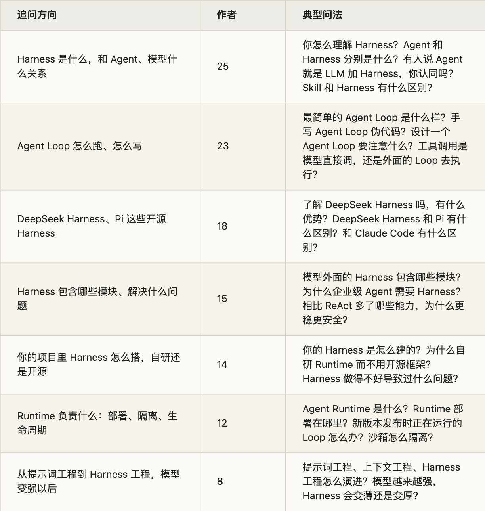
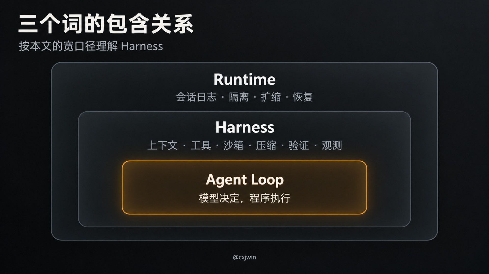
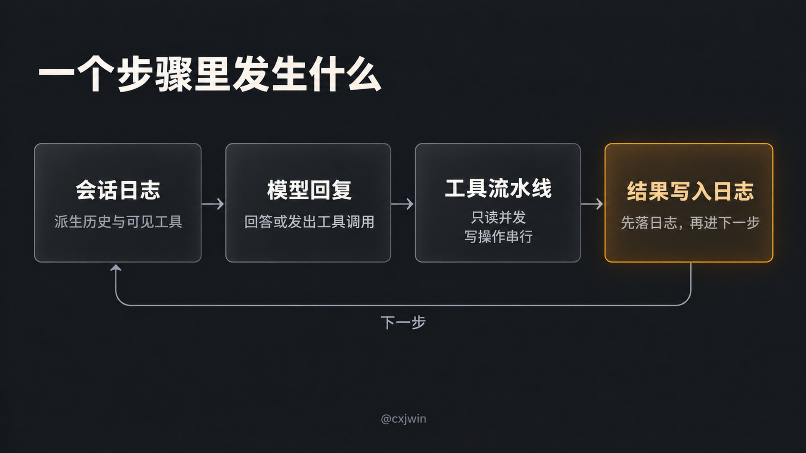
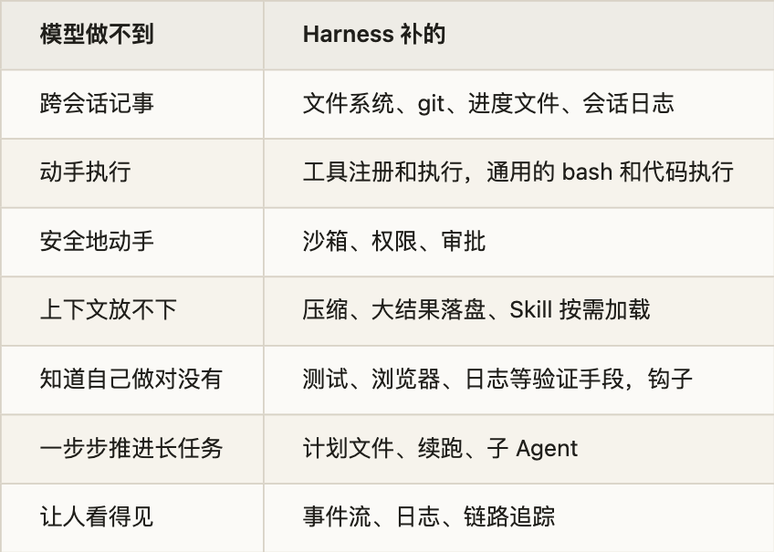
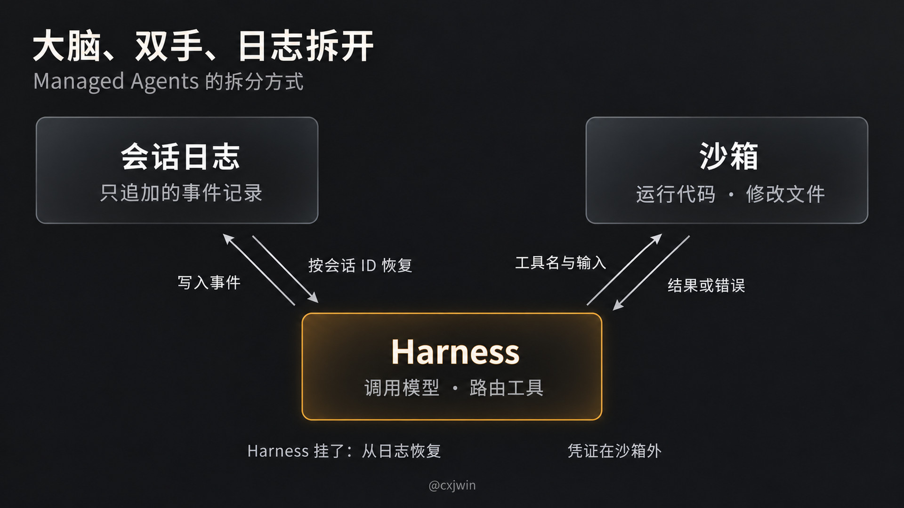
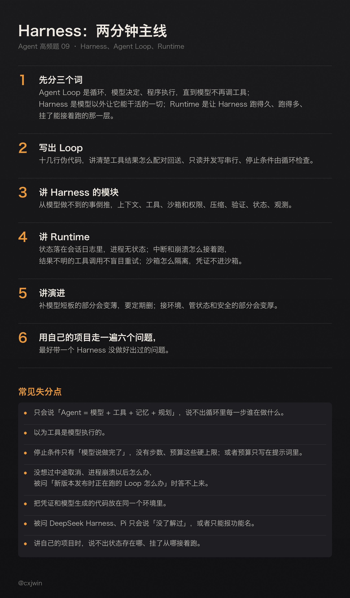

有位候选人面字节 AI 算力基础设施方向的 Agent 研发工程师，面试官从最底下开始问：什么是 Agent Loop？搭一个 Agent Loop 需要哪些模块？Agent Harness 最重要要解决什么问题？候选人事后总结，这一段是沿着 Runtime、Agent Loop、Harness、框架、记忆、工具协议、沙箱一路往下问的，面试官关心的不是你会不会用框架，而是懂不懂一个 Agent 跑起来底下要哪些能力。

另一头是更短的问法。字节剪映一面问模型外面的 Harness 工程包含哪些模块；腾讯云一面问新版本发布时，正在运行的 Agent Loop 怎么办，Agent Loop 和沙箱的生命周期是什么样的；还有不少场次只问一句：你怎么理解 Harness？

这几个词难答，是因为它们没有统一定义。同一样东西，有的团队叫执行器，有的叫调度层，有的叫运行时。面试官不在乎你用哪个词，在乎你能不能说清模型之外每一块在干什么。

这是 Agent 高频面试题单第 9 题的详解。题单里这题是 43 位作者、55 场面试。前几题用的那份 247 场样本，这次没拿到帖子 ID 列表，我改用 10 月 20 日重扫抓下来的全文：8 月 18 日到 10 月 18 日、和 Agent 或 AI 应用有关的单场面经 827 篇，按 Harness、Agent Loop、Runtime 等关键词找出 215 篇，逐条读过，去掉 JS 事件循环、JVM 运行时、断点续传这类同名不同义的，把死循环和终止条件留给第 28 题、Checkpoint 留给第 6 题、框架选型留给第 10 题，问到这道题的有 98 场、73 位作者。追问分七个方向（按作者数，一场可以算进几类）：



问得最多的是「Harness 是什么」，其次是「Agent Loop 怎么写」。这两问最容易答成背定义。面试官想听的是：循环里每一步谁在做决定、谁在执行，循环外面还要补哪些东西，Agent 才能跑得久、跑得稳、出了事能接着跑。

## 一、三个词各指什么

1\. Agent Loop：那个循环本身

Anthropic 在 2024 年底那篇《Building effective agents》里给 Agent 下的定义很朴素：Agent 通常就是大模型在一个循环里，根据环境反馈使用工具。同一篇文章把 Workflow 和 Agent 分开：Workflow 是用预先写好的代码路径编排模型和工具，Agent 是模型自己决定流程和用哪个工具。

Claude Agent SDK 的文档把这个循环拆成五步：模型拿到提示词、系统提示、工具定义和历史；模型决定回答还是调工具；程序执行工具，把结果送回模型；重复前两步，直到模型给出一个不带工具调用的回复；最后返回结果和用量。模型说一次话、程序执行完它要的工具，算一轮。

所以 Agent Loop 回答的是「怎么转起来」：谁做决定（模型），谁动手（程序），什么时候停。

2\. Harness：模型以外让它能干活的一切

Harness 这个词近一年才被大量使用，有宽窄两种用法。

宽的用法，LangChain 今年 3 月那篇《The Anatomy of an Agent Harness》说得最直接：Agent = Model + Harness，不是模型的部分都是 Harness。系统提示词，工具、Skill、MCP 和它们的描述，文件系统、沙箱、浏览器这些基础设施，子 Agent 和路由这类编排逻辑，以及压缩、续跑、lint 检查这类钩子，都算。Claude Code 的文档也是这个意思：Claude Code 是模型外面那一层，提供工具、管理模型看到的上下文，这一层就叫 Agent Harness。

窄的用法，Anthropic 今年 4 月讲 Managed Agents 的工程文章里，Harness 只指「调用模型、把模型的工具调用路由到对应基础设施的那个循环」，会话日志和沙箱是另外两样东西。

面试时说清楚你用的是哪一种就行。宽的说法适合回答「Harness 包含哪些模块」，窄的说法适合讲 Runtime 怎么拆。

3\. Runtime：让 Harness 跑得久、跑得多、死了能接着跑

Runtime 的定义更散。一个比较实在的参照，是腾讯云 Agent Runtime 团队在牛客发的招聘帖，里面列的活是：对话式、常驻、长任务、多 Agent 这几种运行模式下的生命周期管理、状态持久化、暂停恢复、弹性扩缩容、工具执行、网络访问，以及沙箱的快速启动、快照恢复和资源隔离。

这些都不是模型的事，也不是单次循环的事，而是「循环在哪台机器上跑、跑一半挂了怎么办、一千个会话同时跑怎么办、跑的代码会不会伤到别人」。

4\. 一句话分

Agent Loop 是心跳，Harness 是模型以外让它能干活的那套东西，Runtime 是把 Harness 跑起来、跑多份、跑很久的那一层。三者是包含关系：Harness 里有 Loop，Runtime 托着 Harness。

被问「Skill 和 Harness 有什么区别」时也可以用这句：Skill 是 Harness 加载进来的一份说明书，Harness 决定什么时候加载它、加载后放在哪、它里面的脚本在哪跑。第 7 题讲过 Skill 本身。

面试常问：你怎么理解 Harness？Agent 和 Harness 分别是什么？Harness 做了哪些事，能让 Agent 更好地执行任务？有人说 Agent 就是 LLM 加 Harness，你认同吗？Harness 和 Agent 框架的本质是什么？Agent Runtime 是什么？Skill 和 Harness 在理解上有什么区别？chatbot 和 AI Agent 有什么区别？



## 二、Agent Loop 怎么写

1\. 最小的版本

字节有一场面试直接让手写 Agent Loop 伪代码。最小的版本十来行：

```python
messages = [system_prompt, user_task]
for turn in range(MAX_TURNS):
    reply = llm(messages, tools=TOOLS)       # 模型决定：直接回答，还是调工具
    messages.append(reply)
    if not reply.tool_calls:                 # 没有工具调用，就是做完了
        return reply.text
    for call in reply.tool_calls:
        result = run_tool(call)              # 程序执行，模型不执行
        messages.append(tool_result(call.id, result))
    if over_budget(messages):                # 步数和预算由循环检查
        break
return "超出步数或预算，未完成"
```

几个要点都在这十几行里。模型只输出「调哪个工具、填什么参数」，执行的是程序，启云方一面问的「工具调用到底是模型直接调，还是外面的 Loop 去执行」，答案就在这。工具结果要和对应的调用配对送回去，下一轮模型才知道发生了什么。循环的出口有两个：模型自己不再调工具，或者循环替它停下来。

2\. 一个步骤里实际发生什么

真实的 Harness 在这十几行上加了很多东西。DeepSeek Harness 的 Agent Loop 包说明里，一个步骤是这样的：从会话日志派生出这次要发的历史和可见工具，发请求、流式收回复，模型的工具调用经过一条带守卫的工具流水线，每个被接受的结果先追加到会话日志，下一步再从日志派生。

并行也有讲究。它默认一个步骤里最多同时跑 10 个「并行安全」的工具调用，独占的调用单独跑，前后形成屏障，结果仍按模型给出的顺序记录。Claude Agent SDK 的做法类似：只读的工具（读文件、搜索、标了只读的 MCP 工具）可以并发，改状态的工具（编辑、写文件、执行命令）按顺序跑，免得互相踩。

面试被问「Agent Loop 响应比较慢怎么优化」时，这里就是第一个能讲的点：只读工具并发、写操作串行。第二个点是上下文，第 5 题讲过。



3\. 怎么停

正常的出口是模型给出一个不带工具调用的回复。另一个出口是循环替它停：Claude Agent SDK 有最大轮数和最大花费两个上限，碰到了就以 error\_max\_turns 或 error\_max\_budget\_usd 结束。Anthropic 那篇文章也说，任务通常在完成时结束，但常常还要加停止条件，比如最大迭代次数，好让人保持控制。

我九月做过一次多 Agent 实测，吃过这个亏。给的预算是 100 万 token 或 2 小时，哪个先到就停。结果 62 分钟交卷，累计用了 1.92 亿 token，接近预算的 192 倍。问题出在预算只写在题面里，没有变成运行时的停止条件；主 Agent 和三个子 Agent 各自只看到自己那一份，没有谁在汇总。预算要由循环统一累计、到了就停，不能指望每个 Agent 自觉省着用。

至于 Agent 一直调同一个工具、在几个工具之间兜圈子怎么识别、怎么打断，是第 28 题的内容。

4\. 中途取消和崩溃

这部分是很多人手写 Loop 时没想过的，也是面试官追问 Runtime 的入口。

DeepSeek Harness 的 Loop 包说明里写得很细。用户取消时，已经流式发给用户的那段文字会保留下来，记一条标了「被中断」的回复，下一次请求会带上用户实际看到的内容。一个步骤失败时，还没有结果的工具调用会被补上错误结果：已经记录了调用、但没有提交结果的，标成「结果未知」；连调用都没开始的，标成「未开始」。这样后续请求里每个工具调用都有配对的结果，而且不会自动重试结果不明的操作。插件出错结束的是这一轮，不是整个循环。

「结果未知」这一条值得在面试里讲。一个下单、发消息、扣款的工具，调用发出去了但进程崩了，你不知道它到底执行了没有。直接重试可能重复执行，所以要么工具本身支持幂等，要么先去查外部状态再决定。

5\. 手写、框架、SDK 怎么选

字节有一场面试问：手写 Agent Loop、用图编排框架、用更完整的 Agent SDK 或 Harness，各有什么取舍？

Anthropic 的建议是先直接调模型的 API，很多模式几行代码就能写出来；用框架的话，要搞清楚它底下在做什么，对底层的错误假设是常见的出错来源。我的理解是：手写最透明，但取消、崩溃恢复、并行、压缩这些都得自己补；SDK 把这些都做好了，代价是循环长什么样由它定；图编排框架适合流程大体固定、只在几个节点让模型做选择的场景。LangGraph 这些框架用不用，是第 10 题。

面试常问：什么是 Agent Loop？描述一下最简单的 Agent Loop 是什么样子？构造一个 Agent Loop 主要需要哪些模块？设计一个 Agent Loop 要注意什么？手写 Agent Loop 伪代码？工具调用是模型通过语言直接调用，还是模型生成结构化请求、由外部 Loop 执行？系统中有 Agent Loop、模型、工具、文件系统，用户说「帮我写一个贪吃蛇」之后下一步发生什么？Agent Loop 响应慢怎么优化？Agent Loop 里应该设计哪些上下文管理环节？手写 Loop、图编排框架、Agent SDK 各有什么取舍？

## 三、Harness 里有什么

1\. 从模型做不到的事倒推

LangChain 那篇文章的思路很好用：先列模型自己做不到什么，再看 Harness 补了什么。模型只会吃进文本、图片，吐出文本。它记不住跨会话的状态，不能执行代码，拿不到实时的信息，也没法自己装环境。每一样缺口，对应 Harness 的一块：



DeepSeek Harness 的包列表几乎就是这张表的工程版。文件系统、命令执行、沙箱、压缩、会话持久化、用户审批、网络访问，每一样先定义成一个抽象接口，再由可替换的实现插件挂上去：沙箱有 bubblewrap、Landlock、macOS Seatbelt 和 Windows ACL 几种后端；会话持久化有 JSONL 和 SQLite 两种；超大的工具输出会被换成一段预览加一个落盘文件路径；还有两个桥接插件，能直接复用 Claude Code 和 Codex 的 hooks 配置。蚂蚁二面问过「工具、记忆、权限管理和 Agent Loop 全面插件化」怎么看，这就是一个现成的例子。

2\. 长任务的 Harness 长什么样

Anthropic 去年 11 月那篇《Effective harnesses for long-running agents》给了一个具体例子。他们让 Agent 跨很多个上下文窗口去做一个网页应用，发现只靠压缩不够，失败有两种：一是想一口气做完，做到一半上下文用光，下一轮接手时连发生了什么都不知道；二是做了一部分以后，后来的 Agent 看看进度，就宣布做完了。

他们的 Harness 是这么改的：第一轮用一个专门的初始化提示词，让 Agent 搭好环境，写一个启动脚本、一个进度文件，把需求展开成两百多条功能清单，每条初始都标成未通过，用 JSON 存，因为模型改 JSON 比改 Markdown 更守规矩；之后每一轮只做一个功能，做完用 git 提交、更新进度文件；开工先读 git 日志和进度文件，先跑一遍端到端检查，确认上一轮没留下坏掉的东西。另一个改进是给它浏览器自动化工具，让它像用户一样去点一遍，而不是只跑单元测试就算过。

这里没有一样是模型能力，全是 Harness：怎么开局，怎么交接，怎么验收。

3\. Harness 做得不好，会出什么问题

vivo 有一场面试问：讲一个 Agent 工程中，因为 Harness 环节做得不好而导致的问题，以及怎么排查和解决。

我八月读 DeepSeek Harness 的事故复盘时，正好看到一个。一个 Agent 跑在 3081 端口的网页界面里，用户让它改这个界面的主题。它改完源码，先是把验收推回给用户；接着在 5173 端口起了个裸的 Vite，看到 HTTP 200 就宣布成功，页面其实是白屏；最后找到了正确的启动方式，却又在 3334 端口起了一个新服务，对着新服务验收。用户实际在用的 3081，它从头到尾没看过。

复盘的结论是：模型的上下文里根本没有当前界面的地址、承载进程和更新方式，它只能猜。修法不是改模型，是改 Harness：界面启动时把自己的地址写进系统提示词和环境变量，提示词里加一句「起另一个服务器不会更新这个界面」，裸 Vite 则被一个插件直接拒绝启动。

这个例子好用，是因为它说明了 Harness 的一个职责：模型需要知道的环境事实，要由 Harness 主动给，而不是指望模型自己找到。

面试常问：模型外面的 Harness 工程包含哪些模块？Agent Harness 包含哪些关键能力？为什么企业级 Agent 需要 Harness？Harness 相比 ReAct、相比直接调 MCP，多了哪些能力，为什么更稳定、更安全？你觉得写好 Harness，哪些是必须的？Harness 怎么做熔断和安全？如果想让 AI 按指定工作流执行，Harness 上应该怎么做？如何评估 Harness 的效果？讲一个因为 Harness 没做好导致的问题，怎么排查和解决？

## 四、Runtime：状态放哪、怎么隔离、怎么升级

1\. 把大脑、双手和日志拆开

Anthropic 今年 4 月讲 Managed Agents 的文章，是我见过把 Runtime 讲得最清楚的。他们一开始把会话、Harness、沙箱放在同一个容器里，结果容器成了「宠物」：容器一挂，会话就丢了；卡住了只能进容器排查，可容器里又有用户数据。

后来拆成三样东西，各自只通过接口打交道：会话是一份只追加的事件日志，Harness 是调用模型、路由工具调用的循环，沙箱是跑代码、改文件的执行环境。拆完以后：

- Harness 不再住在容器里。它调用沙箱就像调用一个工具，传名字和输入，拿回一个字符串。容器挂了，Harness 收到一个工具调用错误，交给模型决定要不要重试，需要时按标准配方新开一个。

- Harness 自己也不怕挂。会话日志在它外面，挂了就新起一个，按会话 ID 取回事件日志，从最后一个事件接着跑。循环运行时，每一步都把事件写进会话日志。

- 凭证不放进沙箱。Git 的令牌在初始化沙箱时就配进远端，Agent 碰不到；其他工具的 OAuth 令牌放在沙箱外的保险库里，经过代理调用。理由是，令牌和模型生成的代码在同一个容器里，一次提示词注入就能让模型读出来。

- 不需要沙箱的会话不用等沙箱启动。文章给的数字是首个 token 的等待时间，中位数降了约 60%，P95 降了九成以上。



2\. 新版本发布时，正在跑的 Loop 怎么办

腾讯云这一问，答案就在上面的拆法里：状态不在进程里，进程就可以换。

我会这样答。第一，状态全部落在会话日志里，每一步提交了才算数，进程本身无状态。第二，发布时让旧进程在步骤边界停下来，不接新步骤，把正在跑的这一步跑完或者标记中断；新版本按会话 ID 取回日志，从最后一个事件接着跑。第三，正在执行、结果不明的工具调用不能盲目重放，按上一节说的，查外部状态或者依赖幂等。第四，日志格式要向后兼容，新版本得能读懂旧版本写下的事件，否则恢复会失败。

DeepSeek Harness 的 Loop 包里也有对应的做法：恢复一个在轮次中途崩溃的会话时，会先补上几条收尾事件，把那一轮正常关掉，再继续。Claude Agent SDK 则提供了会话存储适配器，把记录同步到你自己的后端，另一台机器可以接着恢复。

3\. 隔离和生命周期

沙箱这一块，面试官常追问用什么隔离。科大讯飞一面问到了 gVisor，它是 Google 开源的容器沙箱，在用户态实现了一层内核，拦住容器里程序的系统调用，比普通容器隔离得更彻底。本地 Agent 更常见的是系统自带的机制：Linux 上的 bubblewrap、Landlock，macOS 上的 Seatbelt。

沙箱的细节不好做。DeepSeek Harness 另一篇复盘里，Linux 旧内核上的沙箱启动器会先打印一行无害的提示，再照常执行命令；Harness 只要在错误输出里看到那个前缀、命令又是非零退出，就判沙箱失败。结果 ripgrep 搜不到结果时正常返回的 1，被误判成了「沙箱不可用」。修法是把判断条件写成一个能表达退出码、同一行、精确排除无害提示的类型。

生命周期可以按会话讲：创建时分配沙箱、加载配置；运行时每一步写日志、累计预算；空闲时暂停或回收沙箱，只留日志；结束时释放资源，日志和产物留档。

4\. 部署在哪

阿里千问二面问过：Agent Runtime 部署在哪里？几种常见的形态：

- 本地：Claude Code、Pi 这类命令行工具，Harness 跟着进程跑在用户机器上，会话记录写本地文件。

- 嵌入式：把 Harness 作为子进程或库嵌进自己的应用。DeepSeek Harness 有一个客户端 SDK，通过标准输入输出上的 JSON-RPC 驱动一个 Harness 子进程；它也支持 ACP 协议，Zed 这类编辑器可以直接接进来。

- 托管：Managed Agents 这类，Harness 无状态、按需起多份，会话日志和沙箱在服务端。

面试常问：Agent Runtime 是什么，核心职责是什么？Runtime 部署在哪里？新版本发布时，正在运行的 Agent Loop 怎么办？Agent Loop 或沙箱的生命周期是什么样的？Runtime 的沙箱和隔离机制怎么做，gVisor 是什么？项目里的 LLM Runtime 和 Tool Runtime 分别负责什么？长时间运行的任务怎么保证稳定？哪些状态由前端维护、哪些由 BFF 维护、哪些由后端 Agent Runtime 维护？Runtime 重试这一层具体怎么做？

## 五、DeepSeek Harness、Pi 这些：被问「了解吗」怎么答

这一类问法从 8 月 18 日那批面经就开始出现，Momenta 二面问候选人了不了解最新的 DeepSeek Harness。问法大多是两种：了解吗，有什么特点？和另一个比有什么区别？

别背功能清单。挑几个维度对比：核心有多大，扩展怎么做，状态放在哪，安全怎么管。

- Pi：作者自己的定位是一个极简的终端编程 Harness。默认只给模型四个工具：读、写、编辑、bash。README 里明说了不做的东西：不内置 MCP（建议写带说明的命令行工具，或者自己装扩展）、不内置子 Agent、不弹权限确认（建议放容器里跑）、不内置计划模式。这些都留给扩展和第三方包。它能以交互、JSON 输出、RPC、SDK 四种方式运行，OpenClaw 就是基于它的 SDK 做的。

- DeepSeek Harness：仓库今年 6 月建立。它走的是另一条路：核心同样不写死功能，但每一种能力都先定义成接口，官方再提供一批可替换的实现，前面那张表里的东西它几乎都有。会话是事件溯源的，所有事实追加进日志，界面和恢复都从日志派生。我读它的仓库时印象最深的是工程纪律：开发主力是 AI Agent，规则写进 AGENTS.md，每个文件的四项覆盖率都要求 100%，出了事故写复盘，再把教训变成门禁。

- Hermes Agent：Nous Research 做的，主打自我进化：从经验里生成 Skill，用的过程中改进它，还会搜索自己过去的对话。它通过一个网关进程同时接 Telegram、Discord、Slack 这些聊天渠道。

- Claude Code、Codex：产品级的 Harness。按 LangChain 的说法，它们的模型在后训练时就把 Harness 放在回路里，所以换一套工具逻辑，模型表现可能变差。前面几节的很多例子都来自它们。

字节一场面试问 DeepSeek Harness 和 Pi 的区别。可以这样落一句：两个都把功能从核心里拿出去，Pi 的选择是核心只留最少的东西，其余让用户自己装；DeepSeek Harness 的选择是把每一块做成可替换的接口，官方把常用的实现都配齐。前者上手轻、可控，后者开箱能力全、结构重。

面试常问：了解 DeepSeek Harness 吗，有什么优势？DeepSeek Harness 的源码看过没？DeepSeek Harness 和 Pi 有什么区别？Claude Code 和 DeepSeek Harness 有什么区别？了解 Pi Agent、Hermes 吗？Hermes 怎么实现自我进化？对业界其他 Agent Harness 有哪些了解，和你的项目怎么结合？如何搭建一个简单的 Chat Harness？

## 六、模型变强以后，Harness 会变薄吗

抖音电商一面问过：模型越来越强以后，Harness 工程会变薄还是变厚？百度一面问的是更早一层：提示词工程、上下文工程到 Harness 工程是怎么演进的？

演进这一问，我以前写过一个判断：驱动这条线的是任务的尺寸。任务是一句话，写好提示词；任务塞不进一次对话，管理上下文；任务要跨小时、要验证、要恢复，就得搭 Harness。我当时还提过一个判据：上一轮的产出能不能干净地变成下一轮的输入。编程适合 Harness，是因为报错、测试结果、日志都能原样喂回去；写作、审美这类活，好不好要人判断，Harness 能帮忙，但驱动不了闭环。

变薄还是变厚，Anthropic 在 Managed Agents 那篇里给了一个很具体的例子：Harness 里写着很多「模型自己做不到什么」的假设，这些假设会随模型变强而过期。他们发现 Claude Sonnet 4.5 在感觉上下文快满时会草草收尾，于是在 Harness 里加了上下文重置；换到 Claude Opus 4.5，这个毛病没了，重置成了累赘。LangChain 的说法也类似：一部分东西会被模型吸收，比如计划、自我验证；但环境、工具、持久状态和验证回路，不管模型多强都能让它更高效。他们还举了一个例子，只改 Harness，他们的编程 Agent 在 Terminal Bench 2.0 上从前 30 名进了前 5。

所以我的答法是：Harness 里补模型短板的部分会变薄，要定期回头删；接环境、管状态、管安全、管预算的部分不会变薄，任务越长、越自动，这部分越厚。

面试常问：如何理解提示词工程到上下文工程到 Harness 工程的演进？谈谈对 Harness Engineering 的理解？模型越来越强，Harness 工程会变薄还是变厚？怎么看待 Harness 工程和模型能力升级之间的冲突？为什么会从早期方案演变到 Harness、上下文工程？怎么看工具、记忆、权限和 Agent Loop 全面插件化？

## 七、讲你自己的 Harness

被问「你的 Harness 是怎么建的」「为什么自研」，用下面六个问题过一遍自己的项目，基本能接住追问：

1. 循环在哪：自己写的，还是用了哪个 SDK、框架；一轮怎么定义，怎么停。

2. 工具怎么接：注册在哪，谁执行，并行还是串行，失败了怎么回给模型。

3. 上下文怎么组装：系统提示词、项目说明、记忆、工具定义各放什么，满了怎么压缩，第 5 题讲过。

4. 状态存在哪：进程挂了能不能接着跑，从哪一步接。

5. 安全怎么管：沙箱、权限、审批、凭证放哪。

6. 怎么知道它好不好：有没有固定的任务集，同一个模型换 Harness 跑一遍对比，第 4 题讲过评测。

自研还是用开源，可以从这几问倒推：如果你的场景要求状态持久、多租户隔离、特定的审批流程，现成的工具不支持，才值得自己写；只是需要一个能读写文件、跑命令的编程 Agent，直接用现成的更合算。

面试常问：你的 Harness 是怎么建的？Harness 的技术选型，是自研还是基于开源改造？为什么选择自研 Agent Runtime，而不是直接用开源框架？已有成熟的开源框架，为什么还要自研 Agent 循环和 Harness 组件？你说的可插拔 Harness 具体怎么设计？日常怎么维护工程的 Harness？如果把云端、桌面 Agent 的 Harness 经验迁移到车端、手机，会有哪些难点？

## 八、面试怎么答

两分钟左右的主线：

1. 先分三个词：Agent Loop 是循环，模型决定、程序执行，直到模型不再调工具；Harness 是模型以外让它能干活的一切；Runtime 是让 Harness 跑得久、跑得多、挂了能接着跑的那一层。

2. 写出 Loop：十几行伪代码，讲清楚工具结果怎么配对回送、只读并发写串行、停止条件由循环检查。

3. 讲 Harness 的模块：从模型做不到的事倒推，上下文、工具、沙箱和权限、压缩、验证、状态、观测。

4. 讲 Runtime：状态落在会话日志里，进程无状态；中断和崩溃怎么接着跑，结果不明的工具调用不盲目重试；沙箱怎么隔离，凭证不进沙箱。

5. 讲演进：补模型短板的部分会变薄，要定期删；接环境、管状态和安全的部分会变厚。

6. 用自己的项目走一遍六个问题，最好带一个 Harness 没做好出过的问题。

几个常见的失分点：

- 只会说「Agent = 模型 + 工具 + 记忆 + 规划」，说不出循环里每一步谁在做什么。

- 以为工具是模型执行的。

- 停止条件只有「模型说做完了」，没有步数、预算这些硬上限；或者预算只写在提示词里。

- 没想过中途取消、进程崩溃以后怎么办，被问「新版本发布时正在跑的 Loop 怎么办」时答不上来。

- 把凭证和模型生成的代码放在同一个环境里。

- 被问 DeepSeek Harness、Pi 只会说「没了解过」，或者只能报功能名。

- 讲自己的项目时，说不出状态存在哪、挂了从哪接着跑。



## 出处

文中的面试问法都出自下面这些面经，括号里是发帖日期，链到牛客原帖。

- 开头的例子：[字节 AI Agent 研发工程师（AI 算力基础设施）](https://www.nowcoder.com/discuss/930155293864914944)（09-17）· [字节剪映 AI 应用开发一面](https://www.nowcoder.com/feed/main/detail/7211e82c75284d23a89b569cd9dc289d)（09-24）· [腾讯云一面 AI 应用](https://www.nowcoder.com/feed/main/detail/517d4adbe09d493e89a32e20801a1995)（09-24）

- 三个词各指什么：[美团 Agent 开发一面](https://www.nowcoder.com/feed/main/detail/58159306df52463ab75d72daa80d66df)（08-25）· [字节 Agent 开发一面（9.3）](https://www.nowcoder.com/discuss/925342611194286080)（09-04）· [百度 Agent Harness 研发工程师一面](https://www.nowcoder.com/discuss/926928449204129792)（09-08）· [美团 AI 后端一面](https://www.nowcoder.com/discuss/927579574932705280)（09-10）· [字节抖音电商客户端一面](https://www.nowcoder.com/feed/main/detail/9d9259986b304b749bc8ab07c20365c9)（09-15）· [华顺信安 golang 实习](https://www.nowcoder.com/discuss/940603493713207296)（10-16）· [小红书面试流程](https://www.nowcoder.com/feed/main/detail/d1a04cfc7c7c4715809b21659403399f)（10-12）· [水滴质量秋招一面](https://www.nowcoder.com/feed/main/detail/13f249a698cb4672992eefb9003d5e07)（09-08）· [三七互娱线下面](https://www.nowcoder.com/feed/main/detail/cd9443129c2a4b05ad4e6b630bf46ad6)（09-11）

- Agent Loop 怎么写：[字节业务中台 AI 全栈日常实习](https://www.nowcoder.com/feed/main/detail/6ac5ba31705a4b64a407b087f39d5447)（10-12）· [字节 AI 应用开发一面（中国交易与广告）](https://www.nowcoder.com/feed/main/detail/b34f6902e8544fe2953696ed52e49dba)（08-31）· [启云方 AI Agent 一面](https://www.nowcoder.com/feed/main/detail/fea2d18bd59a421da7d16fe16223d38c)（09-03）· [阿里云 Agent 开发一面（8.18）](https://www.nowcoder.com/feed/main/detail/42ba29ab006d4bb793112eb263d18f6a)（08-18）· [百度 Agent 三面（8.18）](https://www.nowcoder.com/feed/main/detail/3b91f20a24c34faf84eb0a2b8e517ccf)（08-18）· [快手效果营销二面](https://www.nowcoder.com/discuss/921722245028794368)（08-25）· [字节 260901 一面](https://www.nowcoder.com/feed/main/detail/fa50ef5521f84cb788f911cd31e5a98a)（10-03）· [网易 Agent 开发一面](https://www.nowcoder.com/feed/main/detail/bad72b1323274ad5b172039f48bfa4b1)（10-17）· [千问 AI 研发一面](https://www.nowcoder.com/feed/main/detail/ebf0ec03e5ee4fa8a140cc8d247b1e20)（09-21）

- Harness 里有什么：[蚂蚁 AI Agent 开发一面](https://www.nowcoder.com/feed/main/detail/6490526c86124f92b79a993e171f7222)（08-28）· [淘天日常实习一面（用户运营技术）](https://www.nowcoder.com/feed/main/detail/5dca9d9dd8284cc4aada23b9f0c20f15)（08-18）· [蚂蚁二面（9.21）](https://www.nowcoder.com/feed/main/detail/52b419448b854e24bbdf41ca9e6ffe06)（09-21）· [vivo 线下面 Agent 开发](https://www.nowcoder.com/discuss/932016298563809280)（09-22）· [招银网络测开二面](https://www.nowcoder.com/feed/main/detail/2dc5bf905f6440b2be41f6631d919056)（09-16）· [深信服 AI Agent 一面](https://www.nowcoder.com/feed/main/detail/83326f3bcc5546b2b556373ad29a6d71)（09-03）· [百度](https://www.nowcoder.com/feed/main/detail/fc061fe55af84effb8014ed6c60db92d)（10-14）

- Runtime：[腾讯云一面 AI 应用](https://www.nowcoder.com/feed/main/detail/517d4adbe09d493e89a32e20801a1995)（09-24）· [科大讯飞 AI 应用一面](https://www.nowcoder.com/feed/main/detail/aece93373f9c47ea95c831aef6471886)（09-24）· [阿里千问二面](https://www.nowcoder.com/feed/main/detail/5ff7b7fde8bc49eb960d5badde3ac623)（09-22）· [百度 Agent 一面](https://www.nowcoder.com/feed/main/detail/72858aade19d443facc870fea8bb134f)（09-06）· [亚信安全 Agent 开发一面](https://www.nowcoder.com/feed/main/detail/00254f151d484eb89f8ab6781125d05a)（09-01）· [元戎启行前端三面](https://www.nowcoder.com/feed/main/detail/d7a30a4061eb4da4acf5fca1d6a9b861)（08-27）· [虾皮 Agent 二面](https://www.nowcoder.com/feed/main/detail/345b668e35a9451bb397a9189dfdc943)（08-24）· 腾讯云 Agent Runtime 团队的[招聘帖](https://www.nowcoder.com/discuss/932616763089383424)（09-24，不是面经，不计入）

- DeepSeek Harness、Pi 这些：[字节 Agent 全三轮](https://www.nowcoder.com/feed/main/detail/b4fb3bee56134c3d9bcde6a3166a1711)（10-18）· [字节 Agent 秋招一面](https://www.nowcoder.com/discuss/929731481189044224)（09-16）· [MINISO Agent 开发实习一面](https://www.nowcoder.com/feed/main/detail/f844a4ac20be44bc9b3f756bd0ebb84c)（08-26）· [携程前端一面](https://www.nowcoder.com/feed/main/detail/7f9692ede9464a2287d57dedc23f586f)（09-15）· [新旦智能 AI 应用开发一面](https://www.nowcoder.com/feed/main/detail/299d356b23044bf39fb29e7f8569761d)（09-14）· [美团 AI 后端二面](https://www.nowcoder.com/discuss/929087871779110912)（09-14）· [阿里云 Agent 开发一二面](https://www.nowcoder.com/feed/main/detail/fee780e1140147fbbad0f23a74e265c6)（10-05）· [南京车 300 Java 实习](https://www.nowcoder.com/feed/main/detail/8b78085106ae45a4bada11cb75141d8f)（09-03）

- Harness 的演进：[抖音电商 Agent 全栈一面](https://www.nowcoder.com/discuss/925066865183858688)（09-03）· [百度大模型研发一面](https://www.nowcoder.com/discuss/921590204903723008)（08-25）· [淘天 AI 应用开发二面](https://www.nowcoder.com/feed/main/detail/1b201d12219c45818b447bc7633fd62c)（08-26）· [度小满一面](https://www.nowcoder.com/feed/main/detail/41baab8c631647568203ebfaf3898574)（09-19）· [平安健康 AI 应用开发一面](https://www.nowcoder.com/feed/main/detail/6c11a75a8bd44628943deff3e42ae15c)（08-26）

- 自己的 Harness：[阿里国际 Agent 开发三面](https://www.nowcoder.com/feed/main/detail/747f07e71f4448bebdce6ada5de800cd)（08-31）· [腾讯 WXG 实习一面](https://www.nowcoder.com/feed/main/detail/c2914a90116a4d6692851fecb3c09c40)（10-16）· [腾讯大模型算法岗一二面](https://www.nowcoder.com/feed/main/detail/744b588e62b444a19732eed3fa9aad1c)（10-02）· [阿里全栈一面](https://www.nowcoder.com/feed/main/detail/dbadbb8ec25e421fb6274b54211a4f3f)（09-21）· [阿里控股 Agent 开发一面](https://www.nowcoder.com/feed/main/detail/85c8873901c744688fa7267145b9b3ce)（08-28）· [小鹏二面](https://www.nowcoder.com/feed/main/detail/7c2fa3dd92014d038603ba388fb078f4)（10-03）

- 外部资料：Anthropic [Building effective agents](https://www.anthropic.com/engineering/building-effective-agents)（2024-12-19）· [Effective harnesses for long-running agents](https://www.anthropic.com/engineering/effective-harnesses-for-long-running-agents)（2025-11-26）· [Scaling Managed Agents with stable interfaces](https://www.anthropic.com/engineering/managed-agents)（2026-04-08）· Claude Agent SDK [How the agent loop works](https://code.claude.com/docs/en/agent-sdk/agent-loop)（10-31 读取）· Claude Code [How Claude Code works](https://code.claude.com/docs/en/how-claude-code-works)（10-20 读取）· LangChain [The Anatomy of an Agent Harness](https://blog.langchain.com/the-anatomy-of-an-agent-harness/)（2026-03-10）· DeepSeek Harness 的 npm 包 [@deepseek-ai/dsh-agent-loop](https://www.npmjs.com/package/@deepseek-ai/dsh-agent-loop) 说明和包列表（10-31 读取）· Pi [@mariozechner/pi-coding-agent](https://www.npmjs.com/package/@mariozechner/pi-coding-agent) README（10-31 读取）· Hermes Agent [PyPI 页面](https://pypi.org/project/hermes-agent/)（10-31 读取）

- 我自己的文章：[DeepSeek Harness 的「验尸」哲学](https://x.com/cxjwin/article/2087980295001866708)（08-14）· [62 分钟交卷，Token 用了预算的 192 倍](https://x.com/cxjwin/article/2100289856635383880)（09-17）· [AI 进化比人快，只会提示词就太 Out 了](https://x.com/cxjwin/article/2059136802422665226)（05-26）· [别再 prompt agent 了？](https://x.com/cxjwin/article/2064492969005355193)（06-10）
