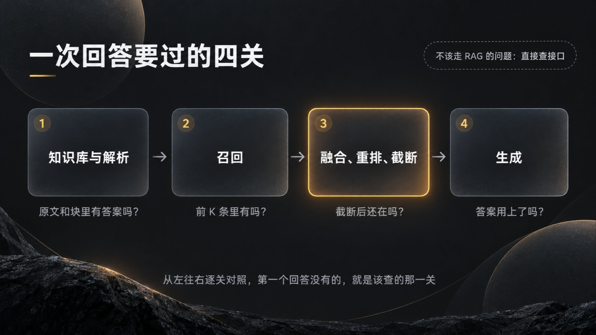
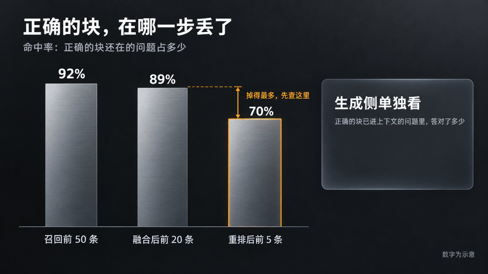
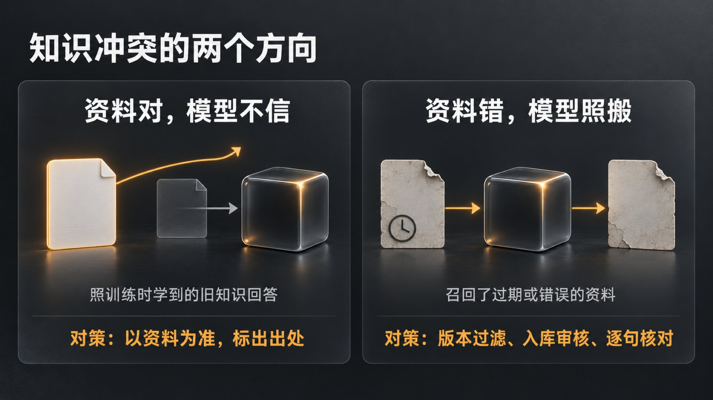
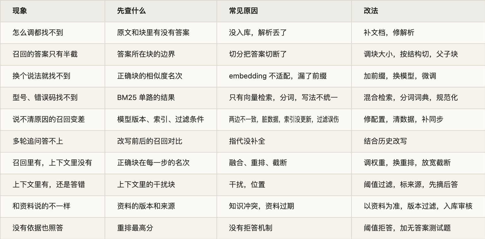

这是 Agent 高频面试题单第 15 题的详解。题单里，这题是 29 位作者、30 场面试，大多在一面。问得最多的是怎么评估 RAG 的效果，其次是效果差、召回不准怎么排查，做过哪些优化，再就是检索到的内容和模型自己的知识冲突了怎么办。

有位作者在面试总结帖里记过一道开放题：给公司做内部知识库问答，员工反馈答得不准，你怎么排查？作者当场答换个 embedding 模型，面试官笑着反问：连问题出在哪都不知道，就换模型？作者事后总结，该先一层层排查，弄清问题出在哪里。

失分就失在这里。换模型、加 rerank、调块大小，这些都可能有用，面试官想听的是你怎么判断该改哪一个。第 1 题讲的是 RAG 每一环怎么搭，这一题问的是出了问题以后怎么查。

所以这篇按排查的顺序讲：先把「效果差」拆成四个可能出错的环节，用两个对照分清是检索还是生成的问题；再讲评测集和分段指标，让问题能量化；然后逐个讲检索侧、生成侧的常见原因、怎么确认、怎么改；最后是怎么证明修好了、一张排查表和面试答法。第 1 题讲过的原理，这里只点到为止。

## 一、先把「效果差」拆开

用户说「答得不对」，背后可能是完全不同的问题。一次 RAG 回答要过四关，哪一关出错，用户看到的结果都差不多：

1. 知识库里有没有答案。文档没入库，或者解析时丢了内容。

2. 答案所在的块有没有被召回。切分、向量模型、检索参数和问题的写法都会影响。

3. 召回到的正确块，有没有撑过融合、重排和截断。比如重排后它落到第 12，最后只取 8 条，它就进不了上下文。

4. 进了上下文以后，模型有没有用对。它可能被相似的干扰内容带偏，可能不信资料，也可能在没有依据时自己编。

还有一种情况在这四关之外：问题本来就不该走 RAG。订单状态、库存这类有确定答案的数据，应该直接查接口。

排查就是拿一个坏例，沿着这四关逐个对照：原文里有答案吗？切出来的块里有吗？召回的前 K 条里有吗？融合、重排、截断之后还在吗？最终的上下文里有吗？答案用上了吗？第一个回答「没有」的地方，就是该查的那一环。

有两个对照能很快分清是检索的问题还是生成的问题：

- 看召回结果里有没有正确的块。没有，先查检索；有，却答错了，查生成。

- 把正确的块直接放进上下文，再问一次。这次答对了，说明模型有能力答，问题在前面的检索；还是答错，问题在生成、提示词，或者资料本身就没写清楚。

这些对照要靠日志。每一步的输入输出都记下来：原始问题、改写后的问题、每一路召回的结果和分数、融合和重排后的名次、最终放进上下文的块、模型的回答和引用。有这条记录，排查就是翻日志；没有，只能事后重放，还不一定复现得出来。

面试常问：检索出来的内容相关性很差，你会怎么排查？召回不准可能是什么原因？回答差或者答非所问，怎么判断是检索的问题还是生成的问题？文档里明明有答案，却没召回，怎么一步步定位？怎么区分问题出在模型本身、提示词、检索还是业务代码？

## 二、先让问题能量化

只盯着几个坏例改，容易修好一个、弄坏三个。排查之前要先有一套评测集：从日志里找真实问题，每题标出应该召回的块和参考答案，再放一批知识库答不了的问题。怎么建、各个指标怎么算，第 1 题的评测一节讲过。排查时，评测集有三个用处。

1\. 分段看指标

同一批问题，分别看召回之后、融合之后、重排之后、最终进上下文时，正确的块还在不在。下面用命中率举例，也就是正确的块还在的问题占多少。

比如召回前 50 条的命中率是 92%，融合后取前 20 条还有 89%，重排后取前 5 条只剩 70%，掉得最多的是重排和截断这一段，就该先查这里，而不是去换 embedding 模型。生成侧单独看：正确的块已经进了上下文的那些问题里，答对了多少。这一项低，问题在生成。

评估重排模型也是同一个思路：固定召回给出的候选，只比较重排前后正确块的名次，用 MRR 这类看名次的指标，召回的好坏就不会混进来。

2\. 按问题类型切开看

平均数会把问题藏起来。总体命中率 85%，型号、错误码这类问题可能只有 40%，这就指向了精确匹配；多轮对话里的追问如果明显更差，指向的是问题改写。常用的切法有这几种：

- 含精确词的：型号、编号、错误码、人名

- 很短的、口语化的

- 多轮对话里带指代的

- 要拼两份以上资料才能答的

- 涉及数字、否定和条件的

- 时效性强的

3\. 给坏例归类

从日志里抽几十到一百个坏例，逐个标出坏在哪一关，再数每一类各占多少，先修占比最高的那类。这一步很笨，但它决定了后面的力气花在哪。

改完之后，在同一个评测集上重跑这些指标，每次只改一个变量，改动带来的延迟和成本也一起记下来。

面试常问：项目用哪些指标衡量 RAG 的效果，检索和生成怎么分开评？评测集的问题从哪来，标准答案由谁定、谁来审？知识库里没有答案的问题，怎么定评分标准？向量召回容易召回语义相近、业务口径却不对的片段，怎么量化地证明原方案有这个缺陷？长问题和两三个字的短问题，召回效果对比过吗？怎么设计评测来判断重排模型好不好？

## 三、检索侧：答案没被找到

分段指标指向检索时，从上游往下游查。上游丢掉的东西，下游怎么调都补不回来。

1\. 知识库里没有，或者解析坏了

症状：怎么调检索参数都找不到；表格里的数字答错；PDF 里的内容前后颠倒。

确认：先在原始文档里搜答案的原文，再在切好的块里搜。原文有、块里没有，是解析或清洗时丢了；块里有，文字却是乱的，是版面或表格没解析对；原文里也没有，就是知识库缺这块内容，检索做得再好也答不出来，只能补文档，或者让系统明确回答不知道。

这一类最容易被跳过。大家习惯先怀疑检索，其实打开那几个块看一眼原文，常常就找到原因了。

改法见第 1 题的解析一节：复杂版面先做版面分析，表格转成 HTML，扫描件走 OCR，入库前做质量检查。

2\. 切分把答案切坏了

症状：召回的块只有半截答案；答案要两块拼起来才完整；块太大，里面混着几件事，相关的块排不上来。

确认：找到答案所在的块，看它的边界切在哪，再看它和问题的相似度在全库排第几。内容是对的、名次却很靠后，往往是块太大，向量被块里的其他内容稀释了。

改：调块的大小和重叠，按标题结构切，用父子块。

另一类改法是给块补上下文。比如一个块写着「该功能在第二季度上线」，单看这一块，不知道「该功能」指什么，检索时自然匹配不上。最简单的做法是把文档标题和标题路径拼在块前面。Anthropic 的 Contextual Retrieval 更进一步：入库时让模型读全文，为每一块写一两句说明，交代它在全文里讲的是什么，拼在块前面，再算向量、建 BM25 索引。他们的测试里，前 20 条召回的失败率因此下降了 49%，再加上重排，下降了 67%。代价是入库时每一块都要多调用一次模型。

3\. 向量模型和数据不对路

症状：换个说法就查得到，换成专有名词、缩写就查不到；中英混写、领域术语多的问题召回差；语义相近、业务口径却不对的块排到了前面。

确认：拿一批召回失败的问题，把正确的块和排在它前面的几块放在一起读。排在前面的往往字面像、意思不对，比如问的是 A 产品的退款规则，召回的是 B 产品的。

改：

- 先查用法对不对。有的模型要求给问题加前缀或检索指令，第 1 题提过 E5 和 BGE 的约定，漏加了，效果会打折扣。

- 换模型。公开榜单只能初筛，要在自己的评测集上比，至少比两三个。

- 用自己的数据微调 embedding 模型。训练数据是问题和正确块的配对，再配上难负例，也就是看起来相关、其实答不了这个问题的块，比如上面那个 B 产品的块。模型要学会的就是这种区分。微调后要把全库重新向量化。

- 加一路关键词检索，补精确匹配，见下一节。

4\. 精确匹配：型号、错误码、人名

向量检索懂意思，但对必须一字不差的词不敏感。这类问题，先单独看 BM25 那一路的结果。

BM25 那一路自己也会出问题，中文最常见的是分词。领域词被切碎了，比如一个产品名被拆成几个常用字，匹配就变成了常用字的匹配，要把领域词加进分词词典。还有写法不统一：XR-2000、XR2000、xr 2000，在检索看来是三个不同的词。入库和查询两边要用同一套规范化，统一全角半角、大小写、空格和连字符。

5\. 检索参数、过滤和索引

这几项查起来便宜，最好先查：

- top-K 太小：正确的块排在第 12，只取了前 10。

- 相似度阈值太高：正确的块分数不够，被过滤掉了。

- 近似索引有损失：拿同一批问题，分别用近似索引和暴力检索查一遍，比较两边结果的重合度。重合度低，就调大 HNSW 的 efSearch，或者 IVF 每次查的簇数。

- 过滤条件误伤：元数据或权限标签打错了，有权限的人也查不到；先检索再过滤时，过滤完只剩几条。

- 两边不一致：查询和入库用的 embedding 模型或版本不同；向量一边归一化了、一边没有，却用内积算相似度；入库时做过清洗，比如繁简转换，查询时没做。

- 库里有脏数据：重复的块、空块、乱码块，还有换模型以后没清掉的旧向量，都会挤占召回的名额。可以定期扫一遍：找出向量几乎相同的块，找出文本过短或乱码的块，核对每条向量记录的模型版本。

- 索引没跟上：新文档还没入库，旧版本没删干净，或者删除后缓存还在，第 1 题的更新一节讲过。

这些问题在指标上的表现和「模型不行」很像，改起来往往只是几行配置。

6\. 问题本身：口语化、指代、多跳

症状：单独问能答，放在多轮对话里问「那它的保修期呢」就答不上；一个问题要两份资料拼起来才能答。

确认：手工把问题改写成一句完整的检索语句，再查一次。召回明显变好，就是问题写法的毛病。

改：结合对话历史补全改写，扩写成几个问法，拆成子问题。多跳问题一次检索往往不够：先查到第一份资料，从中拿到中间结论，再用它去查第二份。这一步可以交给 Agent，让模型自己决定要不要再查、查什么，代价是多轮调用带来的延迟。

7\. 召回到了，却在后面丢了

症状：召回的前 50 条里有正确的块，最后放进上下文的 8 条里没有。

确认：跟踪正确的块在每一步的名次：两路召回各排第几，融合后第几，重排后第几。

改：

- 融合：某一路质量很差，会把融合结果一起拉低。先看各路单独的命中率，差的那一路降权或者去掉。

- 重排：换重排模型，或者用自己的数据微调。还要注意重排模型的输入长度上限，问题和块拼起来超长时，超出的部分会被截掉。答案恰好在块的后半段，重排就看不到它。

- 截断和阈值：放宽截断，能多留住一些正确的块，代价是上下文变长、干扰变多，这会影响下一章讲的生成。

有场面试连着追问了三句：top-k 为什么取 6 或 8，不取 3？取 8 不会带进更多干扰、更容易幻觉吗？取小了召回效果不好，可能是哪几方面没做好？三句问的都是这里的取舍。最后一句值得多想一层：K 取小了效果就差，说明正确的块排得不够靠前，该查的是召回和重排的排序质量，只把 K 调大是在用上下文的预算掩盖排序的问题。

面试常问：检索不到相关内容，是资料里本来就没有、解析时丢了，还是检索策略有问题？文档格式五花八门、没人管质量，解析效果是不是也好不了？内容缺失、重复、过时或互相冲突的文档，怎么发现、怎么处理？RAG 怎么提升召回率？简历上写召回率提升了 20% 左右，具体做了哪些工作？要求召回率和回答准确率都极高的场景，怎么做？目标文档没被召回，或者召回的不是最新版本，怎么处理？向量库里的脏数据会造成什么影响，怎么自动检测？

## 四、生成侧：找到了，却没答对

1\. 资料在上下文里，模型没用上

正确的块进了上下文，答案还是错的，常见的原因是干扰：同时召回了看起来很像的内容，比如旧版本的制度、另一个产品的说明，模型抓错了。2023 年 Shi 等人的论文《Large Language Models Can Be Easily Distracted by Irrelevant Context》在数学应用题里掺进一句无关的话，模型的准确率就明显下降。位置也有影响，第 1 题讲过《Lost in the Middle》。

改：

- 少放。用重排分数的阈值，把弱相关的块挡在上下文外面。

- 标清楚。每一块带上来源、版本和日期，模型才分得清哪段出自哪份文档。

- 先摘后答。让模型先把和问题相关的原文摘出来，再根据摘出的内容回答。Anthropic 给长文档任务的提示词建议里就有这一条，摘出的原文还能直接用作引用。

2\. 检索内容和模型自己的知识冲突

冲突有两个方向。一种是资料对、模型不信，按训练时学到的旧知识回答，资料比模型新的时候最常见；另一种是资料错、模型照搬，比如召回了过期的文档。

两种情况在研究里都出现过。2023 年 Xie 等人的论文《Adaptive Chameleon or Stubborn Sloth》发现，外部资料写得连贯、有说服力时，模型很容易采信，即使它和模型自己的知识冲突；可如果给它的资料里，既有和它原有认知一致的，也有冲突的，它会明显偏向一致的那部分。2024 年的 ClashEval 专门测了资料被改错的情况：模型在六成以上的情况下会放弃自己原本正确的答案，跟着错误的资料走；资料错得越离谱，模型越不容易被带走；模型对自己原来的答案越没把握，越容易采信资料。

处理要分开说：

- 业务系统里，知识库代表的是官方口径，默认以资料为准。提示词里写清楚：只根据资料回答，资料和常识不一致时按资料回答，并标出出处。

- 资料本身要可信。入库时保留版本和生效日期，检索默认只取最新版本，过期文档及时下线；来源分级，权威文档优先。自动沉淀进库的内容要先审核。有面试官举过一个例子：故障案例库里记着「网络不通，拔插一下网线就好了」，真正的原因是网络波动，这种假案例进了库，以后会一直被召回。

- 资料之间互相矛盾：按版本、时间、来源等级取一个，或者把分歧和各自的出处一起摆给用户。

- 答完再核一遍。逐句检查结论能不能在资料里找到依据，可以用 NLI 模型，也可以让另一个模型来判断。找不到依据的句子删掉，或者标出来。

3\. 没有依据时自己编

检索不到相关内容，模型也常常照样给出一个流畅的答案。所以要在生成之前拦一道：重排后的最高分都低于阈值，就直接回答不知道，或者转人工。提示词里「资料里没有就说不知道」也要写，但不能只靠它。

阈值定高了，拒答多，用户觉得系统没用；定低了，编的就多。评测集里要专门放一批知识库答不了的问题，同时看两个数：该拒的拒了多少，不该拒的误拒了多少。

4\. 测试用例怎么设计

测开岗会换个问法：针对 RAG 系统，你会设计哪些测试用例来发现幻觉？照着上面的失败点设计：

- 知识库里没有答案的问题，考拒答。

- 资料互相矛盾、新旧版本并存的问题，考取舍和引用。

- 带数字、否定、条件的问题，比如「除了……以外」「不包括」，考细节。

- 前提本身是错的问题。比如问「这个功能为什么下线了」，其实它没下线，看模型会不会顺着编。

- 要拼两份资料才能答的问题，考多跳。

- 型号、缩写、新词，考精确匹配。

- 多轮对话里的指代。

面试常问：召回的块是对的，最终输出还是不理想，怎么优化？检索内容和模型自己的知识冲突了，怎么处理？新知识和旧知识冲突怎么办，知识库的准确性该由谁来校验？几份参考资料本身互相冲突时，按什么优先级采信？检索不到依据、资料互相矛盾或证据不完整时，系统怎么处理？文档里没有答案，模型自己发挥了一个回答，这种情况怎么评测？针对 RAG 系统，你会设计哪些测试用例来识别幻觉？

## 五、怎么证明修好了

- 和基线比。说 RAG 带来了多少提升，先说清和谁比：不加检索的模型，上一版 RAG，还是人工；在哪个评测集上，多少条，用什么指标。

- 每次只改一个变量。改了切分又换了模型，指标涨了，也说不清是谁的功劳。

- 分段指标一起看。换了重排模型，重排后的命中率涨了，最终答案的正确率也该跟着涨；不涨，问题可能在生成。

- 评测集本身要可信。几十道题、反复对着同一套题调，容易调成只对这套题有效；模型照着文档自动出的题，用词往往和原文很像，检索起来比真实问题容易，指标会偏乐观。合成的题要人工过一遍，再混进真实问题。结果有随机性的，多跑几次看波动。

- 坏例回流。线上被点踩、转人工的问题，查清原因、补上标注以后加进评测集，以后每次改动都跑一遍，防止旧问题复发。评测可以接进 CI，改了切分、提示词或模型，合并前自动跑一遍。

- 线上再验证一次。离线指标涨了，上线时可以做 A/B 对比，一部分流量走新方案，比较两边的线上信号：检索没有结果的比例，重排最高分低于阈值的比例，点踩率，转人工率，引用被点开查看的比例。

面试常问：RAG 的提升到底是多少，各项指标各涨了多少？几千条自己合成的样本，结果可信吗？简历上的效果提升是和什么基线比的，改造前的分数是怎么来的？和单纯的 RAG 比效果如何，和别的知识库系统比过吗？有没有用实验分析过混合检索带来的提升？提升召回率的过程中，哪个优化点效果最明显？最后用了哪些测试、评测和数据证明 RAG 有效？线上能不能用 A/B 测试验证？评测怎么嵌进 CI 流水线？

## 六、一张排查表

七、面试怎么答

两分钟左右的主线：

1. 先量化：哪类问题差，评测集上的分段指标是多少。

2. 再分段：召回结果里有没有正确的块，把正确的块直接给模型能不能答对，确定是检索还是生成的问题。

3. 检索侧按链路查：原文和块、召回、融合重排和截断。先查便宜的工程问题，比如模型版本、索引更新、过滤条件。

4. 生成侧查干扰、冲突和拒答。

5. 修完在同一个评测集上回归，坏例加进评测集。

最好带一个自己处理过的例子：现象是什么，指标是多少，查到哪一环，改了什么，前后的数字各是多少。

几个常见的失分点：

- 一上来就报方案。换模型、加 rerank、调块大小，说不出为什么是它。

- 只有一个总体指标，没有分段，也没按问题类型切开看。

- 说不出数字的来历。面试官会顺着你说的数往下问：召回准确率能到多少？准确率提升超过 20%，怎么验证的，测试集多大，怎么算准？

- 只查检索不查生成，或者反过来。

## 出处

文中的面试问法都出自下面这些面经，括号里是发帖日期，链到牛客原帖。

- 开头的例子：[面试总结帖「说说现在到底都在问什么」](https://www.nowcoder.com/discuss/925432340174606336)（09-04）

- 拆开效果差：[字节 AI Agent 开发一面](https://www.nowcoder.com/feed/main/detail/9cd459d87a754e07a490ba7f1c03b495)（10-17）· [小红书 Product Engineer 一面](https://www.nowcoder.com/feed/main/detail/70ad5ead2f784676b0b399eab877d3d4)（09-24）· [美团 AI 后端一面](https://www.nowcoder.com/discuss/927579574932705280)（09-10）· [韶音 AI 应用开发一面](https://www.nowcoder.com/feed/main/detail/11e40634018b47a7974bf5c96605024c)（09-12）· [某大厂测开一二三面](https://www.nowcoder.com/feed/main/detail/7e8a226e2ecb42dc8a5fcd4c7659acbe)（10-12）

- 量化：[美团、阿里二面](https://www.nowcoder.com/feed/main/detail/a9e773c96cae4a8ebbca23d84f59cb8c)（10-14）· [恒生电子 AI 面试](https://www.nowcoder.com/feed/main/detail/e7981675c7a44b098d97e90a854f9c3c)（09-24）· [美团 Agent 开发一面](https://www.nowcoder.com/feed/main/detail/58159306df52463ab75d72daa80d66df)（08-25）· [某大厂测开一二三面](https://www.nowcoder.com/feed/main/detail/7e8a226e2ecb42dc8a5fcd4c7659acbe)（10-12）

- 检索侧：[阿里 Token Foundry 二面](https://www.nowcoder.com/feed/main/detail/ed25d2f60ddc4436b0139a7c52e62a61)（09-08）· [淘天一面](https://www.nowcoder.com/discuss/926606679108521984)（09-07）· [美团、阿里二面](https://www.nowcoder.com/feed/main/detail/a9e773c96cae4a8ebbca23d84f59cb8c)（10-14）· [字节 Agent 开发一面](https://www.nowcoder.com/discuss/929406267141914624)（09-15）· [百度前端一二面](https://www.nowcoder.com/feed/main/detail/6211d5f22c8d4904ae220fb82aa29b76)（09-03）· [度小满 AI 全栈三面](https://www.nowcoder.com/feed/main/detail/e98c29d76e854e2bbd1b40731d6ce715)（10-01）· [途游 Agent 二面](https://www.nowcoder.com/feed/main/detail/eccda50b085b44b0852c580c68a871b9)（08-18）· [某大厂测开一二三面](https://www.nowcoder.com/feed/main/detail/7e8a226e2ecb42dc8a5fcd4c7659acbe)（10-12）

- 生成侧：[金山数娱 AI 应用开发一面](https://www.nowcoder.com/feed/main/detail/8f0f005a1f7a48958ac5f07bea3c5d88)（09-13）· [网易 Agent 开发一面](https://www.nowcoder.com/feed/main/detail/bad72b1323274ad5b172039f48bfa4b1)（10-17）· [小米后端 Java 一面](https://www.nowcoder.com/feed/main/detail/ec9340e947aa4613a284688e00ec4f5d)（08-27）· [恒生电子 AI 面试](https://www.nowcoder.com/feed/main/detail/e7981675c7a44b098d97e90a854f9c3c)（09-24）· [美团、阿里二面](https://www.nowcoder.com/feed/main/detail/a9e773c96cae4a8ebbca23d84f59cb8c)（10-14）· [某中厂 AI 全栈社招一面](https://www.nowcoder.com/discuss/926232883432296448)（09-06）· [淘天一面](https://www.nowcoder.com/discuss/926606679108521984)（09-07）· [某大厂测开一二三面](https://www.nowcoder.com/feed/main/detail/7e8a226e2ecb42dc8a5fcd4c7659acbe)（10-12）

- 证明修好了：[小红书 Agentic 端侧推理实习一面](https://www.nowcoder.com/feed/main/detail/7d354aa6146d467a92bf1132dd33438f)（09-14）· [腾讯 AI 全栈一面](https://www.nowcoder.com/feed/main/detail/5f08a2b54559471aac95ea8009d38403)（09-10）· [携程 Agent 开发一面](https://www.nowcoder.com/feed/main/detail/0d590f82f4f243b180ee923860010b94)（09-23）· [百度 Agent 一面](https://www.nowcoder.com/feed/main/detail/72858aade19d443facc870fea8bb134f)（09-06）· [携程 Agent 一面](https://www.nowcoder.com/feed/main/detail/9f492f65706f42ed85ecc2d294690638)（10-17）· [虾皮秋招研发工程师](https://www.nowcoder.com/feed/main/detail/dcb2bf1c6b7c4b6a9f4c095ba9329bce)（10-09）· [途游 Agent 二面](https://www.nowcoder.com/feed/main/detail/eccda50b085b44b0852c580c68a871b9)（08-18）· [某大厂测开一二三面](https://www.nowcoder.com/feed/main/detail/7e8a226e2ecb42dc8a5fcd4c7659acbe)（10-12）

- 面试答法：[猎聘面经](https://www.nowcoder.com/feed/main/detail/9416ce6a43584ad59807737c042f6e1a)（10-15）· [美团 AI 数据开发一面](https://www.nowcoder.com/feed/main/detail/eb720e4af3184b03a532bb276a2a5044)（09-23）
