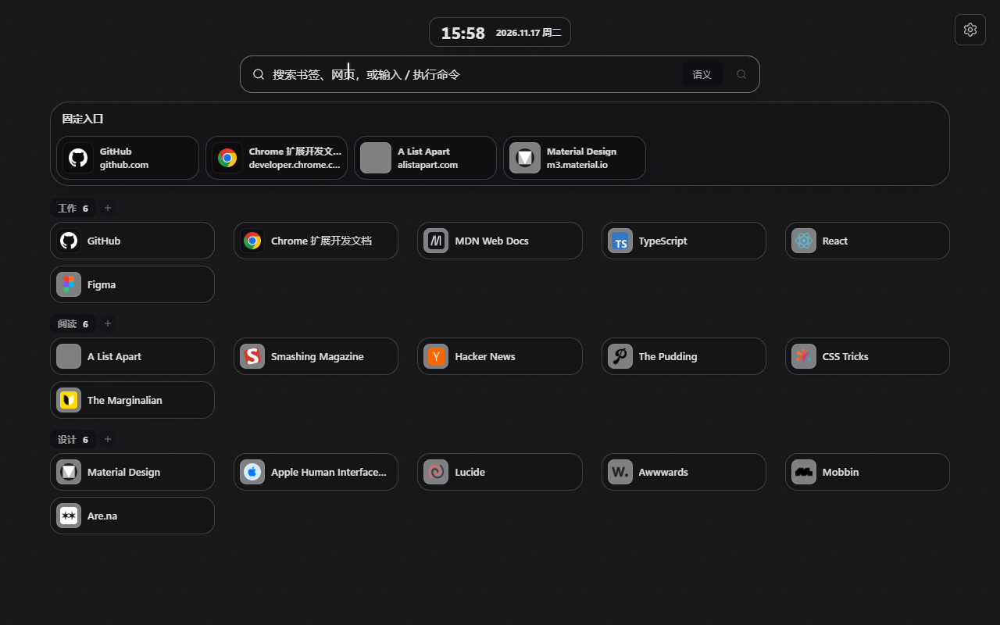
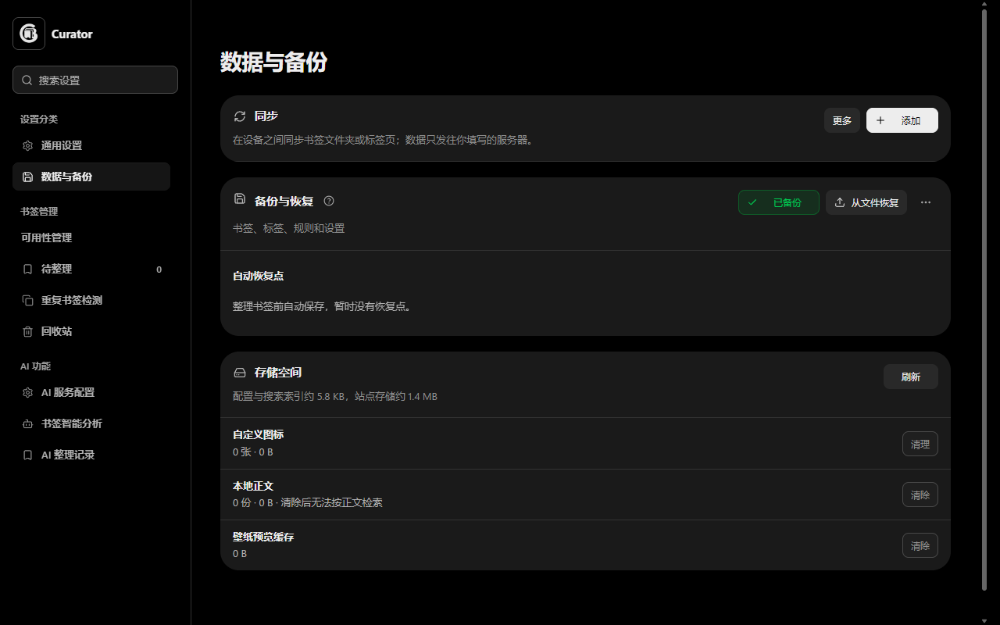

---
categories:
- - 开源项目
cover: null
date: '2026-04-21T14:00:00.000000+08:00'
description: 'Curator 已正式上架 Chrome 应用商店：本地优先的书签工作区，支持弹窗与侧栏、可定制新标签页、拼音与全文检索、AI 整理、多设备同步、备份恢复和网页存档。'
tags:
- Chrome
- 浏览器扩展
- 书签管理
- AI
- 开源项目
title: Curator（策书）：本地优先的 Chrome 书签管理与 AI 整理扩展
updated: '2026-11-18'
---

书签存得多了，Chrome 自带的书签管理器就开始力不从心：搜索不够顺手、旧链接没人管、重复收藏越积越多，临时收下的网页也经常不知道该放到哪个文件夹。

于是我做了一个 Chrome 扩展：**Curator（策书）**。从最初的书签搜索和清理工具，它已经逐步扩展成了一个直接使用 Chrome 原生书签的工作区：弹窗、常驻侧栏和新标签页共享同一份收藏，日常查找、编辑和整理在本机完成。

**2026 年 11 月 18 日，Curator 已正式上架 Chrome 应用商店，当前商店版本为 v1.6.1，可以免费安装。**

[安装 Curator](https://chromewebstore.google.com/detail/curator/bdgcfejkdafjelchllnhfnjklgdbmklp) · [查看源码](https://github.com/sy0u1ti/curator-bookmarks)

## 搜索、收藏与侧栏

点开弹窗就能搜索、编辑、移动和删除书签，也能直接修改当前网页的标题、网址和保存位置。打开常驻侧栏后，切换网页时可以继续查找和整理，不用反复打开弹窗。

来不及分类时，按 `Alt + Shift + I` 把当前页放进“待整理”；按 `Alt + Shift + S` 打开弹窗并聚焦搜索。收藏后的分析与移动策略可以单独设置。

搜索也比早期版本丰富了。除了标题和网址，还能用中文拼音、文件夹路径、已保存的标签、摘要和正文找回资料：

| 输入示例 | 用法 |
| --- | --- |
| `shuqian`、`sq` | 拼音或首字母 |
| `"not found"` | 原文短语 |
| `site:github.com` | 限定站点 |
| `url:/issues` | 匹配网址片段 |
| `folder:"资料"` | 查找文件夹 |
| `最近2周` | 添加时间 |
| `sort:new` | 最近添加优先 |
| `-youtube` | 排除匹配项 |

条件可以组合，比如 `site:github.com folder:"前端资料" 最近2周 -issue`。普通搜索在本机完成，标签、摘要和正文检索依赖本机已经保存的数据；AI 语义搜索按需启用。

## 新标签页

现在 Curator 也提供书签新标签页。把常用文件夹和固定入口放在眼前，拖拽调整顺序，背景、玻璃材质、卡片密度和时钟都可以按自己的习惯设置。

搜索栏既能找本地书签，也能打开网址或搜索网页。网页搜索使用 Chrome 当前默认搜索服务。弹窗、侧栏和新标签页使用同一份原生书签，在哪一处改名、移动或删除，其他入口都会反映出来。



## 清理与 AI 整理

用了多年的收藏夹里，经常混着失效页面、迁移后的项目地址，以及多个文件夹里重复保存的同一个链接。管理页可以集中处理：

- **可用性检测**：批量检查链接，查看检测结果后再决定如何处理。超时、登录限制或站点拦截不一定代表网页已经失效。
- **重定向更新**：确认旧链接跳转后的新网址，再批量更新原书签。
- **重复书签清理**：按网址找出重复收藏，每组至少保留一条。通过 Curator 删除的书签可从回收站恢复。

AI 功能可以接入自己的服务或本机模型，自定义地址、模型和 API Key，用来生成更易读的标题、标签、摘要和分类建议，也可以辅助语义搜索。

批量建议经审核后应用；自动分析、改名和移动按你选择的策略执行。按 `Alt + Shift + F` 可以为当前网页启动智能分类，推荐合适的收藏文件夹。

## 多设备同步

在 **设置 → 数据与备份 → 同步** 中，可以把指定书签文件夹或普通窗口的标签页同步到自己的存储服务。支持 WebDAV、Nextcloud Bookmarks、S3、Git、Linkwarden、Karakeep、Google Drive 和 Dropbox。

每项配置可以选择双向合并、上传或下载。配置好后，从弹窗或侧栏就能查看进度、手动同步或调整自动同步。大量新增或删除会触发保护，等待确认；从服务器覆盖本机标签页时也会另行确认。

同步会传播书签的修改与删除。扩展的标签、设置和本地媒体不随书签同步，迁移时需要另行备份。

## 备份、恢复与网页存档

**设置 → 数据与备份** 可以导出 JSON 备份，保存书签、标签、摘要、规则和可恢复的设置，也能从文件或自动恢复点中预览并恢复数据。

受保护的批量整理和覆盖操作前会创建恢复点，默认保留最近 5 份。书签恢复会补回缺失内容，保留现有书签。



如果需要留住网页本身，可以在弹窗或侧栏选择 **存档当前页面**，把已经加载的文字、图片和样式保存为一个 MHTML 文件，用 Chrome 或 Edge 离线阅读。保存前展开需要保留的内容；流媒体和依赖服务器的功能无法离线运行。

## 隐私与联网

Curator 没有账号体系、自有后端或遥测。原生书签由 Chrome 保存，标签、摘要、设置、正文索引、回收站等附加数据留在浏览器本地；普通搜索和编辑可以离线进行。

联网功能直接访问对应网站或你选择的服务：链接检测会访问书签站点，AI 分析会把所需的查询、书签或网页内容发送给配置的模型服务，同步会把所选书签或标签页发送到配置的服务器。启用 Jina Reader 辅助解析后，目标网址会发送给 Jina Reader。

已启用的自动分析和自动同步可以在后台运行。AI API Key 保存在扩展本地，普通 JSON 备份不包含密钥。完整的数据处理和权限说明见 [隐私政策](https://github.com/sy0u1ti/curator-bookmarks/blob/main/PRIVACY.md)。

## 安装与更新

需要 **Chrome 116+**。商店版可以直接安装，后续通过 Chrome 应用商店更新：

1. 打开 [Curator 商店页面](https://chromewebstore.google.com/detail/curator/bdgcfejkdafjelchllnhfnjklgdbmklp)，点击 **添加至 Chrome**。
2. 将 Curator 固定到工具栏，打开弹窗即可使用已有书签，无需导入。
3. 新建标签页，在设置中选择要展示的文件夹，并按需要配置 AI 或同步。

Curator 会接管新标签页。停用扩展后可以恢复浏览器默认新标签页，原生书签仍由 Chrome 保留。

如果之前使用开发者模式安装，迁移到商店版前先导出 JSON 备份和同步配置。不同扩展 ID 的本地数据不会自动互通；AI API Key 需要重新配置，壁纸、视频和 MHTML 文件需要另行保留。

### 从源码构建

项目目前使用 React 19、TypeScript、Vite / CRXJS、Base UI 和 Tailwind CSS v4。需要修改源码时，使用 Node.js 24 与 npm；下面的分支对应本次商店发布的 1.6.1：

```bash
git clone --branch codex/chrome-web-store-1.6.1 https://github.com/sy0u1ti/curator-bookmarks.git
cd curator-bookmarks
npm ci
npm run build
```

在 `chrome://extensions/` 开启开发者模式，点击 **加载已解压的扩展程序**，选择生成的 `dist/` 文件夹。类型检查和单元测试分别使用 `npm run typecheck`、`npm test`，完整开发说明见 [GitHub README](https://github.com/sy0u1ti/curator-bookmarks#readme)。

## 适合谁用

如果你的书签只有几十个，Chrome 自带管理器其实够用。Curator 更适合下面这些情况：

- 收藏了大量文档、项目和工具站，需要通过拼音、标签或正文找回资料。
- 想把常用书签放在新标签页，浏览网页时用侧栏继续整理。
- 老链接和重复收藏很多，需要批量检查、清理和恢复。
- 经常临时收藏网页，希望先放进待整理，再用自己的 AI 服务辅助归类。
- 在多台设备之间使用同一套收藏，或者需要保存可离线阅读的网页。

项目还在继续迭代，有 bug 或想法可以到 [GitHub Issues](https://github.com/sy0u1ti/curator-bookmarks/issues) 反馈，也欢迎直接 PR。
