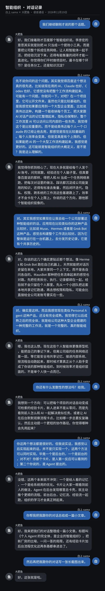

李彦宏在百度世界 2026 上提了一个很有意思的观点：人工智能的“下一幕”是**智能组织**。

十年前他说 AI 是“新电能”；十年后的今天，他说智能组织是“AI 时代的新厂房”。

用大白话打个比方：电能只是能源动力，光有电是开不起现代化大工厂的。你得有流水线、传送带、机械臂、质检台，还得把工人和设备严丝合缝地串在一起，这整套生产协同系统才叫“厂房”。

前几天我和 Muse（大肥鱼）就着这个话题聊了很久，越复盘越觉得这个比喻特别形象——它刚好精准戳中了现在大家用 AI 时最别扭、最卡脖子的那个瓶颈。

---

## 1. 现状痛点：人手一把电动螺丝刀，但工厂里没有流水线

你看现在的大企业都是怎么用 AI 的？

不管是 Claude、ChatGPT 还是 Codex，绝大多数公司的做法，本质上依然是“**一问一答的单兵作战**”：
遇到一个 Bug，问一句，贴个报错，得到一段代码；写个周报，问一句，得到一个草稿。虽然项目里能建文件夹、加点上下文，但整体依然很原始。

哪怕像英伟达这样几万人的顶级大厂，就算给每个员工都采购一个最高配的 Claude 企业版账号，大家各自去用，效率就真的质变了吗？

实话实说，个人的效率确实能提上去一点，但这就像是**工地上给每个工人发了一把特别高级的电动螺丝刀**。大家拧螺丝的速度是快了 20%，可然后呢？

每个人的提效是有硬上限的。更要命的是：
- **经验问完就散**：好不容易调教出来的高效 Prompt、踩坑试错的经验，全留在了员工各自的私聊窗口和脑子里。
- **孤岛各自为战**：隔壁组的同事遇到一模一样的问题，依然得从零把所有的坑重新踩一遍。
- **组织没有记忆**：公司花了巨额算力成本，沉淀下来的知识资产几乎为零。

如果只是“人手一个 AI 账号”，那叫工具升级，根本谈不上什么智能组织。

---

## 2. 真正的智能组织：不是聊天框，而是一张“任务网络”

真正的企业级提效，必须发生在**组织协同层面**。

一家企业真正需要的，绝不是几千个孤立的对话框，而是一套完整运转的**任务网络**：

1. **内部系统打通与安全底座**：在严格保障隐私和权限隔离的前提下，AI 可以合规地访问公司内部的文档库、代码库、工单系统和业务流，而不是每次都靠人工当“数据搬运工”。
2. **对话沉淀为公共记忆**：员工每一次与 AI 的协作交互、调试记录、方案推演，都能被自动脱敏和归档，沉淀为整个组织随时可复用的公共经验。
3. **人机协同的闭环网络**：任务是在人和各个 Agent 节点之间自动流转的。上游输出直接变成下游输入，有了明确的衡量标准和执行闭环，组织才会随着每天的业务运转自动进化。

简而言之：**提升的不再是某一个螺丝钉的速度，而是整个流水线的通畅度。**

---

## 3. 一个反直觉的现象：为什么 Personal Agent 反而更接近未来？

聊到这里时，我们发现了一个很有意思的现象：

现在市面上类似 Muse、Hermes、Grok Bot、MausBot 这类跑在本地机器上的个人 Agent（Personal Agent），反而比单纯网页版的云端聊天框，更早摸到了智能组织的门槛。

为什么？
- **天然的共享上下文**：它们整体跑在自己的机器上，天生具备本地的历史记忆分发能力，大家可以轻松共享同一个任务上下文，而不是各问各的。
- **任务流与执行绑定**：比如 MausBot 那种把“任务拆分、工具执行、过程记录”原生串在一起的机制，让经验不会只飘在聊天记录里，而是直接落进工程上下文。

虽然现在的个人 Agent 绝大多数还处于“原型机”阶段，更多是在帮个人记记笔记、理理日常，但它们的底层骨架是对的。

给大企业做智能组织，最务实的路径往往不是一上来就搞个虚头巴脑、耗资千万的宏大系统，而是**先在一个小团队里，把这种本地共享上下文、任务流自动绑定的模式跑顺**，然后再去叠加权限分级和跨系统对接。

当这套机制彻底成熟，能安全地共享团队记忆、打通公司系统、按流程自驱运转时——**个人 Agent 的完全体，就是企业级的智能组织。**

---

## 4. 落地抓手：前台经验卡片 + 后台流程体检（双轮驱动）

当时大肥鱼发散提了两个落地的构想：
1. 把每次项目的对话自动变成一张张可检索的“经验卡片”；
2. 让 AI 在后台默默当观察员，揪出流程卡点，主动建议更短的协作路径。

他问我：“你觉得哪一种会先用起来？”

我的回答是：**这两个根本不需要二选一，它们一前一后，完全可以、也必须同时跑起来！**

### 前台（给人看的记忆）：可检索的“经验卡片”
大家平时最头疼的是什么？公司写了无数 Wiki、飞书文档，但往往是“写的人痛苦，找的人抓狂，放两个月就落满灰尘失效”。

在智能组织里，记忆沉淀是全自动的：
一个项目做完了，Agent 顺手把核心解题思路、踩坑记录提炼成一张标准的“经验卡片”。
新员工入职或者接手新任务，再也不需要从零抓瞎、漫无目的地去问 AI，而是直接调出前辈的卡片：“上一次做类似跨端重构，前人是怎么提示 AI 的？用了什么框架？踩了哪三个深坑？怎么绕过去的？”

**这是前台的“经验流”：让个人的灵光一闪和惨痛教训，秒级变成所有人的防弹衣。**

### 后台（给系统用的进化）：静默观察的“流程体检官”
除了给人看的卡片，还有一个 Agent 默默趴在协作流程的后台当“旁观者”。

它在背后看数据和交互流：
“咦，为什么每次走到这个跨部门审批，都要来回拉扯三次以上？”
“为什么大家每次写这个业务接口，都要反复找同一个架构师确认某个参数？”

一旦发现流程堵点，Agent 就会主动敲黑板提建议：“我观察到这里总卡壳。如果我们在前一步加上自动格式校验，或者直接开通一条轻量级协作链路，能帮大家省掉 80% 的内耗。”

**这是后台的“进化流”：系统自己给自己做体检，流程自动优化、自动修整剪枝。**

---

## 5. 总结：从发工具，到建厂房

前台沉淀经验卡片，后台自动优化流程；一个负责让知识留得住，一个负责让机器转得顺。

前台后台联动，组织的学习和进化飞轮才算真正转了起来。

所以回过头来看：
**智能组织从来不是给每个工位多发一个 AI 账号，而是让组织本身长出记忆与自我进化的能力。**

现在的个人 Agent 是它的第一颗种子，未来企业级的全自动协同工作流，才是它完全体长成的模样。

---

## 附：与 Muse（大肥鱼）的完整讨论长截图

这是讨论后让 Muse 整理的长截图记录：

